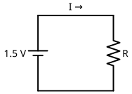
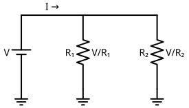
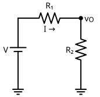
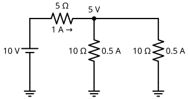

# 第 01 集 · Lec01：電壓、電流、電阻與基本電路 [▶ 影片](https://www.youtube.com/watch?v=c_-V8oT-HWo)

← 上一集：（無） ｜ [總目錄](../README.md) ｜ 下一集：[02](02-circuit-analysis-equivalent-circuits-sources.md) →

> **課程**：電子學（一），陽明交大 電子物理系，112 學年度 — 第 01 集
> **講者**：陳振芳 老師
> **來源**：YouTube 錄影逐字稿（41:05，人工字幕）＋ Sedra & Smith《Microelectronic Circuits》7th ed.，Ch 1 章末「Circuit Basics」(p. 45–)
> **標記說明**：`【口頭】` 老師口頭補充、課本沒有；`【課本補充】` 課本有、課堂沒講；`[▶ mm:ss]` 影片時間點

---

## 目錄

- [0. 這堂課要做什麼](#0-這堂課要做什麼)
- [1. 開場：電子學怎麼學](#1-開場電子學怎麼學)
- [2. 水流比喻：水位差、水管與阻抗](#2-水流比喻水位差水管與阻抗)
- [3. 電壓、電流與歐姆定律](#3-電壓電流與歐姆定律)
- [4. 功率 P = IV](#4-功率-p--iv)
- [5. 接地：把參考電位定成 0 V](#5-接地把參考電位定成-0-v)
- [6. 並聯與分流](#6-並聯與分流)
- [7. 串聯與分壓](#7-串聯與分壓)
- [8. 例題：用等效電阻求電池供給的功率](#8-例題用等效電阻求電池供給的功率)
- [9. 一頁速查表](#9-一頁速查表)
- [10. 與後續集數的連結](#10-與後續集數的連結)

---

## 0. 這堂課要做什麼

第一章「基本概念」的第一堂。電子學建立在電路學上，這集先把電路學最基本的東西複習一遍：

| 主題 | 內容 |
|---|---|
| 電壓、電流、電阻 | 用水流系統比喻，得到歐姆定律 $I = V/R$ |
| 功率 | 從「搬電荷要做功」推出 $P = IV$ |
| 接地 | 電位是相對的，把共同參考點定成 0 V |
| 等效電阻 | 並聯、串聯；分流、分壓公式 |
| 例題 | 用等效電阻算電池供給的功率，並驗證功率守恆 |

---

## 1. 開場：電子學怎麼學

[▶ 00:09](https://youtu.be/c_-V8oT-HWo?t=9) 【口頭】

- 電子學「自成一個系統」，東西多又雜，網路上資料多到看不完、也不容易看懂。
- 老師用**下象棋**比喻：每顆棋（象、馬…）怎麼走都有固定規則。電子學一開始最辛苦，因為要先熟悉電壓、電流這些基本元件的「走法」；熟了以後反而越來越簡單，到電子學（三）、（四），很大的電路也不難。
- 正常順序是 **普通物理（電學）→ 電路學（兩學期）→ 電子學**。修課的同學多半才剛開始上電路學，所以第一章先補電路學的基本概念。[▶ 01:10](https://youtu.be/c_-V8oT-HWo?t=70)

---

## 2. 水流比喻：水位差、水管與阻抗

[▶ 02:46](https://youtu.be/c_-V8oT-HWo?t=166)

兩個水桶，一個水位高、一個水位低，中間接一條水管，水就會從高水位流到低水位。

- 水流跟**水位差**成正比：差越大，水流越大。
- 水流也跟水管的**截面積** $A$ 成正比：管子越粗，水流越大。

老師把截面積「倒過來」定義一個量，叫水管的**阻抗**（impedance）：管子越粗，阻抗越小。這樣就可以寫成

$$
\text{水流} = \frac{\text{水位差}}{\text{阻抗}}
$$

只要把阻抗定義得恰當，這條式子就成立。[▶ 04:50](https://youtu.be/c_-V8oT-HWo?t=290)

> 這裡老師說的「阻抗」在直流電阻電路裡就是**電阻**（resistance）。後面講到電容（第 1.3 節以後）才會出現一般意義的阻抗。

---

## 3. 電壓、電流與歐姆定律

### 3.1 電壓是電位差

[▶ 05:52](https://youtu.be/c_-V8oT-HWo?t=352)

一顆 1.5 V 的電池（battery），正負兩端之間有 1.5 V 的**電位差**，就像兩個水桶的水位差。這個電位差就叫**電壓**（voltage），符號 $v$。

**電壓是相對的概念，不是絕對的**：說「1.5 V」是指正極比負極的電位高 1.5 V。[▶ 06:54](https://youtu.be/c_-V8oT-HWo?t=414)

### 3.2 導線與電阻

[▶ 07:28](https://youtu.be/c_-V8oT-HWo?t=448)

- **導線**（wire）當成**完美導體**（perfect conductor）：沒有阻抗，裡面沒有電場，**整條導線電位都相同**。
- 如果直接用導線把電池兩端接起來，會得到幾乎無窮大的電流，很危險，不能這樣做。
- 所以兩端要接一個**電阻** $R$，用它來控制電流的大小。

因為導線上電位處處相同，電池的電位差 $V$ 會整個跨在電阻上。

### 3.3 歐姆定律

[▶ 08:32](https://youtu.be/c_-V8oT-HWo?t=512)

電阻兩端有電位差，就會有**電流**（current）$i$。電流就是**單位時間流過的電荷**。電流和水流的關係式一模一樣：

$$
I = \frac{V}{R}
$$

這就是**歐姆定律**（Ohm's law），也可以看成是 $R$ 的定義。

**例子**：$V = 1.5\ \text{V}$、$R = 1\ \Omega$ → $I = 1.5\ \text{A}$。[▶ 09:33](https://youtu.be/c_-V8oT-HWo?t=573)

- 1 A（安培）= 每秒流過 1 C（庫倫）的電荷。所以 1.5 A 就是每秒 1.5 C。
- 【口頭】1.5 A 是**很大**的電流；1 Ω 是**很小**的電阻。電子零件行買的電阻一般是幾 kΩ 到幾十 kΩ。

**應用**：用 $R$ 設計你要的電流。[▶ 10:06](https://youtu.be/c_-V8oT-HWo?t=606)
【口頭】雷射筆的光強度跟**電流**成正比，不是跟電壓（這是它的物理特性，以後再談）。如果要 20 mA，就挑一個電阻 $R$ 讓 $V/R = 20\ \text{mA}$，接上雷射筆就會發光。

> 以下**不是逐字稿內容**，是依歐姆定律推論的數字例子：用 1.5 V 電池、要 20 mA，而且先忽略雷射本身的壓降，則 $R = 1.5\ \text{V} / 20\ \text{mA} = 75\ \Omega$。實際上發光元件本身也會吃掉一些電壓，電阻要再算小一點。

### 3.4 電流處處相等

[▶ 12:08](https://youtu.be/c_-V8oT-HWo?t=728)

電荷不會消失：流出去 $q$ 的電荷，就一定有 $q$ 的電荷流回來。所以**只有一條路的迴路裡，每一處的電流都相同**，都是 $i$。

---

## 4. 功率 P = IV

[▶ 11:07](https://youtu.be/c_-V8oT-HWo?t=667)

### 4.1 電池在做什麼

水從高處流到低處之後，要再把水搬回高處，系統才能一直運轉；搬上去要**做功**（work），像在重力場裡把保齡球推上坡。

電池做的是同一件事：電荷流回負極後，電池對電荷做功、給它能量，把它從低電位「抬」到高電位。老師畫成一座**電位的山**：山的高度就是 $V$。[▶ 13:10](https://youtu.be/c_-V8oT-HWo?t=790)

### 4.2 推導

**電壓的定義**：把**單位電荷**從低電位搬到高電位，位能增加的量就是 $V$。[▶ 13:42](https://youtu.be/c_-V8oT-HWo?t=822)

1. 搬的是 $q$ 這麼多電荷，所以要做的功（＝位能增加）是

$$
W = qV
$$

2. 能量除以時間就是**功率**（power）$P$：

$$
P = \frac{W}{t} = \frac{q}{t}\,V
$$

3. 單位時間流過的電荷 $q/t$ 就是電流 $I$，所以

$$
P = IV
$$

[▶ 16:17](https://youtu.be/c_-V8oT-HWo?t=977)

### 4.3 能量去哪裡

[▶ 17:18](https://youtu.be/c_-V8oT-HWo?t=1038)

- 電池**提供**功率，所以電池用一段時間電壓會越來越低（它一直在消耗能量）。
- 電阻**消耗**功率，變成熱，溫度會稍微升高一點。
- 如果負載是雷射或發光二極體，一部分變成光、一部分變成熱。
- **提供的功率 = 消耗的功率**，兩者一定相等。

> 【課本補充】把歐姆定律代進去，電阻消耗的功率還可以寫成 $P = I^2 R = V^2/R$。課堂沒寫這兩個形式。

---

## 5. 接地：把參考電位定成 0 V

[▶ 18:49](https://youtu.be/c_-V8oT-HWo?t=1129)

- 電位要相對某一點才量得出來；電池負極那條導線的「絕對」電位是多少，其實不知道，而且有雜訊會跳動。
- 但那整條導線電位都一樣，「你跳我也跟著跳」，所以不影響電位差。
- 於是乾脆把這條線的電位**定成 0 V**，叫做**地**（ground），畫成接地符號。

【口頭】這個「地」**不是真正地上的地**，只是一個相對的參考點。[▶ 20:21](https://youtu.be/c_-V8oT-HWo?t=1221)

定好地之後：

- 以後說「某一點的電壓」，沒特別講就是**相對於地**，變成一個「絕對」的值。例如電池正極那一點就是 1.5 V。[▶ 20:51](https://youtu.be/c_-V8oT-HWo?t=1251)
- 所有接地的點其實是**連在一起的**，所以那條線可以不畫，只在各處畫接地符號。
- 電路一定**有去有回**：出去多少電荷，就要回來多少，少一顆都不行。如果不相等，只會在一瞬間發生，電路會在很短的時間（約 ns，$10^{-9}$ s）內自己修正，所以平常看到的都是穩定狀態。[▶ 21:57](https://youtu.be/c_-V8oT-HWo?t=1317)
- 以後**電池的畫法**：一長一短兩片平行板（像平行電容板），長的是正極。[▶ 23:00](https://youtu.be/c_-V8oT-HWo?t=1380)

---

## 6. 並聯與分流

### 6.1 兩個電阻並聯

[▶ 23:30](https://youtu.be/c_-V8oT-HWo?t=1410)

電池正極接出來，同時接兩個電阻 $R_1$、$R_2$ 到地，就像多了一條水管，水流一定變多。

解電路：

1. 地是 0 V，正極那條導線電位處處是 $V$，所以 $R_1$、$R_2$ 兩端都跨 $V$。
2. 由歐姆定律，兩條支路的電流分別是 $V/R_1$、$V/R_2$。
3. 電荷不會消失，總電流是兩者相加：

$$
I = \frac{V}{R_1} + \frac{V}{R_2}
$$

[▶ 24:30](https://youtu.be/c_-V8oT-HWo?t=1470)

### 6.2 等效電阻

[▶ 25:00](https://youtu.be/c_-V8oT-HWo?t=1500)

**等效電阻**是以後電子學解電路最常用的方法：把一塊電路框起來，用**一個**電阻 $R$ 取代。兩個電路當然不一樣，但對「站在框框外面往裡看的人」來說是一樣的：同樣的電壓產生同樣的電流。

求法就是歐姆定律：$R$ ＝ 兩端電壓 ÷ 流進去的電流。[▶ 26:34](https://youtu.be/c_-V8oT-HWo?t=1594)

$$
R = \frac{V}{I} = \frac{V}{\dfrac{V}{R_1} + \dfrac{V}{R_2}}
$$

分子分母的 $V$ 消掉，上下同乘 $R_1R_2$：

$$
R = \frac{R_1 R_2}{R_1 + R_2}
\qquad\text{或}\qquad
\frac{1}{R} = \frac{1}{R_1} + \frac{1}{R_2}
$$

這叫**並聯**（parallel），常寫成 $R_1 \parallel R_2$。[▶ 27:34](https://youtu.be/c_-V8oT-HWo?t=1654)

**並聯電阻比兩個都小**：$R < R_1$ 且 $R < R_2$。[▶ 28:11](https://youtu.be/c_-V8oT-HWo?t=1691)
直覺：本來只有 $R_1$ 一條水管，多加一條，水流一定變多，阻抗一定變小；對 $R_2$ 也一樣。

> 代數驗證（補一步）：$R = R_1 \cdot \dfrac{R_2}{R_1 + R_2}$，而 $\dfrac{R_2}{R_1+R_2} < 1$，所以 $R < R_1$；對 $R_2$ 同理。

### 6.3 分流公式

[▶ 29:11](https://youtu.be/c_-V8oT-HWo?t=1751)

總電流 $I$ 進來分成兩條路，流過 $R_2$ 的電流是總電流的「幾分之幾」：

$$
I_2 = I \cdot \frac{V/R_2}{V/R_1 + V/R_2}
= I \cdot \frac{1/R_2}{1/R_1 + 1/R_2}
$$

上下同乘 $R_1R_2$：

$$
I_2 = I\,\frac{R_1}{R_1 + R_2},
\qquad
I_1 = I\,\frac{R_2}{R_1 + R_2}
$$

這就是**分流**（current divider）。[▶ 30:43](https://youtu.be/c_-V8oT-HWo?t=1843)
注意分子是**另一個**電阻：電流跟自己這條路的電阻**成反比**，電阻越大分到的電流越小。

---

## 7. 串聯與分壓

### 7.1 兩個電阻串聯

[▶ 31:45](https://youtu.be/c_-V8oT-HWo?t=1905)

$R_1$、$R_2$ 頭尾相接，只有一條路。

1. 只有一條路，電流處處相同，都是 $I$。
2. 電流流過 $R_1$ 產生壓降 $IR_1$，流過 $R_2$ 產生壓降 $IR_2$。老師提醒：**電流和電壓都有方向**，不能搞混。[▶ 32:46](https://youtu.be/c_-V8oT-HWo?t=1966)
3. 兩端的總電壓是兩座「山」疊起來：$I(R_1 + R_2)$。
4. 等效電阻 ＝ 電壓 ÷ 電流：

$$
R = \frac{I(R_1 + R_2)}{I} = R_1 + R_2
$$

這叫**串聯**（series）：沿著一條路走，看到一個阻抗又一個阻抗，直接相加，所以一定**變大**。[▶ 33:48](https://youtu.be/c_-V8oT-HWo?t=2028)

### 7.2 分壓公式

[▶ 34:23](https://youtu.be/c_-V8oT-HWo?t=2063)

求 $R_2$ 上的電壓 $v_O$：電流乘電阻。電流是 $V/(R_1 + R_2)$，所以

$$
v_O = \frac{V}{R_1 + R_2}\,R_2 = V\,\frac{R_2}{R_1 + R_2}
$$

這就是**分壓**（voltage divider）。[▶ 35:26](https://youtu.be/c_-V8oT-HWo?t=2126)

- 分壓：電壓跟自己的電阻**成正比**（分子是自己）。
- 分流：電流跟自己的電阻**成反比**（分子是另一個）。
- 好幾個電阻串聯時，某個電阻上的電壓 ＝ 總電壓 × 它的電阻 ÷ 所有電阻總和。

---

## 8. 例題：用等效電阻求電池供給的功率

[▶ 35:58](https://youtu.be/c_-V8oT-HWo?t=2158)

**題目**：10 V 電池，先串一個 5 Ω，再接兩個並聯的 10 Ω 到地。求電池提供的功率 $P$（power supplied by battery）。

$P = IV$，$V = 10\ \text{V}$ 已知，所以要先求電流 $I$。用等效電阻：[▶ 37:30](https://youtu.be/c_-V8oT-HWo?t=2250)

**Step 1：兩個 10 Ω 並聯**

$$
10 \parallel 10 = \frac{10 \times 10}{10 + 10} = 5\ \Omega
$$

兩個一樣大的電阻並聯，剛好是一半。

**Step 2：再跟 5 Ω 串聯**

$$
5 + 5 = 10\ \Omega
$$

**Step 3：電流與功率**

$$
I = \frac{10\ \text{V}}{10\ \Omega} = 1\ \text{A},
\qquad
P = 10\ \text{V} \times 1\ \text{A} = 10\ \text{W}
$$

[▶ 39:04](https://youtu.be/c_-V8oT-HWo?t=2344)

**驗算：消耗的功率是不是也是 10 W？** [▶ 39:35](https://youtu.be/c_-V8oT-HWo?t=2375)

- 1 A 流過 5 Ω，壓降 5 V，所以中間節點是 $10 - 5 = 5\ \text{V}$。
- 兩個 10 Ω 都跨 5 V，各流 $5/10 = 0.5\ \text{A}$（兩個加起來剛好 1 A）。
- 各電阻消耗的功率：

$$
\underbrace{5 \times 1}_{5\ \Omega}
+ \underbrace{5 \times 0.5}_{10\ \Omega}
+ \underbrace{5 \times 0.5}_{10\ \Omega}
= 5 + 2.5 + 2.5 = 10\ \text{W}
$$

和電池提供的一樣。【口頭】**一定要一樣；不一樣就是你算錯了。** [▶ 40:06](https://youtu.be/c_-V8oT-HWo?t=2406)

> 【課本補充】課本把這些電路學基礎放在第 1 章章末的「Circuit Basics」習題（p. 45 起），分成 Resistors and Ohm's Law、Voltage Dividers、Current Dividers、Thévenin Equivalent Circuits 幾組，可以拿來自我檢查；戴維寧、諾頓定理的摘要在 Appendix D（課本網站，不在 PDF 內）。

---

## 9. 一頁速查表

| 項目 | 公式 | 關鍵一步 |
|---|---|---|
| 歐姆定律 | $I = V/R$ | 類比「水流 = 水位差 / 阻抗」；也是 $R$ 的定義 |
| 電流 | $I = q/t$ | 單位時間流過的電荷；1 A = 1 C/s |
| 功 | $W = qV$ | $V$ ＝ 單位電荷位能的增加，乘上電荷量 $q$ |
| 功率 | $P = IV$ | $P = W/t = (q/t)V = IV$ |
| 電阻功率 | $P = I^2R = V^2/R$ | 把 $V = IR$ 代入 $P = IV$（課本補充） |
| 並聯 | $R_1 \parallel R_2 = \dfrac{R_1R_2}{R_1+R_2}$ | $I = V/R_1 + V/R_2$，再 $R = V/I$；結果比兩者都小 |
| 串聯 | $R = R_1 + R_2$ | 電流相同，壓降 $IR_1 + IR_2$，再除以 $I$ |
| 分流 | $I_1 = I\,\dfrac{R_2}{R_1+R_2}$ | 分子是**另一個**電阻（反比） |
| 分壓 | $v_O = V\,\dfrac{R_2}{R_1+R_2}$ | 電流 $V/(R_1+R_2)$ 乘 $R_2$；分子是**自己**（正比） |
| 功率守恆 | $P_\text{提供} = \sum P_\text{消耗}$ | 用來驗算 |

觀念：

- 導線電位處處相同；一條迴路電流處處相同；節點流進 = 流出。
- 地 = 自己定的 0 V 參考點，不是真正的地；沒特別說，電壓都是相對於地。

---

## 10. 與後續集數的連結

| 本集觀念 | 後面在哪裡用到 |
|---|---|
| 等效電阻（「從這裡看進去」） | 下一集的等效電路、電源表示法；之後所有放大器的輸入、輸出電阻 |
| 分壓 | 放大器輸入端的信號衰減、電晶體偏壓電路 |
| 接地與「相對於地的電壓」 | 所有電路圖的畫法 |
| 功率 $P = IV$ | 放大器需要直流電源供給功率；第 10 章輸出級的效率 |

---

## 附：本集一句話總結

> **電壓是電位差、電流是單位時間流過的電荷，兩者由 $I = V/R$ 連起來；把複雜的電阻網路用「從這裡看進去」的等效電阻（並聯變小、串聯相加）換掉，就能一步算出電流和功率。**

---

*筆記依據陳振芳老師「電子學（一）」112 學年度 Lec01 錄影逐字稿（人工字幕，41:05）與 Sedra & Smith《Microelectronic Circuits》7th ed. 整理。*
