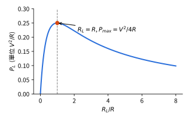
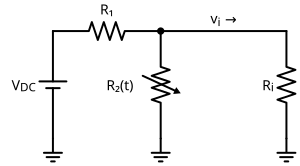

# 第 02 集 · Lec02：電路分析、等效電路、信號源的表示法 [▶ 影片](https://www.youtube.com/watch?v=S_um9oUdhhs)

← 上一集：[01](01-voltage-current-resistance-basic-circuits.md) ｜ [總目錄](../README.md) ｜ 下一集：[03](03-capacitor-condenser-microphone.md) →

> **課程**：電子學（一），陽明交大 電子物理系，112 學年度 — 第 02 集
> **講者**：陳振芳 老師
> **來源**：YouTube 錄影逐字稿（1:27:53，人工字幕）＋ Sedra & Smith《Microelectronic Circuits》7th ed. §1.1、§1.5
> **標記說明**：`【口頭】` 老師口頭補充；`【課本補充】` 課本有、課堂沒講；`⚠️ 逐字稿缺字` 字幕聽錯，依上下文修正；`[▶ mm:ss]` 影片時間點

---

## 目錄

- [0. 這堂課要做什麼](#0-這堂課要做什麼)
- [1. 複習：分壓與分流](#1-複習分壓與分流)
- [2. 最大功率轉移：喇叭要接多大的電阻](#2-最大功率轉移喇叭要接多大的電阻)
- [3. 把複雜電路換成「電壓源串聯電阻」](#3-把複雜電路換成電壓源串聯電阻)
- [4. 完整的電子系統：信號源、電路、負載](#4-完整的電子系統信號源電路負載)
- [5. 信號源的模型 1：電壓源串聯 R_s](#5-信號源的模型-1電壓源串聯-r_s)
- [6. 信號源的模型 2：電流源並聯 R_s](#6-信號源的模型-2電流源並聯-r_s)
- [7. 兩種模型的換算](#7-兩種模型的換算)
- [8. 例題：感測電阻的等效模型](#8-例題感測電阻的等效模型)
- [9. 放大器該「抓電壓」還是「抓電流」](#9-放大器該抓電壓還是抓電流)
- [10. 一頁速查表](#10-一頁速查表)
- [11. 與後續集數的連結](#11-與後續集數的連結)

---

## 0. 這堂課要做什麼

| 主題 | 內容 | 課本 |
|---|---|---|
| 分壓、分流 | 複習，後面用得非常多 | — |
| 最大功率轉移 | 負載電阻 = 內電阻時功率最大 | — |
| 等效電路 | 開路電壓、把電源拿掉後看回去的電阻 | Appendix D（網站） |
| 信號源表示法 | 電壓源串聯 $R_s$、電流源並聯 $R_s$，兩者互換 | §1.1, Fig. 1.1 |
| 放大器的輸入端 | $R_i \to \infty$ 抓電壓、$R_i \to 0$ 抓電流 | §1.5, Table 1.1 |

---

## 1. 複習：分壓與分流

[▶ 00:10](https://youtu.be/S_um9oUdhhs?t=10)

- **電壓源**畫成圓圈（或電池符號），標正負號；**電流源**畫成圓圈加一個箭頭。[▶ 01:11](https://youtu.be/S_um9oUdhhs?t=71)
- **分壓**：$v_O = v_I\,\dfrac{R_2}{R_1 + R_2}$。電壓跟電阻成**正比**。
- **分流**：電流 $i$ 分給並聯的 $R_1$、$R_2$，流過 $R_2$ 的是 $i\,\dfrac{R_1}{R_1 + R_2}$。推法：先算並聯電阻 $R_1 \parallel R_2$，乘上 $i$ 得到電壓，再除以 $R_2$。[▶ 02:15](https://youtu.be/S_um9oUdhhs?t=135)
  電流跟電阻成**反比**：電阻小的那條路電流多，電阻大的反而不流。

---

## 2. 最大功率轉移：喇叭要接多大的電阻

[▶ 03:48](https://youtu.be/S_um9oUdhhs?t=228)

電壓源 $V$ 帶一個**內電阻**（internal resistance）$R$，外面接一個負載（load）$R_L$，例如喇叭。問：$R_L$ 多大時喇叭最大聲？

【口頭】聲音大小看的不是電壓、也不是電流，而是兩者的乘積：**功率**。[▶ 04:49](https://youtu.be/S_um9oUdhhs?t=289)

**Step 1：寫出負載功率**

電流 $I = \dfrac{V}{R + R_L}$；負載電壓用分壓 $V_L = V\,\dfrac{R_L}{R + R_L}$。

$$
P_L = V_L I = \frac{V^2 R_L}{(R + R_L)^2}
$$

**Step 2：先看圖形** [▶ 05:50](https://youtu.be/S_um9oUdhhs?t=350)

- $R_L \ll R$：分母幾乎是常數 $R^2$，$P_L \approx V^2 R_L / R^2$，從 0 開始往上升。
- $R_L \gg R$：$P_L \approx V^2 / R_L$，越來越小。
- 所以中間一定有一個最大值。

**Step 3：微分等於 0** [▶ 07:56](https://youtu.be/S_um9oUdhhs?t=476)

把 $R_L$ 當變數，用商的微分：

$$
\frac{dP_L}{dR_L}
= V^2\,\frac{(R + R_L)^2 \cdot 1 - R_L \cdot 2(R + R_L)}{(R + R_L)^4} = 0
$$

分子要等於 0，消去一個 $(R + R_L)$：

$$
R + R_L = 2R_L \quad\Longrightarrow\quad R_L = R
$$

**Step 4：最大功率** [▶ 09:56](https://youtu.be/S_um9oUdhhs?t=596)

代 $R_L = R$：

$$
P_{L,\max} = \frac{V^2 R}{(2R)^2} = \frac{V^2}{4R}
$$

也可以這樣看：電壓分到一半 $V/2$，電流是 $V/2R$，相乘就是 $V^2/4R$。

**結論**：負載要接得**跟信號源的內電阻一樣大**，功率最大、聲音最大。[▶ 10:57](https://youtu.be/S_um9oUdhhs?t=657)

---

## 3. 把複雜電路換成「電壓源串聯電阻」

[▶ 11:30](https://youtu.be/S_um9oUdhhs?t=690)

### 3.1 問題

上一集的電路（10 V、5 Ω、兩個並聯的 10 Ω）後面再接一個喇叭 $R_L$，$R_L$ 要多大功率才最大？

上一節只會處理「電壓源串聯一個電阻」。電路這麼複雜怎麼辦？→ **用等效電路**：把 $R_L$ 左邊整個電路換成一個電壓源 $v$ 串聯一個電阻 $R$。只要求得出 $v$ 和 $R$，答案就是 $R_L = R$。[▶ 13:01](https://youtu.be/S_um9oUdhhs?t=781)

### 3.2 求 $v$：開路量電壓

[▶ 14:36](https://youtu.be/S_um9oUdhhs?t=876)

**開路**（open circuit）：輸出兩端什麼都不接。

- 對「$v$ 串 $R$」來說：開路就沒有電流，$R$ 上沒有壓差，量到的電壓就是 $v$。
- 【口頭】好的三用電表量電壓就是這樣，在開路的情況下量。
- 所以 $v = v_\text{open}$，也就是原電路的開路電壓。

原電路開路時，兩個 10 Ω 並聯成 5 Ω，再跟 5 Ω 分壓：[▶ 17:41](https://youtu.be/S_um9oUdhhs?t=1061)

$$
v_\text{open} = 10 \times \frac{10 \parallel 10}{5 + 10 \parallel 10} = 10 \times \frac{5}{5 + 5} = 5\ \text{V}
$$

【口頭】這個電壓會因為分壓而變小，**不可以直接當成 10 V**。[▶ 18:42](https://youtu.be/S_um9oUdhhs?t=1122)

### 3.3 求 $R$ 方法一：把信號源拿掉，看回去

[▶ 19:12](https://youtu.be/S_um9oUdhhs?t=1152)

想用三用電表加電壓、量電流來求 $R$，但看回去會同時看到「電阻」和「電池」兩樣東西，量不出來。所以要先讓 $v = 0$。

$v = 10 \times \dfrac{10 \parallel 10}{5 + 10 \parallel 10}$。讓它變 0 有兩種方法：[▶ 20:49](https://youtu.be/S_um9oUdhhs?t=1249)

- 讓某個電阻變 0 → **不行**，這會破壞你要量的電阻本體。
- 讓 **10 V 變 0** → 可以，電阻都沒動到。

**電壓源等於 0 就是短路**。把 10 V 換成短路後，從輸出端看回去：5 Ω、10 Ω、10 Ω 三條路都接到地，是**三個並聯**。[▶ 22:20](https://youtu.be/S_um9oUdhhs?t=1340)

$$
R = 5 \parallel 10 \parallel 10
$$

【口頭】先並簡單的：$10 \parallel 10 = 5$，$5 \parallel 5 = 2.5\ \Omega$，不用按計算機。[▶ 25:30](https://youtu.be/S_um9oUdhhs?t=1530)

### 3.4 求 $R$ 方法二：開路電壓 ÷ 短路電流

[▶ 23:26](https://youtu.be/S_um9oUdhhs?t=1406)

**短路**（short circuit）：輸出兩端直接接起來，量電流。（好的三用電表量電流時就是短路。）

對「$v$ 串 $R$」：短路電流 $i_{sc} = v/R$，開路電壓 $v_{oc} = v$，所以

$$
R = \frac{v_{oc}}{i_{sc}}
$$

> 以下**不是逐字稿內容**，是用方法二驗算本題：輸出短路時，兩個 10 Ω 被短路掉，電流 $i_{sc} = 10/5 = 2\ \text{A}$，所以 $R = 5/2 = 2.5\ \Omega$，和方法一一樣。

### 3.5 答案

[▶ 26:03](https://youtu.be/S_um9oUdhhs?t=1563)

等效電路是 5 V 串聯 2.5 Ω。所以 $R_L = 2.5\ \Omega$ 時功率最大：

- 電流 $= 5/(2.5 + 2.5) = 1\ \text{A}$；負載電壓分到一半，2.5 V。
- $P_{L,\max} = \dfrac{V^2}{4R} = \dfrac{25}{4 \times 2.5} = 2.5\ \text{W}$。也就是 $2.5\ \text{V} \times 1\ \text{A}$。

【口頭】老師板書一開始寫成 0.5 W，用 $V^2/4R$ 驗算發現不對，原來是負載電壓寫錯（應該是 5 V 分一半 = 2.5 V）。他說：「驗證是必要的，我常常也寫錯。」[▶ 27:34](https://youtu.be/S_um9oUdhhs?t=1654)

### 3.6 小結

[▶ 29:09](https://youtu.be/S_um9oUdhhs?t=1749)

- 往前看（看向負載）的等效電阻很簡單，因為全部都是電阻。
- **倒回來看**（看向信號源）一定有信號源，所以：
  1. 開路量電壓 → 等效電壓源。
  2. 把**所有信號源設成 0**（電壓源短路），看回去的電阻 → 等效電阻。或用 $v_{oc}/i_{sc}$。

> 【課本補充】這就是**戴維寧定理**（Thévenin's theorem）。課本的摘要放在 Appendix D（課本網站，不在 PDF 內）。

---

## 4. 完整的電子系統：信號源、電路、負載

[▶ 31:15](https://youtu.be/S_um9oUdhhs?t=1875)

完整的電路一定有三樣東西：

1. **電路本體**（circuit）：做信號處理，放大、加減乘除、積分微分……這是電子學的本體。
2. **負載**（load）：處理完要送去的地方，例如雷射、LED、示波器（oscilloscope）。
3. **信號源**（signal source）：沒有信號源，光有前兩個也沒用。

接下來討論：信號源要怎麼用電路描述？

---

## 5. 信號源的模型 1：電壓源串聯 R_s

[▶ 32:48](https://youtu.be/S_um9oUdhhs?t=1968)

用**麥克風**（microphone）當例子。先不管裡面怎麼做（後面會講）。

- 聲音進來，用 $f(t)$ 代表（聲音是一個力，推動麥克風）。
- 麥克風輸出有兩隻腳（電路一定有去有回），下面那隻當地。

### 5.1 加電流、量電壓

[▶ 34:21](https://youtu.be/S_um9oUdhhs?t=2061)

在輸出端可以「加電壓量電流」或「加電流量電壓」，但**不能同時加電壓又加電流**：電壓和電流只有一個自由度，同時加會出問題、燒壞。

在輸出端加一個電流 $i_x$（方向隨便定），量兩端電壓 $v_x$。對麥克風來說，$f(t)$ 和 $i_x$ 都是 input，$v_x$ 是 output。

### 5.2 線性假設

[▶ 35:53](https://youtu.be/S_um9oUdhhs?t=2153)

假設麥克風是**線性系統**（linear system）。【口頭】不是線性的麥克風就不要用：一旦有平方項、相乘項，就會**失真**。

線性 → 輸出是兩個輸入各乘一個常數再相加：

$$
v_x = A\,f(t) + B\,i_x
$$

- 等號左邊是電壓，所以 $A\,f(t)$ 也是電壓，記作信號源電壓 $v_s(t)$。
- $B\,i_x$ 是電壓、$i_x$ 是電流，所以 $B$ 一定是**電阻**，記作 $R_s$。[▶ 37:31](https://youtu.be/S_um9oUdhhs?t=2251)

$$
v_x = v_s(t) + R_s\,i_x
$$

**電壓相加一定是串聯**。所以麥克風的模型是：**電壓源 $v_s(t)$ 串聯一個電阻 $R_s$**。[▶ 38:03](https://youtu.be/S_um9oUdhhs?t=2283)

不可以是並聯：如果電阻並聯在電壓源上，輸出永遠等於 $v_s$，沒有「相加」那一項，不符合上面的式子。[▶ 40:08](https://youtu.be/S_um9oUdhhs?t=2408)

### 5.3 怎麼量出 $v_s$ 和 $R_s$

[▶ 41:09](https://youtu.be/S_um9oUdhhs?t=2469)

和第 3 節完全一樣：

1. **$v_s$**：有聲音進來時，開路量電壓。
2. **$R_s$**：加電壓 $v_x$ 除以電流 $i_x$，但要先讓 $v_s(t) = 0$，也就是**沒有聲音**（no voice）。把麥克風包起來、不讓聲音進去，量兩端的電阻。

$$
R_s = \left.\frac{v_x}{i_x}\right|_{v_s = 0\ (\text{no voice})}
$$

### 5.4 $R_s$ 是什麼

[▶ 44:16](https://youtu.be/S_um9oUdhhs?t=2656)

【口頭】不講話時麥克風並沒有消失，它還在那裡。所以 **$R_s$ 就是「沒有聲音時麥克風的本體」**。沒聲音時去量兩端，一定量得到一個電阻，可大可小。

---

## 6. 信號源的模型 2：電流源並聯 R_s

[▶ 45:19](https://youtu.be/S_um9oUdhhs?t=2719)

反過來：對同一個麥克風**加電壓 $v_x$、量電流 $i_x$**（電流方向隨便定，你也不知道真正方向）。

線性 → 

$$
i_x = A'\,f(t) + B'\,v_x
$$

- $A'\,f(t)$ 是電流，記作 $i_s(t)$。
- $B'\,v_x$ 是電流，所以 $B'$ 是**電阻的倒數**，$B' = 1/R_s$。[▶ 47:27](https://youtu.be/S_um9oUdhhs?t=2847)

**電流相加一定是並聯**（要有兩條路）。所以模型是：**電流源 $i_s(t)$ 並聯一個電阻 $R_s$**（current source in parallel）。見上圖 (b)。[▶ 48:32](https://youtu.be/S_um9oUdhhs?t=2912)

**規則**：電壓源一定串聯，電流源一定並聯，不能倒過來。[▶ 49:33](https://youtu.be/S_um9oUdhhs?t=2973)
電壓源並聯電阻 → 輸出電壓永遠不變；電流源串聯電阻 → 電流從頭到尾一樣。兩種都描述不出那條式子。

> 【課本補充】課本 Fig. 1.1 (p. 6) 就是這兩種表示法：(a) 叫 **Thévenin form**，(b) 叫 **Norton form**。課本說兩者等價，但 $R_s$ **小**時習慣用 Thévenin 形式，$R_s$ **大**時習慣用 Norton 形式；學到放大器的種類時就會明白原因。

---

## 7. 兩種模型的換算

[▶ 50:06](https://youtu.be/S_um9oUdhhs?t=3006)

如果兩個模型描述**同一個麥克風、同一個聲音**，它們之間有什麼關係？

### 7.1 兩個 $R_s$ 一定一樣

[▶ 50:40](https://youtu.be/S_um9oUdhhs?t=3040)

$R_s$ 是「沒有聲音時」看進去的電阻：

- 電壓源模型：沒有聲音 → $v_s = 0$ → **短路**，看進去就是 $R_s$。
- 電流源模型：沒有聲音 → $i_s = 0$ → **斷路**，看進去也是 $R_s$。

【口頭】**電壓等於 0 是短路，電流等於 0 是斷路**。斷路和短路是兩個極端，搞錯就全錯。[▶ 51:45](https://youtu.be/S_um9oUdhhs?t=3105)

同一個麥克風的本體一樣，所以兩個模型的 $R_s$ **非一樣不可**。

### 7.2 $v_s = i_s R_s$

[▶ 52:48](https://youtu.be/S_um9oUdhhs?t=3168)

兩個模型的**開路電壓**要相等：

- 電壓源模型開路：量到 $v_s$。
- 電流源模型開路：電流出不去，只能在裡面流過 $R_s$，產生 $i_s R_s$ 的電壓。[▶ 53:53](https://youtu.be/S_um9oUdhhs?t=3233)

如果電流源箭頭往下（老師一開始任意定的方向），$R_s$ 上的電壓方向和定義的輸出方向相反，得到 $-i_s R_s = v_s$。【口頭】負號只是在說方向；把電流源箭頭倒過來（改成往上），負號就不見了。[▶ 55:57](https://youtu.be/S_um9oUdhhs?t=3357)

$$
v_s = i_s R_s
\qquad\Longleftrightarrow\qquad
i_s = \frac{v_s}{R_s}
$$

所以一種模型求出來了，另一種**不用再量**，直接換算。[▶ 57:59](https://youtu.be/S_um9oUdhhs?t=3479)

### 7.3 電流源模型怎麼量

[▶ 1:00:32](https://youtu.be/S_um9oUdhhs?t=3632)

要把電流源的電流「抓」出來，輸出端一定要**短路**：短路時 $R_s$ 上沒有電壓、沒有電流，$i_s$ 全部流出來，量到的是最大電流。斷路的話一點電流都量不到。

$$
i_s = i_{sc}\ (\text{short-circuit current})
$$

【口頭】**斷路抓電壓，短路抓電流，錯不得。** [▶ 1:01:34](https://youtu.be/S_um9oUdhhs?t=3694)

> ⚠️ 逐字稿缺字 [▶ 1:01:34](https://youtu.be/S_um9oUdhhs?t=3694)：字幕寫「所以我的 Rs 呢 跟這裡一樣 Rs 原來就是 short circuit current」，依上下文應是「$i_s$ 原來就是 short circuit current」。另外 [▶ 1:00:32](https://youtu.be/S_um9oUdhhs?t=3632) 字幕「你要把電壓抓出來一定要短路」，依上下文應是「把**電流**抓出來一定要短路」。

$R_s$ 的量法一樣：讓 $i_s = 0$（沒有聲音，電流源斷路），看進去就是 $R_s$。

【口頭】這一套不只用來描述信號源，**後面也用來描述放大器**。電子學很長一段時間都在講放大器，放大器的輸出端也是用「電壓源串聯」或「電流源並聯」來描述。所以很重要。[▶ 1:02:35](https://youtu.be/S_um9oUdhhs?t=3755)

---

## 8. 例題：感測電阻的等效模型

### 8.1 用電壓源串聯描述

[▶ 1:03:36](https://youtu.be/S_um9oUdhhs?t=3816)

直流電壓 $V_{DC}$ 經過 $R_1$、$R_2$ 到地，中間拉出來送到放大器。老師說明以後的簡寫：一個箭頭標「$V_{DC}$」，就代表接到一個 $V_{DC}$ 的電池。[▶ 1:06:10](https://youtu.be/S_um9oUdhhs?t=3970)

- **開路電壓**：簡單分壓。

$$
v_{oc} = V_{DC}\,\frac{R_2}{R_1 + R_2}
$$

- **等效電阻**：讓 $V_{DC} = 0$（短路，不能動到電阻本體）。$R_1$ 上端接地、$R_2$ 下端也接地，從輸出看回去是兩條路，**並聯**。[▶ 1:07:41](https://youtu.be/S_um9oUdhhs?t=4061)

$$
R_s = R_1 \parallel R_2
$$

【口頭】「把**所有**信號源拿掉就對了」：信號源拿掉後開路電壓一定是 0，而且沒有動到電阻。[▶ 1:10:16](https://youtu.be/S_um9oUdhhs?t=4216)

### 8.2 讓 $R_2$ 變成感測元件

[▶ 1:10:49](https://youtu.be/S_um9oUdhhs?t=4249)

想量溫度、壓力、流量、水位、光強度……就去電子零件行找一個電阻會隨這些量改變的元件，放在 $R_2$ 的位置，寫成 $R_2(t)$。例如電阻隨溫度變的叫**熱阻器**（thermistor）。[▶ 1:12:26](https://youtu.be/S_um9oUdhhs?t=4346)

希望輸出電壓和 $R_2(t)$ **成正比**，所以選 $R_1 \gg R_2$（大 10 倍以上）。分母的 $R_2$ 就可以忽略：[▶ 1:12:56](https://youtu.be/S_um9oUdhhs?t=4376)

$$
v_{oc} \approx V_{DC}\,\frac{R_2(t)}{R_1},
\qquad
R_s = R_1 \parallel R_2 \approx R_2(t)
$$

開路電壓直接和要量的 $R_2(t)$ 成線性關係，送進放大器就能直接放大。

### 8.3 用電流源並聯描述

[▶ 1:15:02](https://youtu.be/S_um9oUdhhs?t=4502)

- **短路電流**：輸出短路時 $R_2$ 兩端都是 0 V，$R_2$ 沒有電流；$V_{DC}$ 的電流 100% 流過 $R_1$ 到短路線（分流：電阻 0 的那條拿到全部）。

$$
i_{sc} = \frac{V_{DC}}{R_1}
$$

- 並聯電阻一樣是 $R_s \approx R_2(t)$。

注意：**$i_{sc}$ 裡面完全沒有 $R_2(t)$**。

---

## 9. 放大器該「抓電壓」還是「抓電流」

[▶ 1:17:07](https://youtu.be/S_um9oUdhhs?t=4627)

放大器的**輸入端**看進去就是一個電阻，叫**輸入電阻**（input resistance）$R_i$。（輸出端比較複雜，先不管。）

**情況 1：$R_i \to \infty$**（像理想的電壓表）[▶ 1:18:45](https://youtu.be/S_um9oUdhhs?t=4725)

- 輸入端等於開路 → 抓到的是開路電壓。
- 送進放大器的電壓 $v_i = v_{oc} \approx V_{DC}\,R_2(t)/R_1$，和要量的東西成正比。
- 這種放大器 **draw voltage**（抓電壓）。把幾 mV 放大成幾 V，就能偵測溫度、壓力。

**情況 2：$R_i \to 0$** [▶ 1:21:22](https://youtu.be/S_um9oUdhhs?t=4882)

- 輸入端等於短路 → 抓到的是短路電流。
- 送進放大器的電流 $i_i = i_{sc} = V_{DC}/R_1$，**裡面沒有 $R_2(t)$**，什麼都沒抓到。
- 這種放大器 **draw current**（抓電流）。在這個例子**絕對不能用**。[▶ 1:23:29](https://youtu.be/S_um9oUdhhs?t=5009)

> ⚠️ 逐字稿缺字 [▶ 1:21:54](https://youtu.be/S_um9oUdhhs?t=4914)：字幕「進到 amplifier 裡面的電流叫做 Ri input」，依上下文應是輸入電流 $i_i$，不是 $R_i$。

【口頭】重點：

- 抓電壓和抓電流**不是一樣的**。該抓電壓時抓電壓，該抓電流時抓電流。[▶ 1:24:33](https://youtu.be/S_um9oUdhhs?t=4953)
- 有些情況一定要抓電流，例如**光偵測器**（photodetector），抓電壓反而會亂掉（之後會講）。[▶ 1:27:08](https://youtu.be/S_um9oUdhhs?t=5228)
- **你是電路設計者**（circuit designer）：你設計的是中間那塊電路，賣出去後別人接什麼信號源、什麼負載，你控制不了。像這個例子，信號源的電阻你也不知道，所以輸入電阻**越大越好**，把電壓整個抓過來。[▶ 1:25:34](https://youtu.be/S_um9oUdhhs?t=5134)
- 放大器輸入端抓電壓或抓電流有兩種，輸出端送電壓或送電流又有兩種，所以總共 **4 種放大器**。MOS、BJT、運算放大器都可以接成這幾種。[▶ 1:26:38](https://youtu.be/S_um9oUdhhs?t=5198)

> 【課本補充】課本 §1.5 Table 1.1 (p. 28)「The Four Amplifier Types」列出四種：電壓放大器（voltage amplifier）、電流放大器（current amplifier）、轉導放大器（transconductance amplifier，輸入電壓、輸出電流）、轉阻放大器（transresistance amplifier，輸入電流、輸出電壓）。理想的電壓放大器 $R_i = \infty$，理想的電流放大器 $R_i = 0$。

---

## 10. 一頁速查表

| 項目 | 公式 | 關鍵一步 |
|---|---|---|
| 分壓 | $v_O = v_I \dfrac{R_2}{R_1+R_2}$ | 電流 × 自己的電阻 |
| 分流 | $i_2 = i \dfrac{R_1}{R_1+R_2}$ | 先算並聯電壓 $i(R_1\parallel R_2)$，再除以 $R_2$ |
| 負載功率 | $P_L = \dfrac{V^2 R_L}{(R+R_L)^2}$ | 電流 $V/(R+R_L)$ × 分壓 |
| 最大功率轉移 | $R_L = R$，$P_{\max} = \dfrac{V^2}{4R}$ | $dP_L/dR_L = 0 \Rightarrow R + R_L = 2R_L$ |
| 等效電壓源 | $v = v_{oc}$ | 開路 → 沒電流 → $R$ 上沒壓差 |
| 等效電阻 | $R = \left.\dfrac{v_x}{i_x}\right\|_{\text{信號源}=0}$ 或 $R = \dfrac{v_{oc}}{i_{sc}}$ | 只能把信號源設 0，不能動電阻 |
| 電壓源 = 0 | 短路 | |
| 電流源 = 0 | 斷路 | |
| 信號源模型 | $v_x = v_s + R_s i_x$（串聯）或 $i_x = i_s + v_x/R_s$（並聯） | 線性 + 單位分析 |
| 模型互換 | $v_s = i_s R_s$，兩邊 $R_s$ 相同 | 同一個本體、開路電壓相等 |
| 量模型 | $v_s = v_{oc}$，$i_s = i_{sc}$ | 斷路抓電壓，短路抓電流 |
| 放大器輸入 | $R_i\to\infty$：$v_i = v_{oc}$；$R_i \to 0$：$i_i = i_{sc}$ | |

---

## 11. 與後續集數的連結

| 本集觀念 | 後面在哪裡用到 |
|---|---|
| 戴維寧等效（開路電壓、看回去的電阻） | 之後幾乎每個電路分析；電晶體放大器的輸出電阻 |
| 信號源的兩種模型 | 1.3 電容式麥克風的模型；第 2 章光偵測器（電流源） |
| 放大器輸入電阻、抓電壓／抓電流 | 1.8 放大器概念；第 2 章 2.8–2.9 四種轉換器（電壓↔電流） |
| 最大功率轉移 | 輸出級、驅動喇叭（第 2 章 2.11–2.12、第 10 章） |

---

## 附：本集一句話總結

> **任何線性信號源都能寫成「電壓源串聯 $R_s$」或「電流源並聯 $R_s$」（$v_s = i_s R_s$）；開路抓電壓、短路抓電流、把信號源設 0 看回去得 $R_s$。放大器要抓電壓（$R_i$ 大）還是抓電流（$R_i$ 小），取決於你要的資訊藏在哪一個裡面。**

---

*筆記依據陳振芳老師「電子學（一）」112 學年度 Lec02 錄影逐字稿（人工字幕，1:27:53）與 Sedra & Smith《Microelectronic Circuits》7th ed. 整理。*
