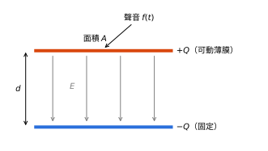
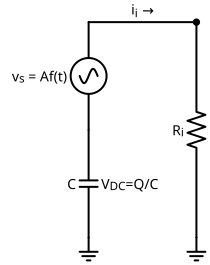

# 第 03 集 · Lec03：電容與電容式麥克風 [▶ 影片](https://www.youtube.com/watch?v=kU-FYHMCbWA)

← 上一集：[02](02-circuit-analysis-equivalent-circuits-sources.md) ｜ [總目錄](../README.md) ｜ 下一集：[04](04-dc-charging-capacitor-transient-ac.md) →

> **課程**：電子學（一），陽明交大 電子物理系，112 學年度 — 第 03 集
> **講者**：陳振芳 老師
> **來源**：YouTube 錄影逐字稿（46:23，人工字幕）；本集內容是普物電學＋老師自己的例子，課本沒有對應段落
> **標記說明**：`【口頭】` 老師口頭補充；`⚠️ 逐字稿缺字` 字幕或口誤，依物理修正；`[▶ mm:ss]` 影片時間點

---

## 目錄

- [0. 這堂課要做什麼](#0-這堂課要做什麼)
- [1. 平行板的電場：高斯定律](#1-平行板的電場高斯定律)
- [2. 從做功到電位差](#2-從做功到電位差)
- [3. 聲音調變板距：麥克風原理](#3-聲音調變板距麥克風原理)
- [4. 電容的定義：水桶的大小](#4-電容的定義水桶的大小)
- [5. 聲音其實是在調變電容](#5-聲音其實是在調變電容)
- [6. 麥克風的等效模型：內阻是一顆電容](#6-麥克風的等效模型內阻是一顆電容)
- [7. 接放大器：只能抓電壓](#7-接放大器只能抓電壓)
- [8. 一頁速查表](#8-一頁速查表)
- [9. 與後續集數的連結](#9-與後續集數的連結)

---

## 0. 這堂課要做什麼

上一集的感測器是「隨溫度、壓力改變的電阻」。這集講第二個感測器：**電容式麥克風**（capacitive microphone），也就是老師身上戴的那支。藉這個例子：

1. 從普物推出平行板的電壓 $V = Qd/(\varepsilon_0 A)$。
2. 定義**電容** $C = Q/V$，得到 $C = \varepsilon_0 A/d$。
3. 說明聲音是在**調變電容**，輸出 = 直流 + 交流。
4. 建立麥克風的等效模型，並說明放大器為什麼只能抓電壓。

---

## 1. 平行板的電場：高斯定律

[▶ 01:43](https://youtu.be/kU-FYHMCbWA?t=103)

電容式麥克風基本上就是**兩片金屬板**。讓上板帶 $+Q$、下板帶 $-Q$，兩板之間就有均勻的電場，從正電荷出發、到負電荷結束，只在兩板之間。

**高斯定律**（Gauss's law）：穿出封閉曲面的電通量 = 包住的電荷 / $\varepsilon_0$。把上板整塊包起來，電場只從下面穿出：[▶ 03:18](https://youtu.be/kU-FYHMCbWA?t=198)

$$
\varepsilon_0 E A = Q
\quad\Longrightarrow\quad
E = \frac{Q}{\varepsilon_0 A}
$$

$\varepsilon_0$ 是真空的**介電常數**（permittivity），固定值。

> ⚠️ 逐字稿缺字 [▶ 03:49](https://youtu.be/kU-FYHMCbWA?t=229)：字幕「E 就可以得到是 ε0 Q 除以 A」，依高斯定律應是 $E = Q/(\varepsilon_0 A)$（$\varepsilon_0$ 在分母）。老師後面代入的 $V = Qd/(\varepsilon_0 A)$ 也是這個形式。

---

## 2. 從做功到電位差

[▶ 04:21](https://youtu.be/kU-FYHMCbWA?t=261)

把一個正電荷 $q$ 放在兩板之間：上板正電排斥、下板負電吸引，它受到一個**往下**的力

$$
F = qE
$$

（這也是電場的定義：每單位電荷受的力。）

要把它從下板搬到上板（距離 $d$），要加一個往上的外力 $qE$ 剛好抵消。【口頭】外力不要比 $qE$ 大，不然會產生加速度、多出動能，自找麻煩。[▶ 05:57](https://youtu.be/kU-FYHMCbWA?t=357)

外力和位移同方向，做**正功**，位能增加：

$$
W = qE\,d = \Delta PE
$$

除以 $q$，得到**單位電荷**的位能增加，也就是**電位差**（電壓）：[▶ 08:33](https://youtu.be/kU-FYHMCbWA?t=513)

$$
V = \frac{W}{q} = E\,d
$$

這就是第 01 集「電壓 = 單位電荷位能的增加」更明確的來源。

**電場是電位的斜率**：把電位畫成一座斜坡，高度 $V$、水平距離 $d$，斜率就是 $E$。普物寫成 $E = -\dfrac{dV}{dx}$。[▶ 11:09](https://youtu.be/kU-FYHMCbWA?t=669)

代入 $E$：[▶ 12:41](https://youtu.be/kU-FYHMCbWA?t=761)

$$
V = \frac{Q\,d}{\varepsilon_0 A}
$$

兩板各接一條線出來（下板接地），用三用電表就量得到這個電壓。它和**總電荷 $Q$** 成正比，也和**幾何形狀**（$d$、$A$）有關。

---

## 3. 聲音調變板距：麥克風原理

[▶ 14:15](https://youtu.be/kU-FYHMCbWA?t=855)

- 沒有聲音：量到一個固定電壓，例如 1 V。
- 麥克風的上板是一片**很薄、可以移動的薄膜**（diaphragm）。聲音 $f(t)$ 進來，薄膜上下振動，**$d$ 被改變了**，但 **$Q$ 沒變**。
- 【口頭】聲音信號是很多 sin、cos 加起來，頻率約 20 Hz 到 20 kHz。數學上寫一根 sin 就好。[▶ 14:46](https://youtu.be/kU-FYHMCbWA?t=886)

板距變成 $d + \Delta d$，其中 $\Delta d \propto f(t)$，寫成 $\Delta d = A' f(t)$：[▶ 15:46](https://youtu.be/kU-FYHMCbWA?t=946)

$$
v(t) = \frac{Q\,(d + \Delta d)}{\varepsilon_0 A}
= \underbrace{\frac{Q\,d}{\varepsilon_0 A}}_{V_{DC}}
+ \underbrace{\frac{Q\,d}{\varepsilon_0 A}\cdot\frac{\Delta d}{d}}_{v_s(t)}
$$

[▶ 18:21](https://youtu.be/kU-FYHMCbWA?t=1101)

- 第一項和時間無關，是**直流**（DC），沒聲音時就有，大約一兩伏。
- 第二項跟著聲音做 sin、cos 變化，是**交流**（AC），記作信號源 $v_s(t)$。大小是直流乘上 $\Delta d/d$（例如十分之一）。

**聲音信號就這樣變成了電壓信號**，這就是麥克風。[▶ 19:58](https://youtu.be/kU-FYHMCbWA?t=1198)

> 【口頭】聲音推動薄膜也是在**做功**，所以電位會被推高、拉低。[▶ 16:17](https://youtu.be/kU-FYHMCbWA?t=977)

---

## 4. 電容的定義：水桶的大小

[▶ 20:29](https://youtu.be/kU-FYHMCbWA?t=1229)

【口頭】電容後面用得非常多，所以趁講麥克風時引進來。

用**水桶**比喻：

| 水桶 | 電路 |
|---|---|
| 水量 | 電荷 $Q$ |
| 水位 | 電位 $V$ |
| 水桶大小 | 電容 $C$ |

水越多，水位越高，兩者成正比。所以定義 [▶ 22:32](https://youtu.be/kU-FYHMCbWA?t=1352)

$$
C \equiv \frac{Q}{V}
$$

$C$ 就是**水桶的大小**：同樣的水位，大水桶裝的水比較多。

代入平行板的 $V = Qd/(\varepsilon_0 A)$，$Q$ 消掉：[▶ 24:36](https://youtu.be/kU-FYHMCbWA?t=1476)

$$
C = \frac{Q}{Qd/(\varepsilon_0 A)} = \frac{\varepsilon_0 A}{d}
$$

**電容只跟幾何形狀有關**（面積 $A$、板距 $d$），跟其他都無關。

---

## 5. 聲音其實是在調變電容

[▶ 25:38](https://youtu.be/kU-FYHMCbWA?t=1538)

聲音改變的不是電荷，是 $d$；$d$ 變了，**$C$ 就變了**。所以聲音是在**調變水桶的大小**。

【口頭】想像一隻巨人的手在擠水桶：壓一下（squeeze）水位升高，放開（release）水位下降。手的力就是聲音 $f(t)$，水位就是電位，跟著高高低低。[▶ 26:40](https://youtu.be/kU-FYHMCbWA?t=1600)

> 以下**不是逐字稿內容**，是把第 4 節的式子換個寫法：$V = Q/C$，$Q$ 固定，$C = \varepsilon_0 A/d$ 變小（$d$ 變大）時 $V$ 變大，和「擠水桶」的直覺一致。

---

## 6. 麥克風的等效模型：內阻是一顆電容

[▶ 28:12](https://youtu.be/kU-FYHMCbWA?t=1692)

- **沒有聲音**：平行板上有固定的 $+Q$、$-Q$，輸出一個直流電壓 $V_{DC} = Q/C$。
- 【口頭】在板子上放永久的固定電荷很容易做到。這是貝爾實驗室（Bell Labs）很早以前的發明：在其中一片放一個永久帶電的極板，電荷幾十年都不會跑掉。[▶ 29:12](https://youtu.be/kU-FYHMCbWA?t=1752)
- **有聲音**：多出一項交流 $v_s = A f(t)$。

兩個電壓**相加** → 一定是**串聯**。所以麥克風的模型是：帶電荷的電容（給出 $V_{DC}$）串聯一個交流電壓源 $v_s$。[▶ 31:18](https://youtu.be/kU-FYHMCbWA?t=1878)

和第 02 集的「$v_s$ 串聯 $R_s$」比一比：[▶ 33:52](https://youtu.be/kU-FYHMCbWA?t=2032)

- 信號源 $v_s$ 一樣跟聲音成正比。
- **內阻** $R_s$ 是「沒有聲音時的麥克風本體」。把聲音拿掉（$v_s = 0$，短路）往回看，看到的是**一顆帶固定電荷的電容**。

【口頭】**$R_s$ 不一定是電阻**。這個例子它是電容；電感式麥克風的話是電感；後面的光偵測器則是二極體。$R_s$ 可能很複雜。[▶ 36:25](https://youtu.be/kU-FYHMCbWA?t=2185)

---

## 7. 接放大器：只能抓電壓

[▶ 37:58](https://youtu.be/kU-FYHMCbWA?t=2278)

麥克風的信號很小，接下來要接放大器放大。放大器輸入端看進去是一個電阻 $R_i$。（老師再提一次：放大器有四種，第一章就是不斷重複這些概念。）

### 7.1 $R_i \to \infty$：抓電壓

[▶ 39:00](https://youtu.be/kU-FYHMCbWA?t=2340)

輸入端等於開路，送進放大器的電壓是全部的 **直流 + 交流**，draw voltage。

問題：真正要放大的只有交流（聲音），但直流也一起進來了。如果放大器不處理，會把直流也放大，大到超過它的限制（limitation），自己「死掉」。[▶ 40:03](https://youtu.be/kU-FYHMCbWA?t=2403)
→ 所以放大器前面要先**用電容把直流擋住**，只讓交流進去（後面會講）。

### 7.2 $R_i \to 0$：抓電流 → 毀掉麥克風

[▶ 41:33](https://youtu.be/kU-FYHMCbWA?t=2493)

輸入端等於短路，draw current。輸入電流

$$
i_i = \frac{V_{DC} + v_s}{0} \to \infty
$$

【口頭】短路的瞬間，電容上的 $+Q$ 和 $-Q$ 直接中和掉，產生幾乎無窮大的電流。電荷沒了，**麥克風就毀了**，只能丟掉。[▶ 44:08](https://youtu.be/kU-FYHMCbWA?t=2648)

**結論**：和上一集的感測電阻一樣，這裡**只能抓電壓，不能抓電流**。

【口頭】實際的產品怕你弄壞，會在麥克風後面直接接一個小放大器，讓你毀不掉它。但無論如何不能短路。下一次講光偵測器（photodetector），那個就**只能抓電流、不能抓電壓**。[▶ 45:11](https://youtu.be/kU-FYHMCbWA?t=2711)

---

## 8. 一頁速查表

| 項目 | 公式 | 關鍵一步 |
|---|---|---|
| 平行板電場 | $E = \dfrac{Q}{\varepsilon_0 A}$ | 高斯定律：$\varepsilon_0 E A = Q$ |
| 電力 | $F = qE$ | 電場 = 單位電荷受的力 |
| 電位差 | $V = Ed$ | $W = qEd$，再除以 $q$ |
| 電場與電位 | $E = -\dfrac{dV}{dx}$ | 電場是電位的斜率 |
| 平行板電壓 | $V = \dfrac{Qd}{\varepsilon_0 A}$ | 把 $E$ 代入 $V = Ed$ |
| 電容定義 | $C = Q/V$ | 水桶大小：水量 / 水位 |
| 平行板電容 | $C = \dfrac{\varepsilon_0 A}{d}$ | $Q$ 消掉，只剩幾何 |
| 麥克風輸出 | $v = V_{DC} + V_{DC}\dfrac{\Delta d}{d}$ | $Q$ 固定，$d \to d + \Delta d$ |
| 麥克風模型 | 電容（$V_{DC} = Q/C$）串聯 $v_s = Af(t)$ | 電壓相加 → 串聯 |

觀念：

- 聲音調變的是電容（幾何），不是電荷。
- 信號源的「內阻」不一定是電阻：可能是電容、電感、二極體。
- 電容式麥克風只能抓電壓；短路會把電荷中和、毀掉麥克風。

---

## 9. 與後續集數的連結

| 本集觀念 | 後面在哪裡用到 |
|---|---|
| 電容 $C = Q/V$ | 下一集 1.4 電容充電（直流、交流）、暫態與穩態 |
| 用電容擋直流 | 1.5 阻擋直流、讓交流通過的條件 |
| 輸出 = 直流 + 交流 | 1.8 直流與交流電路、1.9 MOS 放大器的直流工作點與交流放大 |
| 只能抓電流的感測器 | 第 2 章 2.5–2.7 P-N 介面光偵測器、電流電壓轉換器 |

---

## 附：本集一句話總結

> **電容式麥克風是一對帶固定電荷的平行板（$C = \varepsilon_0 A/d$）；聲音推動薄膜改變 $d$，等於在調變電容，使輸出變成「直流 $Q/C$ + 交流 $v_s$」。它的內阻是一顆電容，所以放大器只能抓電壓，短路會把電荷中和、毀掉麥克風。**

---

*筆記依據陳振芳老師「電子學（一）」112 學年度 Lec03 錄影逐字稿（人工字幕，46:23）整理。*
