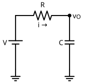
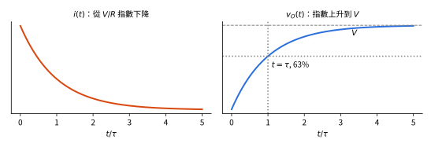
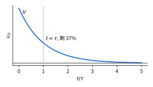
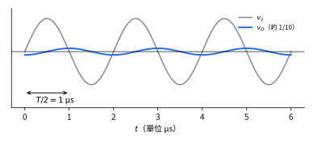

# 第 04 集 · Lec04：直流對電容充電、暫態與穩態、交流充電 [▶ 影片](https://www.youtube.com/watch?v=mCfTmVK6ek8)

← 上一集：[03](03-capacitor-condenser-microphone.md) ｜ [總目錄](../README.md) ｜ 下一集：[05](05-ac-charging-rc-low-pass-filter.md) →

> **課程**：電子學（一），陽明交大 電子物理系，112 學年度 — 第 04 集
> **講者**：陳振芳 老師
> **來源**：YouTube 錄影逐字稿（1:20:55，人工字幕）＋ Sedra & Smith《Microelectronic Circuits》7th ed. §1.6.4
> **標記說明**：`【口頭】` 老師口頭補充；`【課本補充】` 課本有、課堂沒講；`[▶ mm:ss]` 影片時間點

---

## 目錄

- [0. 這堂課要做什麼](#0-這堂課要做什麼)
- [1. 直流對電容充電：先用水桶想](#1-直流對電容充電先用水桶想)
- [2. 微分方程：暫態解 + 穩態解](#2-微分方程暫態解--穩態解)
- [3. 時間常數 τ = RC](#3-時間常數-τ--rc)
- [4. 不解微分方程的三步法](#4-不解微分方程的三步法)
- [5. 例題 1：R 串 C](#5-例題-1r-串-c)
- [6. 例題 2：R1、R2 分壓再接 C](#6-例題-2r1r2-分壓再接-c)
- [7. 例題 3：C 串 R，輸出在 R 上——電容擋直流](#7-例題-3c-串-r輸出在-r-上電容擋直流)
- [8. 為什麼要擋直流](#8-為什麼要擋直流)
- [9. 例題 4：R1、C、R2 串聯](#9-例題-4r1cr2-串聯)
- [10. 電容放在哪裡，功能不同](#10-電容放在哪裡功能不同)
- [11. 交流對電容充電：時間夠不夠](#11-交流對電容充電時間夠不夠)
- [12. 一頁速查表](#12-一頁速查表)
- [13. 與後續集數的連結](#13-與後續集數的連結)

---

## 0. 這堂課要做什麼

| 主題 | 重點 |
|---|---|
| 直流充電 | 電流從 $V/R$ 指數下降，電容電壓指數上升到 $V$ |
| 暫態與穩態 | 把信號源拿掉 → 暫態；讓 $d/dt = 0$（電容開路）→ 穩態 |
| 時間常數 | $\tau = RC$：水桶越大、水管越細，充越久 |
| 三步法 | 以後**不解微分方程**，直接寫答案 |
| 電容擋直流 | 電容在中間時，約 4τ 後直流被擋光 |
| 交流充電 | 信號半週期 vs. $RC$，決定交流過不過得去 |

---

## 1. 直流對電容充電：先用水桶想

[▶ 00:09](https://youtu.be/mCfTmVK6ek8?t=9)

- 電容 = 水桶。直流電壓 $V$（例如 10 V）= 一個**非常大**的水桶，水位永遠不變。
- 中間接一條水管（阻抗 $R$），水從高水位流到電容這個小水桶，水位上升。

由 $Q = CV$ 對時間微分，得到電容最好用的關係式：[▶ 02:44](https://youtu.be/mCfTmVK6ek8?t=164)

$$
i = C\,\frac{dv}{dt}
$$

如果電流是常數，水位就以固定斜率直線上升；**水位的斜率就是水流**（差一個常數 $C$）。[▶ 03:44](https://youtu.be/mCfTmVK6ek8?t=224)

**定性分析** [▶ 04:15](https://youtu.be/mCfTmVK6ek8?t=255)

1. $t = 0$：電容沒有電荷（$Q = 0 \Rightarrow v_O = 0$）。【口頭】就算原本有電荷，也早就漏掉了。
2. 這時兩邊水位差最大，電流最大：$i(0) = (V - 0)/R = V/R$。
3. 電流對電容充電 → $v_O$ 上升 → 水位差 $V - v_O$ 變小 → 電流變小 → $v_O$ 上升變慢。
4. 一直到 $v_O = V$，兩邊水位一樣高，沒有電流，停住。這叫**穩態**（steady state）。[▶ 08:21](https://youtu.be/mCfTmVK6ek8?t=501)

---

## 2. 微分方程：暫態解 + 穩態解

### 2.1 列方程

[▶ 09:54](https://youtu.be/mCfTmVK6ek8?t=594)

電源電壓 = 電阻壓降 + 電容電壓，$i = C\,dv_O/dt$：

$$
V = RC\,\frac{dv_O}{dt} + v_O
$$

一階微分方程。【口頭】它在說：$v_O$ 隨時間變化的快慢，跟 $V - v_O$ 的差成正比；差越大上升越陡，沒有差就平了。

### 2.2 拆成兩部分

[▶ 11:00](https://youtu.be/mCfTmVK6ek8?t=660)

假設

$$
v_O(t) = v_{O,t}(t) + v_{O,ss}
$$

- $v_{O,t}$：**暫態**（transient），還在充電，跟時間有關。
- $v_{O,ss}$：**穩態**（steady state），已經不充電，跟時間無關（常數）。

代入，常數微分是 0：

$$
V = RC\,\frac{dv_{O,t}}{dt} + v_{O,t}(t) + v_{O,ss}
$$

[▶ 12:31](https://youtu.be/mCfTmVK6ek8?t=751) 時間有無窮多個值，每個 $t$ 都要成立，所以「跟時間有關的部分」必須自己等於 0，常數部分自己相等。一條式子拆成兩條：

$$
RC\,\frac{dv_{O,t}}{dt} + v_{O,t} = 0,
\qquad
V = v_{O,ss}
$$

### 2.3 兩個重要觀念

[▶ 13:35](https://youtu.be/mCfTmVK6ek8?t=815)

1. **暫態解 = 把信號源拿掉**（原方程讓 $V = 0$）解出來的解。
2. **穩態解 = 讓時間微分等於 0**。$dv/dt = 0$ 代表 $i_C = C\,dv/dt = 0$，電容沒有電流。一條路 100% 沒電流，就可以把它拔掉 → **電容開路**（C open）。[▶ 15:38](https://youtu.be/mCfTmVK6ek8?t=938)

【口頭】只要還在充電，電壓就還會上升，就不是穩態。

---

## 3. 時間常數 τ = RC

### 3.1 解暫態

[▶ 17:38](https://youtu.be/mCfTmVK6ek8?t=1058)

猜 $v_{O,t} = A e^{st}$，代入：

$$
RCs\,A e^{st} + A e^{st} = 0
\;\Longrightarrow\;
A e^{st}(RCs + 1) = 0
$$

$A \neq 0$（不然沒東西可求），$e^{st} \neq 0$，所以 $s = -\dfrac{1}{RC}$：

$$
v_{O,t} = A\,e^{-t/RC}
$$

### 3.2 全解與起始條件

[▶ 19:14](https://youtu.be/mCfTmVK6ek8?t=1154)

$$
v_O(t) = A\,e^{-t/RC} + V
$$

起始條件：$v_O(0) = 0$（電容上沒電荷，no charge on C）→ $A + V = 0$，$A = -V$：

$$
v_O(t) = V\left(1 - e^{-t/RC}\right)
$$

### 3.3 時間常數的意義

[▶ 20:46](https://youtu.be/mCfTmVK6ek8?t=1246)

定義**時間常數**（time constant）

$$
\tau \equiv RC
$$

- $t = \tau$ 時，$1 - e^{-1} \approx 0.63$，充到 **63%**。
- 【口頭】要說「充滿」，約 **4τ**。時間只要知道**數量級**（order）就好，2τ、3τ、5τ 都無所謂。[▶ 22:16](https://youtu.be/mCfTmVK6ek8?t=1336)

> 以下**不是逐字稿內容**，是直接計算：$1 - e^{-4} \approx 98.2\%$，$1 - e^{-5} \approx 99.3\%$。老師說「99% 大約 4τ」，嚴格算是 5τ 左右，但這正是他說的「只看數量級」。

**數字例子** [▶ 22:47](https://youtu.be/mCfTmVK6ek8?t=1367)：$R = 10\ \text{k}\Omega$、$C = 1\ \text{nF}$ →

$$
\tau = 10^4 \times 10^{-9} = 10^{-5}\ \text{s}
$$

【口頭】做電子實驗時，一接上去 $10^{-5}$ 秒就充得差不多飽了。一般的 $RC$ 不會超過 1 秒，**不用擔心等待時間**。[▶ 23:48](https://youtu.be/mCfTmVK6ek8?t=1428)

**直覺** [▶ 24:21](https://youtu.be/mCfTmVK6ek8?t=1461)：水桶越大（$C$ 大）要等越久；水管越細（$R$ 大）也要等越久。所以是兩者**相乘**，絕對忘不掉。

---

## 4. 不解微分方程的三步法

### 4.1 通式

[▶ 25:54](https://youtu.be/mCfTmVK6ek8?t=1554)

把 $A$ 用 $t = 0$ 和 $t = \infty$ 的值表示：$v_O(0) = A + v_O(\infty)$，所以 $A = v_O(0) - v_O(\infty)$。任何一顆電容的一階電路，**任何位置的電壓**都可以寫成

$$
v(t) = \big[v(0) - v(\infty)\big]\,e^{-t/\tau} + v(\infty)
$$

[▶ 27:30](https://youtu.be/mCfTmVK6ek8?t=1650)

### 4.2 三樣東西怎麼求

| 要求的 | 怎麼求 | 原因 |
|---|---|---|
| $v(\infty)$ | **電容開路**，解電阻電路 | 穩態時電容沒電流 |
| $v(0)$ | 題目給，通常是「電容沒電荷」→ 電容電壓 0，**電容等於短路** | 沒電荷就沒壓差 |
| $\tau$ | **拿掉信號源**，把自己放在電容的位置，看出去的電阻 $R$，$\tau = RC$ | 暫態 = 拿掉信號源 |

**求 τ 的細節** [▶ 28:01](https://youtu.be/mCfTmVK6ek8?t=1681)

1. **Remove input source**：信號源是多餘的干擾，先拿掉（電壓源短路）。
2. 想像做實驗做到一半突然拿掉電源，電容上還有電荷，它要**放電**（discharge）。放電的時間常數就是 $\tau$。
3. 把電容換成你自己加的電壓 $v_x$（replace C by $v_x$），看流出去的電流 $i_x$：

$$
R = \frac{v_x}{i_x},
\qquad
\tau = RC
$$

【口頭】只有一顆電容，所以 $\tau$ 裡的 $C$ 一定是它，要找的只有 $R$。用**放電**去求，不要用充電，充電還有一個 $V$ 在那邊很討厭。放電的時間常數絕對等於充電的時間常數。[▶ 31:12](https://youtu.be/mCfTmVK6ek8?t=1872)

---

## 5. 例題 1：R 串 C

[▶ 33:47](https://youtu.be/mCfTmVK6ek8?t=2027)

就是第 1 節的電路，用三步法重做一次：

1. $v_O(\infty)$：電容開路，沒有電流，$R$ 上沒壓差 → $v_O(\infty) = V$。
2. $v_O(0) = 0$（沒電荷）。【口頭】上次實驗和這次實驗不可能只隔 $10^{-5}$ 秒，所以電荷一定漏光了。[▶ 35:52](https://youtu.be/mCfTmVK6ek8?t=2152)
3. $\tau$：拿掉 $V$（短路），從電容看出去只有 $R$ → $\tau = RC$。

$$
v_O(t) = (0 - V)\,e^{-t/RC} + V = V\left(1 - e^{-t/RC}\right)
$$

和解微分方程一樣，但完全不用解。

---

## 6. 例題 2：R1、R2 分壓再接 C

[▶ 36:57](https://youtu.be/mCfTmVK6ek8?t=2217)

1. $v_O(\infty)$：電容開路，只剩 $R_1$、$R_2$ 分壓：

$$
v_O(\infty) = V\,\frac{R_2}{R_1 + R_2}
$$

2. $v_O(0) = 0$。
3. $\tau$：拿掉 $V$（短路），從電容看出去：一條路經 $R_2$ 到地，另一條經 $R_1$ 到（短路後的）地，**兩條水管 → 並聯**（不是串聯）。[▶ 39:32](https://youtu.be/mCfTmVK6ek8?t=2372)

$$
\tau = (R_1 \parallel R_2)\,C
$$

$$
v_O(t) = V\,\frac{R_2}{R_1 + R_2}\left(1 - e^{-t/\tau}\right)
$$

**數字** [▶ 40:04](https://youtu.be/mCfTmVK6ek8?t=2404)：$V = 10\ \text{V}$、$R_1 = 8\ \text{k}\Omega$、$R_2 = 2\ \text{k}\Omega$ → 只會充到 **2 V**。

【口頭】

- 為什麼只要 2 V？例如後面的 BJT 放大器只需要 2 V，灌 10 V 進去會燒壞。所以用電阻分壓，讓電路自己充到你要的直流電壓。[▶ 41:04](https://youtu.be/mCfTmVK6ek8?t=2464)
- 並聯電阻比較小，所以充電**快一點**。
- 電容跨在輸出端還有一個很重要的特質：**穩定電壓**（後面再講）。

---

## 7. 例題 3：C 串 R，輸出在 R 上——電容擋直流

[▶ 43:12](https://youtu.be/mCfTmVK6ek8?t=2592)

把 $R$、$C$ 位置對調，輸出改成量電阻上的電壓。

1. $v_O(\infty)$：電容開路 → 沒有電流 → $R$ 上電壓 $= 0$。[▶ 44:42](https://youtu.be/mCfTmVK6ek8?t=2682)
2. $v_O(0)$：電容沒電荷 → 電容兩端沒壓差 → **電容等於短路** → $v_O(0) = V$。[▶ 45:43](https://youtu.be/mCfTmVK6ek8?t=2743)
3. $\tau$：拿掉 $V$，從電容看出去只有 $R$ → $\tau = RC$。

$$
v_O(t) = (V - 0)\,e^{-t/RC} + 0 = V\,e^{-t/RC}
$$

一開始輸出有 $V$，但幾個 $RC$ 之後就**沒了**。[▶ 48:53](https://youtu.be/mCfTmVK6ek8?t=2933)
原因：$V$ 對電容充電，約 4τ 後電容上充到 $V$，輸出 = $V - V = 0$。

**結論**：

$$
\textbf{C blocks DC voltage（after}\ \sim 4\tau\textbf{）}
$$

[▶ 49:53](https://youtu.be/mCfTmVK6ek8?t=2993)

---

## 8. 為什麼要擋直流

[▶ 50:26](https://youtu.be/mCfTmVK6ek8?t=3026)

【口頭】電路裡到處都有直流：

- 放大器**需要**直流才能運作。「直流是先決條件，讓你吃飽飽開始運作」，沒給直流它理都不理你。
- 麥克風本身也會產生直流（上一集，平行板上要有電荷）。
- 但真正要放大的是**交流**：聲音、影像這些 sin、cos 信號。

麥克風輸出 = 直流（例如 2 V）+ 小小的交流。如果直接送進放大器，直流比交流大一個數量級，會把放大器「弄死」。[▶ 52:05](https://youtu.be/mCfTmVK6ek8?t=3125)

→ 在中間串一個電容，後面接一個 $R$ 給它一條路充電（沒有路就不能充電，也就擋不了）。約 4τ 後，電容充到 $V_{DC}$，直流被擋住，**只剩交流 $v_s$** 進放大器。[▶ 53:05](https://youtu.be/mCfTmVK6ek8?t=3185)

**問題**：電容會不會連交流也擋掉？如果會，放大器什麼都收不到。[▶ 54:36](https://youtu.be/mCfTmVK6ek8?t=3276)
→ 本集最後開始回答：**can C block AC signal?** 我們要的是「擋直流、不擋交流」。

---

## 9. 例題 4：R1、C、R2 串聯

[▶ 55:36](https://youtu.be/mCfTmVK6ek8?t=3336)

1. $v_O(\infty)$：電容開路 → 沒電流 → $v_O(\infty) = 0$。
2. $v_O(0)$：電容沒電荷 → 短路 → 分壓 $v_O(0) = V\,\dfrac{R_2}{R_1 + R_2}$。[▶ 57:43](https://youtu.be/mCfTmVK6ek8?t=3463)
3. $\tau$：拿掉 $V$，從電容看出去，走一圈經過 $R_1$ 再經過 $R_2$，**同一條路 → 串聯相加**。[▶ 58:47](https://youtu.be/mCfTmVK6ek8?t=3527)

$$
\tau = (R_1 + R_2)\,C,
\qquad
v_O(t) = V\,\frac{R_2}{R_1 + R_2}\,e^{-t/\tau}
$$

一樣最後是 0，直流還是**全部被擋光**，只是擋的時間長一點（電阻相加）。

穩態時：$R_2$ 上沒電流 → 電容右端 0 V；$R_1$ 上沒電流 → 電容左端 $V$。所以**電容兩端非跨 $V$ 不可**，這樣才沒有電流。[▶ 1:01:55](https://youtu.be/mCfTmVK6ek8?t=3715)

---

## 10. 電容放在哪裡，功能不同

[▶ 1:02:56](https://youtu.be/mCfTmVK6ek8?t=3776)

| 電容位置 | 功能 |
|---|---|
| **跨在輸出端**（到地） | 產生一個你要的、**很穩定**的直流電壓給後面的電路用（例題 1、2） |
| **在輸入和輸出中間**（串聯） | **擋直流**（例題 3、4） |

【口頭】為什麼不直接放一個電池？因為前面的 $V$ 是多少你不一定知道，而且可能會變（前面接的不一定是電池）。電容會**自己決定**擋多少、產生多少，自己調整。這是加電池或單純電阻分壓做不到的。[▶ 1:03:56](https://youtu.be/mCfTmVK6ek8?t=3836)

---

## 11. 交流對電容充電：時間夠不夠

### 11.1 設定

[▶ 1:04:58](https://youtu.be/mCfTmVK6ek8?t=3898)

輸入換成 $v_s \sin\omega t$（函數產生器 function generator 可以調頻率；聲音是很多頻率，一次研究一根），接同樣的 $RC$ 電路（輸出在電容上）。

- **頻率不會變**：這是線性電路，輸入什麼頻率、輸出就是什麼頻率。[▶ 1:06:38](https://youtu.be/mCfTmVK6ek8?t=3998)
- 可能有**相位差**，要看頻率；完整答案要包含相位。示波器上兩個波形放在一起才看得出起點有一點 shift。這集先不管相位，只看振幅比。[▶ 1:07:12](https://youtu.be/mCfTmVK6ek8?t=4032)

### 11.2 用「時間夠不夠」來想

[▶ 1:08:14](https://youtu.be/mCfTmVK6ek8?t=4094)

- 電路需要 $\tau = RC$ 才能把電容充到穩態。例如 $10\ \text{k}\Omega \times 1\ \text{nF} = 10^{-5}$ s。
- 正弦信號週期 $T = 2\pi/\omega$（$\omega = 2\pi f$ 是角頻率）。**正半週**（$T/2$）對電容充電，**負半週**把電荷搬回去放電，週期性重複。[▶ 1:11:20](https://youtu.be/mCfTmVK6ek8?t=4280)

**數字**：$\omega = \pi \times 10^6$ rad/s → $T = 2\ \mu\text{s}$，充電時間 $T/2 = 10^{-6}$ s。[▶ 1:12:53](https://youtu.be/mCfTmVK6ek8?t=4373)

【口頭】我做一件事要 10 秒（$10^{-5}$），你只給我 1 秒（$10^{-6}$），那我就只做十分之一，然後就轉頭了。所以輸出振幅大約只有輸入的十分之一：[▶ 1:14:23](https://youtu.be/mCfTmVK6ek8?t=4463)

$$
\frac{v_o}{v_s} \sim \frac{T/2}{\tau} = \frac{10^{-6}}{10^{-5}} = \frac{1}{10}
$$

【口頭】老師說這是「亂猜，不過很準」，下一集會好好畫兩個極端的情況。[▶ 1:18:04](https://youtu.be/mCfTmVK6ek8?t=4684)

> 以下**不是逐字稿內容**，是依一階低通的頻率響應推論（課本 Table 1.2, p. 36）：$|v_o/v_s| = 1/\sqrt{1 + (\omega\tau)^2}$。本例 $\omega\tau = \pi \times 10^6 \times 10^{-5} \approx 31.4$，所以振幅比約 $1/31$，相位落後接近 90°。老師的「1/10」是數量級的估計，方向（頻率太高 → 輸出很小）完全正確。

### 11.3 結論

[▶ 1:19:07](https://youtu.be/mCfTmVK6ek8?t=4747)

- 頻率太高 → 給的時間太短 → 交流沒過來（只過來十分之一）。
- 頻率降低、週期變長，例如長兩個數量級，就保證充得完，輸出振幅 = 輸入振幅 $v_s$，全部過去。
- **關鍵是比較兩個時間**：信號的週期（倒過來是信號頻率）和 $RC$（倒過來是 $RC$ 的**轉折頻率**）。兩個頻率一比，遠大於或遠小於，結果截然不同。[▶ 1:20:10](https://youtu.be/mCfTmVK6ek8?t=4810)

> 【課本補充】課本 §1.6.4 (p. 35) 把只有一個電抗元件（$L$ 或 $C$）加一個電阻的電路叫**單一時間常數網路**（single-time-constant network, STC），分成低通（LP）和高通（HP）兩類。電容跨在輸出端（例題 1）是**低通**，電容串在中間（例題 3）是**高通**；兩者的轉折頻率都是 $\omega_0 = 1/\tau$。

---

## 12. 一頁速查表

| 項目 | 公式 | 關鍵一步 |
|---|---|---|
| 電容電流 | $i = C\,\dfrac{dv}{dt}$ | $Q = Cv$ 對 $t$ 微分 |
| RC 方程 | $V = RC\,\dfrac{dv_O}{dt} + v_O$ | 電源 = 電阻壓降 + 電容電壓 |
| 暫態 | $Ae^{-t/RC}$ | 拿掉信號源，猜 $Ae^{st}$ → $s = -1/RC$ |
| 穩態 | 電容開路 | $dv/dt = 0 \Rightarrow i_C = 0$ |
| 時間常數 | $\tau = RC$；$t=\tau$ 到 63% | $1 - e^{-1} \approx 0.63$ |
| **通式** | $v(t) = [v(0) - v(\infty)]e^{-t/\tau} + v(\infty)$ | $A = v(0) - v(\infty)$ |
| 求 $v(\infty)$ | 電容開路 | |
| 求 $v(0)$ | 沒電荷 → 電容短路 | |
| 求 $\tau$ | 拿掉信號源，從電容看出去的 $R$，$\tau = RC$ | 用放電求 |
| R 串 C（輸出在 C） | $V(1 - e^{-t/RC})$ | |
| R1、R2∥C | $V\frac{R_2}{R_1+R_2}(1 - e^{-t/\tau})$，$\tau = (R_1\parallel R_2)C$ | |
| C 串 R（輸出在 R） | $Ve^{-t/RC}$ → 擋直流 | |
| R1、C、R2 | $V\frac{R_2}{R_1+R_2}e^{-t/\tau}$，$\tau = (R_1+R_2)C$ | |
| 交流估計 | 半週期 $\ll RC$ → 輸出很小 | 時間不夠充 |

---

## 13. 與後續集數的連結

| 本集觀念 | 後面在哪裡用到 |
|---|---|
| 交流能不能通過電容 | 下一集 1.5：阻擋直流、讓交流通過的條件 |
| 三步法、$\tau$ 從電容看出去 | 1.6 電容充放電等效模型；第 2 章積分器、微分器 |
| 兩個頻率比大小（轉折頻率） | 1.7 相量分析、波特圖；第 9 章放大器頻率響應 |
| 電容在輸出端穩定電壓 | 1.9 MOS 放大器的直流工作點 |

---

## 附：本集一句話總結

> **一顆電容的電路，任何電壓都是 $[v(0) - v(\infty)]e^{-t/\tau} + v(\infty)$：電容開路得穩態、沒電荷時電容短路得初值、拿掉信號源從電容看出去得 $\tau = RC$。串在中間的電容約 4τ 就把直流擋光；交流能不能過，看信號半週期和 $RC$ 誰長。**

---

*筆記依據陳振芳老師「電子學（一）」112 學年度 Lec04 錄影逐字稿（人工字幕，1:20:55）與 Sedra & Smith《Microelectronic Circuits》7th ed. 整理。*
