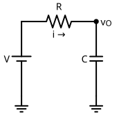
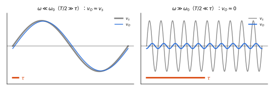
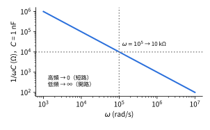
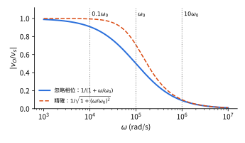
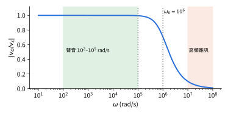

# 第 05 集 · Lec05：交流對電容充電、電容的等效電阻、RC 低通濾波器 [▶ 影片](https://www.youtube.com/watch?v=9k8a8hUeNkE)

← 上一集：[04](04-dc-charging-capacitor-transient-ac.md) ｜ [總目錄](../README.md) ｜ 下一集：[06](06-capacitor-charge-discharge-equivalent-model.md) →

> **課程**：電子學（一），陽明交大 電子物理系，112 學年度 — 第 05 集
> **講者**：陳振芳 老師
> **來源**：YouTube 錄影逐字稿（46:15，人工字幕）＋ Sedra & Smith《Microelectronic Circuits》7th ed. §1.6.4
> **標記說明**：`【口頭】` 老師口頭補充；`【課本補充】` 課本有、課堂沒講；`[▶ mm:ss]` 影片時間點

---

## 目錄

- [0. 這堂課要做什麼](#0-這堂課要做什麼)
- [1. 複習：直流充電與時間常數](#1-複習直流充電與時間常數)
- [2. 交流充電：兩個極端](#2-交流充電兩個極端)
- [3. 頻率響應圖：低通濾波器](#3-頻率響應圖低通濾波器)
- [4. 電容的等效電阻 1/ωC](#4-電容的等效電阻-1ωc)
- [5. 用分壓公式算 RC 電路](#5-用分壓公式算-rc-電路)
- [6. 例題：讓聲音通過、濾掉高頻雜訊](#6-例題讓聲音通過濾掉高頻雜訊)
- [7. 一頁速查表](#7-一頁速查表)
- [8. 與後續集數的連結](#8-與後續集數的連結)

---

## 0. 這堂課要做什麼

上一集結尾的問題：交流能不能通過電容？這集用同一個 $RC$ 電路（輸出在電容上）回答：

1. 先不用數學，比較「信號半週期」和「$\tau = RC$」：低頻全部通過、高頻過不去。
2. 再用一點數學：忽略相位，把電容看成電阻 $1/\omega C$，用分壓公式得到頻率響應。
3. 例題：設計 $C$，讓聲音全部通過、把高頻雜訊濾掉。

---

## 1. 複習：直流充電與時間常數

[▶ 00:10](https://youtu.be/9k8a8hUeNkE?t=10)

直流 10 V 經 $R$ 對 $C$ 充電，$v_O$ 從 0 指數上升到 10 V。充到大約七成（63%）的時間就是 $\tau = RC$。

- 解這個例子只有一個目的：**對電容充電需要時間**。要有電荷，就要電流乘時間。
- $R = 10\ \text{k}\Omega$、$C = 1\ \text{nF}$ → $\tau = 10^{-5}$ s，遠小於 1 秒。
- $C$ 大 = 水桶大，充得久；$R$ 大 = 水管細，也充得久 → $\tau = RC$。[▶ 02:46](https://youtu.be/9k8a8hUeNkE?t=166)

電路圖和上一集例題 1 相同（$v_s$ 經 $R$ 接到 $C$，輸出是電容電壓）：

---

## 2. 交流充電：兩個極端

[▶ 03:18](https://youtu.be/9k8a8hUeNkE?t=198)

輸入 $v_s = V\sin\omega t$（信號產生器，慢慢改頻率）。輸出也是 $\sin\omega t$，但其實會有一點相位差；這集**忽略相位**，只看振幅。[▶ 04:20](https://youtu.be/9k8a8hUeNkE?t=260)

### 2.1 把 τ 換成頻率

[▶ 05:52](https://youtu.be/9k8a8hUeNkE?t=352)

做實驗時大家用頻率比大小，所以把 $\tau$ 倒過來：

$$
\omega_0 = \frac{1}{\tau} = \frac{1}{RC}
\qquad(\text{本例 } 10^5\ \text{rad/s})
$$

叫做 $RC$ 的**轉折頻率**（corner frequency）。它是電路本身的特性，固定不變；改變的只有外加信號的頻率 $\omega$。

- $\omega \ll \omega_0$ ⟺ 週期 $T \gg \tau$
- $\omega \gg \omega_0$ ⟺ 週期 $T \ll \tau$

【口頭】差一個 2（$T/2$ 還是 $T$）不要在乎，「遠大於」本來就是差很多。[▶ 08:59](https://youtu.be/9k8a8hUeNkE?t=539)

### 2.2 低頻：時間夠，充得滿

[▶ 06:54](https://youtu.be/9k8a8hUeNkE?t=414)

- 正半週對電容**充電**（charge），負半週**放電**（discharge），週期性重複。[▶ 09:30](https://youtu.be/9k8a8hUeNkE?t=570)
- 低頻時半週期 $T/2 \gg \tau$。【口頭】一件工作只要 10 秒，你給我 100 秒，我保證做得完。
- 所以每一個時間點電容都充得到和輸入一樣：$v_O \approx v_s$。這叫 **enough time to charge C**。[▶ 11:38](https://youtu.be/9k8a8hUeNkE?t=698)

### 2.3 高頻：時間不夠，幾乎沒電荷

[▶ 13:10](https://youtu.be/9k8a8hUeNkE?t=790)

- 高頻時 $T/2 \ll \tau$。【口頭】一件工作要 10 秒，你只給 1 秒，那我就只做十分之一。電荷才搬到一半、還沒放下去，你就叫我回頭搬回去。[▶ 14:43](https://youtu.be/9k8a8hUeNkE?t=883)
- 電容上幾乎沒有電荷 → 幾乎沒有電壓 → $v_O \approx 0$（例如只有十分之一、百分之一）。這叫 **not enough time to charge C**。[▶ 15:44](https://youtu.be/9k8a8hUeNkE?t=944)

---

## 3. 頻率響應圖：低通濾波器

[▶ 16:51](https://youtu.be/9k8a8hUeNkE?t=1011)

做實驗：頻率從低慢慢增加，量輸出振幅除以輸入振幅 $v_o/v_s$，對頻率畫圖。先把 $\omega_0$ 標上去，再看比它小一個數量級（order）和大一個數量級的兩點：[▶ 17:52](https://youtu.be/9k8a8hUeNkE?t=1072)

- $\omega = 0.1\,\omega_0$：比值約 1（0.9 幾），全部通過。
- $\omega = 10\,\omega_0$：比值約 0.1，幾乎是 0。
- 中間有一個轉折，就在 $\omega_0 = 1/RC$。所以**從實驗圖可以把轉折頻率找出來**。[▶ 19:53](https://youtu.be/9k8a8hUeNkE?t=1193)

**兩個極端的等效電路** [▶ 21:26](https://youtu.be/9k8a8hUeNkE?t=1286)

| 頻率 | 發生什麼 | 電容等效成 |
|---|---|---|
| 很高（$T \ll \tau$） | 來不及充電，沒電荷 → 沒壓差 | **短路**（short circuit），$v_O = 0$ |
| 很低（$T \gg \tau$） | 隨時充到等電位，$v_O = v_s$，$R$ 上電流 $(v_s - v_O)/R = 0$ | **開路**（open circuit），$v_O = v_s$ |

【口頭】電壓 0 是短路，不要搞反了。[▶ 21:58](https://youtu.be/9k8a8hUeNkE?t=1318)

低頻通過、高頻不通過 → 這個電路是**低通濾波器**（low-pass filter）。[▶ 24:00](https://youtu.be/9k8a8hUeNkE?t=1440)
【口頭】整個交流充電就是這張圖，而且完全沒用到數學。

---

## 4. 電容的等效電阻 1/ωC

[▶ 25:38](https://youtu.be/9k8a8hUeNkE?t=1538)

電容的定義 $C = Q/v$，微分得 $i = C\,dv/dt$。現在全部是交流，令 $v = V\sin\omega t$：[▶ 26:40](https://youtu.be/9k8a8hUeNkE?t=1600)

$$
i = C\,\frac{d}{dt}\left(V\sin\omega t\right) = \omega C V\cos\omega t
$$

- 電流也是同頻率的弦波，但 $\cos$ 比 $\sin$ 差 90°，所以電壓和電流**真的有相位差**。[▶ 27:40](https://youtu.be/9k8a8hUeNkE?t=1660)
- 先**忽略相位**（不然就要用向量，很討厭；後面會加回來），把電壓振幅除以電流振幅，當成電容的**等效電阻**（equivalent resistance）：[▶ 28:11](https://youtu.be/9k8a8hUeNkE?t=1691)

$$
R_C \equiv \frac{V}{\omega C V} = \frac{1}{\omega C}
$$

【口頭】我知道它不是電阻，但就是故意把它看成電阻。這個電阻值跟頻率有關。忽略相位只會帶來一點點誤差。[▶ 29:13](https://youtu.be/9k8a8hUeNkE?t=1753)

- 頻率很高：$1/\omega C \to 0$ → **短路**。
- 頻率很低（接近 0）：$1/\omega C \to \infty$ → **開路**。

**數字** [▶ 30:18](https://youtu.be/9k8a8hUeNkE?t=1818)：$C = 1\ \text{nF}$、$\omega = 10^5$ → $1/(10^5 \times 10^{-9}) = 10^4 = 10\ \text{k}\Omega$。頻率更高就比 10 kΩ 小，更低就比 10 kΩ 大。

> 【課本補充】課本把 $1/(j\omega C)$ 稱為電容的阻抗（impedance），大小就是 $1/\omega C$；$j$ 帶的就是老師說的 90° 相位。第 07 集（1.7 相量分析）會把相位加回來。

---

## 5. 用分壓公式算 RC 電路

[▶ 31:22](https://youtu.be/9k8a8hUeNkE?t=1882)

把電容換成「電阻」$1/\omega C$，整個電路就是兩個電阻分壓，**微分都沒有了**：

$$
\frac{v_o}{v_s} = \frac{1/\omega C}{R + 1/\omega C}
= \frac{1}{1 + \omega RC}
= \frac{1}{1 + \omega/\omega_0}
$$

[▶ 32:22](https://youtu.be/9k8a8hUeNkE?t=1942)

這是**振幅比**（相位忽略了）。檢查兩個極端：[▶ 34:24](https://youtu.be/9k8a8hUeNkE?t=2064)

- $\omega = 10\,\omega_0$：$1/11 \approx 0.1$ 以下 → 幾乎 0。
- $\omega = 0.1\,\omega_0$：$1/1.1 \approx 1$。

畫出來和第 3 節實驗的圖一樣。

> 以下**不是逐字稿內容**，是把相位加回來的結果（依課本 Table 1.2, p. 36）：電阻和電容的電壓差 90°，不能直接相加，正確的大小是
> $$
> \left|\frac{v_o}{v_s}\right| = \frac{1}{\sqrt{1 + (\omega/\omega_0)^2}}
> $$
> 兩個式子在 $\omega \ll \omega_0$ 和 $\omega \gg \omega_0$ 時幾乎一樣，差別在轉折附近：$\omega = \omega_0$ 時忽略相位的式子給 0.5，精確值是 $1/\sqrt{2} \approx 0.707$（也就是 −3 dB）。所以老師說「只有一點點誤差」是指兩端；轉折點附近要用相量分析才準。

【口頭】以後就把電容看成電阻 $1/\omega C$：高頻電容短路、低頻電容開路，馬上就能畫出頻率響應。[▶ 37:02](https://youtu.be/9k8a8hUeNkE?t=2222)

---

## 6. 例題：讓聲音通過、濾掉高頻雜訊

[▶ 37:33](https://youtu.be/9k8a8hUeNkE?t=2253)

**題目**：信號是聲音（voice），用這個 $RC$ 電路，要讓**所有聲音都通過**（allow voice to pass），因為後面要放大。

**Step 1：聲音的頻率範圍**

聲音 $f$ = 20 Hz ～ 20 kHz。換成角頻率 $\omega = 2\pi f$，$2\pi \approx 6$，$6 \times 20 = 120 \approx 100$：[▶ 38:03](https://youtu.be/9k8a8hUeNkE?t=2283)

$$
\omega_\text{voice} \approx 10^2 \sim 10^5\ \text{rad/s}
$$

**Step 2：條件**

聲音頻譜（voice spectrum）必須整個落在比值 = 1 的平坦區，也就是要在 $0.1\,\omega_0$ 以內。最高頻 $10^5$ 也要符合：[▶ 40:06](https://youtu.be/9k8a8hUeNkE?t=2406)

$$
0.1\,\omega_0 > 10^5
\quad\Longrightarrow\quad
\omega_0 = \frac{1}{RC} > 10^6
$$

【口頭】$\omega_0$ 不能落在聲音裡面，也不用離太遠，大概在這裡就好。

**Step 3：選元件** [▶ 41:39](https://youtu.be/9k8a8hUeNkE?t=2499)

取 $R = 10\ \text{k}\Omega = 10^4$：

$$
C < \frac{1}{10^6 \times 10^4} = 10^{-10}\ \text{F} = 0.1\ \text{nF}
$$

**這個電路的用途** [▶ 42:43](https://youtu.be/9k8a8hUeNkE?t=2563)

- 電路裡到處都有高頻雜訊（high frequency noise）。比 $\omega_0$ 高一個數量級以上的雜訊全部被濾掉（filter out）。
- 聲音全部通過，雜訊被切掉，送到喇叭就很好聽。
- 所以這個簡單的 $RC$ 就是 **low-pass filter**。

**$C$ 的選擇** [▶ 44:49](https://youtu.be/9k8a8hUeNkE?t=2689)

- $C$ 要夠小：小水桶一點點水就灌滿、一下就倒光，來得及跟著聲音充放電，聲音就過得去。
- 但也不要太小：太小的話 $\omega_0$ 太高，能濾掉的雜訊就少了。

---

## 7. 一頁速查表

| 項目 | 公式 | 關鍵一步 |
|---|---|---|
| 轉折頻率 | $\omega_0 = 1/RC$ | 把 $\tau$ 倒過來 |
| 低頻 $\omega \ll \omega_0$ | 電容**開路**，$v_O \approx v_s$ | 半週期遠長於 $\tau$，充得滿 |
| 高頻 $\omega \gg \omega_0$ | 電容**短路**，$v_O \approx 0$ | 半週期遠短於 $\tau$，沒電荷 |
| 電容電流 | $i = \omega C V\cos\omega t$ | 對 $V\sin\omega t$ 微分；相位差 90° |
| 等效電阻 | $R_C = 1/\omega C$ | 振幅比，忽略相位 |
| RC 低通（忽略相位） | $\dfrac{v_o}{v_s} = \dfrac{1}{1 + \omega/\omega_0}$ | 分壓：$\dfrac{1/\omega C}{R + 1/\omega C}$ |
| RC 低通（精確大小） | $\dfrac{1}{\sqrt{1 + (\omega/\omega_0)^2}}$ | 課本 Table 1.2；轉折點 0.707 |
| 讓信號通過的條件 | 信號最高頻 $< 0.1\,\omega_0$ | 落在平坦區 |
| 聲音頻帶 | $\omega \approx 10^2$–$10^5$ rad/s | $2\pi \times (20\ \text{Hz} \sim 20\ \text{kHz})$ |

---

## 8. 與後續集數的連結

| 本集觀念 | 後面在哪裡用到 |
|---|---|
| 高頻短路、低頻開路 | 下一集電容充放電等效模型；1.8 直流和交流電路分開分析 |
| 忽略相位的 $1/\omega C$ | 1.7 相量分析把相位加回來、波特圖 |
| 低通濾波器、轉折頻率 | 第 2 章積分器（就是低通）、運算放大器頻寬；第 9 章頻率響應 |
| 讓信號落在平坦區 | 1.8–1.9 耦合電容要讓聲音通過（高通的條件） |

---

## 附：本集一句話總結

> **交流對電容充電，看半週期和 $RC$ 誰長：低頻充得滿、電容像開路，信號全過；高頻來不及充、電容像短路，信號過不去。把電容當成電阻 $1/\omega C$ 用分壓，就得到 RC 低通濾波器，轉折頻率 $\omega_0 = 1/RC$。**

---

*筆記依據陳振芳老師「電子學（一）」112 學年度 Lec05 錄影逐字稿（人工字幕，46:15）與 Sedra & Smith《Microelectronic Circuits》7th ed. 整理。*
