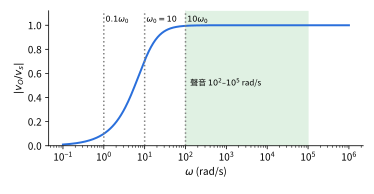
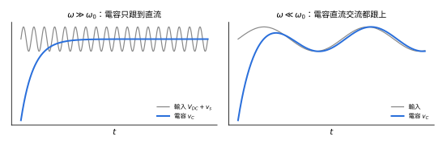

# 第 06 集 · Lec06：電容的等效電阻模型——低通、高通、擋直流、旁路雜訊 [▶ 影片](https://www.youtube.com/watch?v=pNRlI79PUu8)

← 上一集：[05](05-ac-charging-rc-low-pass-filter.md) ｜ [總目錄](../README.md) ｜ 下一集：[07](07-phasor-analysis-rc-bode-plot.md) →

> **課程**：電子學（一），陽明交大 電子物理系，112 學年度 — 第 06 集
> **講者**：陳振芳 老師
> **來源**：YouTube 錄影逐字稿（53:37，人工字幕）＋ Sedra & Smith《Microelectronic Circuits》7th ed. §1.6.4
> **標記說明**：`【口頭】` 老師口頭補充；`【課本補充】` 課本有、課堂沒講；`⚠️ 逐字稿缺字` 字幕或口誤；`[▶ mm:ss]` 影片時間點

---

## 目錄

- [0. 這堂課要做什麼](#0-這堂課要做什麼)
- [1. 複習：電容等效電阻與低通濾波器](#1-複習電容等效電阻與低通濾波器)
- [2. R、C 對調：高通濾波器](#2-rc-對調高通濾波器)
- [3. 例題：高通電路讓聲音通過](#3-例題高通電路讓聲音通過)
- [4. 直流 + 交流一起進來：耦合電容](#4-直流--交流一起進來耦合電容)
- [5. 水桶圖：什麼時候交流跟得上](#5-水桶圖什麼時候交流跟得上)
- [6. 例題：雷射筆要直流、不要交流——旁路電容](#6-例題雷射筆要直流不要交流旁路電容)
- [7. 一頁速查表](#7-一頁速查表)
- [8. 與後續集數的連結](#8-與後續集數的連結)

---

## 0. 這堂課要做什麼

用「電容 = 等效電阻 $1/\omega C$」這個簡化模型，把電容的幾種用途一次整理：

| 電路 | 用途 | 條件 |
|---|---|---|
| R 串、C 到地（低通） | 讓聲音過、濾掉高頻雜訊 | $C$ 夠小 |
| C 串、R 到地（高通） | 擋直流、讓交流過 | $C$ 夠大 |
| C 並在負載旁（旁路） | 讓雜訊走旁邊，負載只拿直流 | $C$ 夠大 |

---

## 1. 複習：電容等效電阻與低通濾波器

[▶ 00:10](https://youtu.be/pNRlI79PUu8?t=10)

$i = C\,dv/dt$，令 $v = V\sin\omega t$：

$$
i = \omega CV\cos\omega t = \omega CV\sin(\omega t + 90^\circ)
$$

電流同頻率、但相位超前 90°。**簡化模型**：忽略這 90° 相位，只看大小，電容的等效電阻是

$$
R_C = \frac{1}{\omega C}
$$

[▶ 02:18](https://youtu.be/pNRlI79PUu8?t=138) 頻率高 → 趨向短路；頻率低 → 趨向開路（斷路）。

**R 串 C、輸出在 C**（上一集）：分壓得

$$
\frac{v_o}{v_s} = \frac{1}{1 + \omega/\omega_0},
\qquad \omega_0 = \frac{1}{RC}
$$

[▶ 05:27](https://youtu.be/pNRlI79PUu8?t=327)

- 高頻端：電容短路，**電容電壓為 0**。
- 低頻端：電容開路，**電容電流為 0**。[▶ 10:35](https://youtu.be/pNRlI79PUu8?t=635)

→ **低通濾波器**。【口頭】這個忽略相位的大小圖和真正的圖只差一點點，很多地方都可以這樣用。[▶ 12:07](https://youtu.be/pNRlI79PUu8?t=727)

上一集的例題（聲音 $10^2$–$10^5$ rad/s 要通過，$R = 10\ \text{k}\Omega$ → $C \le 0.1\ \text{nF}$，濾掉高頻雜訊）老師再講一次。【口頭】$\omega_0$ 不能太靠近聲音（會把聲音濾掉），也不要太遠（雜訊會通過），$C$ 的大小是有選擇的。[▶ 18:19](https://youtu.be/pNRlI79PUu8?t=1099)

---

## 2. R、C 對調：高通濾波器

[▶ 18:50](https://youtu.be/pNRlI79PUu8?t=1130)

把 $R$、$C$ 位置對調，輸出改在電阻上：

分壓：[▶ 19:51](https://youtu.be/pNRlI79PUu8?t=1191)

$$
\frac{v_o}{v_s} = \frac{R}{R + 1/\omega C}
= \frac{1}{1 + \dfrac{1}{\omega RC}}
= \frac{1}{1 + \omega_0/\omega}
$$

和低通剛好倒過來。[▶ 20:22](https://youtu.be/pNRlI79PUu8?t=1222)

- $\omega = 10\,\omega_0$：$1/1.1 \approx 1$，通過。
- $\omega = 0.1\,\omega_0$：$1/11 < 0.1$，幾乎 0。

兩個極端：

- 高頻：電容**短路** → 輸出就是輸入，全部過來。
- 低頻：電容**開路** → 沒有電流 → 電阻上電壓非 0 不可。[▶ 21:55](https://youtu.be/pNRlI79PUu8?t=1315)

高頻通過、低頻不通過 → **高通濾波器**（high-pass filter）。[▶ 22:56](https://youtu.be/pNRlI79PUu8?t=1376)

【口頭】要畫這種圖很簡單：記得**高頻電容短路、低頻電容開路**。

---

## 3. 例題：高通電路讓聲音通過

[▶ 23:26](https://youtu.be/pNRlI79PUu8?t=1406)

聲音 $10^2$–$10^5$ rad/s 要全部通過（後面要放大）。這次聲音要落在高通的平坦區，**最低頻**也要在 $10\,\omega_0$ 的右邊：[▶ 23:56](https://youtu.be/pNRlI79PUu8?t=1436)

$$
10\,\omega_0 \le 10^2
\quad\Longrightarrow\quad
\omega_0 = \frac{1}{RC} \le 10
$$

取 $R = 10\ \text{k}\Omega$：[▶ 24:32](https://youtu.be/pNRlI79PUu8?t=1472)

$$
C \ge \frac{1}{10 \times 10^4} = 10^{-5}\ \text{F} = 10\ \mu\text{F}
$$

> ⚠️ 逐字稿缺字 [▶ 25:02](https://youtu.be/pNRlI79PUu8?t=1502)：字幕寫「大概就是 10 個 mF」，老師接著說「micro 是十的負 6」，所以是 **10 μF**（$10^{-5}$ F）。

**為什麼這次 $C$ 要大？** [▶ 25:34](https://youtu.be/pNRlI79PUu8?t=1534)

- $C$ 大 → $\tau$ 大 → 充放電要很久。交流的半週期太短，電荷「放不到 1%、10%」就被叫回頭。
- 所以電容上**沒有交流電荷 → 沒有交流電壓**，交流 100% 跨到電阻（輸出）上。
- 和低通相反：低通要 $C$ 小、讓電容來得及充；高通要 $C$ 大、讓電容**來不及**充。【口頭】電容在這裡和在那裡，當然是相反的。[▶ 27:08](https://youtu.be/pNRlI79PUu8?t=1628)

---

## 4. 直流 + 交流一起進來：耦合電容

[▶ 27:38](https://youtu.be/pNRlI79PUu8?t=1658)

【口頭】電子學裡**所有信號都是交流 + 直流**：麥克風沒有直流不會動；放大器不給它直流（「給它飯吃」），它也不會動。但要放大的是交流。[▶ 28:09](https://youtu.be/pNRlI79PUu8?t=1689)

**分開看**：直流和交流「扯不在一起，數學上永遠分開」，個別看再加起來。[▶ 31:54](https://youtu.be/pNRlI79PUu8?t=1914)

**直流部分** [▶ 29:11](https://youtu.be/pNRlI79PUu8?t=1751)：$V_{DC}$ 一直對電容充電、不會放電，幾個 $\tau$（遠小於 1 秒）後電容充到 $V_{DC}$，輸出直流 = 0。→ **C can block DC voltage**。

**交流部分** [▶ 32:57](https://youtu.be/pNRlI79PUu8?t=1977)：要讓交流**來不及**對電容充放電。用等效電阻看，分壓要讓交流幾乎全部到 $R$ 上：

$$
\frac{1}{\omega C} \ll R
$$

【口頭】以後「遠小於、遠大於」都定成**差一個數量級**：[▶ 34:31](https://youtu.be/pNRlI79PUu8?t=2071)

$$
\frac{1}{\omega C} \le 0.1\,R
\quad\Longleftrightarrow\quad
\omega \ge \frac{10}{RC} = 10\,\omega_0
$$

和第 3 節「信號在 $10\,\omega_0$ 右邊」是同一件事。[▶ 35:06](https://youtu.be/pNRlI79PUu8?t=2106)

**結果**：電容上跨直流、不跨交流；輸出**沒有直流、只剩交流**，送進放大器放大 50、100 倍，再送到喇叭。[▶ 36:09](https://youtu.be/pNRlI79PUu8?t=2169)

【口頭】如果沒有這顆電容擋直流：聲音信號只有幾 mV，要放大 100 倍以上；直流一兩伏乘 100 倍是 200 V，但偏壓最高也不過十幾伏，放大器會**飽和、死掉**。[▶ 36:39](https://youtu.be/pNRlI79PUu8?t=2199)

---

## 5. 水桶圖：什麼時候交流跟得上

[▶ 37:42](https://youtu.be/pNRlI79PUu8?t=2262)

大水桶的水位 = $V_{DC}$ 加上上上下下的交流 $v_s$；經水管 $R$ 接到小水桶 $C$。

- **直流**：一直灌，幾個 $\tau$ 後小水桶水位 = $V_{DC}$，停住。[▶ 38:45](https://youtu.be/pNRlI79PUu8?t=2325)
- **交流很快**（$\omega \ge 10\,\omega_0$）：小水桶來不及反應，水位**不動**，維持 $V_{DC}$。電阻（水管）兩端差的就是交流 $v_s$ → 從電阻拉出來送去放大。[▶ 40:54](https://youtu.be/pNRlI79PUu8?t=2454)
- **交流很慢**（$\omega \le 0.1\,\omega_0$）：小水桶跟得上，水位 = $V_{DC} + v_s$；電阻上什麼都沒有。[▶ 43:32](https://youtu.be/pNRlI79PUu8?t=2612)

【口頭】直流一定能對電容充電；交流則不一定，看頻率快慢和兩個時間的比較。前面講的其實就是這兩張圖。[▶ 45:05](https://youtu.be/pNRlI79PUu8?t=2705)

---

## 6. 例題：雷射筆要直流、不要交流——旁路電容

[▶ 45:35](https://youtu.be/pNRlI79PUu8?t=2735)

前面是「要交流、不要直流」，這個例題反過來：**要直流、不要交流**。

### 6.1 雷射筆的負載

[▶ 46:05](https://youtu.be/pNRlI79PUu8?t=2765)

- 雷射筆（laser pointer）結構上像一個**二極體**。電流過來就發光，**光強度跟電流成正比**，不是跟電壓。
- 【口頭】原因：電流就是電子電洞對過來、結合產生光子；而二極體的電流電壓是指數關係（後面講二極體物理時再談）。
- 所以用**電流源**來描述最清楚：「一個電路可以從電壓看也可以從電流看，哪個最清楚就用哪個。」[▶ 47:05](https://youtu.be/pNRlI79PUu8?t=2825)
- 假設工作在 20 mA、2 V，等效負載 $R_L = 2\ \text{V}/20\ \text{mA} = 0.1\ \text{k}\Omega = 100\ \Omega$。[▶ 48:06](https://youtu.be/pNRlI79PUu8?t=2886)

### 6.2 問題：60 Hz 漣波

[▶ 48:36](https://youtu.be/pNRlI79PUu8?t=2916)

要做出乾淨的 20 mA 電流源不容易、很貴。一般直流電流源從市電經過簡單電路做出來，會帶 **60 Hz 的雜訊** $i_s$，叫**漣波**（ripple）。

雜訊跟著流進雷射 → 光一下強一下弱，「這賣不出去的」。

### 6.3 解法：給雜訊另一條路

[▶ 50:11](https://youtu.be/pNRlI79PUu8?t=3011)

在雷射旁邊並聯一顆電容 $C$。對 60 Hz 來說，只要電容的等效電阻遠小於 $R_L$，雜訊就會走電容那條路，不走雷射：

$$
\frac{1}{\omega C} \le 0.1\,R_L,
\qquad \omega = 2\pi \times 60 \approx 400\ \text{rad/s}
$$

[▶ 51:15](https://youtu.be/pNRlI79PUu8?t=3075)

$0.1\,R_L = 10\ \Omega$。老師說到這裡「所以你的 $C$ 要大於等於……」就沒算完，結論是**電容要夠大**。

> 以下**不是逐字稿內容**，是把老師的數字代完：$C \ge \dfrac{1}{400 \times 10} = 2.5 \times 10^{-4}\ \text{F} = 250\ \mu\text{F}$。（用精確的 $2\pi \times 60 = 377$ 則約 265 μF。）

**電容在做什麼** [▶ 52:17](https://youtu.be/pNRlI79PUu8?t=3137)：它「犧牲自己」，provide a path for noise，讓有頻率的雜訊從旁邊漏掉，雷射只拿到直流、非常穩定。

【口頭】同樣是電容，前面是要交流不要直流，這裡是要直流不要交流，「電容的用途可大了」。[▶ 52:49](https://youtu.be/pNRlI79PUu8?t=3169)

> 【課本補充】課本把這種並在負載（或電晶體射極、源極電阻）旁邊、讓交流走掉的電容叫**旁路電容**（bypass capacitor）；第 7 章電晶體放大器會常用到。

---

## 7. 一頁速查表

| 項目 | 公式／條件 | 關鍵一步 |
|---|---|---|
| 電容等效電阻 | $1/\omega C$ | 忽略 90° 相位 |
| 低通（輸出在 C） | $\dfrac{1}{1 + \omega/\omega_0}$ | 高頻 C 短路 → 0 |
| 高通（輸出在 R） | $\dfrac{1}{1 + \omega_0/\omega}$ | 低頻 C 開路 → 0 |
| 「遠小於」 | 差一個數量級（×0.1） | |
| 低通讓信號過 | 信號最高頻 $\le 0.1\,\omega_0$ → $C$ 小 | 電容來得及跟 |
| 高通讓信號過 | 信號最低頻 $\ge 10\,\omega_0$ → $C$ 大 | 電容來不及跟 |
| 耦合電容條件 | $1/\omega C \le 0.1\,R$ | 交流全部分到 $R$ |
| 旁路電容條件 | $1/\omega C \le 0.1\,R_L$ | 雜訊走電容不走負載 |
| 例：聲音、高通、$R$=10 kΩ | $C \ge 10\ \mu\text{F}$ | $\omega_0 \le 10$ |
| 例：60 Hz、$R_L$=100 Ω | $C \ge$ 約 250 μF | $\omega \approx 400$（推論） |

---

## 8. 與後續集數的連結

| 本集觀念 | 後面在哪裡用到 |
|---|---|
| 忽略相位的簡化 | 下一集 1.7 相量分析、波特圖把相位加回來 |
| 耦合電容擋直流 | 1.8 直流和交流電路分開；1.9 MOS 放大器輸入耦合 |
| 交流、直流分開看 | 1.8–1.9 直流工作點 + 交流小信號；第 4 章 MOSFET 放大器 |
| 雷射／二極體電流與光成正比 | 第 2 章 2.7 光發射元件；第 3 章 P-N 介面 |
| 旁路電容 | 第 4、5 章電晶體放大器的源極／射極旁路 |

---

## 附：本集一句話總結

> **把電容當成 $1/\omega C$：串在中間就是高通（$C$ 要大，擋直流、讓交流過），接到地就是低通（$C$ 要小，讓信號過、濾掉高頻），並在負載旁就是旁路（$C$ 要大，讓漣波走旁邊，負載只拿直流）。「遠小於」一律取差一個數量級。**

---

*筆記依據陳振芳老師「電子學（一）」112 學年度 Lec06 錄影逐字稿（人工字幕，53:37）與 Sedra & Smith《Microelectronic Circuits》7th ed. 整理。*
