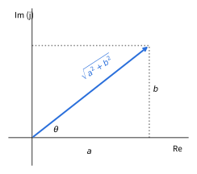
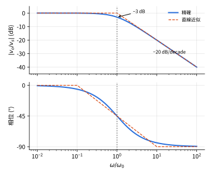
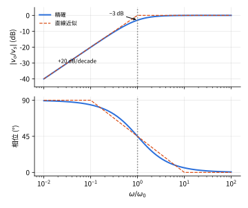

# 第 07 集 · Lec07：相量分析、RC 電路的轉換函數、波特圖 [▶ 影片](https://www.youtube.com/watch?v=VR_jrBdK5lw)

← 上一集：[06](06-capacitor-charge-discharge-equivalent-model.md) ｜ [總目錄](../README.md) ｜ 下一集：[08](08-impedance-dc-ac-circuits-amplifier-concept.md) →

> **課程**：電子學（一），陽明交大 電子物理系，112 學年度 — 第 07 集
> **講者**：陳振芳 老師
> **來源**：YouTube 錄影逐字稿（1:21:12，人工字幕）＋ Sedra & Smith《Microelectronic Circuits》7th ed. §1.4.5、§1.6.4
> **標記說明**：`【口頭】` 老師口頭補充；`【課本補充】` 課本有、課堂沒講；`⚠️ 逐字稿缺字` 字幕或口誤；`[▶ mm:ss]` 影片時間點

---

## 目錄

- [0. 這堂課要做什麼](#0-這堂課要做什麼)
- [1. 目標：全部寫成向量](#1-目標全部寫成向量)
- [2. 複數平面上的向量](#2-複數平面上的向量)
- [3. 向量相乘 = 角度相加（其實就是三角函數）](#3-向量相乘--角度相加其實就是三角函數)
- [4. 微分：跑出一個 jω](#4-微分跑出一個-jω)
- [5. 用相量解 RC 低通](#5-用相量解-rc-低通)
- [6. 分貝 dB](#6-分貝-db)
- [7. 低通的波特圖](#7-低通的波特圖)
- [8. 電容的轉換函數 1/jωC：以後不解微分方程](#8-電容的轉換函數-1jωc以後不解微分方程)
- [9. 例題：低通讓聲音通過，代三個頻率](#9-例題低通讓聲音通過代三個頻率)
- [10. RC 對調：高通的波特圖與例題](#10-rc-對調高通的波特圖與例題)
- [11. 一頁速查表](#11-一頁速查表)
- [12. 與後續集數的連結](#12-與後續集數的連結)

---

## 0. 這堂課要做什麼

前兩集都「忽略相位」。這集用**相量分析**（phasor analysis）把 RC 電路完整解出來，不做任何近似：

1. 把 sin、cos 組成一個複數平面上的向量。
2. 定義向量相乘 = 角度相加，證明它其實就是三角函數的和角公式。
3. 微分變成乘 $j\omega$ → 微分方程變成代數。
4. 得到轉換函數，用 dB 畫成**波特圖**（Bode plot）。

【口頭】「相量」這個中文翻譯只是為了和高中學的向量區分，其實就是向量（vector）。[▶ 00:09](https://youtu.be/VR_jrBdK5lw?t=9)

---

## 1. 目標：全部寫成向量

[▶ 00:40](https://youtu.be/VR_jrBdK5lw?t=40)

- 信號源：題目給 sin 還是 cos 都先不理，自己寫成一個向量 $\mathbf{V}_s$。
- 電路（通常裡面有電容，不然不用這麼麻煩）的輸出也是向量 $\mathbf{V}_o$。
- 兩者的比值叫電路的**轉換函數**（transfer function）：

$$
T(\omega) = \frac{\mathbf{V}_o}{\mathbf{V}_s},
\qquad
\mathbf{V}_o = T\,\mathbf{V}_s
$$

全部都是向量，向量乘向量還是向量。

【口頭】類比高中的**內積**：兩個向量夾角不好直接求，數學家定義「內積 = 大小乘 $\cos\theta$」來幫你求。這一套也是數學家專門為「輸入是正弦波的電路」設計的工具。[▶ 02:46](https://youtu.be/VR_jrBdK5lw?t=166)

---

## 2. 複數平面上的向量

[▶ 03:51](https://youtu.be/VR_jrBdK5lw?t=231)

兩個方向：**實部**（real part）和**虛部**（imaginary part）。虛部方向用 $j$ 標示。兩個方向「絕對扯不在一起」。

$$
a + jb = \sqrt{a^2 + b^2}\,(\cos\theta + j\sin\theta) = \sqrt{a^2 + b^2}\;e^{j\theta},
\qquad
\theta = \tan^{-1}\frac{b}{a}
$$

$e^{j\theta} \equiv \cos\theta + j\sin\theta$ 是單位向量（unit vector），只是一種寫法。$\theta$ ＝ tan⁻¹（虛部 / 實部）。[▶ 05:26](https://youtu.be/VR_jrBdK5lw?t=326)

**例子** [▶ 06:27](https://youtu.be/VR_jrBdK5lw?t=387)

| 向量 | 大小 | 角度 |
|---|---|---|
| $2$ | 2 | 0° |
| $j$ | 1 | 90° |
| $-1$ | 1 | 180° |
| $1 + j$ | $\sqrt 2$ | 45° |

---

## 3. 向量相乘 = 角度相加（其實就是三角函數）

[▶ 08:03](https://youtu.be/VR_jrBdK5lw?t=483)

這一整套的關鍵：**定義**

$$
e^{j\theta_1}\cdot e^{j\theta_2} \equiv e^{j(\theta_1 + \theta_2)}
$$

**$j \cdot j$ 是多少？** $j = e^{j90^\circ}$，所以 $j \cdot j = e^{j180^\circ} = -1$。[▶ 10:39](https://youtu.be/VR_jrBdK5lw?t=639)

**證明這個定義合理** [▶ 09:07](https://youtu.be/VR_jrBdK5lw?t=547)

左邊展開（用 $j^2 = -1$）：

$$
(\cos\theta_1 + j\sin\theta_1)(\cos\theta_2 + j\sin\theta_2)
= (\cos\theta_1\cos\theta_2 - \sin\theta_1\sin\theta_2)
+ j(\sin\theta_1\cos\theta_2 + \cos\theta_1\sin\theta_2)
$$

右邊：$\cos(\theta_1 + \theta_2) + j\sin(\theta_1 + \theta_2)$。

實部對實部、虛部對虛部，得到的正是

$$
\cos(\theta_1 + \theta_2) = \cos\theta_1\cos\theta_2 - \sin\theta_1\sin\theta_2,
\qquad
\sin(\theta_1 + \theta_2) = \sin\theta_1\cos\theta_2 + \cos\theta_1\sin\theta_2
$$

【口頭】這個定義**就是三角函數的和角公式**（trigonometry），只是寫成向量形式，很好記。沒有任何新東西。[▶ 12:41](https://youtu.be/VR_jrBdK5lw?t=761)

推論：向量**相除 = 角度相減**。[▶ 25:41](https://youtu.be/VR_jrBdK5lw?t=1541)

---

## 4. 微分：跑出一個 jω

[▶ 13:42](https://youtu.be/VR_jrBdK5lw?t=822)

電容的電流電壓是微分關係，所以要處理微分。把 $\theta$ 換成 $\omega t$（向量隨時間一直轉）：

$$
\frac{d}{dt}e^{j\omega t}
= \frac{d}{dt}(\cos\omega t + j\sin\omega t)
= \omega(-\sin\omega t + j\cos\omega t)
$$

把 $-1$ 寫成 $j \cdot j$，提出 $j\omega$：

$$
= j\omega(\cos\omega t + j\sin\omega t) = j\omega\,e^{j\omega t}
$$

【口頭】和平常的指數微分一樣：指數照寫，頭上微分跑出 $j\omega$。這裡唯一奇怪的只有 $j \cdot j = -1$，而那就是三角函數，所以絕對正確。[▶ 16:16](https://youtu.be/VR_jrBdK5lw?t=976)

---

## 5. 用相量解 RC 低通

### 5.1 問題

[▶ 16:47](https://youtu.be/VR_jrBdK5lw?t=1007)

$v_s = V_s\cos\omega t$ 經 $R$ 接 $C$，輸出是電容電壓。輸出一定是同頻率（「頻率不一樣沒答案」，因為對無窮多個 $t$ 都要成立），但有相位差：

$$
v_o = V_o\cos(\omega t + \theta)
$$

【口頭】直接代進微分方程用三角函數解，要記得和角公式，會變成一大堆 sin、cos，很難。[▶ 17:53](https://youtu.be/VR_jrBdK5lw?t=1073)

### 5.2 自己架構一個向量

[▶ 18:53](https://youtu.be/VR_jrBdK5lw?t=1133)

- 輸入是 cos 的答案求出來，sin 的答案只差 90°，不用再證明。
- 把 cos 放在實部、sin 乘 $j$ 放在虛部，加起來：

$$
\mathbf{v}_s = V_s(\cos\omega t + j\sin\omega t) = V_s\,e^{j\omega t}
$$

輸出同樣：

$$
\mathbf{v}_o = V_o\,e^{j(\omega t + \theta)} = \underbrace{V_o e^{j\theta}}_{\mathbf{V}_o}\,e^{j\omega t}
$$

把大小和相位併成一個新的向量 $\mathbf{V}_o$。【口頭】這純粹是數學，生活裡只有 cos 或 sin，沒有一個物理量長這樣。[▶ 19:58](https://youtu.be/VR_jrBdK5lw?t=1198)

### 5.3 代入微分方程

[▶ 21:33](https://youtu.be/VR_jrBdK5lw?t=1293)

$$
v_s = RC\,\frac{dv_o}{dt} + v_o
$$

代入向量：

$$
V_s e^{j\omega t} = RC\,(j\omega)\,\mathbf{V}_o e^{j\omega t} + \mathbf{V}_o e^{j\omega t}
$$

**$e^{j\omega t}$ 全部刪掉！**【口頭】用三角函數不管多厲害都刪不掉任何東西，只會把兩個角相加變成四項；改成向量就全刪掉了。「你要 appreciate 數學家做的事情。」[▶ 23:35](https://youtu.be/VR_jrBdK5lw?t=1415)

$$
\mathbf{V}_o(1 + j\omega RC) = V_s
\quad\Longrightarrow\quad
T(\omega) = \frac{\mathbf{V}_o}{V_s} = \frac{1}{1 + j\omega/\omega_0},
\qquad \omega_0 = \frac{1}{RC}
$$

### 5.4 大小與角度

[▶ 26:11](https://youtu.be/VR_jrBdK5lw?t=1571)

分子 1 是角度 0° 的向量；分母大小 $\sqrt{1 + (\omega/\omega_0)^2}$、角度 $\tan^{-1}(\omega/\omega_0)$。相除 → 角度相減：

$$
T(\omega) = \frac{1}{\sqrt{1 + (\omega/\omega_0)^2}}\;e^{-j\tan^{-1}(\omega/\omega_0)}
$$

- 大小比值和兩個頻率有關（輸入頻率 $\omega$、轉折頻率 $\omega_0$）。
- 輸出**落後**輸入 $\tan^{-1}(\omega/\omega_0)$。相位差自然就跑出來了。[▶ 27:20](https://youtu.be/VR_jrBdK5lw?t=1640)

---

## 6. 分貝 dB

[▶ 28:52](https://youtu.be/VR_jrBdK5lw?t=1732)

有根號的式子不好畫，要一點一點描。數學家想辦法讓它變成直線：定義**分貝**（decibel, dB）

$$
|A|_\text{dB} = 20\log_{10}|A|
$$

特色：相乘變相加、相除變相減。[▶ 29:54](https://youtu.be/VR_jrBdK5lw?t=1794)

$$
20\log(ab) = 20\log a + 20\log b,
\qquad
20\log\frac{a}{b} = 20\log a - 20\log b
$$

好幾項相乘相除，每一項個別寫成 dB，再加加減減就好。

| 倍數 | dB | 倍數 | dB |
|---|---|---|---|
| 1 | 0 | | |
| 10 | 20 | 1/10 | −20 |
| 100 | 40 | 1/100 | −40 |
| 1000 | 60 | 1/1000 | −60 |

[▶ 31:26](https://youtu.be/VR_jrBdK5lw?t=1886)

> 【課本補充】§1.4.5 (p. 18)：電壓增益 $20\log|A_v|$ dB；功率增益用 $10\log A_p$ dB（因為功率和電壓平方成正比）。

---

## 7. 低通的波特圖

### 7.1 大小

[▶ 34:05](https://youtu.be/VR_jrBdK5lw?t=2045)

$$
\left|T\right|_\text{dB}
= \underbrace{20\log 1}_{0}
- \underbrace{10\log\left[1 + (\omega/\omega_0)^2\right]}_{\text{分母}}
$$

（根號的 1/2 提出來，20 變 10。）

分母個別畫：[▶ 35:43](https://youtu.be/VR_jrBdK5lw?t=2143)

- $\omega \ll \omega_0$：$10\log 1 = 0$。
- $\omega \gg \omega_0$：$10\log(\omega/\omega_0)^2 = 20\log(\omega/\omega_0)$，每多 10 倍多 20 dB → 斜率 **20 dB/decade**（decade = 頻率變 10 倍）。

分子（0 dB）減分母：

- $\omega < \omega_0$：0 dB，平的。
- $\omega > \omega_0$：**−20 dB/decade** 往下掉。$10\,\omega_0$ 處 −20 dB（1/10），$100\,\omega_0$ 處 −40 dB（1/100）。[▶ 40:21](https://youtu.be/VR_jrBdK5lw?t=2421)
- 轉折點修正：$\omega = \omega_0$ 時大小是 $1/\sqrt 2$，$20\log(1/\sqrt 2) \approx -3$ dB。[▶ 41:22](https://youtu.be/VR_jrBdK5lw?t=2482)

所以 $\omega_0$ 也叫 **3 dB 頻率**（3 dB frequency）。

### 7.2 角度

[▶ 42:56](https://youtu.be/VR_jrBdK5lw?t=2576)

$\angle T = -\tan^{-1}(\omega/\omega_0)$：

- $\omega = 0.1\,\omega_0$：約 0°（其實約 −5.7°）。
- $\omega = \omega_0$：−45°。
- $\omega = 10\,\omega_0$：約 −90°（差 5° 左右不理它）。

畫成直線：$0.1\,\omega_0$ 以前 0°，$10\,\omega_0$ 以後 −90°，中間一條斜線。頻率很高時輸出落後輸入 90°。[▶ 44:28](https://youtu.be/VR_jrBdK5lw?t=2668)

大小圖加角度圖合稱**波特圖**（Bode plot），Bode 是人名。[▶ 45:00](https://youtu.be/VR_jrBdK5lw?t=2700)

---

## 8. 電容的轉換函數 1/jωC：以後不解微分方程

[▶ 45:33](https://youtu.be/VR_jrBdK5lw?t=2733)

整套做法回顧：信號寫成 $e^{j\omega t}$ → 已經是數學，和物理問題無關。電路裡唯一讓微分方程變難的就是**電容的微分**，所以把電容單獨拿出來：[▶ 47:05](https://youtu.be/VR_jrBdK5lw?t=2825)

$$
i = C\frac{dv}{dt}
\;\Longrightarrow\;
\mathbf{I}e^{j\omega t} = C\,(j\omega)\,\mathbf{V}e^{j\omega t}
$$

又全刪掉了（「這是這一套最美的地方」）。電壓除以電流：

$$
\frac{\mathbf{V}}{\mathbf{I}} = \frac{1}{j\omega C}
$$

[▶ 49:39](https://youtu.be/VR_jrBdK5lw?t=2979)

- 大小 $1/\omega C$（就是前兩集的等效電阻）。
- 角度：分子 0°，分母 $j$ 是 90°，相除 → **−90°**。電容的**電壓永遠落後電流 90°**。[▶ 50:09](https://youtu.be/VR_jrBdK5lw?t=3009)

所以：**把電容當成一個「電阻」$1/j\omega C$**，微分方程就變成線性代數，直接分壓：[▶ 51:12](https://youtu.be/VR_jrBdK5lw?t=3072)

$$
\frac{\mathbf{V}_o}{\mathbf{V}_s} = \frac{1/j\omega C}{R + 1/j\omega C} = \frac{1}{1 + j\omega/\omega_0}
$$

和第 5 節一樣，但快很多。【口頭】以後連 $e^{j\omega t}$ 都不寫，反正會消掉；但心裡要記得這些都是向量，裡面有角度的資訊。[▶ 53:59](https://youtu.be/VR_jrBdK5lw?t=3239)

---

## 9. 例題：低通讓聲音通過，代三個頻率

### 9.1 直接代公式

[▶ 54:29](https://youtu.be/VR_jrBdK5lw?t=3269)

$v_s = 1\sin\omega t$（V）進 RC 低通：

$$
v_o = \frac{1}{\sqrt{1 + (\omega/\omega_0)^2}}\,\sin\!\left(\omega t - \tan^{-1}\frac{\omega}{\omega_0}\right)
$$

頻率一定一樣，相位落後。題目寫 cos 就寫 cos；寫 $\sin(\omega t + 30^\circ)$ 就寫 $\sin(\omega t + 30^\circ - \tan^{-1}\cdots)$。【口頭】「管你題目給我什麼，反正相位差就差這麼多、大小比值就差這麼多。」[▶ 56:40](https://youtu.be/VR_jrBdK5lw?t=3400)

### 9.2 設計

[▶ 58:18](https://youtu.be/VR_jrBdK5lw?t=3498)

聲音 $10^2$–$10^5$ rad/s 要通過，而且最好不要碰到轉折（不然在 $\omega_0$ 會小 $1/\sqrt2$）→ 差一個數量級：

$$
10^5 \le 0.1\,\omega_0 \;\Rightarrow\; \omega_0 = \frac{1}{RC} \ge 10^6
$$

$R = 10\ \text{k}\Omega$ → $C \le 10^{-10}$ F。取 $C = 10^{-10}$ F，$\omega_0 = 10^6$。[▶ 1:01:26](https://youtu.be/VR_jrBdK5lw?t=3686)

### 9.3 代三個頻率

[▶ 1:02:27](https://youtu.be/VR_jrBdK5lw?t=3747)

| 輸入 | 位置 | 輸出 |
|---|---|---|
| $1\sin(10^6 t)$ | $\omega = \omega_0$ | $\dfrac{1}{\sqrt2}\sin(10^6 t - 45^\circ)$ |
| $1\sin(10^7 t)$ | $10\,\omega_0$ | $0.1\sin(10^7 t - 90^\circ)$（約） |
| $1\sin(10^5 t)$ | $0.1\,\omega_0$ | $1\sin(10^5 t)$（約，0°） |

【口頭】所有題目都是這樣，其實就是看圖。[▶ 1:05:00](https://youtu.be/VR_jrBdK5lw?t=3900)

---

## 10. RC 對調：高通的波特圖與例題

### 10.1 轉換函數

[▶ 1:05:30](https://youtu.be/VR_jrBdK5lw?t=3930)

$C$ 串在前、$R$ 到地，輸出在 $R$。直接分壓：

$$
\frac{\mathbf{V}_o}{\mathbf{V}_s} = \frac{R}{R + 1/j\omega C}
= \frac{j\omega RC}{1 + j\omega RC}
= \frac{j\omega/\omega_0}{1 + j\omega/\omega_0}
$$

$$
= \frac{\omega/\omega_0}{\sqrt{1 + (\omega/\omega_0)^2}}\;
e^{j\left[90^\circ - \tan^{-1}(\omega/\omega_0)\right]}
$$

[▶ 1:07:05](https://youtu.be/VR_jrBdK5lw?t=4025)

### 10.2 波特圖

[▶ 1:08:08](https://youtu.be/VR_jrBdK5lw?t=4088)

用 dB「相除變相減」：

- 分子 $20\log(\omega/\omega_0)$：一條 +20 dB/decade 的直線，在 $\omega_0$ 過 0 dB。
- 分母：$\omega_0$ 以前 0，之後 +20 dB/decade。
- 相減：$\omega_0$ 以前 +20 dB/decade 上升，之後**平在 0 dB**。$\omega_0$ 處 −3 dB。[▶ 1:10:10](https://youtu.be/VR_jrBdK5lw?t=4210)

角度 $90^\circ - \tan^{-1}(\omega/\omega_0)$：低頻 90°、$\omega_0$ 處 +45°、高頻 0°。輸出反而**超前**。[▶ 1:11:46](https://youtu.be/VR_jrBdK5lw?t=4306)

### 10.3 例題

[▶ 1:12:48](https://youtu.be/VR_jrBdK5lw?t=4368)

聲音要通過 → 最低頻 $10^2$ 要在 $10\,\omega_0$ 右邊：$10\,\omega_0 \le 10^2$，$\omega_0 \le 10$。$R = 10\ \text{k}\Omega$ → $C \ge 10^{-5}$ F。取 $C = 10^{-5}$ F，$\omega_0 = 10$。[▶ 1:14:25](https://youtu.be/VR_jrBdK5lw?t=4465)

| 輸入 | 位置 | 輸出 |
|---|---|---|
| $1\sin(10t)$ | $\omega = \omega_0$ | $\dfrac{1}{\sqrt2}\sin(10t + 45^\circ)$ |
| $1\sin(1t)$ | $0.1\,\omega_0$ | $0.1\sin(t + 90^\circ)$（約） |
| $1\sin(100t)$ | $10\,\omega_0$ | $1\sin(100t)$（約，0°） |

> ⚠️ 逐字稿缺字 [▶ 1:16:28](https://youtu.be/VR_jrBdK5lw?t=4588)：字幕寫「掉一個 order 掉四分之一」，$\omega = 1$ 比 $\omega_0 = 10$ 小一個數量級，應是掉到**十分之一**。

**意義** [▶ 1:17:33](https://youtu.be/VR_jrBdK5lw?t=4653)

- $\omega_0$ 夠小 = $RC$ 很長 → 交流來不及對電容充電 → 電容上沒有交流電壓 → 交流全部通過，C allows voice to pass。
- 如果還有直流：直流只有一個方向，一直充到飽（幾個 $\tau$），所以 **C 永遠擋直流**。
- 這是**高通濾波器**：對聲音來說它是「高頻」（因為 $\omega_0$ 取得很小），所以聲音通過、直流被擋。[▶ 1:19:36](https://youtu.be/VR_jrBdK5lw?t=4776)

---

## 11. 一頁速查表

| 項目 | 公式 | 關鍵一步 |
|---|---|---|
| 複數向量 | $a + jb = \sqrt{a^2+b^2}\,e^{j\tan^{-1}(b/a)}$ | $e^{j\theta} = \cos\theta + j\sin\theta$ |
| 相乘／相除 | 大小相乘除、角度相加減 | 就是和角公式 |
| $j^2$ | $-1$ | $e^{j90^\circ}e^{j90^\circ} = e^{j180^\circ}$ |
| 微分 | $\dfrac{d}{dt}e^{j\omega t} = j\omega e^{j\omega t}$ | 展開後把 $-1$ 寫成 $j^2$ |
| 電容 | $\mathbf{V}/\mathbf{I} = 1/j\omega C$ | 大小 $1/\omega C$，電壓落後 90° |
| 低通 | $T = \dfrac{1}{1 + j\omega/\omega_0}$ | 分壓 $\dfrac{1/j\omega C}{R + 1/j\omega C}$ |
| 低通大小 | $1/\sqrt{1+(\omega/\omega_0)^2}$ | |
| 低通相位 | $-\tan^{-1}(\omega/\omega_0)$ | 0° → −45° → −90° |
| 高通 | $T = \dfrac{j\omega/\omega_0}{1 + j\omega/\omega_0}$ | 分壓 $\dfrac{R}{R + 1/j\omega C}$ |
| 高通相位 | $90^\circ - \tan^{-1}(\omega/\omega_0)$ | 90° → 45° → 0° |
| dB | $20\log\lvert A\rvert $ | 相乘變相加 |
| 斜率 | ±20 dB/decade | $20\log(\omega/\omega_0)$ |
| 轉折點 | −3 dB（$1/\sqrt2$） | $\omega_0$ = 3 dB 頻率 |

---

## 12. 與後續集數的連結

| 本集觀念 | 後面在哪裡用到 |
|---|---|
| 電容阻抗 $1/j\omega C$ | 下一集 1.8 阻抗、直流與交流電路；第 2 章積分器、微分器 |
| 波特圖、−20 dB/decade | 第 2 章積分器波特圖（2.4）、運算放大器頻寬（2.10）；第 9 章頻率響應 |
| 3 dB 頻率 | 放大器頻寬的定義 |
| 高通讓聲音過、擋直流 | 1.9 MOS 放大器的耦合電容 |

---

## 附：本集一句話總結

> **把 sin、cos 組成 $e^{j\omega t}$，微分就變成乘 $j\omega$、$e^{j\omega t}$ 全部消掉，電容變成阻抗 $1/j\omega C$；RC 低通 $1/(1+j\omega/\omega_0)$、高通 $\dfrac{j\omega/\omega_0}{1+j\omega/\omega_0}$，用 dB 畫成直線：平的、±20 dB/decade、轉折點 −3 dB。**

---

*筆記依據陳振芳老師「電子學（一）」112 學年度 Lec07 錄影逐字稿（人工字幕，1:21:12）與 Sedra & Smith《Microelectronic Circuits》7th ed. 整理。*
