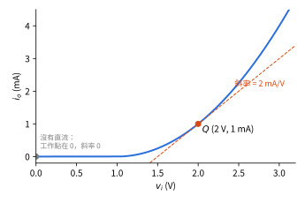
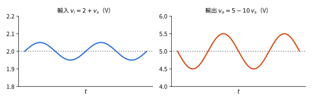

# 第 08 集 · Lec08：電容阻抗 1/jωC、雷射筆旁路電容、放大器的基本概念 [▶ 影片](https://www.youtube.com/watch?v=xPoQ0B7i1Fo)

← 上一集：[07](07-phasor-analysis-rc-bode-plot.md) ｜ [總目錄](../README.md) ｜ 下一集：[09](09-simple-mos-amplifier-dc-operating-point.md) →

> **課程**：電子學（一），陽明交大 電子物理系，112 學年度 — 第 08 集
> **講者**：陳振芳 老師
> **來源**：YouTube 錄影逐字稿（1:22:02，人工字幕）＋ Sedra & Smith《Microelectronic Circuits》7th ed. §7.1
> **標記說明**：`【口頭】` 老師口頭補充；`【課本補充】` 課本有、課堂沒講；`[▶ mm:ss]` 影片時間點

---

## 目錄

- [0. 這堂課要做什麼](#0-這堂課要做什麼)
- [1. 電容在相量世界：1/jωC](#1-電容在相量世界1jωc)
- [2. 雷射筆：直流部分](#2-雷射筆直流部分)
- [3. 雷射筆：交流雜訊用相量分流](#3-雷射筆交流雜訊用相量分流)
- [4. 放大器的核心：電壓轉電流](#4-放大器的核心電壓轉電流)
- [5. 加直流：直流工作點 Q](#5-加直流直流工作點-q)
- [6. 加交流：小信號近似](#6-加交流小信號近似)
- [7. 輸出電壓：放大 −10 倍](#7-輸出電壓放大-10-倍)
- [8. 沒加直流會怎樣](#8-沒加直流會怎樣)
- [9. 直流從哪來：分壓 + 耦合電容](#9-直流從哪來分壓--耦合電容)
- [10. 一頁速查表](#10-一頁速查表)
- [11. 與後續集數的連結](#11-與後續集數的連結)

---

## 0. 這堂課要做什麼

1. 把電容的相量關係 $\mathbf{V}/\mathbf{I} = 1/j\omega C$ 再推一次，用它把上一集的雷射筆例題完整解一遍。
2. 第一章最後一個概念：**放大器**。用一個簡化的 MOS 模型說明：
   - 半導體元件把輸入電壓轉成輸出電流；
   - 一定要先給**直流工作點**；
   - 交流要夠小（**小信號近似**）；
   - 直流偏壓怎麼用分壓電阻 + 電容做出來。

---

## 1. 電容在相量世界：1/jωC

[▶ 00:10](https://youtu.be/xPoQ0B7i1Fo?t=10)

$v = V\cos\omega t$ → $i = I\cos(\omega t + \theta)$；再加一組 sin 版本（只差 90°，一定也成立）乘 $j$ 加起來：

$$
\mathbf{v} = V e^{j\omega t},
\qquad
\mathbf{i} = I e^{j(\omega t + \theta)} = (Ie^{j\theta})\,e^{j\omega t} \equiv \mathbf{I}e^{j\omega t}
$$

代入 $i = C\,dv/dt$，微分跑出 $j\omega$，$e^{j\omega t}$ 兩邊消掉：[▶ 03:16](https://youtu.be/xPoQ0B7i1Fo?t=196)

$$
\mathbf{I} = j\omega C\,\mathbf{V}
\quad\Longrightarrow\quad
\frac{\mathbf{V}}{\mathbf{I}} = \frac{1}{j\omega C}
$$

微分方程變成**線性**（linear）關係。以後電容一律寫成 $1/j\omega C$。[▶ 03:47](https://youtu.be/xPoQ0B7i1Fo?t=227)

---

## 2. 雷射筆：直流部分

[▶ 04:18](https://youtu.be/xPoQ0B7i1Fo?t=258)

（第 06 集的例題，這次完整分析。）

- 雷射光強度跟**電流**成正比 → 信號源用**電流源**。【口頭】「不要自找麻煩，用電壓源還要經過一大堆電阻轉換，搞老半天。」[▶ 05:19](https://youtu.be/xPoQ0B7i1Fo?t=319)
- 20 mA 時雷射上 2 V → $R_L = 2/20 = 0.1\ \text{k}\Omega = 100\ \Omega$。[▶ 06:51](https://youtu.be/xPoQ0B7i1Fo?t=411)
- 直流電流源從 60 Hz 市電轉換來，一定帶 60 Hz 的**漣波雜訊**（ripple noise）→ 並一顆電容讓雜訊走旁邊。

**直流怎麼走？** [▶ 09:26](https://youtu.be/xPoQ0B7i1Fo?t=566)

1. $t = 0$：電容沒電荷 → 電壓 0 → 雷射上也是 0 V、沒電流。20 mA 全部流進電容充電。
2. 電容電壓上升 → 雷射開始有電流 → 充電電流減少。
3. 最後（幾個 $RC$）：電容電壓 = 2 V，電容沒有電流（穩態），20 mA 全部走雷射。[▶ 11:27](https://youtu.be/xPoQ0B7i1Fo?t=687)

直流沒問題，雷射理論上發出穩定的光。

---

## 3. 雷射筆：交流雜訊用相量分流

[▶ 12:28](https://youtu.be/xPoQ0B7i1Fo?t=748)

只看交流：雜訊 $\mathbf{I}_n e^{j\omega t}$，電容寫成 $1/j\omega C$，$e^{j\omega t}$ 不寫（反正會消掉）。

**分流**（電流跟另一個電阻成正比）：[▶ 14:01](https://youtu.be/xPoQ0B7i1Fo?t=841)

$$
\mathbf{I}_C = \mathbf{I}_n\,\frac{R_L}{R_L + 1/j\omega C}
= \mathbf{I}_n\,\frac{j\omega R_L C}{1 + j\omega R_L C}
= \mathbf{I}_n\,\frac{j\omega/\omega_0}{1 + j\omega/\omega_0},
\qquad \omega_0 = \frac{1}{R_L C}
$$

大小：[▶ 16:04](https://youtu.be/xPoQ0B7i1Fo?t=964)

$$
\left|\frac{\mathbf{I}_C}{\mathbf{I}_n}\right| = \frac{\omega/\omega_0}{\sqrt{1 + (\omega/\omega_0)^2}}
$$

**dB 圖**（相除變相減）：分子 +20 dB/decade 的直線；分母在 $\omega_0$ 前 0、之後 +20 dB/decade；相減後 $\omega_0$ 以前上升、以後**平在 0 dB（= 1）**。形狀和上一集的高通一樣。[▶ 19:46](https://youtu.be/xPoQ0B7i1Fo?t=1186)

**設計**：60 Hz → $\omega = 2\pi \times 60 \approx 400$。要讓雜訊幾乎全部走電容（比值 = 1），而且避開轉折點（那裡會掉 3 dB），所以差一個數量級：[▶ 22:18](https://youtu.be/xPoQ0B7i1Fo?t=1338)

$$
\omega \ge 10\,\omega_0 = \frac{10}{R_L C}
\quad\Longrightarrow\quad
400 \ge \frac{10}{100\,C}
\quad\Longrightarrow\quad
C \ge \frac{1}{4000}\ \text{F} = 250\ \mu\text{F}
$$

[▶ 23:19](https://youtu.be/xPoQ0B7i1Fo?t=1399) 剛好差一個數量級時，大約九成以上的雜訊走電容，剩一成跑到雷射，不用管。角度那時接近 0°，也不用畫。

【口頭】再強調一次：看物理特性決定用電流源還是電壓源。雷射光跟電流成正比，就用電流看；「從電壓直接看馬上知道答案就用電壓，不要自找麻煩」。[▶ 24:20](https://youtu.be/xPoQ0B7i1Fo?t=1460)

---

## 4. 放大器的核心：電壓轉電流

[▶ 25:21](https://youtu.be/xPoQ0B7i1Fo?t=1521)

第一章只剩**放大器**（amplifier）還沒提。這裡先給概念，後面會很詳細。

**最基本的放大元件**：不管是 MOS、BJT 還是運算放大器（op），都是把**輸入電壓轉成輸出電流**。[▶ 26:25](https://youtu.be/xPoQ0B7i1Fo?t=1585)

用 MOS（金屬氧化半導體場效電晶體）當例子，但先不講裡面：

- 它有三隻腳。一隻當 input、一隻當 output、第三隻輸入輸出共用，接地（信號要有去有回，地都是相連的）。[▶ 27:57](https://youtu.be/xPoQ0B7i1Fo?t=1677)
- **輸入端**：MOS 的 O 是**氧化層**，絕緣，電流進不去 → 輸入電阻**無窮大** → 開路。[▶ 29:28](https://youtu.be/xPoQ0B7i1Fo?t=1768)
- **輸出端**：一個被輸入電壓控制的**電流源** $i_o$。【口頭】物理上：材料裡有一座電位的山，外加電壓調變山的高度，另一頭的電流就被調變。[▶ 30:30](https://youtu.be/xPoQ0B7i1Fo?t=1830)

**特性方程**（最基本的形式）：[▶ 31:01](https://youtu.be/xPoQ0B7i1Fo?t=1861)

$$
i_o = \frac{k}{2}\,(v_i - 1)^2 \quad (v_i > 1),
\qquad
i_o = 0 \quad (v_i < 1)
$$

- $k$ 是這顆 MOS 的特性，和它的大小有關；1 V 是**臨界值**（threshold），要比它大才導通。
- 為了好算取 $k = 2\ \text{mA/V}^2$（【口頭】真的去買 MOS，$k$ 都是幾百以上）→ $i_o = (v_i - 1)^2$ mA。[▶ 32:04](https://youtu.be/xPoQ0B7i1Fo?t=1924)

> 【課本補充】課本 §5.2 會推出真正的 MOSFET 飽和區電流 $i_D = \frac{1}{2}k_n'\frac{W}{L}(v_{GS} - V_t)^2$；老師這裡的 $k$、「1 V」就對應 $k_n'(W/L)$ 和臨界電壓 $V_t$。

---

## 5. 加直流：直流工作點 Q

[▶ 33:36](https://youtu.be/xPoQ0B7i1Fo?t=2016)

- 輸入加 2 V 直流（電池）→ $i_o = (2 - 1)^2 = 1\ \text{mA}$。
- 輸出端接負載 $R_L = 5\ \text{k}\Omega$ 到 **10 V 電源**。【口頭】一定要加這個 10 V，「沒給它飯吃，它就不會動」。[▶ 34:38](https://youtu.be/xPoQ0B7i1Fo?t=2078)
- 輸出電壓 $v_o = 10 - 1 \times 5 = 5\ \text{V}$，示波器上是一條 5 V 的直線。

這個點 (2 V, 1 mA) 叫**直流工作點**（DC operating point），記作 $Q$。[▶ 42:21](https://youtu.be/xPoQ0B7i1Fo?t=2541)

---

## 6. 加交流：小信號近似

[▶ 36:11](https://youtu.be/xPoQ0B7i1Fo?t=2171)

麥克風的聲音信號 $v_s$（很小，所以才要放大）加進來，$v_i = 2 + v_s$：[▶ 37:14](https://youtu.be/xPoQ0B7i1Fo?t=2234)

$$
i_o = (2 + v_s - 1)^2 = (1 + v_s)^2 = 1 + 2v_s + v_s^2
$$

**問題**：$v_s^2$ 項。如果 $v_s$ 頻率是 $\omega$，平方會跑出 $2\omega$，那不是我要的（失真）。[▶ 38:15](https://youtu.be/xPoQ0B7i1Fo?t=2295)

**假設** $v_s^2 \ll 2v_s$，遠小於取差一個數量級：$v_s \le 0.2$ V。這叫**小信號近似**（small signal approximation），一定要成立。[▶ 38:46](https://youtu.be/xPoQ0B7i1Fo?t=2326)

$$
i_o \approx \underbrace{1\ \text{mA}}_{\text{直流}} + \underbrace{2\,v_s}_{\text{交流}}
$$

- 輸入有直流 → 輸出有直流；輸入有交流 → 輸出有交流，**純粹線性相加**，二次方沒了。[▶ 41:18](https://youtu.be/xPoQ0B7i1Fo?t=2478)
- 那個 2 有單位：**2 mA/V**，因為它把電壓轉成電流。[▶ 40:16](https://youtu.be/xPoQ0B7i1Fo?t=2416)

**2 就是 Q 點的斜率**：[▶ 44:29](https://youtu.be/xPoQ0B7i1Fo?t=2669)

$$
\left.\frac{di_o}{dv_i}\right|_{Q} = 2(v_i - 1)\Big|_{v_i = 2} = 2\ \text{mA/V}
$$

圖上看：輸入的小 sin 對著 Q 點一點一點描，輸出電流也是 sin，大小 = 輸入大小 × 斜率。只要信號夠小，曲線在 Q 附近就像一條直線。[▶ 50:42](https://youtu.be/xPoQ0B7i1Fo?t=3042)

> 【課本補充】課本 §7.1.5 (p. 374) 把這個斜率叫**轉導**（transconductance）$g_m$，小信號條件寫成 $v_{gs} \ll 2V_{OV}$（$V_{OV}$ 是超過臨界電壓的量，這裡 = 1 V）。老師取 $v_s \le 0.2$ V 正是 $0.1 \times 2V_{OV}$。

---

## 7. 輸出電壓：放大 −10 倍

[▶ 52:15](https://youtu.be/xPoQ0B7i1Fo?t=3135)

$$
v_o = 10 - (1 + 2v_s)\times 5 = 5 - 10\,v_s
$$

- 單位檢查：$2\ \text{mA/V} \times 5\ \text{k}\Omega$，kΩ = V/mA，全部消掉 → 10 **沒有單位**，就是放大倍數。[▶ 53:18](https://youtu.be/xPoQ0B7i1Fo?t=3198)
- **負號**：$v_s$ 正半週 → 電流變大 → 電阻壓降變大 → 輸出下降。負號 = $-1 = e^{j180^\circ}$，輸出和輸入**差 180°**。[▶ 54:54](https://youtu.be/xPoQ0B7i1Fo?t=3294)

$$
A_v = \frac{-10\,v_s}{v_s} = -10
$$

【口頭】整個元件只做一件事：把電壓轉成電流；電流再乘上自己放的電阻變回電壓，就放大了。輸入有直流輸出就有直流，輸入有交流輸出就有交流。[▶ 56:27](https://youtu.be/xPoQ0B7i1Fo?t=3387)

> 【課本補充】課本 §7.1.5 的結果 $A_v = -g_m R_D$；本例 $g_m = 2$ mA/V、$R_D = 5$ kΩ → −10。

---

## 8. 沒加直流會怎樣

[▶ 57:31](https://youtu.be/xPoQ0B7i1Fo?t=3451)

忘了加 2 V，只加交流 $v_s$：

- 直流工作點落在 $v_i = 0$，那裡 $i_o = 0$（低於臨界值 1 V）。
- 輸出直流 = $10 - 0 = 10$ V。[▶ 59:04](https://youtu.be/xPoQ0B7i1Fo?t=3544)
- 交流 sin 在 0 附近擺動，**全部低於 1 V，電流永遠是 0**。那裡斜率是 0 → 放大倍數 0 → 示波器上看不到任何 sin。[▶ 1:00:37](https://youtu.be/xPoQ0B7i1Fo?t=3637)

**結論**：放大一定要**先做直流**，把工作點放在有斜率的地方，再加交流。交流還要夠小才能線性放大。[▶ 1:02:10](https://youtu.be/xPoQ0B7i1Fo?t=3730)

---

## 9. 直流從哪來：分壓 + 耦合電容

### 9.1 用分壓得到 2 V

[▶ 1:03:41](https://youtu.be/xPoQ0B7i1Fo?t=3821)

做電子實驗可以放一顆 2 V 電池，但要賣的產品不行：多一個 2 V 電源成本很高。已經有 10 V 電源（一定要有），就從 10 V **分壓**：80 kΩ 和 20 kΩ，8 比 2 → 2 V。MOS 輸入沒有電流（氧化層），所以分壓公式直接成立。[▶ 1:05:16](https://youtu.be/xPoQ0B7i1Fo?t=3916)

### 9.2 直接接麥克風：2 V 不見了

[▶ 1:06:18](https://youtu.be/xPoQ0B7i1Fo?t=3978)

把 $v_s$ 直接接到分壓點 → 那一點電壓被強迫等於 $v_s$，**2 V 沒了**，直流變 0 伏。10 V 全部跨在 80 kΩ 上，「做白工」。[▶ 1:06:50](https://youtu.be/xPoQ0B7i1Fo?t=4010)

### 9.3 加一顆電容

[▶ 1:07:50](https://youtu.be/xPoQ0B7i1Fo?t=4070)

【口頭】「前面一有問題就加什麼？電容。」

**先看直流**（分析電路要直流、交流分開，直流 OK 了再看交流）：[▶ 1:08:20](https://youtu.be/xPoQ0B7i1Fo?t=4100)

1. $t = 0$：電容沒電荷，分壓點 0 V。10 V 經 80 kΩ 的電流全部流去對電容充電。
2. 分壓點電壓上升 → 20 kΩ 開始有電流 → 充電電流變小。
3. 幾個 $RC$ 後電容不再充電 → 拉斷它 → 分壓點回到 **2 V**。[▶ 1:11:23](https://youtu.be/xPoQ0B7i1Fo?t=4283)

【口頭】電容很便宜，放進去它自己就充到 2 V 穩在那裡，不用另外做一個 2 V 電源。

**麥克風自己有直流也沒關係** [▶ 1:14:01](https://youtu.be/xPoQ0B7i1Fo?t=4441)：例如麥克風有 3 V 直流。不管誰充誰，穩態時電容沒有電流、可以拉斷 → 分壓點還是 2 V，電容兩端跨 $3 - 2 = 1$ V。「我根本不管你直流有多少，電容解決所有問題。」[▶ 1:16:09](https://youtu.be/xPoQ0B7i1Fo?t=4569)

反過來，如果用電池去「補」直流，你根本不知道麥克風本身有幾伏直流（3 V 的話難道要加 −1 V？），控制不了。[▶ 1:20:46](https://youtu.be/xPoQ0B7i1Fo?t=4846)

**再看交流** [▶ 1:17:40](https://youtu.be/xPoQ0B7i1Fo?t=4660)：

- 交流 $v_s$ 也可能跨在電容上（正負半週充放電）。如果電容來得及充放電，$v_s$ 全跨在電容上，分壓點只剩直流 2 V，「完蛋」。
- 所以 **$C$ 要夠大**：$RC$ 時間常數大到交流一個週期來不及充放電。這裡的 $R$ 是從電容看出去的兩個電阻**並聯**（80 kΩ ∥ 20 kΩ）。[▶ 1:18:43](https://youtu.be/xPoQ0B7i1Fo?t=4723)
- 這樣電容上只有直流（1 V），沒有交流 → 分壓點 = **2 V + $v_s$**，就是第 6 節要的輸入。[▶ 1:19:13](https://youtu.be/xPoQ0B7i1Fo?t=4753)

【口頭】前面花很長時間講電容，就是為了這個：一顆電容讓你得到要的直流，同時讓交流送進來。[▶ 1:20:16](https://youtu.be/xPoQ0B7i1Fo?t=4816)

> 【課本補充】課本把這顆電容叫**耦合電容**（coupling capacitor），分壓電阻叫偏壓網路（bias network）；§7.1.4 (p. 371) 講為什麼要把電晶體偏壓在 Q 點才能線性放大。

---

## 10. 一頁速查表

| 項目 | 公式 | 關鍵一步 |
|---|---|---|
| 電容阻抗 | $\mathbf{V}/\mathbf{I} = 1/j\omega C$ | $i = C\,dv/dt$ 代入 $e^{j\omega t}$ |
| 相量分流 | $\mathbf{I}_C = \mathbf{I}_n\dfrac{R_L}{R_L + 1/j\omega C}$ | 分子是另一支 |
| 旁路條件 | $\omega \ge 10/(R_L C)$ | 例：60 Hz、100 Ω → $C \ge 250\ \mu$F |
| MOS 簡化模型 | 輸入開路；$i_o = \frac{k}{2}(v_i - V_t)^2$ | 氧化層絕緣 |
| Q 點 | $v_i = 2$ V → $i_o = 1$ mA，$v_o = 5$ V | |
| 小信號近似 | $v_s^2 \ll 2v_s$ → $v_s \le 0.2$ V | 去掉二次項（失真） |
| 轉導（斜率） | $di_o/dv_i\|_Q = 2$ mA/V | 對特性方程微分 |
| 電壓增益 | $A_v = -(\text{斜率})\times R_L = -10$ | $v_o = 10 - i_o R_L$ |
| 負號 | 反相 180° | $-1 = e^{j180^\circ}$ |
| 沒直流 | 工作點斜率 0 → 增益 0 | 先做直流 |
| 偏壓 | 分壓 + 耦合電容 | 穩態電容開路 |
| 耦合電容條件 | $C$ 夠大，$(R_1\parallel R_2)C$ 遠長於信號週期 | 交流不跨在電容上 |

---

## 11. 與後續集數的連結

| 本集觀念 | 後面在哪裡用到 |
|---|---|
| MOS 簡化模型、Q 點、小信號 | 下一集 1.9 簡易 MOS 放大器完整做一遍；第 4 章 MOSFET |
| 轉導 = 斜率 | 第 4 章 $g_m$；第 5 章 BJT |
| 偏壓 + 耦合電容 | 第 4、5 章所有分立放大器 |
| 電壓轉電流 | 第 2 章 2.8–2.9 四種轉換器 |
| 雷射／二極體 | 第 2 章 2.7 光發射元件；第 3 章 P-N 介面 |

---

## 附：本集一句話總結

> **放大器的核心是把電壓轉成電流的元件：先用分壓電阻 + 耦合電容把它偏壓在有斜率的直流工作點 Q，再加夠小的交流信號，輸出交流 = 斜率（轉導）× 輸入，乘上負載電阻就是電壓增益（本例 −10 倍，反相）。**

---

*筆記依據陳振芳老師「電子學（一）」112 學年度 Lec08 錄影逐字稿（人工字幕，1:22:02）與 Sedra & Smith《Microelectronic Circuits》7th ed. 整理。*
