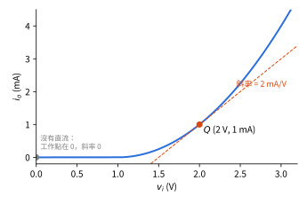
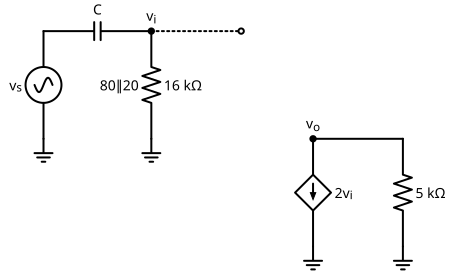
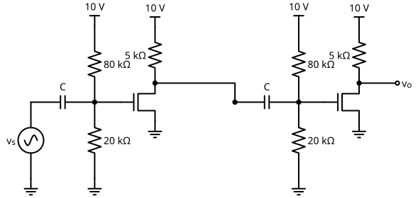

# 第 09 集 · Lec09：簡易 MOS 放大器——直流工作點、直流交流分開、兩級串接 [▶ 影片](https://www.youtube.com/watch?v=PkfrM1-hcHM)

← 上一集：[08](08-impedance-dc-ac-circuits-amplifier-concept.md) ｜ [總目錄](../README.md) ｜ 下一集：[10](10-ideal-op-amp-negative-feedback-follower.md) →

> **課程**：電子學（一），陽明交大 電子物理系，112 學年度 — 第 09 集
> **講者**：陳振芳 老師
> **來源**：YouTube 錄影逐字稿（47:49，人工字幕）＋ Sedra & Smith《Microelectronic Circuits》7th ed. §7.1–7.2
> **標記說明**：`【口頭】` 老師口頭補充；`【課本補充】` 課本有、課堂沒講；`[▶ mm:ss]` 影片時間點

---

## 目錄

- [0. 這堂課要做什麼](#0-這堂課要做什麼)
- [1. MOS：把輸入電壓轉成輸出電流](#1-mos把輸入電壓轉成輸出電流)
- [2. 第一步：選直流工作點，求斜率](#2-第一步選直流工作點求斜率)
- [3. 直流偏壓電路](#3-直流偏壓電路)
- [4. 加交流與 MOS 的電路模型](#4-加交流與-mos-的電路模型)
- [5. 把電路拆成直流電路 + 交流電路](#5-把電路拆成直流電路--交流電路)
- [6. 交流電路：耦合電容要多大](#6-交流電路耦合電容要多大)
- [7. 電壓增益 −10](#7-電壓增益-10)
- [8. 兩級串接：放大 100 倍](#8-兩級串接放大-100-倍)
- [9. 一頁速查表](#9-一頁速查表)
- [10. 與後續集數的連結](#10-與後續集數的連結)

---

## 0. 這堂課要做什麼

第一章最後一集。把上一集的放大器概念完整做一次，然後進第二章：

1. 選直流工作點 $Q$、算斜率。
2. 偏壓電路（分壓 + 耦合電容）。
3. 最重要的方法：**把電路拆成直流電路和交流電路**分開分析。
4. 用交流電路決定耦合電容的大小、算出增益 −10。
5. 兩級串接得到 +100 倍。

---

## 1. MOS：把輸入電壓轉成輸出電流

[▶ 00:10](https://youtu.be/PkfrM1-hcHM?t=10)

- MOS（金屬氧化層半導體）有三隻腳，一隻當 input、一隻當 output、一隻共用。
- 輸入電壓控制元件裡的一座電位山，山的高低改變輸出電流。所以 MOS 只做一件事：**transfer $v_i$ to $i_o$**。[▶ 01:11](https://youtu.be/PkfrM1-hcHM?t=71)

特性（這次 $k/2 = 1\ \text{mA/V}^2$）：[▶ 01:44](https://youtu.be/PkfrM1-hcHM?t=104)

$$
i_o = 1\,(v_i - 1)^2\ \text{mA}\quad (v_i > 1\ \text{V}),
\qquad
i_o = 0\quad (v_i < 1\ \text{V})
$$

兩個數字（1 mA/V²、1 V）都是這顆 MOS 的特性，先接受它。

---

## 2. 第一步：選直流工作點，求斜率

[▶ 03:18](https://youtu.be/PkfrM1-hcHM?t=198)

**第一件事：choose 一個適當的直流工作點**（DC operating point）$Q$。一定要選在**有斜度**的地方，交流才會被放大。[▶ 03:50](https://youtu.be/PkfrM1-hcHM?t=230)

- 取 $v_i = 2$ V → $i_o = (2-1)^2 = 1$ mA。
- 輸出端一定要接東西，MOS 才會 work：5 kΩ 接到 10 V（電壓要夠大，MOS 才會導通）。[▶ 04:51](https://youtu.be/PkfrM1-hcHM?t=291)
- 輸出直流 $v_o = 10 - 1 \times 5 = 5$ V。

**斜率**（等一下交流要用）：[▶ 06:29](https://youtu.be/PkfrM1-hcHM?t=389)

$$
\left.\frac{di_o}{dv_i}\right|_Q = 2 \times 1\,\text{mA/V}^2 \times (v_i - 1)\Big|_{v_i=2} = 2\ \text{mA/V}
$$

---

## 3. 直流偏壓電路

[▶ 07:30](https://youtu.be/PkfrM1-hcHM?t=450)

- 不能另外放一顆 2 V 電池（已經有 10 V 了，再加成本太高）→ 從 10 V 用 **80 kΩ / 20 kΩ 分壓**得到 2 V。
- 分壓公式能直接用，是因為 MOS 輸入是 **SiO₂ 氧化層**，沒有電流流進去。[▶ 08:01](https://youtu.be/PkfrM1-hcHM?t=481)
- 麥克風的交流信號不能直接接到分壓點：那一點會被強迫等於 $v_s$，2 V 直流變成 0，工作點跑到沒有斜率的地方。[▶ 09:05](https://youtu.be/PkfrM1-hcHM?t=545)
- 所以**加一顆電容**。只看直流：一開始電容沒電荷，10 V 的電流全部去充電；電壓上升後 20 kΩ 開始分走電流；幾個 $RC$ 後電容不再充電、可以拉斷 → 分壓點回到 2 V，電容自己充了 2 V。[▶ 10:41](https://youtu.be/PkfrM1-hcHM?t=641)

【口頭】這就是電容最大的好處：你都不用理它，它自己會充到該有的電壓。[▶ 12:45](https://youtu.be/PkfrM1-hcHM?t=765)

---

## 4. 加交流與 MOS 的電路模型

[▶ 13:16](https://youtu.be/PkfrM1-hcHM?t=796)

交流信號 $v_i$（sin、cos）加到 2 V 上，對著 Q 點一點一點描：電流也多一個交流，大小 = $v_i$ × 斜率：

$$
i_o = 1\ \text{mA} + 2\,v_i\quad(\text{單位 mA/V})
$$

**電路模型**（model）[▶ 15:17](https://youtu.be/PkfrM1-hcHM?t=917)：輸入端電阻無窮大（氧化層）；輸出端是一個**可變電流源**（受 $v_i$ 控制）。注意這是 model，不是實際的 MOS，只是換成我們比較習慣的電路形式。

> 這裡的 $v_i$ 是 MOS 輸入端的交流，**不一定等於** $v_s$。什麼情況下才相等？要看耦合電容（第 6 節）。[▶ 17:21](https://youtu.be/PkfrM1-hcHM?t=1041)

輸出：$v_o = 10 - (1 + 2v_i)\times 5 = 5 - 10\,v_i$。[▶ 19:24](https://youtu.be/PkfrM1-hcHM?t=1164)

---

## 5. 把電路拆成直流電路 + 交流電路

[▶ 20:25](https://youtu.be/PkfrM1-hcHM?t=1225)

**數學道理**：一條「直流 + 交流 = 直流 + 交流」的式子，一定可以拆成「直流 = 直流」和「交流 = 交流」兩條，因為兩者完全不同。電路也一樣。[▶ 20:56](https://youtu.be/PkfrM1-hcHM?t=1256)

電路中**任何一點**的電壓或電流都可以寫成

$$
v = \underbrace{f(10\ \text{V},\ 1\ \text{mA},\ \ldots)}_{\text{只跟直流電源有關}}
+ \underbrace{g(v_s)}_{\text{只跟交流信號源有關}}
$$

[▶ 21:56](https://youtu.be/PkfrM1-hcHM?t=1316)

| 要求 | 怎麼做 |
|---|---|
| **直流電路**（DC circuit） | 讓交流信號源 $v_s = 0$ |
| **交流電路**（AC circuit） | 讓**所有直流電源** = 0（10 V 電源、直流電流…） |

[▶ 22:58](https://youtu.be/PkfrM1-hcHM?t=1378)

- 直流電路：拿掉 $v_s$，就回到第 3 節的電路（電容跨 2 V）。
- 交流電路：$v_s$ 留著、電容留著；**10 V 變成 0 V = 接地**。[▶ 24:30](https://youtu.be/PkfrM1-hcHM?t=1470)
  - 80 kΩ 上端接地 → 和 20 kΩ **並聯**：$80 \parallel 20 = 16\ \text{k}\Omega$。
  - MOS 的直流 1 mA 拿掉，只剩交流電流源 $2v_i$。
  - 5 kΩ 上端（原本 10 V）也接地。
  - 量到的是交流輸出 $v_o$。

最後把直流電路（5 V）和交流電路（$v_o$）的答案加起來，就是完整的答案。

【口頭】直流已經算過了，做交流時千萬不要再把直流放進去。不拆開的話不容易看到那個 16 kΩ。[▶ 27:08](https://youtu.be/PkfrM1-hcHM?t=1628)

---

## 6. 交流電路：耦合電容要多大

[▶ 27:38](https://youtu.be/PkfrM1-hcHM?t=1658)

交流 $v_s$ 遇到電容 $C$，就是之前電容充放電的問題，用相量分析：$C \to 1/j\omega C$，$R = 16\ \text{k}\Omega$，分壓：

$$
\frac{\mathbf{V}_i}{\mathbf{V}_s} = \frac{R}{R + 1/j\omega C}
= \frac{j\omega/\omega_0}{1 + j\omega/\omega_0},
\qquad \omega_0 = \frac{1}{RC}
$$

大小 $\dfrac{\omega/\omega_0}{\sqrt{1 + (\omega/\omega_0)^2}}$：dB 圖先 +20 dB/decade 上升，過 $\omega_0$ 後平在 0 dB（= 1）。**高通**。[▶ 31:17](https://youtu.be/PkfrM1-hcHM?t=1877)

**設計**：聲音 $10^2$–$10^5$ rad/s 要全部通過（不能被電容擋住），而且避開轉折（−3 dB），差一個數量級：[▶ 33:20](https://youtu.be/PkfrM1-hcHM?t=2000)

$$
\omega_0 \le 0.1 \times 10^2 = 10
\quad\Longrightarrow\quad
\frac{1}{16\times10^3\,C} \le 10
\quad\Longrightarrow\quad
C \ge \frac{1}{16\times10^4}\ \text{F}
$$

> 以下**不是逐字稿內容**，是把數字算完：$1/(16\times10^4) \approx 6.25\times10^{-6}$ F，也就是 $C \gtrsim 6.3\ \mu$F。

$C$ 夠大 → 時間常數長 → 交流來不及充電 → 電容上沒有交流電壓 → **$v_i = v_s$**，全部過去。[▶ 34:55](https://youtu.be/PkfrM1-hcHM?t=2095)
如果聲音落在轉折頻率以下，就被擋住，放大也是 0。

---

## 7. 電壓增益 −10

[▶ 36:27](https://youtu.be/PkfrM1-hcHM?t=2187)

交流電路裡 $v_i = v_s$，電流 $2v_s$ 往下流過 5 kΩ（上端是交流地）：

$$
v_o = 0 - 2v_s \times 5 = -10\,v_s
$$

完整輸出 = 直流 5 V + 交流 $-10v_s$：示波器上在 5 V 附近，輸入正半週時輸出先往下掉。[▶ 37:33](https://youtu.be/PkfrM1-hcHM?t=2253)

$$
A_v = \frac{v_o}{v_s} = -10
$$

- **放大倍數只算交流 ÷ 交流**。【口頭】不要算「輸出直流 5 V ÷ 輸入直流 2 V」，沒有人在算這個；直流一點意義都沒有，但一定要有，它才會 work。[▶ 38:34](https://youtu.be/PkfrM1-hcHM?t=2314)
- 負號 = **180° out of phase**。[▶ 39:07](https://youtu.be/PkfrM1-hcHM?t=2347)

> 【課本補充】§7.2.1 (p. 383) 的共源極（common-source）放大器，小信號增益 $A_v = -g_m R_D$，這裡 $g_m = 2$ mA/V、$R_D = 5$ kΩ。

---

## 8. 兩級串接：放大 100 倍

[▶ 40:07](https://youtu.be/PkfrM1-hcHM?t=2407)

10 倍不夠：麥克風只有幾 mV，要到快 1 V 至少要 100 倍 → **串兩級**。

**問題**：第一級輸出有 5 V 直流，第二級輸入要的是 2 V → 中間**再加一顆電容**。[▶ 41:41](https://youtu.be/PkfrM1-hcHM?t=2501)

**直流**：5 V 會往電容充電，10 V 經 80 kΩ 也會往電容充電，誰比較大不知道，但無所謂：幾個 $RC$ 後電容不再充電，沒有電流就拉斷。[▶ 42:42](https://youtu.be/PkfrM1-hcHM?t=2562)

- 拉斷後左邊 = 第一級的直流 5 V，右邊 = 分壓 2 V。
- 電容充了 $5 - 2 = 3$ V（左高右低），第二級閘極還是 **2 V**，直流電流還是 1 mA。[▶ 44:14](https://youtu.be/PkfrM1-hcHM?t=2654)

**交流**：電容取夠大（同第 6 節，$C \ge 1/(16\times10^4)$ F），第一級的交流 $-10v_s$ 全部進第二級，再乘 −10：[▶ 45:15](https://youtu.be/PkfrM1-hcHM?t=2715)

$$
v_o = 5\ \text{V} + (-10)(-10\,v_s) = 5 + 100\,v_s,
\qquad
A_{v,\text{overall}} = (-10)\times(-10) = +100
$$

兩級反相兩次，變回同相。幾 mV 的信號就放大到接近 0.5 V、快 1 V。[▶ 46:17](https://youtu.be/PkfrM1-hcHM?t=2777)

【口頭】放大器一定要先做直流、再做交流。第一章講了很多電容充放電，其實最主要就是為了這些；放大器的概念就是這樣，很簡單、沒有多難。[▶ 46:48](https://youtu.be/PkfrM1-hcHM?t=2808)

---

## 9. 一頁速查表

| 項目 | 公式／做法 | 關鍵一步 |
|---|---|---|
| MOS 特性 | $i_o = (v_i - 1)^2$ mA（$v_i > 1$） | 輸入沒有電流（氧化層） |
| Q 點 | $v_i = 2$ V，$i_o = 1$ mA，$v_o = 5$ V | 選在有斜率的地方 |
| 斜率（轉導） | $2(v_i - 1)\|_{2} = 2$ mA/V | 微分取 Q 點 |
| 偏壓 | 10 V 經 80k/20k 分壓 = 2 V | 輸入沒電流，分壓直接用 |
| 直流電路 | 交流源設 0 | 電容開路 |
| 交流電路 | 所有直流電源設 0（10 V → 地） | 80k∥20k = 16k |
| 耦合電容（高通） | $\omega_0 = 1/(RC) \le 0.1\,\omega_{\min}$ | 本例 $C \ge 1/(16\times10^4)$ F |
| 單級增益 | $A_v = -2 \times 5 = -10$ | 只算交流 |
| 級間電容 | 跨 $5 - 2 = 3$ V | 穩態拉斷 |
| 兩級增益 | $(-10)(-10) = +100$ | 相乘 |

---

## 10. 與後續集數的連結

| 本集觀念 | 後面在哪裡用到 |
|---|---|
| 直流／交流電路分開 | 之後所有電晶體電路（第 4 章 MOSFET、第 5 章 BJT） |
| 共源極放大器 $-g_mR_D$ | 第 4 章 MOSFET 放大器 |
| 多級串接、級間耦合電容 | 第 7 章差動與多級放大器 |
| 下一集 | 第二章運算放大器：理想特性、負回授 |

---

## 附：本集一句話總結

> **做放大器先做直流：分壓 + 耦合電容把 MOS 偏在有斜率的 Q 點；再把所有直流電源設成 0 畫出交流電路，耦合電容取夠大讓聲音全過，增益 = −斜率 × 負載 = −10；兩級串接（中間再一顆電容擋直流）得到 +100。**

---

*筆記依據陳振芳老師「電子學（一）」112 學年度 Lec09 錄影逐字稿（人工字幕，47:49）與 Sedra & Smith《Microelectronic Circuits》7th ed. 整理。*
