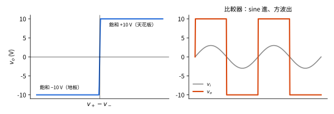
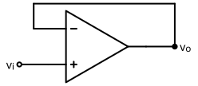
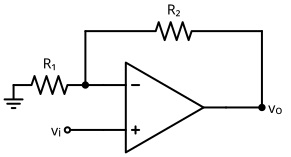
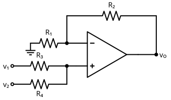
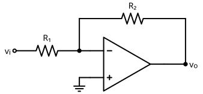
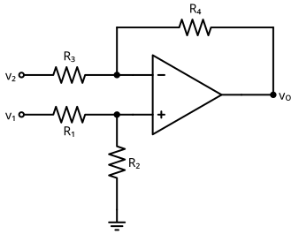

# 第 10 集 · Lec10：理想運算放大器、負回授、電壓追隨器與基本放大電路 [▶ 影片](https://www.youtube.com/watch?v=0srEkyr8cFY)

← 上一集：[09](09-simple-mos-amplifier-dc-operating-point.md) ｜ [總目錄](../README.md) ｜ 下一集：[11](11-difference-instrumentation-amplifier-ecg.md) →

> **課程**：電子學（一），陽明交大 電子物理系，112 學年度 — 第 10 集
> **講者**：陳振芳 老師
> **來源**：YouTube 錄影逐字稿（1:24:53，人工字幕）＋ Sedra & Smith《Microelectronic Circuits》7th ed. §2.1–2.4
> **標記說明**：`【口頭】` 老師口頭補充；`【課本補充】` 課本有、課堂沒講；`[▶ mm:ss]` 影片時間點

---

## 目錄

- [0. 這堂課要做什麼](#0-這堂課要做什麼)
- [1. 運算放大器這塊 IC](#1-運算放大器這塊-ic)
- [2. 不接回授：比較器](#2-不接回授比較器)
- [3. 負回授與亦步亦趨（virtual short）](#3-負回授與亦步亦趨virtual-short)
- [4. 電壓追隨器](#4-電壓追隨器)
- [5. 正增益放大器（非反相）](#5-正增益放大器非反相)
- [6. 疊加原理與加法器、平均值](#6-疊加原理與加法器平均值)
- [7. 反相放大器與反相器](#7-反相放大器與反相器)
- [8. 減法器與差動放大器](#8-減法器與差動放大器)
- [9. 一頁速查表](#9-一頁速查表)
- [10. 與後續集數的連結](#10-與後續集數的連結)

---

## 0. 這堂課要做什麼

第二章：**運算放大器**（operational amplifier, op amp）。這集建立整章的工具：

1. 理想 op amp 的特性。
2. 負回授 → **亦步亦趨**（virtual short circuit）。
3. 用等效模型（$R_i$、$R_o$、開路電壓）看懂電壓追隨器為什麼有用。
4. 一路推出：非反相放大器、加法器、平均值、反相放大器、反相器、減法器、差動放大器。

---

## 1. 運算放大器這塊 IC

[▶ 00:10](https://youtu.be/0srEkyr8cFY?t=10)

- op amp 是一塊 IC。輸入兩隻腳：**正端**（+）、**負端**（−）；一隻輸出腳。
- 另外要接**正負電源**（例如 +10～15 V、−10～15 V，都相對於地）。【口頭】不接就是沒給它飯吃，它不會動。[▶ 00:41](https://youtu.be/0srEkyr8cFY?t=41)
- 它偵測兩個輸入的差值，放大 $A_d$ 倍：

$$
v_o = A_d\,(v_+ - v_-)
$$

**理想 op amp**（ideal）：[▶ 02:16](https://youtu.be/0srEkyr8cFY?t=136)

1. 輸入端**沒有電流**：$i_+ = i_- = 0$。只偵測電壓、不拉電流，所以不會影響信號源；輸入端到地可看成無窮大電阻。
2. $A_d \to \infty$。【口頭】老牌的 op 741，$A_d$ 大約 $10^5$，可以當成無窮大。[▶ 03:17](https://youtu.be/0srEkyr8cFY?t=197)

> 【課本補充】§2.1.2 (p. 61) 的理想 op amp 還包括：輸出電阻為 0、頻寬無窮大、共模增益為 0。

---

## 2. 不接回授：比較器

[▶ 03:49](https://youtu.be/0srEkyr8cFY?t=229)

$v_o$ 對 $(v_+ - v_-)$ 的圖：斜率 $A_d \approx \infty$，幾乎是垂直線。但輸出不可能超過電源：上面飽和在約 +10 V（**天花板**），下面飽和在約 −10 V（**地板**）。任何 IC 都一樣，操作範圍要在這兩者之間。[▶ 04:53](https://youtu.be/0srEkyr8cFY?t=293)

**例**：負端接地、正端接 sin 波 $v_i$ [▶ 06:25](https://youtu.be/0srEkyr8cFY?t=385)
→ $v_i$ 只要比 0 大一點點，輸出就飽和在 +10 V；比 0 小就飽和在 −10 V。
→ sine 進去、**方波**（square wave）出來。這不是放大器，是**比較器**（comparator），後面會用到。

---

## 3. 負回授與亦步亦趨（virtual short）

[▶ 08:27](https://youtu.be/0srEkyr8cFY?t=507)

op amp 真正拿來用時，要接**負回授**（negative feedback）：把輸出接回輸入的**負端**。

輸出直接接回負端（$v_{o,\text{open}} = v_-$，先不接負載）：[▶ 10:29](https://youtu.be/0srEkyr8cFY?t=629)

$$
A_d(v_+ - v_-) = v_-
\;\Longrightarrow\;
v_- = \frac{A_d}{1 + A_d}\,v_+ \;\approx\; v_+
\quad(A_d \gg 1)
$$

另一個看法：$v_+ - v_- = v_-/A_d$，右邊乘了 $1/A_d$ 幾乎是 0，所以括號裡兩個要相等。[▶ 13:05](https://youtu.be/0srEkyr8cFY?t=785)

$$
\boxed{v_- = v_+}
$$

這叫 **virtual short circuit**（虛短路；老師也叫「虛接地」），中文老師叫它**亦步亦趨**：兩點沒有真的接起來，但負端的電壓會 follow 正端，你上升我就上升、你下降我就下降。[▶ 12:04](https://youtu.be/0srEkyr8cFY?t=724)

【口頭】**超級無敵的溫控系統**比喻：$v_+$ 是設定溫度，$v_-$ 是量到的溫度。$A_d$ 無窮大 → 修正的力量無窮大：量到的比設定低，輸出就正很大，把它拉上去，直到兩者幾乎一樣才停。式子裡沒有時間 → 修正不需要時間（真正的原因是：在輸入信號的頻率下修正都來得及）。[▶ 14:37](https://youtu.be/0srEkyr8cFY?t=877)

> 【課本補充】課本強調 virtual short 只有在**負回授**而且 $A$ 很大時才成立；正端接地時負端就成為 **virtual ground**（虛接地）。

---

## 4. 電壓追隨器

### 4.1 開路輸出

[▶ 14:06](https://youtu.be/0srEkyr8cFY?t=846)

輸出直接接回負端、信號 $v_i$ 接正端 → $v_- = v_i$ → $v_{o,\text{open}} = v_i$。輸入什麼、輸出就是什麼：**voltage follower**（電壓追隨器）。

### 4.2 等效模型：$R_i$、$R_o$、開路電壓

[▶ 16:43](https://youtu.be/0srEkyr8cFY?t=1003)

從輸出端倒回去看，整個電路是一個**信號源** → 用「電壓源串聯電阻」描述（我們關心的是電壓）。

**電壓源**：開路量電壓（沒電流、電阻上沒壓差）→ 就是 $v_{o,\text{open}} = v_i$。[▶ 18:14](https://youtu.be/0srEkyr8cFY?t=1094)

**倒看回去的電阻**（老師把它從 $R_s$ 改名叫 $R_o$）：[▶ 20:16](https://youtu.be/0srEkyr8cFY?t=1216)

$$
R_o = \left.\frac{v_x}{i_x}\right|_{v_i = 0}
$$

- $v_i = 0$（正端接地）→ 亦步亦趨，負端也是 0 → 輸出點（直接接負端）也是 0。
- 加電壓 $v_x$：$i_x = (v_x - 0)/(\text{導線電阻} = 0)$ → $R_o = 0$。[▶ 22:52](https://youtu.be/0srEkyr8cFY?t=1372)
- 【口頭】做實驗最好**加電流量電壓**：輸出點被「地」住了，硬加電壓電流可能無窮大，會燒壞。加電流 $i_x$，電流流進 op amp 輸出到地，量到電壓 0 → $R_o = 0/i_x = 0$。[▶ 23:58](https://youtu.be/0srEkyr8cFY?t=1438)

**輸入電阻**：從 $v_i$ 看進去，$R_i = v_i/0 = \infty$（理想 op amp 輸入沒電流）。[▶ 31:40](https://youtu.be/0srEkyr8cFY?t=1900)

等效模型：**$R_i = \infty$ → 增益 1 的電壓源 → $R_o = 0$**。[▶ 33:15](https://youtu.be/0srEkyr8cFY?t=1995)

### 4.3 為什麼有用

[▶ 28:34](https://youtu.be/0srEkyr8cFY?t=1714)

- 輸出接負載 $R_L$：$v_o = v_{o,\text{open}}\dfrac{R_L}{R_o + R_L}$，$R_o = 0$ → $v_o = v_{o,\text{open}}$，**跟負載無關**（independent of $R_L$）。後面接什麼電路都不影響。
- 輸入接信號源（$v_s$ 串 $R_s$）：$v_i = v_s\dfrac{R_i}{R_s + R_i}$，$R_i = \infty$ → $v_i = v_s$，**跟 $R_s$ 無關**。[▶ 34:49](https://youtu.be/0srEkyr8cFY?t=2089)

$$
v_o = v_s\quad(\text{independent of } R_s \text{ and } R_L)
$$

**例子** [▶ 36:24](https://youtu.be/0srEkyr8cFY?t=2184)：信號源 $R_s = 10$ kΩ 直接接 $R_L = 0.1$ kΩ → $v_o = v_s \times 0.1/10.1 \approx v_s/100$。兩個電阻完全不匹配，信號都浪費在 $R_s$ 上。中間加一個電壓追隨器 → $v_o = v_s$，全部過來。

**意義**：把一個**非理想電壓源**（有 $R_s$）變成**理想電壓源**（$R_o = 0$）。增益只有 1 沒關係，等一下要放大再放大。它抓電壓、再送電壓出去，是理想的 **v→v amplifier**。[▶ 38:57](https://youtu.be/0srEkyr8cFY?t=2337)

> 【課本補充】§2.3.4 (p. 75) 把它叫 **buffer amplifier**（緩衝放大器），用途就是把高阻抗的信號源接到低阻抗的負載。

---

## 5. 正增益放大器（非反相）

[▶ 46:16](https://youtu.be/0srEkyr8cFY?t=2776)

回授路徑加分壓 $R_1$、$R_2$，只把輸出的一部分拉回負端：

$$
v_- = \beta\,v_{o,\text{open}},
\qquad
\beta = \frac{R_1}{R_1 + R_2}
$$

（例：$R_1 = 1$ k、$R_2 = 9$ k → $\beta = 1/10$。）

$$
A_d(v_+ - v_-) = \frac{v_-}{\beta}
\;\Longrightarrow\;
v_- = \frac{\beta A_d}{1 + \beta A_d}\,v_+ \approx v_+
\quad(\beta A_d \gg 1)
$$

[▶ 49:30](https://youtu.be/0srEkyr8cFY?t=2970) 只要 $\beta$ 不要太小（不要千分之一、萬分之一），$\beta A_d$ 還是遠大於 1 → **還是亦步亦趨**。【口頭】無窮大乘十分之一還是無窮大。

**直接用亦步亦趨解**：[▶ 51:03](https://youtu.be/0srEkyr8cFY?t=3063) $v_- = v_i$，$R_1$ 上電流 $v_i/R_1$，負端沒電流，所以同一個電流流過 $R_2$：

$$
v_{o,\text{open}} = v_i + \frac{v_i}{R_1}R_2 = \left(1 + \frac{R_2}{R_1}\right)v_i = \frac{1}{\beta}\,v_i
$$

拉十分之一回去，就放大 10 倍。

**等效模型**（同 4.2 的方法）：[▶ 52:38](https://youtu.be/0srEkyr8cFY?t=3158)

- $R_o$：$v_i = 0$ → 負端 0 → 輸出點經導線看進 op amp 輸出，$R_o = 0$。[▶ 55:16](https://youtu.be/0srEkyr8cFY?t=3316)
- $R_i = \infty$。
- 開路電壓 $(1 + R_2/R_1)v_i$。

→ $v_o = (1 + R_2/R_1)\,v_s$，看不到 $R_s$、$R_L$，是**理想的 v→v 放大器**；把非理想電壓源變成理想電壓源，而且有增益。[▶ 1:00:02](https://youtu.be/0srEkyr8cFY?t=3602)

> 【課本補充】§2.3.1 (p. 73)：非反相組態的閉迴路增益 $G = 1 + R_2/R_1$；有限 $A$ 時 $G = \dfrac{1 + R_2/R_1}{1 + (1 + R_2/R_1)/A}$（§2.3.2）。

---

## 6. 疊加原理與加法器、平均值

### 6.1 加法器

[▶ 1:03:10](https://youtu.be/0srEkyr8cFY?t=3790)

正端接兩個輸入：$v_1$ 經 $R_3$、$v_2$ 經 $R_4$；負端是同樣的 $R_1$、$R_2$ 回授（所有電壓都相對於地）。

只要求出正端電壓 $v_+$，再乘 $(1 + R_2/R_1)$ 就是答案（第 5 節）。

**疊加原理**（superposition principle）：電路是線性的（【口頭】「不是 linear 的還早，電子學四才會有」），所以 [▶ 1:04:45](https://youtu.be/0srEkyr8cFY?t=3885)

$$
v_+ = a\,v_1 + b\,v_2
$$

- 讓 $v_2 = 0$：$v_1$ 經 $R_3$、$R_4$ 分壓（正端沒電流）→ $v_1\dfrac{R_4}{R_3 + R_4}$。
- 讓 $v_1 = 0$：$v_2\dfrac{R_3}{R_3 + R_4}$。[▶ 1:06:17](https://youtu.be/0srEkyr8cFY?t=3977)

$$
v_o = \frac{R_1 + R_2}{R_1}\cdot\frac{R_4 v_1 + R_3 v_2}{R_3 + R_4}
$$

電阻太多，自己選讓 $R_1 + R_2 = R_3 + R_4$：[▶ 1:07:17](https://youtu.be/0srEkyr8cFY?t=4037)

$$
v_o = \frac{R_4}{R_1}\,v_1 + \frac{R_3}{R_1}\,v_2
$$

相加，而且兩個比重可以不同 → **加法器**（adder）。

### 6.2 平均值

[▶ 1:08:20](https://youtu.be/0srEkyr8cFY?t=4100)

正端兩個電阻相等、負端不接電阻（電壓追隨器）→ $v_o = v_+ = \tfrac12(v_1 + v_2)$ → **取平均值**（take average）。

**問題**：信號源自己有內電阻 $R_{s1}$、$R_{s2}$，會跟正端的電阻加在一起（兩個源之間有電流流來流去），比重就不再是 1/2。賣出去之後你根本不知道別人接什麼。[▶ 1:09:22](https://youtu.be/0srEkyr8cFY?t=4162)
→ **每個輸入先加一個電壓追隨器**，問題就解決了（追隨器輸入沒電流）。[▶ 1:10:27](https://youtu.be/0srEkyr8cFY?t=4227)

---

## 7. 反相放大器與反相器

[▶ 1:11:32](https://youtu.be/0srEkyr8cFY?t=4292)

正端接地，信號經 $R_1$ 接負端，$R_2$ 從輸出回授到負端（一定要有回授，不然沒有亦步亦趨）。假設信號頻率在頻寬內，亦步亦趨成立。

- 正端 0 → 負端也是 0。
- $R_1$ 上電流 $v_i/R_1$，流不進 op amp，只能流過 $R_2$。
- $v_o = 0 - \dfrac{v_i}{R_1}R_2$：

$$
v_o = -\frac{R_2}{R_1}\,v_i
$$

[▶ 1:13:02](https://youtu.be/0srEkyr8cFY?t=4382)

- 例：$R_1 = 1$ k、$R_2 = 10$ k → 放大 10 倍。【口頭】電阻取 kΩ 級，不要取幾 Ω。
- 負號：輸入正半週時電流變大、輸出掉得更多 → **反相**（inverting）放大器。[▶ 1:14:35](https://youtu.be/0srEkyr8cFY?t=4475)

**一樣的問題**：信號源 $R_s$ 會和 $R_1$ 串在一起，增益變成 $-R_2/(R_1 + R_s)$。設計 10 倍，別人接起來剩 2 倍。不能要求別人的 $R_s = 0$。→ **前面加電壓追隨器**，才是賣得出去的完整電路。[▶ 1:15:07](https://youtu.be/0srEkyr8cFY?t=4507)

**反相器**：$R_1 = R_2$ → $v_o = -v_i$，把波形倒過來、不放大。類比電路的 **inverter**。前面一樣最好加追隨器。[▶ 1:16:39](https://youtu.be/0srEkyr8cFY?t=4599)

> 【課本補充】§2.2 (p. 64)：反相組態的輸入電阻就是 $R_1$（因為負端是虛接地），不是無窮大；這正是 $R_s$ 會影響增益的原因。

---

## 8. 減法器與差動放大器

[▶ 1:17:39](https://youtu.be/0srEkyr8cFY?t=4659)

正端：$v_1$ 經 $R_1$，$R_2$ 到地；負端：$v_2$ 經 $R_3$，$R_4$ 回授。

**疊加**：[▶ 1:18:10](https://youtu.be/0srEkyr8cFY?t=4690)

- $v_2 = 0$：就是非反相放大器，正端 $v_1\dfrac{R_2}{R_1 + R_2}$，乘 $\left(1 + \dfrac{R_4}{R_3}\right)$。
- $v_1 = 0$：正端 0 → 就是反相放大器，$-\dfrac{R_4}{R_3}v_2$。[▶ 1:19:45](https://youtu.be/0srEkyr8cFY?t=4785)

$$
v_o = \frac{R_2}{R_1 + R_2}\left(1 + \frac{R_4}{R_3}\right)v_1 - \frac{R_4}{R_3}\,v_2
$$

取 $R_1 + R_2 = R_3 + R_4$：$v_o = \dfrac{R_2}{R_3}v_1 - \dfrac{R_4}{R_3}v_2$ → **減法器**，比重可調。[▶ 1:20:49](https://youtu.be/0srEkyr8cFY?t=4849)

再讓 $R_2 = R_4$（於是 $R_1 = R_3$）：[▶ 1:21:54](https://youtu.be/0srEkyr8cFY?t=4914)

$$
v_o = \frac{R_4}{R_3}\,(v_1 - v_2)
$$

兩個信號單純相減再乘一個倍數 → **差動放大器**（differential amplifier）。

【口頭】這個電路很重要，工業上用途很多；前面一樣要加電壓追隨器。**量心電圖一定要用它**：人身上到處都是雜訊，而且很大。實驗室用儀器掃過這個空間的頻譜，最大的一根就是 **60 Hz**（所有電源都是 60 Hz），另外還有很多高頻信號（不然手機怎麼會響）。這些都會耦合（couple）到身體上，而心電圖信號非常微弱——只能靠差動放大器。[▶ 1:23:01](https://youtu.be/0srEkyr8cFY?t=4981)

> 【課本補充】§2.4.1 (p. 78)：單一 op amp 差動放大器要讓共模增益為 0，條件是 $R_4/R_3 = R_2/R_1$；此時 $v_o = \dfrac{R_2}{R_1}(v_{I2} - v_{I1})$（課本的標號和老師相反）。

---

## 9. 一頁速查表

| 項目 | 公式 | 關鍵一步 |
|---|---|---|
| op amp | $v_o = A_d(v_+ - v_-)$ | 理想：$i_\pm = 0$，$A_d \to \infty$ |
| 不接回授 | 比較器，輸出 ±飽和 | 斜率太大 |
| 負回授 | $v_- = \dfrac{\beta A_d}{1 + \beta A_d}v_+ \approx v_+$ | $\beta A_d \gg 1$ |
| 亦步亦趨 | $v_- = v_+$（virtual short） | 只在負回授時成立 |
| 電壓追隨器 | $v_o = v_i$；$R_i = \infty$、$R_o = 0$ | 非理想源 → 理想源 |
| 非反相放大 | $v_o = (1 + R_2/R_1)v_i$ | $R_1$ 電流 $= R_2$ 電流 |
| 等效模型 | $R_i$、$v_{o,\text{open}}$、$R_o = v_x/i_x\|_{v_i=0}$ | $R_o$ 用加電流量電壓 |
| 加法器 | $v_o = \dfrac{R_4}{R_1}v_1 + \dfrac{R_3}{R_1}v_2$ | 疊加；$R_1+R_2 = R_3+R_4$ |
| 平均值 | $v_o = \tfrac12(v_1 + v_2)$ | 前面要加追隨器 |
| 反相放大 | $v_o = -\dfrac{R_2}{R_1}v_i$ | 負端虛接地 |
| 反相器 | $v_o = -v_i$ | $R_1 = R_2$ |
| 減法器 | $v_o = \dfrac{R_2}{R_3}v_1 - \dfrac{R_4}{R_3}v_2$ | 疊加 = 非反相 + 反相 |
| 差動放大 | $v_o = \dfrac{R_4}{R_3}(v_1 - v_2)$ | $R_2 = R_4$、$R_1 = R_3$ |
| 信號源 $R_s$ 的問題 | 前面加電壓追隨器 | 追隨器 $R_i = \infty$ |

---

## 10. 與後續集數的連結

| 本集觀念 | 後面在哪裡用到 |
|---|---|
| 差動放大器、60 Hz 雜訊 | 下一集：儀表放大器、心電圖量測、右腳驅動電路 |
| 亦步亦趨 + 電容 | 2.3–2.4 積分器、微分器 |
| 比較器 | 第 6 章信號產生（方波） |
| $R_i$、$R_o$ 等效模型 | 2.8–2.9 四種轉換器 |
| 「在頻寬內」的前提 | 2.10 運算放大器頻寬與迴轉率 |

---

## 附：本集一句話總結

> **理想 op amp 輸入不吃電流、增益無窮大；接成負回授就有「亦步亦趨」$v_- = v_+$，用它一步解出電壓追隨器（$R_i=\infty$、$R_o=0$，把非理想電壓源變理想）、非反相 $1+R_2/R_1$、反相 $-R_2/R_1$、加法器與差動放大器；信號源有內阻的問題，一律在前面加電壓追隨器。**

---

*筆記依據陳振芳老師「電子學（一）」112 學年度 Lec10 錄影逐字稿（人工字幕，1:24:53）與 Sedra & Smith《Microelectronic Circuits》7th ed. 整理。*
