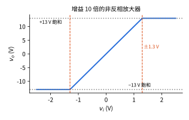
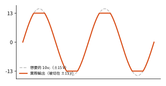

# 第 11 集 · Lec11：差動放大器、儀表放大器、心電圖與右腳驅動、輸出的電壓電流極限 [▶ 影片](https://www.youtube.com/watch?v=R_teP26mPRU)

← 上一集：[10](10-ideal-op-amp-negative-feedback-follower.md) ｜ [總目錄](../README.md) ｜ 下一集：[12](12-integrator-square-triangle-dc-offset.md) →

> **課程**：電子學（一），陽明交大 電子物理系，112 學年度 — 第 11 集
> **講者**：陳振芳 老師
> **來源**：YouTube 錄影逐字稿（1:18:46，人工字幕）＋ Sedra & Smith《Microelectronic Circuits》7th ed. §2.4、§2.8
> **標記說明**：`【口頭】` 老師口頭補充；`【課本補充】` 課本有、課堂沒講；`⚠️ 待確認` 查不清楚；`[▶ mm:ss]` 影片時間點

---

## 目錄

- [0. 這堂課要做什麼](#0-這堂課要做什麼)
- [1. 複習：減法器與差動放大器](#1-複習減法器與差動放大器)
- [2. 前面加電壓追隨器 → 儀表放大器](#2-前面加電壓追隨器--儀表放大器)
- [3. 心電圖：差模信號與共模雜訊](#3-心電圖差模信號與共模雜訊)
- [4. 電阻不完全相等：共模雜訊漏進來](#4-電阻不完全相等共模雜訊漏進來)
- [5. 右腳驅動：共模負回授](#5-右腳驅動共模負回授)
- [6. 為什麼不能用濾波器](#6-為什麼不能用濾波器)
- [7. 實際 op amp 的電壓極限](#7-實際-op-amp-的電壓極限)
- [8. 實際 op amp 的電流極限](#8-實際-op-amp-的電流極限)
- [9. 一頁速查表](#9-一頁速查表)
- [10. 與後續集數的連結](#10-與後續集數的連結)
- [⚠️ 待確認清單](#️-待確認清單)

---

## 0. 這堂課要做什麼

1. 差動放大器前面加電壓追隨器，再改良成**儀表放大器**（instrumentation amplifier）。
2. 用它量**心電圖**（EKG／ECG）：把信號拆成差模（心電圖）和共模（雜訊）。
3. 電阻不可能完全一樣 → 共模雜訊漏進輸出 → 用**右腳驅動**（共模負回授）壓下去。
4. 實際 op amp 的兩個限制：輸出電壓會飽和、輸出電流有上限。

---

## 1. 複習：減法器與差動放大器

[▶ 00:09](https://youtu.be/R_teP26mPRU?t=9)

（電路圖見[上一集第 8 節](10-ideal-op-amp-negative-feedback-follower.md#8-減法器與差動放大器)。）疊加原理：$v_o = Av_1 + Bv_2$，各讓另一個為 0：

- $v_2 = 0$：非反相放大器 → $v_1\dfrac{R_2}{R_1 + R_2}\left(1 + \dfrac{R_4}{R_3}\right)$
- $v_1 = 0$：反相放大器 → $-\dfrac{R_4}{R_3}v_2$

$R_1 + R_2 = R_3 + R_4$ → 減法器（subtractor）$\dfrac{R_2}{R_3}v_1 - \dfrac{R_4}{R_3}v_2$；再讓 $R_2 = R_4$（所以 $R_1 = R_3$）→ [▶ 04:25](https://youtu.be/R_teP26mPRU?t=265)

$$
v_o = \frac{R_4}{R_3}(v_1 - v_2)
$$

**差動放大器**（differential amplifier）。

---

## 2. 前面加電壓追隨器 → 儀表放大器

### 2.1 問題與第一個解法

[▶ 05:29](https://youtu.be/R_teP26mPRU?t=329)

信號源都有內電阻 $R_{s1}$、$R_{s2}$（麥克風或前一級電路），接上去會和 $R_3$ 加在一起，前面的公式全錯。而且電路是你設計的，別人接什麼你不知道——「這樣導出來的公式一點意思都沒有，你也賣不出這一塊 IC。」

→ 前面加**不拉電流**的東西：電壓追隨器。追隨器輸入沒電流 → $R_s$ 上沒壓差 → 追隨器輸出就是 $v_{s1}$、$v_{s2}$。[▶ 07:01](https://youtu.be/R_teP26mPRU?t=421)

### 2.2 改良：兩個追隨器之間加 $R_1$

[▶ 08:33](https://youtu.be/R_teP26mPRU?t=513)

兩個追隨器的負端之間接一個 $R_1$，各自的回授路徑上加 $R_2$：

1. 兩個 op amp 都有負回授 → 亦步亦趨：上面負端 = $v_1$，下面負端 = $v_2$。
2. $R_1$ 上的電流 $i = \dfrac{v_1 - v_2}{R_1}$。op amp 輸入不吃電流 → 同一個 $i$ 從上面的 op amp 輸出流過 $R_2$、$R_1$、$R_2$，流進下面的 op amp 輸出。[▶ 09:38](https://youtu.be/R_teP26mPRU?t=578)
3. 兩個輸出：

$$
v_1' = v_1 + \frac{R_2}{R_1}(v_1 - v_2),
\qquad
v_2' = v_2 - \frac{R_2}{R_1}(v_1 - v_2)
$$

4. 代進後面的差動放大器：[▶ 10:39](https://youtu.be/R_teP26mPRU?t=639)

$$
v_o = \frac{R_4}{R_3}(v_1' - v_2')
= \frac{R_4}{R_3}\left(1 + \frac{2R_2}{R_1}\right)(v_1 - v_2)
$$

**IC 的做法** [▶ 11:40](https://youtu.be/R_teP26mPRU?t=700)

- 讓 $R_3 = R_4$ → $v_o = \left(1 + \dfrac{2R_2}{R_1}\right)(v_1 - v_2)$。
- $R_2$ 固定在 IC 裡（大約 50 kΩ）；$R_1$ 放在 IC 外面，可以調（adjustable）→ **調 $R_1$ 就調增益**。
- $R_1$ 的**中點**也拉出來：疊加可證中點電壓 = $\tfrac12(v_1 + v_2)$，兩個輸入的**平均值**。後面要用。[▶ 12:40](https://youtu.be/R_teP26mPRU?t=760)

這塊 IC 叫**儀表放大器**（instrumentation amplifier），網路上查得到現成的料號。[▶ 13:42](https://youtu.be/R_teP26mPRU?t=822)

> 【課本補充】§2.4.2 (p. 82) 推出同樣的增益 $\dfrac{R_4}{R_3}\left(1 + \dfrac{R_2}{R_1}\right)$（課本把可調電阻記為 $2R_1$），並指出這個架構的優點：輸入電阻無窮大、增益只靠一顆電阻調、共模信號在第一級只被放大 1 倍。

---

## 3. 心電圖：差模信號與共模雜訊

### 3.1 心臟的模型

[▶ 14:45](https://youtu.be/R_teP26mPRU?t=885)

心臟把血液推出去、經過身體再回來。血液裡有離子，會導電，就像電流在流。所以把心臟 model 成一個**很低頻的交流電壓源**（約 1 Hz）。量心臟兩邊的電壓差，就是心電圖信號 $v_\text{EKG}$。[▶ 16:15](https://youtu.be/R_teP26mPRU?t=975)

### 3.2 問題：身上全是雜訊

[▶ 17:48](https://youtu.be/R_teP26mPRU?t=1068)

- 空間裡到處都是電磁波（不然手機不會響），最大的一根是 **60 Hz**（所有電燈、電源）。【口頭】實驗室用儀器掃頻率，放一台電腦風扇在轉就多一根。
- 這些雜訊經由類似電容的耦合（coupling）跑進身體。身上任何一點相對於地（op amp ±15 V 電源的中點）去量，都是非常大的雜訊。[▶ 18:55](https://youtu.be/R_teP26mPRU?t=1135)
- 但兩點的雜訊幾乎一樣 → **相減就消掉了**。

### 3.3 共模、差模分解

[▶ 23:39](https://youtu.be/R_teP26mPRU?t=1419)

空間中任意兩點的電壓都可以寫成：

$$
v_1 = v_{cm} + \frac{v_{id}}{2},
\qquad
v_2 = v_{cm} - \frac{v_{id}}{2}
$$

$$
v_{id} \equiv v_1 - v_2\ \ (\text{差模, differential}),
\qquad
v_{cm} \equiv \frac{v_1 + v_2}{2}\ \ (\text{共模, common mode})
$$

【口頭】為什麼要這樣寫、不直接寫 $v_1$、$v_2$？因為有物理意義：$v_{id}$ 是心電圖信號，$v_{cm}$ 是共同的雜訊。[▶ 25:19](https://youtu.be/R_teP26mPRU?t=1519)

理想情況下儀表放大器輸出只有 $v_{id}$ 乘增益，共模完全消掉。增益通常取到約 100 倍，再大會出問題（第 7、8 節）。[▶ 25:50](https://youtu.be/R_teP26mPRU?t=1550)

---

## 4. 電阻不完全相等：共模雜訊漏進來

[▶ 26:21](https://youtu.be/R_teP26mPRU?t=1581)

【口頭】後面差動級的四個電阻「百分之一千都一樣」是不可能的，就算台積電做 IC 也會差幾個百分點。

假設其中一個電阻變成 $R + \Delta R$，重算差動級。分母的 $\Delta R$ 很小可以拿掉（分子的不能拿，不然就不用算了）。把 $v_1$、$v_2$ 換成共模、差模後，老師得到：[▶ 35:09](https://youtu.be/R_teP26mPRU?t=2109)

$$
v_o \approx \left(1 + \frac{2R_2}{R_1}\right)\left(1 + \frac{\Delta R}{2R}\right)v_{id}
+ \frac{\Delta R}{R}\,v_{cm}
$$

- **第一項**：心電圖的增益從 50 倍變成 49 或 51 倍。無所謂，反正都是放大。[▶ 36:11](https://youtu.be/R_teP26mPRU?t=2171)
- **第二項**：完蛋了，**共模雜訊跑出來了**。$\Delta R/R$ 就算只有 10%（0.1），看起來比 50～100 倍小很多；但**共模雜訊比心電圖大 100 倍、甚至 1000 倍**，所以這一項不能忽略。[▶ 37:13](https://youtu.be/R_teP26mPRU?t=2233)

> ⚠️ 待確認 [▶ 28:23](https://youtu.be/R_teP26mPRU?t=1703)：板書上 $\Delta R$ 放在哪一顆電阻、中間化簡的係數，字幕讀不清楚。以下**不是逐字稿內容**，是依電路推論：若把正端到地的那顆換成 $R + \Delta R$，得到的共模項係數是 $\Delta R/(2R)$、差模修正是 $1 + \Delta R/(4R)$，和老師寫的差一個 2 倍。結論（共模增益 $\propto \Delta R/R$、不會是 0）不受影響。

> 【課本補充】課本用**共模拒斥比**（common-mode rejection ratio, CMRR）$= 20\log\dfrac{|A_d|}{|A_{cm}|}$ 描述這件事（§2.4.1, p. 79）：$A_{cm}$ 就是這裡的 $\Delta R/R$ 那一項。

---

## 5. 右腳驅動：共模負回授

### 5.1 想法

[▶ 39:55](https://youtu.be/R_teP26mPRU?t=2395)

要把共模雜訊弄小，只有一個方法：**回授**。產生一個和共模雜訊亦步亦趨、但正負相反的信號，送回身體，讓共模雜訊自己減自己。

### 5.2 電路

[▶ 40:55](https://youtu.be/R_teP26mPRU?t=2455)

1. **取共模信號**：$R_1$ 的中點電壓 = $\tfrac12(v_1 + v_2)$，正好就是共模信號 $v_{cm}$。這就是 IC 把中點拉出來的原因。
2. **加電壓追隨器**：不能從中點拉電流，否則前面推導的電路全被改變。追隨器輸入電阻無窮大，「偷拉出來它也不知道」。[▶ 41:57](https://youtu.be/R_teP26mPRU?t=2517)
3. **反相放大** $-R_2/R_1$（一般的反相放大器，和儀表放大器內部的 $R_1$、$R_2$ 無關）：要產生亦步亦趨的信號必須再放大（亦步亦趨靠的是很大的增益）。[▶ 44:06](https://youtu.be/R_teP26mPRU?t=2646)
4. **送進右腳**（右腳不再接地）。【口頭】這很危險，電流流進身體會死人，所以串一個大電阻，保證只有電壓進去、沒有電流。[▶ 44:41](https://youtu.be/R_teP26mPRU?t=2681)

### 5.3 解回授

[▶ 45:42](https://youtu.be/R_teP26mPRU?t=2742)

設右腳的電壓（相對地）為 $v$，它疊加到身體上，兩個輸入都多了 $v$：

$$
v_1 = v_{cm} + v + \frac{v_{id}}{2},
\qquad
v_2 = v_{cm} + v - \frac{v_{id}}{2}
$$

中點 = $v_{cm} + v$，經追隨器、乘 $-R_2/R_1$ 等於 $v$：

$$
v = -\frac{R_2}{R_1}(v_{cm} + v)
\;\Longrightarrow\;
v = -\frac{R_2/R_1}{1 + R_2/R_1}\,v_{cm} \approx -v_{cm}
\quad(R_2/R_1 \gg 1)
$$

[▶ 47:16](https://youtu.be/R_teP26mPRU?t=2836)

產生了一個和共模亦步亦趨、差一個負號的信號。加回去：[▶ 48:53](https://youtu.be/R_teP26mPRU?t=2933)

$$
v_{cm} + v = \frac{v_{cm}}{1 + R_2/R_1}
$$

取 $R_2/R_1 = 100$ → **共模信號減少約 100 倍**，差模（心電圖）沒動。

**為什麼差模不受影響？** 對差模信號來說，一正一負，中點是 0，0 乘什麼都是 0 → 差模**沒有回授**，就和右腳接地一樣。[▶ 50:27](https://youtu.be/R_teP26mPRU?t=3027)

$$
\text{feedback for } v_{cm},\quad \text{no feedback for } v_{id}
$$

**最後輸出** [▶ 52:00](https://youtu.be/R_teP26mPRU?t=3120)

$$
v_o \approx \left(1 + \frac{2R_2}{R_1}\right)v_{id}
+ \frac{\Delta R}{R}\cdot\frac{v_{cm}}{1 + R_2/R_1}
$$

（沒有回授時第二項是 $\dfrac{\Delta R}{R}v_{cm}$。）

【口頭】回授最主要就是：任何電路都做不到理想，共模增益可以很小但絕不等於 0（電阻、電晶體只要有一點不對稱，共模信號就產生）；靠回授把不理想的影響盡量壓下來。在雜訊很大的工業環境，只能取兩點相減。這種共模回授以後還會常常看到。[▶ 54:35](https://youtu.be/R_teP26mPRU?t=3275)

---

## 6. 為什麼不能用濾波器

[▶ 55:38](https://youtu.be/R_teP26mPRU?t=3338)

- 心電圖約 1 Hz，雜訊 60 Hz，**兩個頻率太接近**。
- RC 濾波器的斜率只有 −20 dB/decade，不可能讓 1 Hz 全部通過、60 Hz 突然全部濾掉。[▶ 57:12](https://youtu.be/R_teP26mPRU?t=3432)
- 如果雜訊是很高頻的，一個低通就解決了；這裡做不到，只能靠相減：靠經驗找兩點雜訊幾乎一樣、而要量的信號剛好是它們的差值。

---

## 7. 實際 op amp 的電壓極限

[▶ 57:46](https://youtu.be/R_teP26mPRU?t=3466)

op 741 加 ±15 V 電源，輸出會飽和在比電源小一兩伏的地方，例如 **±13 V**。【口頭】「飽和」是什麼現在沒辦法講，要等後面講到差動放大器的內部電路。[▶ 1:00:21](https://youtu.be/R_teP26mPRU?t=3621)

**一旦進入飽和**，就像掉進**沼澤**，要花一段時間才爬得出來，電路就「死在那裡」。所以要避免。[▶ 1:01:21](https://youtu.be/R_teP26mPRU?t=3681)

**例** [▶ 1:02:53](https://youtu.be/R_teP26mPRU?t=3773)：非反相放大器，增益 $1 + R_2/R_1 = 10$（1 k、9 k），輸入 $v_i\sin\omega t$。要求

$$
10\,v_i < 13\ \text{V}
\quad\Longrightarrow\quad
v_i < 1.3\ \text{V}
$$

輸入 1.5 V 時，以為會輸出 ±15 V，實際上在 ±13 V 被切掉，「頭不見尾不見」：[▶ 1:07:09](https://youtu.be/R_teP26mPRU?t=4029)

**沼澤的時間限制** [▶ 1:08:09](https://youtu.be/R_teP26mPRU?t=4089)：若爬出沼澤要 $\Delta t = 1$ ms，信號頻率高於約 $10^3$ 就看不到這種切頂波形了——它爬不出來。所以信號頻率要夠慢，才能 follow 這張圖。

> 【課本補充】§2.8.1 (p. 110) 把這個叫**輸出電壓飽和**（output voltage saturation），規格上寫成 $v_{O\max}$。

---

## 8. 實際 op amp 的電流極限

[▶ 1:09:41](https://youtu.be/R_teP26mPRU?t=4181)

op 741 的輸出電流上限大約十幾 mA，這裡取 **±13 mA**。

**例 1：只有回授電阻** — 回授路徑的電流（亦步亦趨，負端 = $v_i$）：

$$
i_o = \frac{v_i}{R_1} < 13\ \text{mA}
\quad\Longrightarrow\quad
R_1 > \frac{v_i}{13\ \text{mA}}
$$

$v_i = 1$ V → $R_1 > 1/13$ kΩ ≈ 0.1 kΩ。**$R_1$ 不能取太小**。[▶ 1:11:47](https://youtu.be/R_teP26mPRU?t=4307)

**例 2：加負載 $R_L$**（1 k、9 k、$v_i = 1$ V，輸出 10 V）：[▶ 1:13:54](https://youtu.be/R_teP26mPRU?t=4434)

$$
i_o = \frac{v_i}{R_1} + \frac{v_o}{R_L} = 1\ \text{mA} + \frac{10\ \text{V}}{R_L} < 13\ \text{mA}
\quad\Longrightarrow\quad
R_L > \frac{10}{12}\ \text{k}\Omega
$$

接 1 kΩ 時輸出電流已經 11 mA，快到極限了。

**兩個結論**：增益不能太大（電壓極限）、電阻不能太小（電流極限）。[▶ 1:12:52](https://youtu.be/R_teP26mPRU?t=4372)

【口頭】op amp 電壓放得很大、有亦步亦趨一大堆好處，但**提供電流的能力很差**，只有十幾 mA，「它不是真正的 superman」。不能直接接幾十 Ω、甚至幾 Ω 的喇叭。[▶ 1:17:02](https://youtu.be/R_teP26mPRU?t=4622)

> 【課本補充】§2.8.2 (p. 110) 的**輸出電流極限**（output current limits），741 約 ±20 mA；課本例題同樣要考慮回授網路和負載兩路電流。

---

## 9. 一頁速查表

| 項目 | 公式 | 關鍵一步 |
|---|---|---|
| 差動放大器 | $v_o = \dfrac{R_4}{R_3}(v_1 - v_2)$ | $R_1 = R_3$、$R_2 = R_4$ |
| 儀表放大器第一級 | $v_1' - v_2' = \left(1 + \dfrac{2R_2}{R_1}\right)(v_1 - v_2)$ | 同一電流 $(v_1-v_2)/R_1$ 流過 $R_2$、$R_1$、$R_2$ |
| 儀表放大器（$R_3 = R_4$） | $v_o = \left(1 + \dfrac{2R_2}{R_1}\right)(v_1 - v_2)$ | 調外接 $R_1$ |
| $R_1$ 中點 | $\tfrac12(v_1 + v_2) = v_{cm}$ | 疊加 |
| 共模／差模 | $v_{id} = v_1 - v_2$，$v_{cm} = \tfrac12(v_1 + v_2)$ | $v_{1,2} = v_{cm} \pm v_{id}/2$ |
| 電阻誤差 | 共模項 $\propto \dfrac{\Delta R}{R}v_{cm}$ | $v_{cm} \gg v_{id}$ 所以要緊 |
| 右腳驅動 | $v \approx -v_{cm}$；剩 $\dfrac{v_{cm}}{1 + R_2/R_1}$ | 只對共模回授 |
| 電壓極限 | $\|A v_i\| < V_\text{sat}$（例 ±13 V） | 飽和 = 掉進沼澤 |
| 電流極限 | $\dfrac{v_i}{R_1} + \dfrac{v_o}{R_L} < I_\max$（例 13 mA） | 電阻不能太小 |

---

## 10. 與後續集數的連結

| 本集觀念 | 後面在哪裡用到 |
|---|---|
| 共模、差模、共模回授 | 第 7 章差動放大器（電晶體版）、CMRR |
| 輸出電流不夠 | 2.11–2.12 加 BJT 增加電流驅動、AB 類輸出級；第 10 章輸出級 |
| 飽和 | 第 7 章差動對的內部電路才解釋 |
| 下一集 | 2.3 積分器、方波轉三角波、直流偏移 |

---

## 附：本集一句話總結

> **儀表放大器 = 兩個帶 $R_1$、$R_2$ 的輸入追隨器 + 差動放大器，增益 $1 + 2R_2/R_1$ 只靠一顆外接電阻調；量心電圖時共模雜訊遠大於差模信號，電阻的一點誤差就讓雜訊漏進來，所以從 $R_1$ 中點取出共模、反相放大送回右腳做共模負回授。實際 op amp 還有 ±13 V 飽和與十幾 mA 電流的限制。**

---

## ⚠️ 待確認清單

1. [▶ 28:23](https://youtu.be/R_teP26mPRU?t=1703) 電阻誤差 $\Delta R$ 放在哪一顆、共模項係數是 $\Delta R/R$（老師）還是 $\Delta R/(2R)$（依正端接地電阻推論）。

---

*筆記依據陳振芳老師「電子學（一）」112 學年度 Lec11 錄影逐字稿（人工字幕，1:18:46）與 Sedra & Smith《Microelectronic Circuits》7th ed. 整理。*
