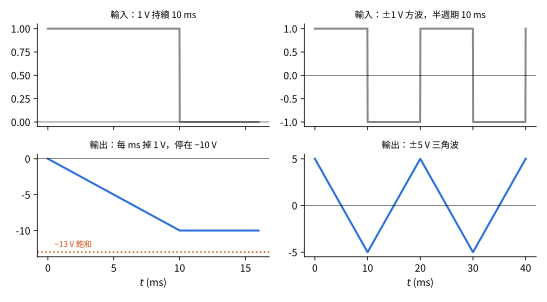
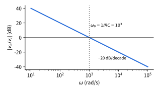
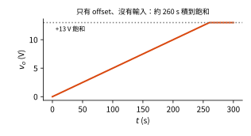

# 第 12 集 · Lec12：積分器、方波轉三角波、輸出偏移讓積分器自己積死 [▶ 影片](https://www.youtube.com/watch?v=kh33Sdwb82k)

← 上一集：[11](11-difference-instrumentation-amplifier-ecg.md) ｜ [總目錄](../README.md) ｜ 下一集：[13](13-integrator-dc-problem-differentiator.md) →

> **課程**：電子學（一），陽明交大 電子物理系，112 學年度 — 第 12 集
> **講者**：陳振芳 老師
> **來源**：YouTube 錄影逐字稿（44:11，人工字幕）＋ Sedra & Smith《Microelectronic Circuits》7th ed. §2.5.2、§2.6
> **標記說明**：`【口頭】` 老師口頭補充；`【課本補充】` 課本有、課堂沒講；`[▶ mm:ss]` 影片時間點

---

## 目錄

- [0. 這堂課要做什麼](#0-這堂課要做什麼)
- [1. Miller 積分器：亦步亦趨還成立嗎](#1-miller-積分器亦步亦趨還成立嗎)
- [2. 輸出 = 輸入的積分](#2-輸出--輸入的積分)
- [3. 步階輸入：一直積就會積死](#3-步階輸入一直積就會積死)
- [4. 方波輸入 → 三角波](#4-方波輸入--三角波)
- [5. 正弦輸入：積分器的頻率響應](#5-正弦輸入積分器的頻率響應)
- [6. 輸出偏移 offset](#6-輸出偏移-offset)
- [7. offset 讓積分器自己積死](#7-offset-讓積分器自己積死)
- [8. 一頁速查表](#8-一頁速查表)
- [9. 與後續集數的連結](#9-與後續集數的連結)

---

## 0. 這堂課要做什麼

1. 反相放大器的回授電阻換成電容 → **積分器**（integrator）。
2. 步階輸入會一直積到飽和；方波輸入變三角波；從頻率看是 −20 dB/decade 的直線。
3. 實際 op amp 的**輸出偏移**（output offset）：即使輸入沒有直流，積分器還是會自己積死。

---

## 1. Miller 積分器：亦步亦趨還成立嗎

[▶ 00:10](https://youtu.be/kh33Sdwb82k?t=10)

正端接地，輸入經 $R$ 接負端，**回授改成電容 $C$**（只有電容才能積分）。這叫 **Miller integrator**（Miller 是人名）。

電容上可能有電荷，所以有電壓 $v_C$。輸出 = 負端電壓 + 電容電壓：[▶ 01:41](https://youtu.be/kh33Sdwb82k?t=101)

$$
A_d(v_+ - v_-) = v_- + v_C
\;\Longrightarrow\;
v_- = \frac{A_d}{1 + A_d}v_+ - \frac{v_C}{1 + A_d}
$$

$A_d$ 無窮大，除非 $v_C$ 也無窮大（不可能），第二項可以忽略 → $v_- \approx v_+$。**亦步亦趨依然成立**。[▶ 02:44](https://youtu.be/kh33Sdwb82k?t=164)

【口頭】回授的力量無窮大，就算浪費一點電壓在電容上，回來的力量還是夠；就像之前用 $R_1$、$R_2$ 只分一部分回來，還是亦步亦趨。

---

## 2. 輸出 = 輸入的積分

[▶ 03:44](https://youtu.be/kh33Sdwb82k?t=224)

- 正端 0 → 負端 0。
- $R$ 上電流 $v_i/R$，流不進 op amp，全部去對電容充電（左正右負）。
- 輸出 = 0 − 電容電壓：

$$
v_o(t) = -v_C(0) - \frac{1}{C}\int_0^t \frac{v_i}{R}\,dt
$$

假設 $t = 0$ 時電容沒電荷（no charge on C）：[▶ 04:46](https://youtu.be/kh33Sdwb82k?t=286)

$$
v_o(t) = -\frac{1}{RC}\int_0^t v_i\,dt
$$

輸出是輸入對時間的積分乘上 $-1/RC$ → **積分器**。

> 【課本補充】§2.5.2 (p. 89)：$v_O(t) = -\dfrac{1}{CR}\displaystyle\int_0^t v_I(t)\,dt - V_C$；$CR$ 叫積分器的時間常數（integrator time constant）。

---

## 3. 步階輸入：一直積就會積死

[▶ 05:23](https://youtu.be/kh33Sdwb82k?t=323)

取 $RC = 1$ ms，用 ms 當時間單位：$v_o = -\dfrac{1}{1\ \text{ms}}\displaystyle\int v_i\,dt$。

輸入 1 V 的**步階函數**（step function）→ $v_o = -t$（$t$ 以 ms 計，單位 V）：1 ms 時 −1 V、10 ms 時 −10 V。它在算面積，面積越來越大就一直往下。[▶ 06:24](https://youtu.be/kh33Sdwb82k?t=384)

**積到飽和** [▶ 07:58](https://youtu.be/kh33Sdwb82k?t=478)：實際 op amp 輸出飽和在 ±13 V → 13 ms 時到 −13 V，掉進「沼澤」，要很久才爬得出來，後面什麼都不會發生。

【口頭】輸入只要是直流，**一定會積死自己**，差別只在多久：1 V 要 13 ms，0.1 V 要 130 ms，0.01 V 要 1300 ms，「其實也是一下子」。[▶ 10:01](https://youtu.be/kh33Sdwb82k?t=601)

**在飽和前停** [▶ 10:31](https://youtu.be/kh33Sdwb82k?t=631)：輸入 1 V 只給 10 ms 就掉回 0 → 負端 0、輸入也 0 → 沒有電流 → 電容不再充電 → 輸出停在 −10 V 不動。

所以要持續操作，輸入**一定要掉回負的**再上去，正負交替。

---

## 4. 方波輸入 → 三角波

[▶ 12:02](https://youtu.be/kh33Sdwb82k?t=722)

輸入 ±1 V 方波，半週期 10 ms。

1. $t = 0$ 時輸出在哪不知道（電容一直重複充放電，不一定是 0），先設為 $v_o(0)$。[▶ 12:34](https://youtu.be/kh33Sdwb82k?t=754)
2. 正半週 10 ms → 掉 10 V，到 $v_o(0) - 10$。
3. 負半週 → 往上積 10 V，回到 $v_o(0)$。重複。

**穩態一定是週期函數** [▶ 14:10](https://youtu.be/kh33Sdwb82k?t=850)：輸入是週期函數，輸出也非是不可。不是週期的只有剛開始做實驗那一剎那（幾個時間常數），眼睛根本看不到。

週期函數要上下對稱：[▶ 15:12](https://youtu.be/kh33Sdwb82k?t=912)

$$
v_o(0) - 10 = -v_o(0) \;\Longrightarrow\; v_o(0) = 5\ \text{V}
$$

→ ±5 V 的**三角波**（triangular wave）。方波經過積分變成三角波。[▶ 15:43](https://youtu.be/kh33Sdwb82k?t=943)

**一點直流都不能有** [▶ 16:16](https://youtu.be/kh33Sdwb82k?t=976)：函數產生器的方波若往上抬一點點直流，三角波就會一邊擺一邊往下漂，經過一段時間進入飽和（saturation）死掉。

---

## 5. 正弦輸入：積分器的頻率響應

[▶ 17:49](https://youtu.be/kh33Sdwb82k?t=1069)

相量分析：電容 → $1/j\omega C$。就是反相放大器 $-R_2/R_1$，$R_2 = 1/j\omega C$、$R_1 = R$：[▶ 18:54](https://youtu.be/kh33Sdwb82k?t=1134)

$$
\frac{\mathbf{V}_o}{\mathbf{V}_i} = -\frac{1/j\omega C}{R} = -\frac{1}{j\omega RC} = -\frac{\omega_0}{j\omega}
= j\,\frac{\omega_0}{\omega},
\qquad \omega_0 = \frac{1}{RC}
$$

大小 $\omega_0/\omega$，相位 $+90^\circ$。例：輸入 $1\sin\omega t$ → 輸出 $\dfrac{\omega_0}{\omega}\sin(\omega t + 90^\circ)$。[▶ 19:56](https://youtu.be/kh33Sdwb82k?t=1196)

- 一條 **−20 dB/decade** 的直線，在 $\omega_0$ 處 0 dB。[▶ 20:56](https://youtu.be/kh33Sdwb82k?t=1256)
- $\omega_0 = 10^3$：輸入頻率 $10^2$ → 放大 10 倍；$10^4$ → 縮小 10 倍。
- 一根 sin 積分會跑出 $1/\omega$，所以頻率響應長這樣。【口頭】以後看到「在信號範圍內是 −20 dB/decade 的斜線」，它就是在做積分。[▶ 22:31](https://youtu.be/kh33Sdwb82k?t=1351)

---

## 6. 輸出偏移 offset

[▶ 23:01](https://youtu.be/kh33Sdwb82k?t=1381)

確定函數產生器沒有直流，做實驗盯著看一段時間——**op amp 還是積死自己**。為什麼？

實際 op amp 的另一個限制：**輸出偏移**（output offset）。兩個輸入都接地，理論上輸出 0 V；實際去量，可能是 5 V、甚至負幾伏，每顆都不同、完全 random。[▶ 24:33](https://youtu.be/kh33Sdwb82k?t=1473)

【口頭】任何 IC 都會偏移：裡面增益這麼大，稍微一點不對稱就偏很多。半導體公司可以用其他方法控制，但那種 op amp 很貴。[▶ 26:06](https://youtu.be/kh33Sdwb82k?t=1566)

**模型** [▶ 27:09](https://youtu.be/kh33Sdwb82k?t=1629)：在輸出加一個 $V_{of}$（例 5 V）。等效上把它搬到輸入端：

$$
v_o = A_d\left(v_+ + \frac{V_{of}}{A_d} - v_-\right)
$$

看起來就像正端多了一個 $V_{of}/A_d$ 的小電壓源（正負號不一定）。這顆電壓源在 op amp 裡面，不是你加的。

**接成負回授時** [▶ 28:43](https://youtu.be/kh33Sdwb82k?t=1723)：$A_d(v_+ + V_{of}/A_d - v_-) = v_-/\beta$。左邊的係數 $A_d$ 遠大於右邊的 $1/\beta$，所以括號裡要等於 0：

$$
v_- = v_+ + \frac{V_{of}}{A_d}
$$

亦步亦趨的兩點是「內部理想 op amp」的兩端：負端 follow 的是 $v_+$ 加上這個小電壓。[▶ 32:16](https://youtu.be/kh33Sdwb82k?t=1936)

> 【課本補充】§2.6.1 (p. 96) 用的是**輸入偏移電壓**（input offset voltage）$V_{OS}$，一般 741 約 1～5 mV；這正是老師的 $V_{of}/A_d$。課本的模型就是在正端串一顆 $V_{OS}$。

---

## 7. offset 讓積分器自己積死

[▶ 34:21](https://youtu.be/kh33Sdwb82k?t=2061)

積分器，輸入先接 0（只看 offset 的影響，之後再疊加方波）：

- 負端電壓 = $V_{of}/A_d$（不是 0）。
- $R$ 上電流 $\dfrac{V_{of}/A_d}{R}$，一直對電容充電——這是**直流**，永遠存在。[▶ 37:31](https://youtu.be/kh33Sdwb82k?t=2251)

$$
v_o(t) = \frac{V_{of}}{A_d} + \frac{1}{RC}\cdot\frac{V_{of}}{A_d}\,t
$$

第一項（5 V / $10^5$）小到不用寫，第二項隨時間一直上升。[▶ 38:32](https://youtu.be/kh33Sdwb82k?t=2312)

**多久會死** [▶ 39:32](https://youtu.be/kh33Sdwb82k?t=2372)：$RC = 10^{-3}$ s、$V_{of} = 5$ V、$A_d = 10^5$，令輸出 = 13 V：

$$
\frac{1}{10^{-3}}\cdot\frac{5}{10^5}\cdot t = 13
$$

老師估「大約 3 分鐘」。

> 以下**不是逐字稿內容**，是把數字算完：$t = \dfrac{13 \times 10^5 \times 10^{-3}}{5} = 260$ s ≈ 4.3 分鐘。數量級就是「幾分鐘」。

【口頭】所以做實驗只有幾分鐘：加方波進去會看到三角波，但整個慢慢往上漂，幾分鐘後還是死了。op amp 自己產生一個直流電流，自己把自己積死。offset 是正的就往上、負的就往下，每個同學拿到的 op amp 不一樣。[▶ 40:37](https://youtu.be/kh33Sdwb82k?t=2437)

**解法（下一集）** [▶ 41:40](https://youtu.be/kh33Sdwb82k?t=2500)：電容上面**並一個電阻**，給直流電流另一條路走。直流電流全部從電阻流走時，電容就不再充電，輸出停在某個值，不會死。

> 【課本補充】§2.6.3 (p. 103)：積分器對直流的增益是 $A$（開迴路，因為電容在直流時開路），所以任何輸入偏移都會被積到飽和；解法就是在 $C$ 旁並一個大電阻 $R_F$，讓直流增益變成 $-R_F/R$。

---

## 8. 一頁速查表

| 項目 | 公式 | 關鍵一步 |
|---|---|---|
| Miller 積分器 | $v_o = -\dfrac{1}{RC}\displaystyle\int_0^t v_i\,dt$ | 負端虛接地，$v_i/R$ 全部充電容 |
| 亦步亦趨 | 仍成立 | $v_C/(1+A_d) \to 0$ |
| 步階 1 V、$RC$ = 1 ms | $v_o = -t$（V，$t$ 以 ms） | 13 ms 到 −13 V 飽和 |
| 直流輸入 | 一定積到飽和 | 只差時間 |
| 方波 ±1 V、半週期 10 ms | 三角波 ±5 V | 穩態週期、上下對稱 |
| 頻率響應 | $\dfrac{\mathbf{V}_o}{\mathbf{V}_i} = j\dfrac{\omega_0}{\omega}$ | $-\dfrac{1/j\omega C}{R}$ |
| 波特圖 | −20 dB/decade，$\omega_0 = 1/RC$ 過 0 dB | |
| 輸出偏移模型 | 正端多 $V_{of}/A_d$ | $v_- = v_+ + V_{of}/A_d$ |
| offset 積死時間 | $t = \dfrac{13\,A_d\,RC}{V_{of}}$ | 例 ≈ 260 s |
| 解法 | $C$ 並一個電阻 | 給直流一條路 |

---

## 9. 與後續集數的連結

| 本集觀念 | 後面在哪裡用到 |
|---|---|
| 積分器的直流問題 | 下一集：積分器外加電阻、積分器波特圖（含轉折）、微分器 |
| 方波 → 三角波 | 第 6 章信號產生（方波、三角波產生器） |
| 輸出偏移、輸入偏移電壓 | 任何高增益直流放大器；第 7 章差動對不對稱 |
| −20 dB/decade = 積分 | 2.10 op amp 頻寬（內部就像一個積分器） |

---

## 附：本集一句話總結

> **把反相放大器的回授電阻換成電容就是積分器 $v_o = -\frac{1}{RC}\int v_i\,dt$：方波變三角波、頻率響應是 −20 dB/decade 的直線；但它對任何直流都會一直積到飽和，連 op amp 自己的輸出偏移也會在幾分鐘內把它積死，所以下一集要在電容旁並一個電阻。**

---

*筆記依據陳振芳老師「電子學（一）」112 學年度 Lec12 錄影逐字稿（人工字幕，44:11）與 Sedra & Smith《Microelectronic Circuits》7th ed. 整理。*
