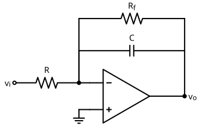
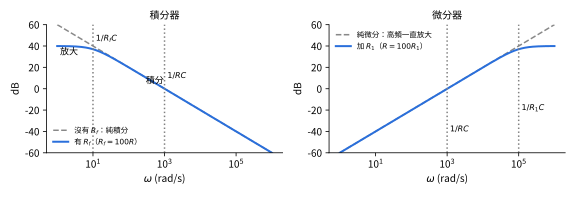
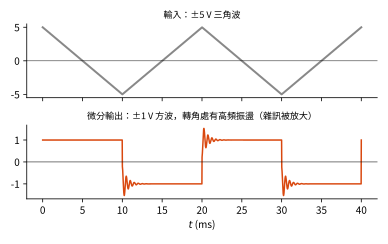

# 第 13 集 · Lec13：積分器並聯 R_f、微分器與高頻雜訊、用積分器解微分方程 [▶ 影片](https://www.youtube.com/watch?v=He9SF0tKNfE)

← 上一集：[12](12-integrator-square-triangle-dc-offset.md) ｜ [總目錄](../README.md) ｜ 下一集：[14](14-pn-photodetector-diode-model.md) →

> **課程**：電子學（一），陽明交大 電子物理系，112 學年度 — 第 13 集
> **講者**：陳振芳 老師
> **來源**：YouTube 錄影逐字稿（1:09:41，人工字幕）＋ Sedra & Smith《Microelectronic Circuits》7th ed. §2.5–2.6
> **標記說明**：`【口頭】` 老師口頭補充；`【課本補充】` 課本有、課堂沒講；`⚠️ 待確認` 查不清楚；`[▶ mm:ss]` 影片時間點

---

## 目錄

- [0. 這堂課要做什麼](#0-這堂課要做什麼)
- [1. 複習：offset 讓積分器 4 分鐘積死](#1-複習offset-讓積分器-4-分鐘積死)
- [2. 電容旁並一個 R_f](#2-電容旁並一個-r_f)
- [3. 加了 R_f 的頻率響應：低頻放大、高頻積分](#3-加了-r_f-的頻率響應低頻放大高頻積分)
- [4. 微分器](#4-微分器)
- [5. 微分器的高頻雜訊與串聯 R_1](#5-微分器的高頻雜訊與串聯-r_1)
- [6. 用積分器解微分方程：彈簧系統](#6-用積分器解微分方程彈簧系統)
- [7. 一頁速查表](#7-一頁速查表)
- [8. 與後續集數的連結](#8-與後續集數的連結)
- [⚠️ 待確認清單](#️-待確認清單)

---

## 0. 這堂課要做什麼

1. 解決上一集的問題：積分器電容旁並一個 $R_f$，offset 就只會讓輸出停在幾 mV。
2. 加了 $R_f$ 的積分器在低頻是放大器、高頻才是積分器。
3. 電容、電阻對調 → 微分器；它會放大高頻雜訊，所以要串一個小電阻 $R_1$。
4. 用兩個積分器 + 反相器 + 加法器解彈簧的微分方程（類比電腦）。

---

## 1. 複習：offset 讓積分器 4 分鐘積死

[▶ 00:09](https://youtu.be/He9SF0tKNfE?t=9)

（詳見上一集第 6、7 節。）實際 op amp 有輸出偏移 $V_{of}$，等效上正端多一個 $V_{of}/A_d$，亦步亦趨變成

$$
v_- = v_+ + \frac{V_{of}}{A_d}
$$

[▶ 06:47](https://youtu.be/He9SF0tKNfE?t=407)

正端接地時負端是 $V_{of}/A_d$，電流 $\dfrac{V_{of}}{A_d R}$ 一直充電容：

$$
v_o(t) \approx \frac{1}{RC}\cdot\frac{V_{of}}{A_d}\,t
$$

$RC = 10^{-3}$ s、$V_{of} = 5$ V、$A_d = 10^5$ → 到 13 V 要 $t = \dfrac{13}{5}\times 10^2 = 260$ s，**約 4 分鐘**。[▶ 12:28](https://youtu.be/He9SF0tKNfE?t=748)

【口頭】拿到這顆 op amp，4 分鐘之內一定要做完實驗：三角波一邊做一邊往上漂，4 分鐘後就死了。op amp「不是真正的 superman」，任何 IC 都會自己跑出不該有的直流。[▶ 13:00](https://youtu.be/He9SF0tKNfE?t=780)

---

## 2. 電容旁並一個 R_f

### 2.1 想法

[▶ 13:31](https://youtu.be/He9SF0tKNfE?t=811)

會積死是因為**電流只有一條路**（只能充電容）。在電容上面再給它一條路 $R_f$，最後直流電流就會走 $R_f$，不再一直充電容。

### 2.2 解微分方程（暫態 + 穩態）

[▶ 15:03](https://youtu.be/He9SF0tKNfE?t=903)

輸入先接地（只看 offset）。設電容電壓 $v_C$，KCL：

$$
\frac{V_{of}/A_d}{R} = \frac{v_C}{R_f} + C\frac{dv_C}{dt}
$$

拆成 $v_C = v_{C,t}(t) + v_{C,ss}$：[▶ 16:06](https://youtu.be/He9SF0tKNfE?t=966)

- 跟時間有關的部分要自己等於 0 → **暫態**（transient）：把輸入源拿掉的解。
- 剩下的常數部分 → **穩態**（steady state）：$d/dt = 0$，電容電流 0，**電容開路**。

【口頭】再做一次給你看，以後就不解微分方程了，直接用這兩個概念。[▶ 19:14](https://youtu.be/He9SF0tKNfE?t=1154)

**時間常數** [▶ 19:46](https://youtu.be/He9SF0tKNfE?t=1186)：輸入源是 op amp 自己產生的那個 $V_{of}/A_d$，把它拿掉 → 負端 0。電容上的電荷要漏，$R$ 兩端都是 0 不能走，只能經 $R_f$：

$$
\tau = R_f C
$$

**穩態** [▶ 22:21](https://youtu.be/He9SF0tKNfE?t=1341)：電容開路 → 就是非反相放大器，輸入是 $V_{of}/A_d$：

$$
v_{o,ss} = \left(1 + \frac{R_f}{R}\right)\frac{V_{of}}{A_d}
$$

**全解**（起始時電容沒電荷，$v_o(0)$ 只有那極小的 $V_{of}/A_d$）：[▶ 24:00](https://youtu.be/He9SF0tKNfE?t=1440)

$$
v_o(t) = \big[v_o(0) - v_{o,ss}\big]e^{-t/R_fC} + v_{o,ss}
$$

指數上升，然後**平下來**——不會死了。

**平在哪裡** [▶ 26:02](https://youtu.be/He9SF0tKNfE?t=1562)：取 $R_f = 100R$：

$$
v_{o,ss} \approx 100 \times \frac{5}{10^5} = 5\ \text{mV}
$$

這麼小，示波器上不仔細看根本看不到它跑上來。取 1000 倍是 50 mV，也還小；但不要取到一萬倍。

### 2.3 直接從電路看

[▶ 27:32](https://youtu.be/He9SF0tKNfE?t=1652)

1. $t = 0$：電容沒電荷 → 電壓 0 → $R_f$ 上沒電流（拉斷）→ 電流 100% 去充電容，電壓上升很快。
2. 電容電壓 0.1、0.2…上升 → $R_f$ 開始分走電流 → 充電變慢。
3. 最後 $R_f$ 的電流 = 全部電流，電容不再充 → 穩態。輸出 = 負端電壓 + 電流 × $R_f$，就是上面的式子。[▶ 29:35](https://youtu.be/He9SF0tKNfE?t=1775)

> 【課本補充】§2.6.3 (p. 103)：加 $R_F$ 後積分器的直流增益從開迴路 $A$ 降到 $-R_F/R$，輸出偏移就變成 $V_{OS}(1 + R_F/R)$；代價是它不再是理想積分器。

---

## 3. 加了 R_f 的頻率響應：低頻放大、高頻積分

[▶ 30:41](https://youtu.be/He9SF0tKNfE?t=1841)

輸入 $v_i e^{j\omega t}$（offset 已經分析完，不要再放進去）。反相放大器 $-Z_f/R$，$Z_f = R_f \parallel \dfrac{1}{j\omega C} = \dfrac{R_f}{1 + j\omega R_f C}$：[▶ 32:16](https://youtu.be/He9SF0tKNfE?t=1936)

$$
\frac{\mathbf{V}_o}{\mathbf{V}_i} = -\frac{R_f}{R}\cdot\frac{1}{1 + j\omega/\omega_0},
\qquad \omega_0 = \frac{1}{R_f C}
$$

- 低頻：平的，大小 $R_f/R$ → **放大器**。
- $\omega > 1/R_fC$：−20 dB/decade → **積分器**。
- 斜線和沒有 $R_f$ 時的純積分線重合：平線高度 $R_f/R$ 乘轉折頻率 $1/R_fC$ = $1/RC$，正好是純積分線過 0 dB 的點。【口頭】「我們考試就考這個。」[▶ 34:51](https://youtu.be/He9SF0tKNfE?t=2091)

**信號落在哪裡決定電路在做什麼** [▶ 36:52](https://youtu.be/He9SF0tKNfE?t=2212)

- 信號全在斜線段 → **pure integrator**（完美積分器）。
- 信號全在平線段 → **pure amplification**（放大器）。
- 跨在轉折兩邊 → 一部分積分、一部分放大。「這很奇怪啦，不過就是這樣。」

**設計條件** [▶ 38:25](https://youtu.be/He9SF0tKNfE?t=2305)

$$
\text{純積分：}\ \omega_{\min} \ge \frac{10}{R_f C},
\qquad
\text{純放大：}\ \omega_{\max} \le \frac{0.1}{R_f C}
$$

給定信號最低頻和 $C$，就能求出 $R_f$ 至少要多大。

---

## 4. 微分器

[▶ 40:35](https://youtu.be/He9SF0tKNfE?t=2435)

積分是因為電容本身有積分關係；把電容和電阻**互換位置**：輸入經 $C$ 接負端，回授是 $R$。

負端 0 → 電容電流 $C\dfrac{dv_i}{dt}$ → 全部流過 $R$：[▶ 41:08](https://youtu.be/He9SF0tKNfE?t=2468)

$$
v_o = -RC\,\frac{dv_i}{dt}
$$

**微分器**（differentiator）。offset 只在負端多一個 $V_{of}/A_d$ 的常數，常數微分是 0，所以**offset 對微分器沒有影響**。[▶ 41:38](https://youtu.be/He9SF0tKNfE?t=2498)

**頻率響應** [▶ 42:09](https://youtu.be/He9SF0tKNfE?t=2529)：

$$
\frac{\mathbf{V}_o}{\mathbf{V}_i} = -\frac{R}{1/j\omega C} = -j\omega RC = -j\frac{\omega}{\omega_0},
\qquad \omega_0 = \frac{1}{RC}
$$

大小 $\omega/\omega_0$，相位 $-90^\circ$（$-1 = e^{\pm j180^\circ}$ 加 $j = e^{j90^\circ}$）。輸入 $\sin\omega t$ → 輸出 $\dfrac{\omega}{\omega_0}\sin(\omega t - 90^\circ)$。波特圖是 **+20 dB/decade** 的直線，和積分器剛好相反。[▶ 44:16](https://youtu.be/He9SF0tKNfE?t=2656)

> 【課本補充】§2.5.3 (p. 94) 也強調微分器是「雜訊放大器」（noise magnifier），所以實務上很少用，常在 $C$ 前串一個小電阻 $R_f$。

---

## 5. 微分器的高頻雜訊與串聯 R_1

### 5.1 問題

[▶ 44:47](https://youtu.be/He9SF0tKNfE?t=2687)

電路裡到處是雜訊：只要有電荷在跑，就有溫度、有隨機運動、有雜訊，而且雜訊頻寬很寬，很高頻都有。微分器**頻率越高放大越多** → 把高頻雜訊放得很大，示波器上會出現一根一根不知道哪來的東西。【口頭】所以積分器用得非常多，微分器相對很少用。[▶ 46:18](https://youtu.be/He9SF0tKNfE?t=2778)

頻率太高時電容短路 → $R/0$，增益無窮大。

### 5.2 解法：電容前串一個小電阻 $R_1$

[▶ 47:22](https://youtu.be/He9SF0tKNfE?t=2842)

$$
\frac{\mathbf{V}_o}{\mathbf{V}_i} = -\frac{R}{R_1 + 1/j\omega C}
= -\frac{R}{R_1}\cdot\frac{1}{1 + \dfrac{1}{j\omega R_1 C}}
$$

[▶ 48:25](https://youtu.be/He9SF0tKNfE?t=2905)

- 高頻：電容短路 → 大小 $R/R_1$，**平了**，不會無窮大。
- 轉折頻率 $1/R_1C$，以下才是 +20 dB/decade 的微分。

### 5.3 雜訊長什麼樣

[▶ 49:59](https://youtu.be/He9SF0tKNfE?t=2999)

把上一集的 ±5 V 三角波（半週期 10 ms）送進微分器：斜率正 → 輸出負、斜率負 → 輸出正，得到 ±1 V 方波（$RC$ 和上次一樣）。

但信號產生器不是 superman：三角波轉角處不可能瞬間改變斜率（那要無窮寬的頻寬），轉角一定帶高頻成分。微分器把它放大 → 轉角處出現**震盪**。[▶ 51:38](https://youtu.be/He9SF0tKNfE?t=3098)

【口頭】它真的會震起來：回授電路本來是負回授不會震，但在某個高頻相位轉了角度變成正回授，加上高頻增益特別大，就會震一下。為什麼、什麼情況會震，要到電子學（三）的尾巴才講，「一年之後」。還好震一下就沒了。[▶ 53:10](https://youtu.be/He9SF0tKNfE?t=3190)

### 5.4 設計條件

[▶ 54:42](https://youtu.be/He9SF0tKNfE?t=3282)

- 要純微分：$\omega_{\max} \le \dfrac{0.1}{R_1 C}$（不然進到平的區域就變成放大）。
- 但 $1/RC$ 也不能離信號太遠：信號太低頻時微分後振幅只剩十分之一、百分之一，「都在地板上」，看不到。[▶ 55:20](https://youtu.be/He9SF0tKNfE?t=3320)

---

## 6. 用積分器解微分方程：彈簧系統

### 6.1 歷史

[▶ 55:51](https://youtu.be/He9SF0tKNfE?t=3351)

【口頭】全世界第一台電腦在 1940 年代，用真空管解微分方程、算彈道軌跡，幫美國國防部，三層樓高。聽說一開機整個費城的燈都暗下來；平均 7 分鐘就要換一顆燒掉的真空管。所以 Bell Labs 的三個人去找半導體材料，讓電子直接在材料裡跑、用電位山控制電流——第一顆電晶體（transistor），之後才有 IC。[▶ 1:08:12](https://youtu.be/He9SF0tKNfE?t=4092)

> ⚠️ 待確認 [▶ 55:51](https://youtu.be/He9SF0tKNfE?t=3351)：字幕寫「Penn State 大學」「費城是一個州」，可能是口誤或字幕錯；本筆記的來源（逐字稿、課本）無法確認這台電腦的學校名稱。

### 6.2 方程

[▶ 56:22](https://youtu.be/He9SF0tKNfE?t=3382)

質量 $m$ 接彈簧，位移 $y$（$y = 0$ 是不施力時的位置）。三個力：外力 $F_a$、彈力 $-ky$（elastic force）、摩擦力 $-\mu\,dy/dt$（friction force，跟速度成正比）。牛頓定律 $F = ma$：

$$
m\frac{d^2y}{dt^2} = F_a - ky - \mu\frac{dy}{dt}
\;\Longrightarrow\;
\frac{d^2y}{dt^2} = \frac{F_a}{m} - k_1 y - k_2\frac{dy}{dt}
$$

$k_1 = k/m$、$k_2 = \mu/m$ 都是電路上的常數。[▶ 58:27](https://youtu.be/He9SF0tKNfE?t=3507)

### 6.3 電路

[▶ 58:59](https://youtu.be/He9SF0tKNfE?t=3539)

1. 假設電路某一點是 $y''$。
2. 積分（$RC = 1$，單位取 ms）→ $-y'$；再積分 → $y$（負負得正）。這個 $y$ 接到示波器。
3. $-y'$ 用**反相器**（兩電阻相等的反相放大）變成 $+y'$，讓符號一致。[▶ 1:00:00](https://youtu.be/He9SF0tKNfE?t=3600)
4. **反相加法器**：$y'$ 經 $R_2/k_2$、$y$ 經 $R_2/k_1$、外力電壓 $v_\text{in}$ 經 $R_2$ 進負端，回授 $R_2$ → 輸出 $-k_2y' - k_1y - v_\text{in}$。外力電壓的符號約定是 $v_\text{in} = -F_a/m$，所以輸出就是方程右邊。[▶ 1:01:00](https://youtu.be/He9SF0tKNfE?t=3660)
5. 這個輸出正是 $y''$ → 接回第 1 步的那一點。電路反應非常快（ns 級）。

【口頭】這裡不用加 $R_f$：外力拿掉後，來回震幾次（幾個 ms）就結束了，積死自己要好幾分鐘，影響還沒到它就結束了。如果要跑很久（例如輸入 sin），就要加 $R_f$，而且要比 $R$ 大、但不能太大。[▶ 1:06:38](https://youtu.be/He9SF0tKNfE?t=3998)

### 6.4 模擬一次

[▶ 1:02:31](https://youtu.be/He9SF0tKNfE?t=3751)

- $t < 0$：加 1 V（$F_a$ 為負，把物體往內壓）。直流不會有速度、加速度，所以 $0 = -k_1 y_0 - v_\text{in}$：

$$
y_0 = -\frac{v_\text{in}}{k_1}
$$

（老師口述寫成「負的 $k_1 v_\text{input}$」；依方程 $0 = -k_1 y_0 - v_\text{in}$ 應是 $-v_\text{in}/k_1$。）物體被壓進去，$y_0$ 是負的。[▶ 1:05:37](https://youtu.be/He9SF0tKNfE?t=3937)
- $t = 0$：拿掉外力（remove $F_a$），讓它自己震——來回振盪、因摩擦而衰減，幾次就結束。示波器上看到的波形和理論計算完全一樣。[▶ 1:06:08](https://youtu.be/He9SF0tKNfE?t=3968)

【口頭】幾個 op amp 幾塊錢、加個電源幾百塊，就解了一個 1940 年代要三層樓電腦才能解的問題。[▶ 1:07:41](https://youtu.be/He9SF0tKNfE?t=4061)

---

## 7. 一頁速查表

| 項目 | 公式 | 關鍵一步 |
|---|---|---|
| offset 積死時間 | $t = 13A_dRC/V_{of}$ ≈ 260 s | 例：5 V、$10^5$、1 ms |
| 加 $R_f$ 的時間常數 | $\tau = R_fC$ | 拿掉輸入，電荷只能經 $R_f$ 漏 |
| 加 $R_f$ 的穩態 | $(1 + R_f/R)V_{of}/A_d$ ≈ 5 mV | 電容開路 → 非反相放大 |
| 加 $R_f$ 的轉換函數 | $-\dfrac{R_f}{R}\cdot\dfrac{1}{1 + j\omega R_fC}$ | $Z_f = R_f \parallel 1/j\omega C$ |
| 純積分條件 | $\omega_{\min} \ge 10/(R_fC)$ | 落在斜線段 |
| 純放大條件 | $\omega_{\max} \le 0.1/(R_fC)$ | 落在平線段 |
| 微分器 | $v_o = -RC\,dv_i/dt$；$-j\omega RC$ | +20 dB/decade，offset 無影響 |
| 微分器加 $R_1$ | $-\dfrac{R}{R_1 + 1/j\omega C}$，高頻平在 $R/R_1$ | 擋住高頻雜訊 |
| 純微分條件 | $\omega_{\max} \le 0.1/(R_1C)$ | |
| 彈簧方程 | $y'' = F_a/m - k_1y - k_2y'$ | 兩次積分 + 反相 + 加法器 |

---

## 8. 與後續集數的連結

| 本集觀念 | 後面在哪裡用到 |
|---|---|
| 高頻相位轉成正回授而震盪 | 電子學（三）第 8 章負回授的穩定度 |
| 低頻放大、高頻積分的形狀 | 2.10 op amp 本身的頻率響應（單極點） |
| 方波／三角波 | 第 6 章信號產生 |
| 下一集 | 2.5 P-N 介面光偵測器、二極體 |

---

## 附：本集一句話總結

> **積分器電容旁並 $R_f$，給直流一條路，offset 只讓輸出停在 $(1+R_f/R)V_{of}/A_d$（幾 mV），代價是低頻變成增益 $R_f/R$ 的放大器、$1/R_fC$ 以上才是積分；電容電阻互換是微分器，會把高頻雜訊放大到震盪，所以電容前串小電阻 $R_1$ 讓高頻平在 $R/R_1$；兩個積分器加反相器、加法器就能解彈簧的微分方程。**

---

## ⚠️ 待確認清單

1. [▶ 55:51](https://youtu.be/He9SF0tKNfE?t=3351) 第一台電腦所在學校：字幕「Penn State 大學」「費城是一個州」，無法從本筆記的來源確認。

---

*筆記依據陳振芳老師「電子學（一）」112 學年度 Lec13 錄影逐字稿（人工字幕，1:09:41）與 Sedra & Smith《Microelectronic Circuits》7th ed. 整理。*
