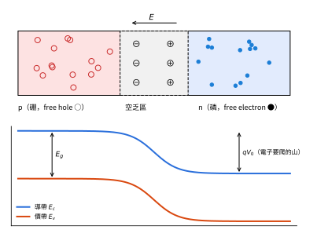
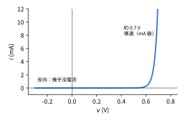

# 第 14 集 · Lec14：P-N 介面、二極體、光偵測器的等效模型 [▶ 影片](https://www.youtube.com/watch?v=ROKlwmtaEzA)

← 上一集：[13](13-integrator-dc-problem-differentiator.md) ｜ [總目錄](../README.md) ｜ 下一集：[15](15-photodetector-transimpedance-street-light.md) →

> **課程**：電子學（一），陽明交大 電子物理系，112 學年度 — 第 14 集
> **講者**：陳振芳 老師
> **來源**：YouTube 錄影逐字稿（46:01，人工字幕）＋ Sedra & Smith《Microelectronic Circuits》7th ed. Ch 3、§4.7.3
> **標記說明**：`【口頭】` 老師口頭補充；`【課本補充】` 課本有、課堂沒講；`⚠️ 逐字稿缺字` 字幕或口誤；`[▶ mm:ss]` 影片時間點

---

## 目錄

- [0. 這堂課要做什麼](#0-這堂課要做什麼)
- [1. 矽與共價鍵：價電子不會導電](#1-矽與共價鍵價電子不會導電)
- [2. 摻雜：n 型與 p 型](#2-摻雜n-型與-p-型)
- [3. P-N 介面：擴散、空乏區、內建電場](#3-p-n-介面擴散空乏區內建電場)
- [4. 位能障與能帶圖](#4-位能障與能帶圖)
- [5. 正向偏壓與二極體方程](#5-正向偏壓與二極體方程)
- [6. 光偵測器：光電流](#6-光偵測器光電流)
- [7. 接上負載：光電流被二極體吃掉一部分](#7-接上負載光電流被二極體吃掉一部分)
- [8. 光偵測器的等效模型](#8-光偵測器的等效模型)
- [9. 抓電壓：得到 log，不好用](#9-抓電壓得到-log不好用)
- [10. 一頁速查表](#10-一頁速查表)
- [11. 與後續集數的連結](#11-與後續集數的連結)

---

## 0. 這堂課要做什麼

op amp 的另一個應用要用到**光偵測器**（photodetector），所以先講一點半導體物理：

1. 矽、共價鍵、摻雜 → n 型、p 型。
2. P-N 介面的空乏區、內建電場、位能障 → 二極體方程（先接受，下一章推導）。
3. 照光產生光電流；光偵測器的等效模型 = 電流源並聯一顆二極體。
4. 用電壓去「抓」它會得到 log 的關係——不好用，下一集改抓電流。

---

## 1. 矽與共價鍵：價電子不會導電

[▶ 00:40](https://youtu.be/ROKlwmtaEzA?t=40)

- 矽（silicon）最外圍有 8 個空位，卻只有 4 個電子。填滿能量最低最高興，所以它去抓旁邊矽原子的電子，你抓我、我抓你，共用 → **共價鍵**（covalent bond）。[▶ 01:12](https://youtu.be/ROKlwmtaEzA?t=72)
- 每個矽周圍 4 顆矽，8 個位置剛好填滿 → **單晶**（crystal）。
- 共價鍵上的電子叫**價電子**（valence electron），被抓得緊緊的，不能動，**不是自由電子**（free electron）→ 不導電。純矽單晶「像玻璃一樣」，沒什麼用。[▶ 02:45](https://youtu.be/ROKlwmtaEzA?t=165)

---

## 2. 摻雜：n 型與 p 型

### 2.1 n 型：加五價的磷

[▶ 03:18](https://youtu.be/ROKlwmtaEzA?t=198)

高溫下把**磷**（P，五價）摻進去，佔據一個矽的位置。磷多一個電子，但沒有位置給它 → 室溫下就跑掉，成為**自由電子**。

- 每加一顆磷 → 一個 free electron（帶負電）＋ 一個固定不動的正離子 $\mathrm{P}^+$（加進去是中性，跑掉一個負電就帶正電）。[▶ 04:52](https://youtu.be/ROKlwmtaEzA?t=292)
- 很多自由電子 → **n 型半導體**（n-type）。

### 2.2 p 型：加三價的硼

[▶ 06:24](https://youtu.be/ROKlwmtaEzA?t=384)

摻**硼**（B，三價）→ 少一個電子，留下一個**空位**。旁邊共價鍵的電子被拉過來填它，那邊又變成空位……

- 【口頭】沒有空位，價電子是不能動的；一旦有空位，旁邊的價電子就能藉著空位移動。與其追蹤一大堆價電子，不如直接看那個空位怎麼動。[▶ 07:28](https://youtu.be/ROKlwmtaEzA?t=448)
- 這個會動的空位叫**電洞**（hole）。其實是帶負電的價電子在動，空位往相反方向動，所以電洞**帶正電**。
- 每加一顆硼 → 一個 free hole ＋ 一個固定的負離子 $\mathrm{B}^-$ → **p 型半導體**。[▶ 09:01](https://youtu.be/ROKlwmtaEzA?t=541)

---

## 3. P-N 介面：擴散、空乏區、內建電場

[▶ 10:04](https://youtu.be/ROKlwmtaEzA?t=604)

把 p 和 n 接在一起，交界叫**介面**（junction）。

1. **擴散**（diffusion）：n 側擠滿自由電子、p 側沒有 → 電子往 p 側跑；電洞同理往 n 側跑。【口頭】像捷運一節車廂擠滿、旁邊車廂是空的。半導體裡擴散是很強的力量。
2. free electron ＋ free hole → 填進空位變回價電子，不動、不導電。[▶ 10:34](https://youtu.be/ROKlwmtaEzA?t=634)
3. 介面附近於是**既沒有自由電子也沒有自由電洞**，只剩固定的離子：n 側的 $\mathrm{P}^+$、p 側的 $\mathrm{B}^-$。這塊叫**空乏區**（depletion region）。[▶ 11:34](https://youtu.be/ROKlwmtaEzA?t=694)
4. 正離子到負離子之間就有電場（像平行電容板）→ **內建電場**（built-in field），不是外加的。[▶ 12:35](https://youtu.be/ROKlwmtaEzA?t=755)

---

## 4. 位能障與能帶圖

[▶ 13:05](https://youtu.be/ROKlwmtaEzA?t=785)

- p 側的電洞想繼續擴散到 n 側，但電場把它推回去。要過去，得施力克服電場、對它做正功 → 電洞在 n 側的能量比較高，相差 $V_0$。
- 電子同理，也要爬山才能過到 p 側。[▶ 15:41](https://youtu.be/ROKlwmtaEzA?t=941)
- 這座山叫**位能障**（potential barrier）：電子、電洞都要爬山。

**能帶圖**（energy band diagram）[▶ 16:43](https://youtu.be/ROKlwmtaEzA?t=1003)：電洞和電子的山方向相反，只能選一種來畫，「電子比較偉大」，所以畫電子的。

- 導帶、價帶之間是**能隙**（energy gap），中間不能放電子，大小固定 → 兩條帶平行地在介面彎下來。
- n 側：導帶裡很多自由電子，正離子畫在導帶下面一點（室溫就能解離）。p 側：價帶裡很多自由電洞，負離子畫在價帶上面一點。空乏區只剩離子。[▶ 18:49](https://youtu.be/ROKlwmtaEzA?t=1129)

> ⚠️ 逐字稿缺字 [▶ 20:19](https://youtu.be/ROKlwmtaEzA?t=1219)：字幕「silicon 材料的能隙 1.5 eV 接近啦 1.46 還是多少」。【課本補充】課本 §3.1 (p. 137) 給的矽能隙是 $E_g = 1.12$ eV（室溫）。

> 【課本補充】§3.4 (p. 148) 推出內建電壓 $V_0 = V_T\ln\dfrac{N_A N_D}{n_i^2}$，一般矽約 0.6～0.9 V。

---

## 5. 正向偏壓與二極體方程

[▶ 21:19](https://youtu.be/ROKlwmtaEzA?t=1279)

p 接正、n 接負，外加電壓 $v$：

- p 側、n 側有大量自由載子，導電好、電阻小；空乏區沒有載子，電阻特別大。電流處處一樣，所以**電壓幾乎全跨在空乏區**。[▶ 21:49](https://youtu.be/ROKlwmtaEzA?t=1309)
- 外加電場方向和內建電場**相反** → 山變矮：$V_0 \to V_0 - v$。[▶ 22:19](https://youtu.be/ROKlwmtaEzA?t=1339)
- 這叫**正向偏壓**（forward bias）：reduce the potential barrier → 電洞、電子過得去 → 電流開始流。

這個元件就是**二極體**（diode），符號是三角形（p 端）加一條線（n 端），像一個箭頭指出電流方向。[▶ 23:54](https://youtu.be/ROKlwmtaEzA?t=1434)

**二極體方程**（先接受，下一章推導）：[▶ 24:26](https://youtu.be/ROKlwmtaEzA?t=1466)

$$
i = I_s\left(e^{v/V_T} - 1\right)
$$

- $I_s$：和材料、摻雜濃度有關，非常小，約 $10^{-14}$～$10^{-15}$ A。
- $V_T \approx 0.025$ V（室溫），和溫度有關。

- 電壓小時幾乎沒電流；到 0.6～0.7 V 才有 mA 級電流。0.6 到 0.8 V 之間電流跨約 4 個數量級（0.1 mA 到 100 mA）。我們就把 **0.7 V 當作導通**。[▶ 26:00](https://youtu.be/ROKlwmtaEzA?t=1560)
- **反向**偏壓把山提得更高，更不能流 → 幾乎沒電流。只讓一個方向過 → **整流**（rectification）。[▶ 26:31](https://youtu.be/ROKlwmtaEzA?t=1591)

---

## 6. 光偵測器：光電流

[▶ 27:02](https://youtu.be/ROKlwmtaEzA?t=1622)

- 把空乏區做寬一點（摻雜濃度低一點就會寬）。
- 光照到空乏區，光子能量只要比能隙大，就把共價鍵上的電子打出來 → 一個自由電子 ＋ 一個電洞：**電子電洞對**（electron-hole pair）。一個光子產生一對。[▶ 28:04](https://youtu.be/ROKlwmtaEzA?t=1684)
- 它們本來會再結合，還好空乏區裡有**電場把它們掃開**：電子往 n 側、電洞往 p 側。場越大，掃開越強。這就是為什麼要打在空乏區。[▶ 29:37](https://youtu.be/ROKlwmtaEzA?t=1777)
- 穩態下電子加電洞在任一截面形成電流 → **光電流** $i_{ph}$。[▶ 31:08](https://youtu.be/ROKlwmtaEzA?t=1868)

$$
i_{ph} \propto \text{光強度} \times \text{效率（例 0.7～0.8）}
$$

效率小於 1：有些光被反射，有些電子電洞對還是結合了、變成熱。[▶ 32:08](https://youtu.be/ROKlwmtaEzA?t=1928)

**方向**：光電流的方向和**正向電流相反**（場把電子掃向 n、電洞掃向 p）。[▶ 33:41](https://youtu.be/ROKlwmtaEzA?t=2021)

> 【課本補充】§4.7.3 (p. 228)：光二極體（photodiode）通常操作在反向偏壓，反向電流隨光強度增加；常用化合物半導體如砷化鎵（GaAs）製作。

---

## 7. 接上負載：光電流被二極體吃掉一部分

[▶ 34:12](https://youtu.be/ROKlwmtaEzA?t=2052)

光偵測器接到放大器，輸入電阻 $R_i$：

1. 光電流流過 $R_i$，產生電壓 $v = i_{ph}R_i$。
2. 這個電壓回過頭來跨在二極體上，**方向剛好是正向偏壓** → 產生正向電流 $I_s(e^{v/V_T} - 1)$，方向和光電流相反。[▶ 35:14](https://youtu.be/ROKlwmtaEzA?t=2114)
3. 所以真正流過 $R_i$ 的是兩者相減：[▶ 36:50](https://youtu.be/ROKlwmtaEzA?t=2210)

$$
v = \left[i_{ph} - I_s\left(e^{v/V_T} - 1\right)\right]R_i
$$

一邊是線性、一邊是指數，寫不出好的解。

---

## 8. 光偵測器的等效模型

[▶ 38:23](https://youtu.be/ROKlwmtaEzA?t=2303)

兩個電流相加減 → 一定是**並聯**：

- 一個電流源 $i_{ph}$（光的貢獻）。
- 沒有光時 $i_{ph} = 0$，但倒看回去，**二極體還在**，加電壓它照樣有正向電流。【口頭】「沒有打光，二極體不會消失。」[▶ 38:53](https://youtu.be/ROKlwmtaEzA?t=2333)

$$
\text{光偵測器} = \text{電流源 } i_{ph} \text{ 並聯一顆二極體}
$$

回想第 02 集：信號源 = 電壓源串聯 $R_s$，或電流源並聯 $R_s$。這裡就是電流源並聯，**內電阻 $R_s$ 就是那顆二極體**——和第 03 集麥克風的內阻是電容一樣，不一定是電阻。[▶ 40:28](https://youtu.be/ROKlwmtaEzA?t=2428)

---

## 9. 抓電壓：得到 log，不好用

[▶ 41:32](https://youtu.be/ROKlwmtaEzA?t=2492)

用第 10 集的非反相放大器（輸入電阻無窮大）去接 → 輸入端**開路**，外面不能有電流。光電流只能 100% 流進自己的二極體：[▶ 43:04](https://youtu.be/ROKlwmtaEzA?t=2584)

$$
i_{ph} = I_s\left(e^{v/V_T} - 1\right)
\quad\Longrightarrow\quad
v = V_T\ln\left(\frac{i_{ph}}{I_s} + 1\right)
$$

[▶ 44:05](https://youtu.be/ROKlwmtaEzA?t=2645)

要抓的是光電流，抓到的卻是它除以一個不知道多少的 $I_s$ 再取 log。【口頭】抓電壓不合理，這個電路不能用。[▶ 44:35](https://youtu.be/ROKlwmtaEzA?t=2675)

**下一集**：改成**抓電流**——輸出端短路，二極體兩端壓差 0、沒有電流，光電流全部流出來。【口頭】這就是第 02 集說的「有的感測器一定要抓電流」。[▶ 45:06](https://youtu.be/ROKlwmtaEzA?t=2706)

---

## 10. 一頁速查表

| 項目 | 內容 | 關鍵 |
|---|---|---|
| 價電子 vs 自由電子 | 共價鍵上的不能動；跑掉的才能導電 | |
| n 型 | 摻磷（五價）→ free electron + $\mathrm{P}^+$ | |
| p 型 | 摻硼（三價）→ free hole + $\mathrm{B}^-$ | 電洞帶正電 |
| 空乏區 | 擴散後只剩離子 → 內建電場 | 電阻最大 |
| 位能障 | 電子、電洞都要爬 $V_0$ | 能帶圖畫電子的 |
| 正向偏壓 | p 接正 → 山變 $V_0 - v$ | 電壓跨在空乏區 |
| 二極體方程 | $i = I_s(e^{v/V_T} - 1)$ | $I_s \sim 10^{-14}$ A，$V_T = 25$ mV |
| 導通電壓 | 約 0.7 V | 0.6–0.8 V 跨 4 個數量級 |
| 光電流 | 光子 → 電子電洞對 → 場掃開 | 方向和正向電流相反 |
| 光偵測器模型 | $i_{ph}$ 並聯二極體 | 內阻 = 二極體 |
| 開路抓電壓 | $v = V_T\ln(i_{ph}/I_s + 1)$ | 不好用 |

---

## 11. 與後續集數的連結

| 本集觀念 | 後面在哪裡用到 |
|---|---|
| 抓電流 | 下一集：光偵測器的電流電壓轉換器（轉阻放大器）、自動街燈 |
| 二極體方程 | 第 3 章 P-N 介面完整推導（電子學二） |
| 電洞、電子、空乏區 | 第 4 章 MOSFET、第 5 章 BJT 的物理 |
| 雷射／LED 光強度和電流成正比 | 2.7 光發射元件 |

---

## 附：本集一句話總結

> **摻磷得自由電子、摻硼得電洞，P-N 接起來擴散出只剩離子的空乏區和內建電場（一座位能障），正向偏壓把山壓低就有 $I_s(e^{v/V_T}-1)$ 的電流；光照進空乏區產生被電場掃開的光電流，所以光偵測器 = 電流源並聯一顆二極體，用電壓去抓只會得到 log，得改抓電流。**

---

*筆記依據陳振芳老師「電子學（一）」112 學年度 Lec14 錄影逐字稿（人工字幕，46:01）與 Sedra & Smith《Microelectronic Circuits》7th ed. 整理。*
