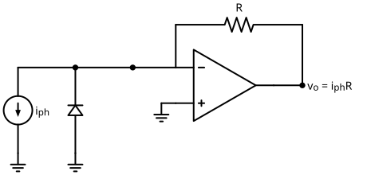
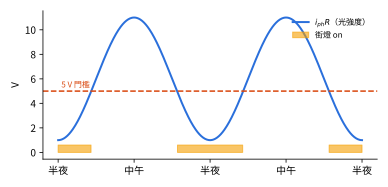

# 第 15 集 · Lec15：光偵測器要抓電流——電流電壓轉換器、自動街燈系統、BJT 與保護二極體 [▶ 影片](https://www.youtube.com/watch?v=zdMD_Vaboqw)

← 上一集：[14](14-pn-photodetector-diode-model.md) ｜ [總目錄](../README.md) ｜ 下一集：[16](16-photodetector-iv-conversion-light-emitter.md) →

> **課程**：電子學（一），陽明交大 電子物理系，112 學年度 — 第 15 集
> **講者**：陳振芳 老師
> **來源**：YouTube 錄影逐字稿（1:25:21，人工字幕）＋ Sedra & Smith《Microelectronic Circuits》7th ed. §4.7.3、Table 1.1
> **標記說明**：`【口頭】` 老師口頭補充；`【課本補充】` 課本有、課堂沒講；`⚠️ 逐字稿缺字` 字幕或口誤；`[▶ mm:ss]` 影片時間點

---

## 目錄

- [0. 這堂課要做什麼](#0-這堂課要做什麼)
- [1. 複習：光電流與暗電流](#1-複習光電流與暗電流)
- [2. 三種接法：電阻、開路、短路](#2-三種接法電阻開路短路)
- [3. 電流電壓轉換器：把光電流全部抓出來](#3-電流電壓轉換器把光電流全部抓出來)
- [4. 兩種等效模型的對應](#4-兩種等效模型的對應)
- [5. 自動街燈：比較器 + 二極體 + 繼電器](#5-自動街燈比較器--二極體--繼電器)
- [6. 電流不夠：加一顆 BJT](#6-電流不夠加一顆-bjt)
- [7. BJT 射基極反向崩潰：再串一顆二極體](#7-bjt-射基極反向崩潰再串一顆二極體)
- [8. 繼電器是電感：飛輪（保護）二極體](#8-繼電器是電感飛輪保護二極體)
- [9. 一頁速查表](#9-一頁速查表)
- [10. 與後續集數的連結](#10-與後續集數的連結)

---

## 0. 這堂課要做什麼

1. 光偵測器後面接不同的放大器，結果截然不同：接電阻 → 解不出；開路 → log；**短路 → 線性**。
2. 用 op amp 做出「輸入電阻 0」的**電流電壓轉換器**（I-V converter）。
3. 拿它設計交大的**自動街燈系統**，一路碰到實際問題：op amp 電流不夠 → BJT；BJT 反向崩潰 → 串二極體；繼電器是電感 → 飛輪二極體。

---

## 1. 複習：光電流與暗電流

[▶ 00:09](https://youtu.be/zdMD_Vaboqw?t=9)

- 光要打在空乏區（那裡才有電場），產生的電子電洞對被電場掃開 → **光電流** $i_{ph} = \eta \times$ 光強度（$\eta$ 是效率）。[▶ 02:45](https://youtu.be/zdMD_Vaboqw?t=165)
- 接一個電阻 $R$：光電流在 $R$ 上產生電壓 $v$，這個電壓正好讓二極體**正向偏壓**，二極體自己又流一個正向電流 $I_s(e^{v/V_T} - 1)$——沒有照光也會有，叫**暗電流**（dark current，in the dark）。[▶ 05:49](https://youtu.be/zdMD_Vaboqw?t=349)

$$
v = \left[i_{ph} - I_s\left(e^{v/V_T} - 1\right)\right]R
$$

模型：**電流源 $i_{ph}$ 並聯一顆不照光的二極體**（詳見[上一集](14-pn-photodetector-diode-model.md#8-光偵測器的等效模型)）。[▶ 10:58](https://youtu.be/zdMD_Vaboqw?t=658)

---

## 2. 三種接法：電阻、開路、短路

### 2.1 接反相放大器 = 接一個電阻

[▶ 07:23](https://youtu.be/zdMD_Vaboqw?t=443)

反相放大器負端是虛接地，從輸入看進去就是 $R_1$ 到地 → 等於接一個電阻 $R_1$，得到上面那條解不出來的式子（再乘 $R_2/R_1$，注意 $v_i = -v$ 的方向）。抓到的東西很複雜。[▶ 08:56](https://youtu.be/zdMD_Vaboqw?t=536)

### 2.2 開路：抓電壓

[▶ 12:07](https://youtu.be/zdMD_Vaboqw?t=727)

開路 → 外面沒電流 → 光電流全被自己的二極體吃掉：

$$
v_{oc} = V_T\ln\left(\frac{i_{ph}}{I_s} + 1\right)
$$

用**電壓追隨器**（輸入電阻無窮大）就是開路，輸出 = $v_{oc}$。這叫 **open circuit voltage**——開路能抓到最大的電壓。[▶ 13:41](https://youtu.be/zdMD_Vaboqw?t=821)

### 2.3 短路：抓電流

[▶ 16:47](https://youtu.be/zdMD_Vaboqw?t=1007)

輸出短路 → 二極體兩端 0 V → 沒有暗電流 → **光電流 100% 流出來**。問題是怎麼「短路」又能把電流量出來？→ 下一節。

---

## 3. 電流電壓轉換器：把光電流全部抓出來

[▶ 17:20](https://youtu.be/zdMD_Vaboqw?t=1040)

op amp 正端接地，負端到輸出接一個 $R$（一定要有負回授），光偵測器接負端：

- 亦步亦趨 → 負端 = 0 V。從這裡看進去：電壓 0、卻有電流流進來 → **輸入電阻 $R_i = 0$**，等於短路。[▶ 18:23](https://youtu.be/zdMD_Vaboqw?t=1103)
- 【口頭】兩點實質上沒有接，但 op amp 的力量讓它們等效上接在一起。[▶ 19:25](https://youtu.be/zdMD_Vaboqw?t=1165)
- 二極體兩端 0 V → 沒有暗電流 → 光電流全部流出；op amp 輸入吃不進電流 → 全部流過 $R$：[▶ 19:55](https://youtu.be/zdMD_Vaboqw?t=1195)

$$
v_o = i_{ph}\,R
$$

這叫抓到 **short circuit current**。和光強度**成線性**。

| 接法 | 輸入電阻 | 抓到 | 和光強度的關係 |
|---|---|---|---|
| 電壓追隨器 | ∞（開路） | 只有電壓 $v_{oc}$ | log |
| 電流電壓轉換器 | 0（短路） | 只有電流 $i_{sc} = i_{ph}$ | 線性 |
| 一般電阻 | 中間 | 電壓電流都有一點 | 解不出 |

【口頭】抓 log 幹嘛？難道後面再接一個 exponential 放大器倒回來嗎？何必。[▶ 22:00](https://youtu.be/zdMD_Vaboqw?t=1320)

這個電路叫 **I-V converter**（電流 → 電壓轉換器）；之前的非反相放大器是 v→v amplifier。輸入是光偵測器，就要用這個。[▶ 27:44](https://youtu.be/zdMD_Vaboqw?t=1664)

> 【課本補充】Table 1.1 (p. 28) 把「輸入電流、輸出電壓」的放大器叫**轉阻放大器**（transresistance amplifier），理想的 $R_i = 0$、$R_o = 0$，增益單位是 Ω。這個電路就是最基本的轉阻放大器；§4.7.3 也說光二極體常這樣接。

---

## 4. 兩種等效模型的對應

[▶ 22:30](https://youtu.be/zdMD_Vaboqw?t=1350)

信號源只有兩種模型：電壓源串聯 $R_s$，或電流源並聯 $R_s$；同一個信號源時 $i_s = v_s/R_s$。光偵測器：

- **電流源並聯**：電流源 = $i_{ph}$，$R_s$ = 那顆二極體。很簡單。
- **電壓源串聯**：電壓源 = $V_T\ln(i_{ph}/I_s + 1)$，串聯同一顆二極體。很複雜。[▶ 25:40](https://youtu.be/zdMD_Vaboqw?t=1540)

驗證：電壓源模型短路時，這個電壓整個跨在二極體上，代入 $I_s(e^{v/V_T} - 1)$，log 和 exponential 消掉，正好得到 $i_{ph}$。[▶ 26:11](https://youtu.be/zdMD_Vaboqw?t=1571)

【口頭】這個例子告訴你：到底要抓電流還是抓電壓，看哪一個模型簡單。[▶ 27:11](https://youtu.be/zdMD_Vaboqw?t=1631)

---

## 5. 自動街燈：比較器 + 二極體 + 繼電器

### 5.1 光強度與門檻

[▶ 28:44](https://youtu.be/zdMD_Vaboqw?t=1724)

電流電壓轉換器輸出 $i_{ph}R$ 代表太陽光強度：中午最強、半夜最弱。設一個門檻（critical level）**5 V**：大於 5 V 是白天、街燈 off；小於 5 V 是晚上、街燈 on。[▶ 30:49](https://youtu.be/zdMD_Vaboqw?t=1849)

### 5.2 比較器

[▶ 32:51](https://youtu.be/zdMD_Vaboqw?t=1971)

op amp **不接回授**（接回授就變放大器了），只拿來比大小：$i_{ph}R$ 接負端、5 V 接正端。電源取 ±12 V，輸出飽和在約 ±10 V，不會停在中間。[▶ 34:22](https://youtu.be/zdMD_Vaboqw?t=2062)

- 白天（例 7 V > 5 V）：負端大 → 輸出 **−10 V**。
- 晚上（< 5 V）：正端大 → 輸出 **+10 V**。

### 5.3 二極體 + 繼電器

[▶ 36:26](https://youtu.be/zdMD_Vaboqw?t=2186)

比較器輸出接**二極體**（整流：導通跨 0.7 V，不導通沒電流），再經電阻 $R$ 接**繼電器**（relay）。繼電器有電流 → 線圈產生磁場 → 吸住開關 → 220 V 的大功率街燈電路導通。[▶ 37:59](https://youtu.be/zdMD_Vaboqw?t=2279)

【口頭】二極體電路「用猜的」：它不是導通就是不導通，猜一個，再驗證。[▶ 36:58](https://youtu.be/zdMD_Vaboqw?t=2218)

- **白天 −10 V**：猜不導通 → 沒電流 → 繼電器那端 0 V → 二極體跨 −10 V，確實不導通 ✓ → 街燈不亮。[▶ 39:00](https://youtu.be/zdMD_Vaboqw?t=2340)
- **晚上 +10 V**：猜導通 → 二極體跨 0.7 V → 剩 9.3 V。繼電器線圈只是繞圈的導線、電阻很小，直接接會產生很大的電流、浪費電 → 用 $R$ 控制電流。繼電器規格 10 mA 就能吸合 → $R = 9.3/10 = 0.93$ kΩ。[▶ 42:06](https://youtu.be/zdMD_Vaboqw?t=2526)

---

## 6. 電流不夠：加一顆 BJT

[▶ 44:38](https://youtu.be/zdMD_Vaboqw?t=2678)

如果繼電器要 **20 mA** 才吸得動？把 $R$ 減半（9.3/20 kΩ）——但 op 741 輸出最大只有約 **13 mA**，$R$ 再小也沒用，繼電器吸不動。[▶ 45:08](https://youtu.be/zdMD_Vaboqw?t=2708)

→ 需要一個**放大電流**的元件：**雙極性介面電晶體**（bipolar junction transistor, BJT）。物理到電子學（二）才講，現在先拿來用。[▶ 46:40](https://youtu.be/zdMD_Vaboqw?t=2800)

**BJT 怎麼用** [▶ 47:44](https://youtu.be/zdMD_Vaboqw?t=2864)

- 三隻腳：**基極** B（base）、**射極** E（emitter，有箭頭）、**集極** C（collector）。
- B–E 之間就是一個 P-N 介面二極體 → 直接拿它取代原來的二極體，導通一樣跨 0.7 V。
- 條件：集極電壓要比射極高（這裡接 10 V，一定夠高）。[▶ 48:45](https://youtu.be/zdMD_Vaboqw?t=2925)
- 電流關係（$\beta$ 約 50～200，每顆不一樣）：[▶ 49:17](https://youtu.be/zdMD_Vaboqw?t=2957)

$$
i_C = \beta\,i_B,
\qquad
i_E = (1 + \beta)\,i_B
$$

> ⚠️ 逐字稿缺字 [▶ 48:45](https://youtu.be/zdMD_Vaboqw?t=2925)：字幕「如果你 1 比 c 高」，依上下文應是「c（集極）比 e（射極）高」。

**結果** [▶ 51:18](https://youtu.be/zdMD_Vaboqw?t=3078)：射極接 $R$ 和繼電器。+10 V 時 B–E 導通，射極 9.3 V，$R = 9.3/20 \approx 0.47$ kΩ → 射極電流 20 mA。$\beta = 100$ 時基極只要 $20/100 = 0.2$ mA，op amp 一點都不吃力。大電流是從集極（10 V 電源）供應的。[▶ 52:19](https://youtu.be/zdMD_Vaboqw?t=3139)

【口頭】op amp 提供電壓沒問題，可以做各種數學運算；但要它提供大電流它很吃力，它本來就不是做這個的。要大電流就交給 BJT。[▶ 53:53](https://youtu.be/zdMD_Vaboqw?t=3233)

> 【課本補充】這種接法（集極接電源、射極接負載、輸出跟著基極電壓走）課本叫**射極隨耦器**（emitter follower），第 6、7 章會詳細分析。

---

## 7. BJT 射基極反向崩潰：再串一顆二極體

[▶ 54:26](https://youtu.be/zdMD_Vaboqw?t=3266)

白天輸出 −10 V：B–E 不導通、沒電流 → 射極那端 0 V → **B–E 接面反向偏壓 10 V**。

- 一般二極體反向太大也會**崩潰**（breakdown）：一打穿就等於短路。普通二極體的崩潰電壓約十幾伏（例 −14 V），撐得住 10 V。[▶ 56:30](https://youtu.be/zdMD_Vaboqw?t=3390)
- 但 **BJT 的 B–E 接面只能撐反向約 7 V**：BJT 中間要做得很窄，比較難做、難控制。[▶ 57:03](https://youtu.be/zdMD_Vaboqw?t=3423)
- 10 V > 7 V → 崩潰 → 大電流乘大電壓 → 燒壞。「等它不導通的時候燒壞了。」[▶ 59:15](https://youtu.be/zdMD_Vaboqw?t=3555)

**解法** [▶ 1:00:17](https://youtu.be/zdMD_Vaboqw?t=3617)：射極再**串一顆普通二極體**。反向時兩個都不導通，要兩個都崩潰才會壞：能撐 $14 + 7 = 21$ V > 10 V ✓。

導通時多一個 0.7 V：射極這邊剩 $10 - 1.4 = 8.6$ V，$R$ 改成 $8.6/20$ kΩ 就還是 20 mA。[▶ 1:02:51](https://youtu.be/zdMD_Vaboqw?t=3771)

> 【口頭】老師說「pnp 的電晶體它就是這樣」[▶ 57:03](https://youtu.be/zdMD_Vaboqw?t=3423)；本電路畫的是箭頭朝外的 npn（集極接正電源），B–E 反向崩潰約 6～7 V 對 npn 也成立。

---

## 8. 繼電器是電感：飛輪（保護）二極體

### 8.1 問題：關掉的瞬間

[▶ 1:04:28](https://youtu.be/zdMD_Vaboqw?t=3868)

繼電器線圈是一個**電感**。電感、電容都有微分關係，$dt$ 很小時會產生很大的電壓或電流。

早上 6、7 點，比較器從 +10 V 瞬間變 −10 V → BJT 從導通到關閉（假設 $\Delta t = 1\ \mu$s）→ 電感電流從 20 mA 瞬間變 0。電感會反抗（冷次定律 Lenz's law）：[▶ 1:07:37](https://youtu.be/zdMD_Vaboqw?t=4057)

$$
v = L\frac{di}{dt} = 5\times10^{-3}\ \text{H}\times\frac{0 - 20\ \text{mA}}{10^{-6}\ \text{s}} = -100\ \text{V}
$$

（$L = 5$ mH 是假設值。）

- 繼電器上端瞬間 −100 V、BJT 基極 −10 V → B–E（和串聯的二極體）被加了 **90 V 的正向偏壓**。正向 0.7 V 電流就指數上升了，90 V 是天文數字 → **BJT 燒掉**。[▶ 1:12:21](https://youtu.be/zdMD_Vaboqw?t=4341)

【口頭】老師在美國念書時操作老闆的大型 X-ray 系統，每次關機後下次就打不開——拆開一看，電感旁邊的 BJT 都燒了，就是這個問題。[▶ 1:11:51](https://youtu.be/zdMD_Vaboqw?t=4311)

### 8.2 解法：給電感一條路

[▶ 1:14:33](https://youtu.be/zdMD_Vaboqw?t=4473)

電感的電流不能瞬間從有變無；你不給它路走，它就用無窮大的電壓抵抗你。→ 在繼電器旁**並聯一顆二極體**（反向接）：

- **平常導通時**：繼電器上端只比地高一點點（線圈內阻 × 20 mA），這顆二極體是反向，不導通，不影響。[▶ 1:17:39](https://youtu.be/zdMD_Vaboqw?t=4659)
- **關掉的瞬間**：電感想把上端拉到 −100 V，但只要到 −0.7 V，這顆二極體就導通，原本的 20 mA 由它繼續流 → −100 V 不可能發生，最多 −0.7 V。[▶ 1:19:10](https://youtu.be/zdMD_Vaboqw?t=4750)
- 這時 BJT 那邊：基極 −10 V、射極側 −0.7 V → 反向 9.3 V < 21 V，撐得住 ✓。[▶ 1:22:44](https://youtu.be/zdMD_Vaboqw?t=4964)

這顆叫**保護二極體**（protection diode）、**飛輪二極體**（flyback diode）：provide a current path，只在關掉的那一剎那導通。[▶ 1:20:11](https://youtu.be/zdMD_Vaboqw?t=4811)

【口頭】電路當開關用、做瞬間 on/off 時要特別小心：電感瞬間斷電流會產生很大的反向電壓；電容瞬間被短路（兩端都硬接地）會爆出很大的電流——大電容甚至可能電到碰機殼的人。[▶ 1:23:46](https://youtu.be/zdMD_Vaboqw?t=5026)

---

## 9. 一頁速查表

| 項目 | 公式／做法 | 關鍵 |
|---|---|---|
| 光偵測器接電阻 | $v = [i_{ph} - I_s(e^{v/V_T}-1)]R$ | 有暗電流，解不出 |
| 開路（追隨器） | $v_{oc} = V_T\ln(i_{ph}/I_s + 1)$ | log |
| 短路（I-V 轉換器） | $v_o = i_{ph}R$ | 虛接地 → $R_i = 0$，沒暗電流 |
| 兩種模型 | $i_{ph}$ ∥ 二極體 ⟺ $V_T\ln(\cdot)$ 串 二極體 | 同一個 $R_s$ |
| 比較器 | 不接回授，輸出 ±10 V | ±12 V 電源 |
| 二極體分析 | 猜導通（0.7 V）或不導通（0 A），再驗證 | |
| 繼電器限流 | $R = (10 - 0.7)/I_\text{relay}$ | |
| op amp 電流上限 | 約 13 mA | 不夠就加 BJT |
| BJT | $i_C = \beta i_B$，$i_E = (1+\beta)i_B$，$\beta$ 50–200 | B–E 就是二極體 |
| B–E 反向崩潰 | 約 7 V | 串一顆二極體 → 21 V |
| 電感關斷 | $v = L\,di/dt$，例 −100 V | 飛輪二極體提供電流路徑 |

---

## 10. 與後續集數的連結

| 本集觀念 | 後面在哪裡用到 |
|---|---|
| I-V 轉換器 | 下一集 2.7 光偵測器、電流電壓轉換；2.8–2.9 四種轉換器 |
| BJT 放大電流 | 2.11 op amp 外加 BJT 增加電流驅動、AB 類輸出級；第 5 章 BJT |
| 二極體崩潰 | 第 3 章 P-N 介面（崩潰、齊納） |
| 比較器 | 第 6 章信號產生 |

---

## 附：本集一句話總結

> **光偵測器的光電流要用「短路」抓：op amp 虛接地做成輸入電阻 0 的電流電壓轉換器，$v_o = i_{ph}R$ 和光強度成線性；拿它接比較器做自動街燈時，op amp 電流不夠就加 BJT，BJT 的 B–E 反向只撐 7 V 就再串一顆二極體，繼電器是電感就並一顆飛輪二極體，免得關斷瞬間 $L\,di/dt$ 把 BJT 燒掉。**

---

*筆記依據陳振芳老師「電子學（一）」112 學年度 Lec15 錄影逐字稿（人工字幕，1:25:21）與 Sedra & Smith《Microelectronic Circuits》7th ed. 整理。*
