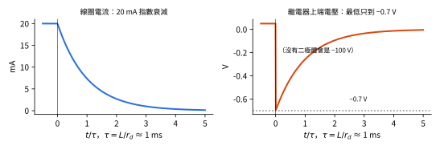
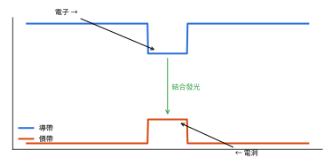

# 第 16 集 · Lec16：飛輪二極體的暫態、電流電壓轉換器的等效模型、發光元件 [▶ 影片](https://www.youtube.com/watch?v=ualjv7gi4tE)

← 上一集：[15](15-photodetector-transimpedance-street-light.md) ｜ [總目錄](../README.md) ｜ 下一集：[17](17-amplifier-models-four-converters.md) →

> **課程**：電子學（一），陽明交大 電子物理系，112 學年度 — 第 16 集
> **講者**：陳振芳 老師
> **來源**：YouTube 錄影逐字稿（45:46，人工字幕）＋ Sedra & Smith《Microelectronic Circuits》7th ed. Table 1.1、§4.7
> **標記說明**：`【口頭】` 老師口頭補充；`【課本補充】` 課本有、課堂沒講；`[▶ mm:ss]` 影片時間點

---

## 目錄

- [0. 這堂課要做什麼](#0-這堂課要做什麼)
- [1. 複習：街燈系統關燈的瞬間](#1-複習街燈系統關燈的瞬間)
- [2. 電感電流必須連續](#2-電感電流必須連續)
- [3. 飛輪二極體導通後的暫態](#3-飛輪二極體導通後的暫態)
- [4. 電流電壓轉換器的等效模型](#4-電流電壓轉換器的等效模型)
- [5. 為什麼要先轉成電壓](#5-為什麼要先轉成電壓)
- [6. 發光元件：光強度和電流成正比](#6-發光元件光強度和電流成正比)
- [7. 一頁速查表](#7-一頁速查表)
- [8. 與後續集數的連結](#8-與後續集數的連結)

---

## 0. 這堂課要做什麼

1. 把上一集飛輪二極體的保護作用算清楚：電感電流連續、二極體導通後的 $L/r_d$ 暫態。
2. 把電流電壓轉換器（I-V converter）寫成**放大器模型**，求 $R_i$、$R_o$、$A$——它是理想的「抓電流、送電壓」放大器。
3. 發光二極體（LED）、雷射的光強度和電流成正比 → 也需要「送電流」的放大器，為下一集四種轉換器鋪路。

---

## 1. 複習：街燈系統關燈的瞬間

[▶ 00:09](https://youtu.be/ualjv7gi4tE?t=9)

（電路圖見[上一集第 8 節](15-photodetector-transimpedance-street-light.md#8-繼電器是電感飛輪保護二極體)。）

- **晚上**：比較器 +10 V → BJT 的 B–E 和串聯二極體都導通，各跨 0.7 V → 剩 8.6 V → $R = 8.6/20$ kΩ，繼電器電流 20 mA，燈亮。[▶ 01:09](https://youtu.be/ualjv7gi4tE?t=69)
- **天亮**：光強度讓轉換器輸出到 5 V，比較器翻成 −10 V → 都不導通 → 反向 10 V。BJT 的 B–E 只能撐約 7 V，串聯的普通二極體能撐約 15 V，加起來 22 V，撐得住。[▶ 03:43](https://youtu.be/ualjv7gi4tE?t=223)

（上一集老師說普通二極體約 14 V、合計 21 V；這次說 15 V、合計 22 V。都只是舉例的數量級。）

---

## 2. 電感電流必須連續

[▶ 04:45](https://youtu.be/ualjv7gi4tE?t=285)

電感：$v = L\dfrac{di}{dt}$ → $i = \dfrac{1}{L}\displaystyle\int v\,dt$。

在同一個時間點的前一瞬間 $t^-$ 和後一瞬間 $t^+$：

$$
i(t^+) - i(t^-) = \frac{1}{L}\int_{t^-}^{t^+} v\,dt = 0
$$

除非電壓無窮大，否則積分的面積是 0 → **電感電流必須連續**（must be continuous）。[▶ 05:46](https://youtu.be/ualjv7gi4tE?t=346)

【口頭】這和電容「電壓必須連續」是同一件事，只是電壓電流對調。[▶ 06:16](https://youtu.be/ualjv7gi4tE?t=376)

BJT 關斷（假設 1 μs）把電流從 20 mA 硬扯到 0：$v = 5\ \text{mH}\times\dfrac{0 - 20\ \text{mA}}{1\ \mu\text{s}} = -100$ V。繼電器上端 −100 V、BJT 基極 −10 V → B–E 和二極體被加 90 V 正向偏壓，「電流大到嚇人」，一定燒壞。[▶ 07:16](https://youtu.be/ualjv7gi4tE?t=436)

---

## 3. 飛輪二極體導通後的暫態

[▶ 09:54](https://youtu.be/ualjv7gi4tE?t=594)

繼電器旁反向並聯一顆二極體。平常它反向、不導通，不影響。關斷瞬間：

1. 繼電器上端開始往下掉，到 −0.7 V 時二極體導通。[▶ 10:57](https://youtu.be/ualjv7gi4tE?t=657)
2. 電流連續 → 二極體一開始就流 **20 mA**。
3. 二極體方程沒辦法解，把它在 20 mA 附近看成一個小電阻 $r_d$（i-v 曲線斜率的倒數）。[▶ 11:58](https://youtu.be/ualjv7gi4tE?t=718)

電路變成 $L$ 和 $r_d$：$v = L\dfrac{di}{dt} = -i\,r_d$ →

$$
\frac{di}{dt} + \frac{r_d}{L}\,i = 0,
\qquad
\tau = \frac{L}{r_d}
$$

[▶ 13:00](https://youtu.be/ualjv7gi4tE?t=780)

用通式（$i(0) = 20$ mA，$r_d$ 消耗能量所以 $i(\infty) = 0$）：

$$
i(t) = 20\ \text{mA}\;e^{-t/\tau}
$$

電壓是電流的微分，所以繼電器上端從 −0.7 V 以同樣的 $\tau$ 回到 0。[▶ 15:05](https://youtu.be/ualjv7gi4tE?t=905)

**估算** [▶ 15:36](https://youtu.be/ualjv7gi4tE?t=936)：$r_d$ 不是常數——電流變小，工作點往下走，斜率變小、$r_d$ 越來越大。只能估一個常數，取 $r_d = 5\ \Omega$：

$$
\tau = \frac{5\times10^{-3}}{5} = 10^{-3}\ \text{s}
$$

（$r_d$ 後來變大，所以實際上後段會快一點。）約 1 ms 後電流就沒了，回到正常不導通的狀態。

**安全嗎？** [▶ 17:41](https://youtu.be/ualjv7gi4tE?t=1061)：最低只到 −0.7 V。此時基極 −10 V、射極側 −0.7 V → 反向 9.3 V < 22 V，沒問題。

---

## 4. 電流電壓轉換器的等效模型

### 4.1 要求的模型

[▶ 19:46](https://youtu.be/ualjv7gi4tE?t=1186)

自動街燈前端：光偵測器 → 電流電壓轉換器 → 比較器。把轉換器（op amp、正端接地、$R$ 回授）用**電流 → 電壓放大器**來 model：

- 輸入：抓電流 $i_i$，輸入電阻 $R_i$。
- 輸出：電壓源 $A\,i_i$ 串聯 $R_o$（電壓源一定串聯，電流源一定並聯）。[▶ 22:20](https://youtu.be/ualjv7gi4tE?t=1340)

### 4.2 求 $R_i$

[▶ 23:52](https://youtu.be/ualjv7gi4tE?t=1432)

在輸入端加電壓 $v$、量電流 $i$。電流進不了 op amp，只能流過 $R$，輸出 $= v - iR$。代入 $A_d(v_+ - v_-) = v_o$，$v_+ = 0$、$v_- = v$：

$$
A_d(0 - v) = v - iR
\;\Longrightarrow\;
R_i = \frac{v}{i} = \frac{R}{1 + A_d} \approx 0
$$

[▶ 26:35](https://youtu.be/ualjv7gi4tE?t=1595)

用亦步亦趨更快：負端 0 V，有電流流進來卻沒電壓 → $R_i = 0$。【口頭】數學上可以「硬加電壓」，做實驗不行——等於地的點硬加電壓，電流幾乎無窮大。[▶ 28:41](https://youtu.be/ualjv7gi4tE?t=1721)

### 4.3 求 $R_o$

[▶ 29:43](https://youtu.be/ualjv7gi4tE?t=1783)

$R_o = v_x/i_x$，條件 $i_i = 0$。**電流為 0 是開路，不是短路**——輸入端開路。

- 從輸出加 $v_x$，$R$ 那條路通往開路的輸入端，沒有電流 → 負端電壓也是 $v_x$。
- $A_d(0 - v_x) = v_x$ → $v_x(1 + A_d) = 0$ → $v_x = 0$。
- 電流 $i_x$ 流得進 op amp 輸出、電壓卻是 0 → $R_o = 0$。[▶ 33:20](https://youtu.be/ualjv7gi4tE?t=2000)

### 4.4 求 $A$

[▶ 33:50](https://youtu.be/ualjv7gi4tE?t=2030)

輸出開路（$R_o$ 上沒壓差），開路電壓除以輸入電流。亦步亦趨：$v_o = 0 - i_iR$ →

$$
A = \frac{v_{o,\text{open}}}{i_i} = -R
$$

### 4.5 結論：理想的 I→V 放大器

[▶ 35:23](https://youtu.be/ualjv7gi4tE?t=2123)

$R_i \approx 0$、$R_o = 0$。接上信號源（$i_s$ 並 $R_s$）和負載 $R_L$：

- $R_i = 0$ → 輸入端短路 → $R_s$ 兩端 0 V，沒電流 → $i_s$ **100% 被抓進來**（draw current）。
- $R_o = 0$ → 電壓全部到負載上：

$$
v_o = A\,i_s = -R\,i_s
$$

和 $R_s$ 無關、和 $R_L$ 無關。[▶ 38:26](https://youtu.be/ualjv7gi4tE?t=2306)

它把電流全抓進來、轉成電壓、再送（deliver）電壓到負載 → **ideal I-V amplifier**（或叫 converter）。[▶ 39:29](https://youtu.be/ualjv7gi4tE?t=2369)

> 【課本補充】Table 1.1 (p. 28) 的**轉阻放大器**（transresistance amplifier）：理想 $R_i = 0$、$R_o = 0$，開路轉阻 $R_m = v_o/i_i$（單位 Ω）。這裡 $R_m = -R$。

---

## 5. 為什麼要先轉成電壓

[▶ 40:30](https://youtu.be/ualjv7gi4tE?t=2430)

- 到目前為止的放大器：電壓轉電壓（正向、反向、有放大的）；現在多了電流轉電壓。
- 【口頭】信號處理 95% 以上都是**電壓**：加減、積分、微分、比較都是用電壓做，用電流做很難。[▶ 41:00](https://youtu.be/ualjv7gi4tE?t=2460)
- 光偵測器一定要抓**電流**（才和光強度成正比），所以抓進來後先轉成電壓，後面才好處理。

還有兩種沒講：電流轉電流、電壓轉電流——為什麼會需要？看後面接什麼。[▶ 41:31](https://youtu.be/ualjv7gi4tE?t=2491)

---

## 6. 發光元件：光強度和電流成正比

[▶ 42:03](https://youtu.be/ualjv7gi4tE?t=2523)

後面如果是**雷射**或 **LED**（電路符號是二極體加箭頭），它發的光和**電流**成正比，不是電壓。這是 P-N 介面的物理：[▶ 42:33](https://youtu.be/ualjv7gi4tE?t=2553)

- 能帶圖上方是**導帶**（conduction band），電子在那裡跑；下方是**價帶**（valence band），電洞在那裡跑。
- 電子從一邊過來、電洞從另一邊過來，在中間結合產生光子 → 多少電子電洞過來，就產生多少光 → 和電流成正比。[▶ 43:06](https://youtu.be/ualjv7gi4tE?t=2586)
- 只是這樣效率不好，載子會直接跑過去。所以把中間的能階「挖小一點」：導帶往下凹，電子掉進去；價帶往上凸（電洞的能帶要倒過來看，其實也是往下掉），電洞也掉進去 → 兩者被侷限在同一區，結合效率高。[▶ 43:37](https://youtu.be/ualjv7gi4tE?t=2617)
- 雷射只是兩邊再複雜一點，讓它「震起來」。[▶ 44:41](https://youtu.be/ualjv7gi4tE?t=2681)

所以光偵測器 → 電流 → 電壓 → 再轉成**電流**驅動雷射或 LED，光進、光出，有增益的話就是**光放大器**（optical amplifier）。[▶ 45:11](https://youtu.be/ualjv7gi4tE?t=2711)

> 【課本補充】§4.7.4 (Ch 4) 的發光二極體（light-emitting diode, LED）：光輸出和順向電流成正比，通常用砷化鎵（GaAs）等直接能隙的化合物半導體；把光二極體和 LED 封在一起叫光耦合器（optoisolator）。

---

## 7. 一頁速查表

| 項目 | 公式 | 關鍵一步 |
|---|---|---|
| 電感電流連續 | $i(t^+) = i(t^-)$ | $\frac1L\int_{t^-}^{t^+}v\,dt = 0$ |
| 電容電壓連續 | $v(t^+) = v(t^-)$ | 對偶 |
| 關斷感應電壓 | $L\,di/dt$，例 −100 V | 5 mH、20 mA、1 μs |
| 飛輪二極體暫態 | $i = 20\ \text{mA}\,e^{-t/\tau}$，$\tau = L/r_d$ ≈ 1 ms | 二極體看成小電阻 $r_d$ |
| 最低電壓 | −0.7 V | 二極體導通 |
| I-V 轉換器 $R_i$ | $R/(1 + A_d) \approx 0$ | 虛接地 |
| I-V 轉換器 $R_o$ | 0 | $v_x(1 + A_d) = 0$ |
| I-V 轉換器 $A$ | $-R$（Ω） | $v_o = -i_iR$ |
| 理想 I→V | $v_o = -R\,i_s$，和 $R_s$、$R_L$ 無關 | 抓電流、送電壓 |
| LED／雷射 | 光強度 ∝ 電流 | 電子電洞結合 |

---

## 8. 與後續集數的連結

| 本集觀念 | 後面在哪裡用到 |
|---|---|
| 放大器模型 $R_i$、$R_o$、$A$ | 下一集 2.8：四種放大器交流模型、V→I、I→I 轉換器 |
| 送電流給 LED／雷射 | 下一集電壓電流轉換器、電流電流放大器 |
| 二極體的小電阻 $r_d$ | 第 3 章二極體小信號模型 |
| 電感、電容的連續性 | 開關電路、第 10 章輸出級 |

---

## 附：本集一句話總結

> **電感電流必須連續，飛輪二極體在關斷瞬間接手 20 mA、讓它以 $L/r_d$ 約 1 ms 衰減，電壓只到 −0.7 V；電流電壓轉換器的模型是 $R_i \approx 0$、$R_o = 0$、$A = -R$ 的理想 I→V 放大器；而 LED、雷射的光和電流成正比，所以下一步需要「送電流」的放大器。**

---

*筆記依據陳振芳老師「電子學（一）」112 學年度 Lec16 錄影逐字稿（人工字幕，45:46）與 Sedra & Smith《Microelectronic Circuits》7th ed. 整理。*
