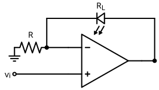

# 第 17 集 · Lec17：放大器的四種模型——I→V、V→I（雷射驅動）、I→I 與電流追隨器 [▶ 影片](https://www.youtube.com/watch?v=EW1StqxM4vs)

← 上一集：[16](16-photodetector-iv-conversion-light-emitter.md) ｜ [總目錄](../README.md) ｜ 下一集：[18](18-op-amp-converter-summary.md) →

> **課程**：電子學（一），陽明交大 電子物理系，112 學年度 — 第 17 集
> **講者**：陳振芳 老師
> **來源**：YouTube 錄影逐字稿（1:25:40，人工字幕）＋ Sedra & Smith《Microelectronic Circuits》7th ed. §1.5
> **標記說明**：`【口頭】` 老師口頭補充；`【課本補充】` 課本有、課堂沒講；`⚠️ 逐字稿缺字` 字幕或口誤；`[▶ mm:ss]` 影片時間點

---

## 目錄

- [0. 這堂課要做什麼](#0-這堂課要做什麼)
- [1. 一般雙埠模型與放大器的條件](#1-一般雙埠模型與放大器的條件)
- [2. I→V 模型與三個參數的求法](#2-iv-模型與三個參數的求法)
- [3. 用模型分析 I→V 轉換器](#3-用模型分析-iv-轉換器)
- [4. V→I 模型：雷射驅動電路](#4-vi-模型雷射驅動電路)
- [5. I→I 放大器](#5-ii-放大器)
- [6. 電流追隨器](#6-電流追隨器)
- [7. 一頁速查表](#7-一頁速查表)
- [8. 與後續集數的連結](#8-與後續集數的連結)

---

## 0. 這堂課要做什麼

第二章接近尾聲，把 op amp 放大電路整理成四種模型：V→V、I→V、V→I、I→I。

【口頭】基本原則：**碰到光都是電流**（光偵測器抓電流、雷射 LED 送電流），**碰到電路處理都是電壓**（加減、積分微分都用電壓）。所以會有各種轉換。[▶ 01:11](https://youtu.be/EW1StqxM4vs?t=71)

---

## 1. 一般雙埠模型與放大器的條件

[▶ 01:41](https://youtu.be/EW1StqxM4vs?t=101)

一個電路有輸入端（$v_1$、$i_1$）和輸出端（$v_2$、$i_2$）。每一端只能選一個當 input、另一個當 output。以 I→V 為例：輸入端選**電流** $i_1$ 當 input（$v_1$ 是 output），輸出端選**電壓** $v_2$ 當 output（$i_2$ 是 input）。線性系統（沒有平方、沒有相乘）一定可以寫成：[▶ 03:20](https://youtu.be/EW1StqxM4vs?t=200)

$$
v_1 = h_{11}\,i_1 + h_{12}\,i_2,
\qquad
v_2 = h_{21}\,i_1 + h_{22}\,i_2
$$

| 係數 | 意義 |
|---|---|
| $h_{11}$ | 輸入端自己的電壓/電流 → 輸入電阻 $R_i$ |
| $h_{22}$ | 輸出端自己的 → 輸出電阻 $R_o$ |
| $h_{21}$ | 輸入 → 輸出：**forward transfer** |
| $h_{12}$ | 輸出 → 輸入：**reverse transfer** |

[▶ 03:50](https://youtu.be/EW1StqxM4vs?t=230)

**放大器只能往前，不能倒回來**：後面的變化影響到前面就亂掉了。所以理想放大器 $h_{12} = 0$。[▶ 05:25](https://youtu.be/EW1StqxM4vs?t=325)

拿掉後：輸入端只剩一個電阻 $R_i$；輸出端兩個電壓相加 → **串聯**：電壓源 $h_{21}i_1$ 串聯 $R_o$。[▶ 06:25](https://youtu.be/EW1StqxM4vs?t=385)

**模型的關鍵就是那個受控源**：輸入電流乘一個倍數變成輸出電壓——其他兩個只是電阻。[▶ 07:27](https://youtu.be/EW1StqxM4vs?t=447)

> ⚠️ 逐字稿缺字 [▶ 09:01](https://youtu.be/EW1StqxM4vs?t=541)：老師把 $A = v/i$ 叫「transconductance」。【課本補充】Table 1.1 (p. 28)：電壓除以電流的增益是**轉阻**（transresistance）$R_m$，單位 Ω；**轉導**（transconductance）$G_m$ 是電流除以電壓，用在 V→I。

> 【課本補充】§1.5 用的四種模型（Table 1.1）：電壓放大器 $A_{vo}$、電流放大器 $A_{is}$、轉導放大器 $G_m$、轉阻放大器 $R_m$；以及理想條件（下表第 7 節）。課本也提到電晶體放大器不完全單向（有 reverse transfer），那時要用更完整的模型。

---

## 2. I→V 模型與三個參數的求法

[▶ 09:59](https://youtu.be/EW1StqxM4vs?t=599)

模型：輸入 $R_i$（電流 $i_i$ 進來）→ 電壓源 $A\,i_i$ 串 $R_o$。

| 參數 | 求法 |
|---|---|
| $R_i$ | 送電流 $i_i$ 進去，量輸入電壓，相除 |
| $A\,i_i$ | **輸出開路**量到的電壓（open circuit voltage；開路沒電流，$R_o$ 上沒壓差） |
| $R_o$ | 在輸出加 $v_x$、量 $i_x$，**但輸入信號要先拿掉**（$i_i = 0$） |

[▶ 11:02](https://youtu.be/EW1StqxM4vs?t=662)

【口頭】真正的輸出一定要接東西（喇叭、下一級的輸入電阻），沒接負載量到的只是「開路電壓」，像在做數學題目。[▶ 13:37](https://youtu.be/EW1StqxM4vs?t=817)

---

## 3. 用模型分析 I→V 轉換器

（電路：op amp 正端接地、$R$ 回授，見[第 15 集](15-photodetector-transimpedance-street-light.md#3-電流電壓轉換器把光電流全部抓出來)。）

### 3.1 三個參數（完全不做近似）

[▶ 16:12](https://youtu.be/EW1StqxM4vs?t=972)

- $R_i$：電流流不進 op amp（氧化層），只能流過 $R$ → 輸出 $= v_- - i_iR$。代入 $A_d(0 - v_-) = v_- - i_iR$：

$$
v_- = \frac{R\,i_i}{1 + A_d}
\;\Longrightarrow\;
R_i = \frac{R}{1 + A_d}
$$

$A_d \to \infty$ 時 $v_- = 0$——這就是以前的**亦步亦趨**，「喔，原來是這回事。」[▶ 19:18](https://youtu.be/EW1StqxM4vs?t=1158)

- $A$：開路電壓 $= v_- - R\,i_i = \left(\dfrac{1}{1 + A_d} - 1\right)R\,i_i$：[▶ 20:50](https://youtu.be/EW1StqxM4vs?t=1250)

$$
A = -\frac{A_d}{1 + A_d}\,R \;\to\; -R
$$

- $R_o$：輸入拿掉（電流 0 是**開路**），從輸出加 $v_x$。$R$ 上沒電流 → 負端 = $v_x$ → $A_d(0 - v_x) = v_x$ → $v_x(1 + A_d) = 0$ → $v_x = 0$，電流照樣流得進去：[▶ 25:28](https://youtu.be/EW1StqxM4vs?t=1528)

$$
R_o = 0
$$

### 3.2 接上光偵測器和負載

[▶ 27:31](https://youtu.be/EW1StqxM4vs?t=1651)

信號源：光偵測器（電流源 $i_s$ 並聯 $R_s$，$R_s$ 其實是二極體）；負載 $R_L$（下一級的輸入電阻或喇叭）。

- 一般情況輸出要分壓：$v_o = A\,i_i\dfrac{R_L}{R_o + R_L}$，**和負載有關**——$R_L$ 溫度一變，$v_o$ 就變，不好。但 $R_o = 0$ → 和 $R_L$ 無關。[▶ 29:03](https://youtu.be/EW1StqxM4vs?t=1743)
- 輸入要分流：$i_i = i_s\dfrac{R_s}{R_s + R_i}$。$R_i \approx 0$ → $i_i = i_s$，和 $R_s$ 無關。[▶ 31:11](https://youtu.be/EW1StqxM4vs?t=1871)

$$
v_o = -R\,i_s\quad(\text{independent of } R_s,\ R_L)
$$

它把一個**非理想電流源**（有 $R_s$）變成一個**理想電壓源**（$R_o = 0$）乘上增益，給後面做電壓運算。[▶ 33:16](https://youtu.be/EW1StqxM4vs?t=1996)

---

## 4. V→I 模型：雷射驅動電路

### 4.1 模型

[▶ 36:24](https://youtu.be/EW1StqxM4vs?t=2184)

信號處理完（調變、AM、FM…）最後要轉成電流送給雷射或 LED → **laser driver**。輸入取電壓、輸出取電流；寫出方程、拿掉 reverse transfer：[▶ 37:56](https://youtu.be/EW1StqxM4vs?t=2276)

- 輸入：一個電阻 $R_i$。
- 輸出：兩個電流相加 → **並聯**：電流源 $A\,v_i$ 並聯 $R_o$。

| 參數 | 求法 |
|---|---|
| $R_i$ | 加電壓、量電流 |
| $A\,v_i$ | **輸出短路**量到的電流（short circuit current；短路時 $R_o$ 兩端沒壓差、沒電流） |
| $R_o$ | 在負載兩端加 $v_x$、量 $i_x$，輸入 $v_i = 0$ |

[▶ 45:41](https://youtu.be/EW1StqxM4vs?t=2741)

### 4.2 電路

[▶ 40:30](https://youtu.be/EW1StqxM4vs?t=2430)

$v_i$ 接正端，負端經 $R$ 到地，**雷射接在輸出和負端之間**（回授路徑上）：

亦步亦趨 → 負端 = $v_i$ → $R$ 上電流 $v_i/R$，流不進 op amp，只能從輸出經過雷射流下來。

【口頭】**電壓和電流的負載接法不一樣**：電壓是把一點拉出來、和地之間接負載；電流一定要把負載放在**一條迴路（loop）裡面**。[▶ 41:34](https://youtu.be/EW1StqxM4vs?t=2494)

### 4.3 三個參數

[▶ 48:15](https://youtu.be/EW1StqxM4vs?t=2895)

- $R_i$：正端吃不進電流 → $R_i = \infty$。
- $A$：負載短路，短路電流 $i_{sc}$ 流過 $R$，負端 $= i_{sc}R$。$A_d(v_i - i_{sc}R) = i_{sc}R$：[▶ 49:46](https://youtu.be/EW1StqxM4vs?t=2986)

$$
i_{sc} = \frac{A_d}{(1 + A_d)R}\,v_i \;\to\; \frac{v_i}{R},
\qquad
A = \frac{A_d}{(1 + A_d)R} \approx \frac1R
$$

- $R_o$：$v_i = 0$，負載兩端加 $v_x$，$i_x$ 流過 $R$ → 負端 $= i_xR$；輸出 $= i_xR + v_x$。$A_d(0 - i_xR) = i_xR + v_x$：[▶ 53:52](https://youtu.be/EW1StqxM4vs?t=3232)

$$
R_o = \left|\frac{v_x}{i_x}\right| = R\,(1 + A_d) \;\to\; \infty
$$

### 4.4 接上信號源和雷射

[▶ 56:29](https://youtu.be/EW1StqxM4vs?t=3389)

$$
i_o = \frac{A_d}{(1 + A_d)R}\,v_s\cdot\frac{R(1 + A_d)}{R(1 + A_d) + R_L}
\;\to\; \frac{v_s}{R}
$$

$R_i = \infty$ → $v_s$ 全部抓進來；$R_o = \infty \gg R_L$ → 電流全部給雷射。**和 $R_s$、$R_L$ 都無關**。[▶ 58:34](https://youtu.be/EW1StqxM4vs?t=3514)

【口頭】雷射發光和電流成正比（電子電洞在一個能階較低的區域被侷限、結合產生光子；震起來是雷射、沒震起來是 LED）。雷射操作一段時間變燙，$R_L$ 就變了；但 $i_o$ 和 $R_L$ 無關，光強度還是很穩定。換一顆雷射也一樣。這就是為什麼 op amp 要把 $A_d$ 做這麼大。[▶ 1:00:38](https://youtu.be/EW1StqxM4vs?t=3638)

這是理想的 V→I 放大器：輸入 ∞、輸出 ∞。[▶ 1:04:16](https://youtu.be/EW1StqxM4vs?t=3856)

---

## 5. I→I 放大器

[▶ 1:04:46](https://youtu.be/EW1StqxM4vs?t=3886)

光偵測器進來、雷射出去 → 光進光出，有增益就是**光放大器**（optical amplifier）。模型：輸入 $R_i$、輸出電流源 $A\,i_i$ 並聯 $R_o$。

**$R_i$** [▶ 1:07:50](https://youtu.be/EW1StqxM4vs?t=4070)：$i_i$ 進不了 op amp，流過 $R_2$ → X 點 $= v_- - i_iR_2$；輸出 $=$ X 點（開路求法裡負載不接）。$A_d(0 - v_-) = v_- - i_iR_2$：

$$
R_i = \frac{R_2}{1 + A_d} \approx 0
$$

**$A$（短路電流）** [▶ 1:11:24](https://youtu.be/EW1StqxM4vs?t=4284)：雷射短路。負端 ≈ 0（亦步亦趨），流過 $R_2$ 的是 $i_i$，X 點 $= -i_iR_2$，流過 $R_1$ 的電流 $i_iR_2/R_1$。雷射電流 = 兩者相加：

$$
i_{sc} = \left(1 + \frac{R_2}{R_1}\right)i_i,
\qquad
A = 1 + \frac{R_2}{R_1}
$$

（完整式子還有一項 $\propto 1/(1 + A_d)$，$A_d$ 很大時拿掉。）

**$R_o$** [▶ 1:14:31](https://youtu.be/EW1StqxM4vs?t=4471)：輸入拿掉（開路），$R_2$ 沒電流 → 負端 = X 點。從雷射兩端加 $v_x$，$i_x$ 流過 $R_1$ → X 點 $= i_xR_1$；$A_d(0 - i_xR_1) = i_xR_1 + v_x$：

$$
R_o = R_1(1 + A_d) \to \infty
$$

**接上** [▶ 1:17:38](https://youtu.be/EW1StqxM4vs?t=4658)：$R_i = 0$ 把 $i_s$ 全抓進來，$R_o = \infty$ 把電流全給雷射：

$$
i_o = \left(1 + \frac{R_2}{R_1}\right)i_s\quad(\text{independent of } R_s,\ R_L)
$$

把一個**非理想電流源**變成**理想電流源**（內阻無窮大）並放大。理想電流源 = 並聯的內電阻無窮大。[▶ 1:20:20](https://youtu.be/EW1StqxM4vs?t=4820)

---

## 6. 電流追隨器

[▶ 1:22:26](https://youtu.be/EW1StqxM4vs?t=4946)

上面的電路取 $R_2 = 0$、$R_1 = \infty$：雷射直接接在輸出和負端之間。$i_s$ 進不了 op amp，只能流過雷射 → $i_o = i_s$。

- 輸入電阻 0 → $R_s$ 沒影響；輸出看回去無窮大 → 和負載無關。
- 增益 1。和電壓追隨器對照：**電流追隨器**（current follower）把非理想電流源變成理想電流源。[▶ 1:24:00](https://youtu.be/EW1StqxM4vs?t=5040)

**四種整理** [▶ 1:21:55](https://youtu.be/EW1StqxM4vs?t=4915)

- 非理想電壓源 → 理想電壓源（電壓追隨器、非反相放大器）
- 非理想電流源 → 理想電壓源（I→V 轉換器）
- 非理想電壓源 → 理想電流源（V→I 轉換器）
- 非理想電流源 → 理想電流源（電流追隨器、I→I 放大器）

---

## 7. 一頁速查表

| 種類 | 輸入要 | 輸出要 | 增益（$A_d \to \infty$） | op amp 電路 |
|---|---|---|---|---|
| V→V | $R_i = \infty$ | $R_o = 0$ | $1 + R_2/R_1$ | 非反相放大器 |
| I→V | $R_i = 0$ | $R_o = 0$ | $-R$（Ω） | 正端接地、$R$ 回授 |
| V→I | $R_i = \infty$ | $R_o = \infty$ | $1/R$（S） | $R$ 到地、負載在回授路徑 |
| I→I | $R_i = 0$ | $R_o = \infty$ | $1 + R_2/R_1$ | $R_2$、$R_1$ + 負載在回授 |

| 參數 | 求法 |
|---|---|
| $R_i$ | 輸入加電流量電壓（或反之） |
| 電壓源型（V 輸出）的 $A\cdot$輸入 | 輸出**開路**電壓 |
| 電流源型（I 輸出）的 $A\cdot$輸入 | 輸出**短路**電流 |
| $R_o$ | 輸出加 $v_x$ 量 $i_x$，**輸入源設 0**（電壓源短路、電流源開路） |

| 推導結果（不近似） | |
|---|---|
| I→V | $R_i = \dfrac{R}{1+A_d}$，$A = -\dfrac{A_d R}{1+A_d}$，$R_o = 0$ |
| V→I | $R_i = \infty$，$A = \dfrac{A_d}{(1+A_d)R}$，$R_o = R(1+A_d)$ |
| I→I | $R_i = \dfrac{R_2}{1+A_d}$，$A \approx 1 + \dfrac{R_2}{R_1}$，$R_o = R_1(1+A_d)$ |

---

## 8. 與後續集數的連結

| 本集觀念 | 後面在哪裡用到 |
|---|---|
| 四種轉換器 | 下一集 2.9 運算放大器轉換器總整理 |
| reverse transfer = 0 的單向假設 | 第 4、5 章電晶體放大器（實際上有一點 reverse） |
| 輸出電阻變大／變小靠 $(1 + A_d)$ | 電子學（三）第 8 章負回授：串聯／並聯回授改變輸入輸出電阻 |
| 輸出電流能力 | 2.11–2.12 加 BJT 推大電流 |

---

## 附：本集一句話總結

> **理想放大器不能有 reverse transfer，所以模型只剩 $R_i$、受控源、$R_o$：電壓輸出看開路電壓、電流輸出看短路電流、$R_o$ 要先把輸入源設 0；用 op amp 做出四種理想轉換器——抓電壓要 $R_i=\infty$、抓電流要 $R_i=0$、送電壓要 $R_o=0$、送電流要 $R_o=\infty$，送電流時負載要放在回授迴路裡。**

---

*筆記依據陳振芳老師「電子學（一）」112 學年度 Lec17 錄影逐字稿（人工字幕，1:25:40）與 Sedra & Smith《Microelectronic Circuits》7th ed. 整理。*
