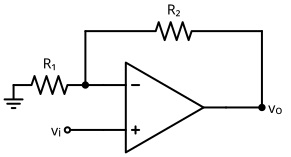
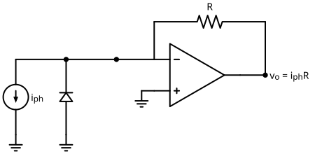
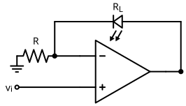

# 第 18 集 · Lec18：四種 op amp 轉換器總整理（用亦步亦趨快速求 R_i、R_o） [▶ 影片](https://www.youtube.com/watch?v=enBDng3JQVI)

← 上一集：[17](17-amplifier-models-four-converters.md) ｜ [總目錄](../README.md) ｜ 下一集：[19](19-op-amp-bandwidth-slew-rate.md) →

> **課程**：電子學（一），陽明交大 電子物理系，112 學年度 — 第 18 集
> **講者**：陳振芳 老師
> **來源**：YouTube 錄影逐字稿（44:10，人工字幕）＋ Sedra & Smith《Microelectronic Circuits》7th ed. Table 1.1
> **標記說明**：`【口頭】` 老師口頭補充；`【課本補充】` 課本有、課堂沒講；`⚠️ 逐字稿缺字` 字幕或口誤；`[▶ mm:ss]` 影片時間點

---

## 目錄

- [0. 這堂課要做什麼](#0-這堂課要做什麼)
- [1. V→V：電壓放大器](#1-vv電壓放大器)
- [2. I→V：電流電壓轉換器](#2-iv電流電壓轉換器)
- [3. V→I：雷射驅動](#3-vi雷射驅動)
- [4. I→I：光放大器](#4-ii光放大器)
- [5. 為什麼 op amp 要把 A_d 做到無窮大](#5-為什麼-op-amp-要把-a_d-做到無窮大)
- [6. 一頁速查表](#6-一頁速查表)
- [7. 與後續集數的連結](#7-與後續集數的連結)

---

## 0. 這堂課要做什麼

上一集用完整的 $A_d$ 推導四種轉換器；這一集**假設 $A_d \to \infty$，直接用亦步亦趨（virtual short circuit）**，很快地把每一種的 $R_i$、$R_o$、等效電路和「接上信號源、負載後的輸出」重做一遍。[▶ 00:09](https://youtu.be/enBDng3JQVI?t=9)

共同的方法：

- 沒接負載算到的是**開路電壓**（電壓輸出）或**短路電流**（電流輸出），不是接上負載後的值。
- $R_o$：輸出加 $v_x$、量 $i_x$，**輸入信號源先拿掉**。

---

## 1. V→V：電壓放大器

[▶ 00:39](https://youtu.be/enBDng3JQVI?t=39)

非反相放大器：$v_i$ 接正端，$R_1$、$R_2$ 回授。

- **開路電壓**：亦步亦趨 → 負端 $= v_i$ → $R_1$ 電流 $v_i/R_1$ 全部流過 $R_2$ → $v_{o,\text{open}} = (1 + R_2/R_1)v_i$。[▶ 02:13](https://youtu.be/enBDng3JQVI?t=133)
- **$R_i$**：可以加電壓、卻沒有電流流進去 → $\infty$。[▶ 02:43](https://youtu.be/enBDng3JQVI?t=163)
- **$R_o$**：$v_i = 0$ → 輸出點跟著變 0；加 $v_x$ 加不進去（還是 0），電流卻流得進去 → $0$。[▶ 04:17](https://youtu.be/enBDng3JQVI?t=257)

**等效電路**：要看電壓，用**電壓源串聯電阻**（不能並聯）。電壓源 = 開路電壓，串聯 $R_o = 0$。[▶ 05:50](https://youtu.be/enBDng3JQVI?t=350)

**接上** $v_s$（串 $R_s$）和 $R_L$：[▶ 07:55](https://youtu.be/enBDng3JQVI?t=475)

$$
v_o = \left(1 + \frac{R_2}{R_1}\right)v_i\cdot\frac{R_L}{0 + R_L},
\qquad
v_i = v_s\cdot\frac{\infty}{R_s + \infty} = v_s
$$

$$
v_o = \left(1 + \frac{R_2}{R_1}\right)v_s
\quad(\text{independent of } R_s,\ R_L)
$$

非理想電壓源 → 理想電壓源（$R_s = 0$）加增益。後面接什麼都沒影響，「對後面的電路太簡單了」。功能：**draw voltage、deliver voltage**。[▶ 11:29](https://youtu.be/enBDng3JQVI?t=689)

---

## 2. I→V：電流電壓轉換器

[▶ 12:32](https://youtu.be/enBDng3JQVI?t=752)

- **開路電壓**：負端 0（虛接地），電流全部流過 $R$ → $v_{o,\text{open}} = -R\,i_i$。[▶ 13:32](https://youtu.be/enBDng3JQVI?t=812)
- **$R_i$**：負端電壓 0、電流流得進去 → $0$。[▶ 14:03](https://youtu.be/enBDng3JQVI?t=843)
- **$R_o$**：$i_i = 0$ → 輸出 0；加 $v_x$ 還是 0，電流流得進去 → $0$。[▶ 14:33](https://youtu.be/enBDng3JQVI?t=873)

**接上** $i_s$（並 $R_s$）和 $R_L$：$R_i = 0$ → 輸入短路，$R_s$ 沒電流，$i_i = i_s$；$R_o = 0$ → 電壓全到負載。[▶ 17:10](https://youtu.be/enBDng3JQVI?t=1030)

$$
v_o = -R\,i_s\quad(\text{independent of } R_s,\ R_L)
$$

非理想電流源 → 理想電壓源。功能：**draw current、deliver voltage**。[▶ 18:45](https://youtu.be/enBDng3JQVI?t=1125)

---

## 3. V→I：雷射驅動

[▶ 19:46](https://youtu.be/enBDng3JQVI?t=1186)

- 雷射放在一個**環路**裡（in the loop）。沒放雷射時把那裡短路，算到的是**短路電流**：負端 $= v_i$ → $i_{sc} = v_i/R$。[▶ 21:20](https://youtu.be/enBDng3JQVI?t=1280)
- **$R_i$**：電壓加得進去、沒有電流 → $\infty$。[▶ 22:20](https://youtu.be/enBDng3JQVI?t=1340)
- **等效電路**：要看電流（雷射光強度跟電流成正比），用**電流源並聯電阻**。[▶ 22:50](https://youtu.be/enBDng3JQVI?t=1370)
- **$R_o$**：從雷射兩端加 $v_x$，$v_i = 0$ → 負端 0 → $R$ 上沒電流 → 這條迴路電流 $i_x = 0$；電壓加得進去 → $\infty$。[▶ 23:52](https://youtu.be/enBDng3JQVI?t=1432)

電流源方向取得和短路電流一致，省一個負號；電流源 = $i_{sc} = v_i/R$，並聯 $R_o = \infty$ → **理想電流源**。【口頭】對電壓源，理想是內阻 0；對電流源，理想是內阻無窮大。[▶ 28:25](https://youtu.be/enBDng3JQVI?t=1705)

**接上**：$i_o = \dfrac{v_i}{R}\cdot\dfrac{\infty}{\infty + R_L}$，$v_i = v_s$：[▶ 28:57](https://youtu.be/enBDng3JQVI?t=1737)

$$
i_o = \frac{v_s}{R}\quad(\text{independent of } R_s,\ R_L)
$$

雷射溫度變了、$R_L$ 跟著變，電流不變 → 光很穩定。功能：**draw voltage、deliver current**；非理想電壓源 → 理想電流源，增益 $1/R$。[▶ 32:06](https://youtu.be/enBDng3JQVI?t=1926)

> ⚠️ 逐字稿缺字 [▶ 32:06](https://youtu.be/enBDng3JQVI?t=1926)：字幕「再乘以一個增益 1/8」，依上下文應是增益 $1/R$。

---

## 4. I→I：光放大器

[▶ 32:36](https://youtu.be/enBDng3JQVI?t=1956)

光偵測器進來、雷射出去 → 光到光 → **optical amplifier**。

【口頭】歸納四個電路：**電流都從負端進來，電壓都從正端進來**。[▶ 33:39](https://youtu.be/enBDng3JQVI?t=2019)

- **短路電流**：負端 0，$i_i$ 流過 $R_2$。從 X 點看，$R_1$ 和 $R_2$ 是對雷射電流的**分流**；從分出去的那一支倒推回總電流，一定變大：[▶ 35:09](https://youtu.be/enBDng3JQVI?t=2109)

$$
i_{sc} = \left(1 + \frac{R_2}{R_1}\right)i_i
$$

（就像電壓的分壓倒推回去會放大，這裡是分流倒推回去。）
- **$R_i$**：負端 0 V、電流送得進去 → $0$。[▶ 36:10](https://youtu.be/enBDng3JQVI?t=2170)
- **$R_o$**：從雷射兩端看，$i_i = 0$ → 那一頭沒電流 → $\infty$。[▶ 36:40](https://youtu.be/enBDng3JQVI?t=2200)

**接上**：$R_i = 0$ 把 $i_s$ 全抓進來，$R_o = \infty$ 全給雷射：[▶ 39:50](https://youtu.be/enBDng3JQVI?t=2390)

$$
i_o = \left(1 + \frac{R_2}{R_1}\right)i_s\quad(\text{independent of } R_s,\ R_L)
$$

功能：**draw current、deliver current**。

【口頭】光偵測器一定要抓電流（抓電壓會得到 log，還帶著 $I_s$，後面難道要接 exponential 放大器倒回來？自找麻煩）；抓進來後轉成理想電流源，雷射的光就和雷射負載無關、很穩定。[▶ 40:56](https://youtu.be/enBDng3JQVI?t=2456)

---

## 5. 為什麼 op amp 要把 A_d 做到無窮大

[▶ 41:58](https://youtu.be/enBDng3JQVI?t=2518)

四個電路的 $R_i$、$R_o$ **不是 0 就是無窮大**，都是極端、都是理想的——前提是 $A_d$ 很大很大。

【口頭】三四十年前一大堆公司做 op amp，目的就是把 $A_d$ 做得很大很大。不接回授它只能當比較器用（街燈系統用過）；它就是要你接回授：接成電壓放大器、電流放大器，四種全都有。[▶ 42:29](https://youtu.be/enBDng3JQVI?t=2549)

特例：

- V→V 裡 $R_1$ 開路、$R_2$ 短路 → **電壓追隨器**。
- I→I 裡 $R_2 = 0$、$R_1 = \infty$ → **電流追隨器**。[▶ 43:00](https://youtu.be/enBDng3JQVI?t=2580)

---

## 6. 一頁速查表

| | V→V | I→V | V→I | I→I |
|---|---|---|---|---|
| 輸入從 | 正端 | 負端 | 正端 | 負端 |
| $R_i$ | ∞ | 0 | ∞ | 0 |
| $R_o$ | 0 | 0 | ∞ | ∞ |
| 等效輸出 | 電壓源串 $R_o$ | 電壓源串 $R_o$ | 電流源並 $R_o$ | 電流源並 $R_o$ |
| 怎麼求增益 | 開路電壓 | 開路電壓 | 短路電流 | 短路電流 |
| 增益 | $1 + R_2/R_1$ | $-R$ | $1/R$ | $1 + R_2/R_1$ |
| 負載接法 | 輸出到地 | 輸出到地 | 在回授環路裡 | 在回授環路裡 |
| 轉換 | 非理想 V → 理想 V | 非理想 I → 理想 V | 非理想 V → 理想 I | 非理想 I → 理想 I |
| 用途 | 一般放大 | 光偵測器 | 雷射驅動 | 光放大器 |

用亦步亦趨求 $R_i$、$R_o$ 的訣竅：

- 某點被亦步亦趨「釘」在 0 V，卻有電流流得進去 → 那裡看進去是 **0**。
- 某支路被證明電流一定是 0，電壓卻加得進去 → 那裡看進去是 **∞**。

---

## 7. 與後續集數的連結

| 本集觀念 | 後面在哪裡用到 |
|---|---|
| 「$A_d$ 很大」的前提 | 下一集 2.10：$A_d$ 會隨頻率下降（頻寬）、迴轉率 |
| 送電流的能力 | 2.11 加 BJT 增加輸出電流、AB 類輸出級 |
| 回授讓 $R_i$、$R_o$ 變 0 或 ∞ | 電子學（三）第 8 章負回授的四種組態 |

---

## 附：本集一句話總結

> **只要 $A_d$ 夠大、用亦步亦趨，四種 op amp 電路的 $R_i$、$R_o$ 都落在 0 或 ∞：電壓從正端進、電流從負端進；抓電壓 $R_i=\infty$、抓電流 $R_i=0$；送電壓 $R_o=0$（負載到地）、送電流 $R_o=\infty$（負載放在回授環路裡），所以輸出永遠和信號源內阻、負載無關。**

---

*筆記依據陳振芳老師「電子學（一）」112 學年度 Lec18 錄影逐字稿（人工字幕，44:10）與 Sedra & Smith《Microelectronic Circuits》7th ed. 整理。*
