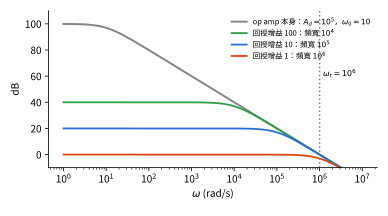
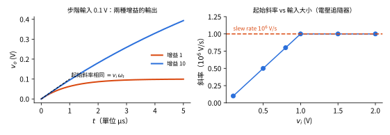
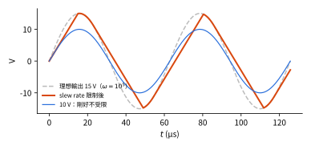

# 第 19 集 · Lec19：op amp 的頻寬（增益頻寬積）與迴轉率 [▶ 影片](https://www.youtube.com/watch?v=MBZKYJ6cbd4)

← 上一集：[18](18-op-amp-converter-summary.md) ｜ [總目錄](../README.md) ｜ 下一集：[20](20-bjt-current-boost-class-ab-output.md) →

> **課程**：電子學（一），陽明交大 電子物理系，112 學年度 — 第 19 集
> **講者**：陳振芳 老師
> **來源**：YouTube 錄影逐字稿（1:16:05，人工字幕）＋ Sedra & Smith《Microelectronic Circuits》7th ed. §2.7、§2.8.3–2.8.4
> **標記說明**：`【口頭】` 老師口頭補充；`【課本補充】` 課本有、課堂沒講；`[▶ mm:ss]` 影片時間點

---

## 目錄

- [0. 這堂課要做什麼](#0-這堂課要做什麼)
- [1. op amp 一定有頻寬：用 R0C0 建模](#1-op-amp-一定有頻寬用-r0c0-建模)
- [2. 增益頻寬積 ω_t](#2-增益頻寬積-ω_t)
- [3. 接成負回授：增益降、頻寬增](#3-接成負回授增益降頻寬增)
- [4. 例：音響用的放大倍數上限](#4-例音響用的放大倍數上限)
- [5. 步階輸入：時間常數 = 頻寬的倒數](#5-步階輸入時間常數--頻寬的倒數)
- [6. 起始斜率 = 輸入大小 × ω_t](#6-起始斜率--輸入大小--ω_t)
- [7. 迴轉率 slew rate](#7-迴轉率-slew-rate)
- [8. 例題：避免迴轉率限制](#8-例題避免迴轉率限制)
- [9. 一頁速查表](#9-一頁速查表)
- [10. 與後續集數的連結](#10-與後續集數的連結)

---

## 0. 這堂課要做什麼

最後兩週要做一個簡單的 op amp 音響（stereo system），牽涉到 op amp 反應有多快。兩個不同的限制：

1. **頻寬**（bandwidth）：增益頻寬積是常數，回授增益越大頻寬越窄；步階響應的起始斜率 = 輸入大小 × $\omega_t$。
2. **迴轉率**（slew rate）：輸出電壓變化速度的終極上限。

---

## 1. op amp 一定有頻寬：用 R0C0 建模

[▶ 00:39](https://youtu.be/MBZKYJ6cbd4?t=39)

op amp 裡面不管是 BJT 還是 MOS 都有一堆電容要充放電，所以一定有頻寬；沒有人做得出頻寬無窮寬的放大器。用一個 $R_0C_0$ 低通來代表：$A_d(v_+ - v_-)$ 經 $R_0$ 對 $C_0$ 充電，輸出取在 $C_0$ 上。[▶ 01:11](https://youtu.be/MBZKYJ6cbd4?t=71)

相量分析（$C_0 \to 1/j\omega C_0$，分壓）：[▶ 02:43](https://youtu.be/MBZKYJ6cbd4?t=163)

$$
\frac{v_o}{v_+ - v_-} = \frac{A_d}{1 + j\omega/\omega_0},
\qquad \omega_0 = \frac{1}{R_0C_0}
$$

低頻增益 $A_d$；過 $\omega_0$ 後 −20 dB/decade 往下掉。

---

## 2. 增益頻寬積 ω_t

[▶ 05:57](https://youtu.be/MBZKYJ6cbd4?t=357)

大小降到 1（0 dB）的頻率：$\dfrac{A_d}{\omega/\omega_0} = 1$ →

$$
\omega_t = A_d\,\omega_0
$$

這叫**增益頻寬積**（gain-bandwidth product）。[▶ 06:27](https://youtu.be/MBZKYJ6cbd4?t=387)

【口頭】同一批 op amp，每一顆的 $A_d$、$\omega_0$ 都不同，但 $A_d$ 大的 $\omega_0$ 就小，乘起來幾乎是常數。公司不會每顆去量（一顆才幾塊錢），只告訴你這一批的 $\omega_t$。這裡假設 op 741 的 $\omega_t = 10^6$ rad/s。[▶ 06:58](https://youtu.be/MBZKYJ6cbd4?t=418)

> 【課本補充】§2.7.1 (p. 105)：$A(s) = \dfrac{A_0}{1 + s/\omega_b}$，$\omega_t = A_0\omega_b$ 叫單位增益頻寬（unity-gain bandwidth）；741 的 $f_t$ 約 1 MHz（$\omega_t \approx 2\pi\times10^6$），$f_b$ 只有約 10 Hz。

---

## 3. 接成負回授：增益降、頻寬增

[▶ 07:59](https://youtu.be/MBZKYJ6cbd4?t=479)

非反相放大器，回授係數 $\beta = \dfrac{R_1}{R_1 + R_2}$（例 1/10）。$v_+ = v_i$、$v_- = \beta v_o$：[▶ 10:35](https://youtu.be/MBZKYJ6cbd4?t=635)

$$
\frac{A_d}{1 + j\omega/\omega_0}(v_i - \beta v_o) = v_o
$$

整理、上下乘 $(1 + j\omega/\omega_0)$ 再除以 $(1 + \beta A_d)$：[▶ 12:09](https://youtu.be/MBZKYJ6cbd4?t=729)

$$
A_f = \frac{v_o}{v_i}
= \frac{\dfrac{A_d}{1 + \beta A_d}}{1 + j\dfrac{\omega}{\omega_0(1 + \beta A_d)}}
$$

- 低頻增益：$\dfrac{A_d}{1 + \beta A_d} \approx \dfrac1\beta = 1 + \dfrac{R_2}{R_1}$，**降了** $1 + \beta A_d$ 倍。
- 頻寬：$\omega_B = \omega_0(1 + \beta A_d)$，**增加**了 $1 + \beta A_d$ 倍。[▶ 13:12](https://youtu.be/MBZKYJ6cbd4?t=792)
- 相乘：$\dfrac{A_d}{1 + \beta A_d}\cdot\omega_0(1 + \beta A_d) = A_d\omega_0 = \omega_t$——**不變**。[▶ 14:14](https://youtu.be/MBZKYJ6cbd4?t=854)

$$
\boxed{(\text{回授增益}) \times (\text{回授頻寬}) = \omega_t}
$$

| 回授增益 | 頻寬（$\omega_t = 10^6$） |
|---|---|
| 1（電壓追隨器） | $10^6$（最寬） |
| 10（1 k、9 k） | $10^5$ |
| 100（1 k、99 k） | $10^4$ |

[▶ 17:27](https://youtu.be/MBZKYJ6cbd4?t=1047)

> 【課本補充】§2.7.2 (p. 107)：非反相放大器的 3 dB 頻率 $\omega_{3dB} = \dfrac{\omega_t}{1 + R_2/R_1}$，正是這個結果。

---

## 4. 例：音響用的放大倍數上限

[▶ 19:28](https://youtu.be/MBZKYJ6cbd4?t=1168)

聲音 $10^2$～$10^5$ rad/s：

- 增益 10 → 頻寬 $10^5$，剛好勉強可以（聲音實際上不會到 $10^5$）。
- 增益 100 → 頻寬 $10^4$，比聲音最高頻還低，高頻被 cut 掉，**不行**。[▶ 20:35](https://youtu.be/MBZKYJ6cbd4?t=1235)

麥克風只有幾 mV，至少要 100 倍以上才到幾 V → 用**好幾級增益 10 串起來**（兩級 100、三級 1000）。[▶ 21:40](https://youtu.be/MBZKYJ6cbd4?t=1300)

---

## 5. 步階輸入：時間常數 = 頻寬的倒數

[▶ 22:13](https://youtu.be/MBZKYJ6cbd4?t=1333)

輸入改成步階（step function），看輸出上升多快。$t > 0$ 的微分方程：[▶ 23:47](https://youtu.be/MBZKYJ6cbd4?t=1427)

$$
A_d(v_i - \beta v_o) = R_0C_0\frac{dv_o}{dt} + v_o
$$

老師再複習一次暫態／穩態的拆法（第 04 集）：[▶ 24:49](https://youtu.be/MBZKYJ6cbd4?t=1489)

- **暫態解**：把輸入信號拿掉解出來的。
- **穩態解**：讓微分項 = 0 → 電容電流 0 → **電容開路**。

**求時間常數**（不解微分方程）：[▶ 30:28](https://youtu.be/MBZKYJ6cbd4?t=1828)

1. 輸入拿掉（接地）。
2. 把電容換成電壓源 $v_x$，看流出的電流 $i_x$，$\tau = C_0 \times (v_x/i_x)$。

此時 $v_o = v_x$，負端 $= \beta v_x$，op amp 輸出 $= -\beta A_d v_x$（非常負）→ $R_0$ 上電流很大：[▶ 34:02](https://youtu.be/MBZKYJ6cbd4?t=2042)

$$
i_x = \frac{v_x + \beta A_d v_x}{R_0}
\;\Longrightarrow\;
\frac{v_x}{i_x} = \frac{R_0}{1 + \beta A_d}
$$

$$
\tau = \frac{R_0C_0}{1 + \beta A_d} = \frac{1}{\omega_0(1 + \beta A_d)} = \frac{1}{\omega_B}
$$

**時間常數剛好是回授頻寬的倒數**。又是 $1 + \beta A_d$。以後只要做一個（頻寬或時間常數），另一個倒過來就好。[▶ 36:38](https://youtu.be/MBZKYJ6cbd4?t=2198)

**穩態**：電容開路 → 亦步亦趨 → $v_o(\infty) = \dfrac{1}{\beta}v_i = \left(1 + \dfrac{R_2}{R_1}\right)v_i$。[▶ 38:45](https://youtu.be/MBZKYJ6cbd4?t=2325)

---

## 6. 起始斜率 = 輸入大小 × ω_t

[▶ 39:46](https://youtu.be/MBZKYJ6cbd4?t=2386)

輸出從 0 指數上升到 $v_i/\beta$，**最陡的是一開始**（initial slope）：

$$
\left.\frac{dv_o}{dt}\right|_{\max}
= \frac{v_i/\beta}{\tau}
= \frac{v_i}{\beta}\cdot\omega_0(1 + \beta A_d)
\approx v_i\,A_d\,\omega_0
$$

$$
\boxed{\left.\frac{dv_o}{dt}\right|_{\max} = v_i\,\omega_t}
$$

[▶ 43:20](https://youtu.be/MBZKYJ6cbd4?t=2600)

**和增益無關**（$\beta$ 消掉了）。只和**輸入的大小**有關。[▶ 43:50](https://youtu.be/MBZKYJ6cbd4?t=2630)

**例 1**：電壓追隨器，步階 0.1 V，$\omega_t = 10^6$ → $0.1 \times 10^6 = 10^5$ V/s。為什麼不是瞬間衝上去？因為頻寬有限。[▶ 49:28](https://youtu.be/MBZKYJ6cbd4?t=2968)

**例 2**：增益 10（1 k、9 k），一樣 0.1 V → 還是 $10^5$ V/s。輸出放大 10 倍、時間常數也變長 10 倍，兩者一除，起始斜率不變。[▶ 51:01](https://youtu.be/MBZKYJ6cbd4?t=3061)

---

## 7. 迴轉率 slew rate

[▶ 53:39](https://youtu.be/MBZKYJ6cbd4?t=3219)

電壓追隨器把輸入從 0.1 V 加到 0.5、0.8 V：起始斜率 $5\times10^5$、$8\times10^5$ V/s，越來越陡。再加到一點多伏——**不會再增加了**，卡在一條極限線上。這個終極的上升斜度叫**迴轉率**（slew rate）：[▶ 55:48](https://youtu.be/MBZKYJ6cbd4?t=3348)

$$
SR = \left.\frac{dv_o}{dt}\right|_{\max}
$$

【口頭】就像跑車：再好的車，從 0 加速也有極限。741 的 slew rate 很低，好的 op amp 可以很高。[▶ 57:21](https://youtu.be/MBZKYJ6cbd4?t=3441)

**為什麼有這個極限**（電路要到電子學（三）才講得清楚，先簡單講）：[▶ 57:55](https://youtu.be/MBZKYJ6cbd4?t=3475)

- 把「電壓源串 $R_0$」換成「電流源並 $R_0$」（兩者等價：開路電壓、短路電流都一樣）。這個電流對 $C_0$ 充電：$v_o = \dfrac{1}{C_0}\displaystyle\int i\,dt$，$\dfrac{dv_o}{dt} = \dfrac{i}{C_0}$。
- op amp 內部能提供的電流有上限 $I_{\max}$（裡面有定電流源；就像輸出電流只有十幾 mA）。全部拿來充 $C_0$ 就是最快的速度：[▶ 1:01:07](https://youtu.be/MBZKYJ6cbd4?t=3667)

$$
SR = \frac{I_{\max}}{C_0}
$$

這裡假設 $SR = 10^6$ V/s。

> 【課本補充】§2.8.3 (p. 112)：741 的 slew rate 約 0.5 V/μs（$5\times10^5$ V/s）。課本也區分：小信號時輸出是頻寬決定的指數上升（起始斜率 $\omega_t V$）；大信號時被 slew rate 限制成一條斜直線。

---

## 8. 例題：避免迴轉率限制

### 8.1 步階輸入最大能多大

[▶ 1:03:17](https://youtu.be/MBZKYJ6cbd4?t=3797)

電壓追隨器，$\omega_t = 10^6$、$SR = 10^6$ V/s。還沒碰到 slew rate 之前，斜率由頻寬決定 $= v_i\omega_t$；碰到為止：

$$
v_i\,\omega_t = SR
\;\Longrightarrow\;
v_i = \frac{10^6}{10^6} = 1\ \text{V}
$$

【口頭】0.8、0.9 到 1 V 就碰到了；1.2、1.3 V 斜率也不會再增加。[▶ 1:05:50](https://youtu.be/MBZKYJ6cbd4?t=3950)

**換成增益 10 的放大器**：答案還是 **1 V**。起始斜率 $v_i\omega_t$ 和增益無關，題目問的是輸入大小。[▶ 1:06:21](https://youtu.be/MBZKYJ6cbd4?t=3981)

### 8.2 正弦輸出最大能多大（音響）

[▶ 1:10:31](https://youtu.be/MBZKYJ6cbd4?t=4231)

$v_o = V_o\sin\omega t$，最大斜率在過零點：$\left.\dfrac{dv_o}{dt}\right|_{\max} = V_o\,\omega$。要小於 slew rate，聲音最高頻取 $10^5$：[▶ 1:12:03](https://youtu.be/MBZKYJ6cbd4?t=4323)

$$
V_o \times 10^5 \le 10^6
\;\Longrightarrow\;
V_{o,\max} = 10\ \text{V}
$$

超過 10 V：過零附近的斜率超過 slew rate，那種波形不可能出現——斜率被壓成直線，波形**扭曲**成像三角波，音響就不能用了。[▶ 1:13:36](https://youtu.be/MBZKYJ6cbd4?t=4416)

**整理** [▶ 1:14:37](https://youtu.be/MBZKYJ6cbd4?t=4477)：輸出的最大斜率有兩個限制——還沒碰到 slew rate 時是**頻寬**（$v_i\omega_t$）；最終極的是 **slew rate**。下一週設計音響時要避開它們。

> 【課本補充】§2.8.4 (p. 114)：**全功率頻寬**（full-power bandwidth）$\omega_M = SR/V_{o\max}$——輸出要擺到最大值而不扭曲的最高頻率；本例就是 $V_o\omega \le SR$ 的另一種寫法。

---

## 9. 一頁速查表

| 項目 | 公式 | 關鍵一步 |
|---|---|---|
| op amp 頻率響應 | $\dfrac{A_d}{1 + j\omega/\omega_0}$ | 內部 $R_0C_0$ |
| 增益頻寬積 | $\omega_t = A_d\omega_0$ | 大小 = 1 的頻率 |
| 回授增益 | $\dfrac{A_d}{1+\beta A_d} \approx 1 + \dfrac{R_2}{R_1}$ | 降 $(1+\beta A_d)$ 倍 |
| 回授頻寬 | $\omega_B = \omega_0(1 + \beta A_d)$ | 增 $(1+\beta A_d)$ 倍 |
| 守恆 | 增益 × 頻寬 = $\omega_t$ | |
| 步階時間常數 | $\tau = 1/\omega_B$ | 拿掉輸入、從 $C_0$ 看出去 $R_0/(1+\beta A_d)$ |
| 起始斜率 | $v_i\,\omega_t$ | 和增益無關 |
| 迴轉率 | $SR = I_{\max}/C_0$ | 終極上限 |
| 步階不碰 SR | $v_i \le SR/\omega_t$ | 例 1 V |
| 正弦不碰 SR | $V_o\,\omega \le SR$ | 例 10 V（$\omega = 10^5$） |

---

## 10. 與後續集數的連結

| 本集觀念 | 後面在哪裡用到 |
|---|---|
| 頻寬、slew rate 限制 | 下一集起：簡易音響系統 |
| $1 + \beta A_d$ | 電子學（三）第 8 章負回授 |
| 內部定電流源充電容 | 第 7 章差動放大器、op amp 內部電路 |
| 單極點頻率響應 | 第 9 章放大器頻率響應 |

---

## 附：本集一句話總結

> **op amp 內部的電容讓它有頻寬，增益頻寬積 $\omega_t = A_d\omega_0$ 固定：回授增益降多少倍、頻寬就增多少倍，步階響應的時間常數就是頻寬的倒數，所以起始斜率 $= v_i\,\omega_t$ 和增益無關；再往上還有內部最大電流充電容決定的迴轉率 $SR$，正弦輸出要滿足 $V_o\omega \le SR$ 才不會扭曲。**

---

*筆記依據陳振芳老師「電子學（一）」112 學年度 Lec19 錄影逐字稿（人工字幕，1:16:05）與 Sedra & Smith《Microelectronic Circuits》7th ed. 整理。*
