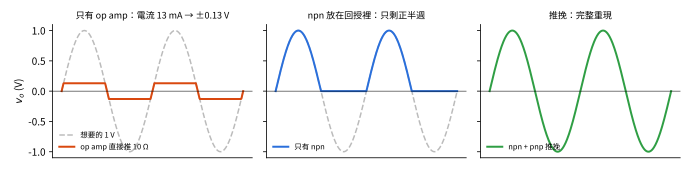
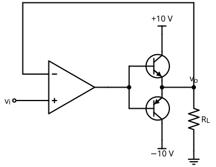

# 第 20 集 · Lec20：op amp 推不動喇叭——外加 BJT、super diode、推挽輸出級 [▶ 影片](https://www.youtube.com/watch?v=C8_8h8pLFgI)

← 上一集：[19](19-op-amp-bandwidth-slew-rate.md) ｜ [總目錄](../README.md) ｜ 下一集：[21](21-class-ab-diodes-simple-audio-system.md) →

> **課程**：電子學（一），陽明交大 電子物理系，112 學年度 — 第 20 集
> **講者**：陳振芳 老師
> **來源**：YouTube 錄影逐字稿（40:59，人工字幕）＋ Sedra & Smith《Microelectronic Circuits》7th ed. §12.3
> **標記說明**：`【口頭】` 老師口頭補充；`【課本補充】` 課本有、課堂沒講；`⚠️ 逐字稿缺字` 字幕或口誤；`[▶ mm:ss]` 影片時間點

---

## 目錄

- [0. 這堂課要做什麼](#0-這堂課要做什麼)
- [1. 問題：op amp 推不動 10 Ω 喇叭](#1-問題op-amp-推不動-10-ω-喇叭)
- [2. npn BJT 怎麼用](#2-npn-bjt-怎麼用)
- [3. 例：單獨一顆 BJT 會少 0.7 V](#3-例單獨一顆-bjt-會少-07-v)
- [4. 把 BJT 放進 op amp 的回授：super diode](#4-把-bjt-放進-op-amp-的回授super-diode)
- [5. 負半週：BJT 不導通](#5-負半週bjt-不導通)
- [6. pnp BJT](#6-pnp-bjt)
- [7. npn + pnp：推挽輸出級](#7-npn--pnp推挽輸出級)
- [8. 一頁速查表](#8-一頁速查表)
- [9. 與後續集數的連結](#9-與後續集數的連結)

---

## 0. 這堂課要做什麼

最後三堂做一個簡單的**音響系統**（stereo system）。麥克風幾 mV，前面的電壓放大已經會了；最後一級要的是**電流**，才有足夠的功率推喇叭。這一級叫**輸出級**（output stage），本質上是一個**電流放大器**。[▶ 00:40](https://youtu.be/C8_8h8pLFgI?t=40)

---

## 1. 問題：op amp 推不動 10 Ω 喇叭

[▶ 01:12](https://youtu.be/C8_8h8pLFgI?t=72)

- 電壓追隨器後面接喇叭 $R_L$。【口頭】類比喇叭電阻很小，不是 4 Ω 就是 8 Ω——目的就是讓你得到很大的電流（幾百、幾千 mA）、功率才夠大。這裡用 10 Ω 比較好算。[▶ 01:44](https://youtu.be/C8_8h8pLFgI?t=104)
- 輸入（已經放大過）$v_i = 1\sin\omega t$ V。亦步亦趨 → 輸出應該也是 $1\sin\omega t$，電流

$$
i_o = \frac{1\ \text{V}}{10\ \Omega} = 100\ \text{mA}\ \sin\omega t
$$

- 但 op 741 輸出電流最多約 **13 mA**。電流不夠就沒有電壓：最多 $13\ \text{mA}\times 10\ \Omega = 0.13$ V。輸出被壓成 ±0.13 V。[▶ 04:48](https://youtu.be/C8_8h8pLFgI?t=288)

【口頭】op amp 放大電壓很容易，提供電流沒辦法。[▶ 05:21](https://youtu.be/C8_8h8pLFgI?t=321)

---

## 2. npn BJT 怎麼用

[▶ 05:52](https://youtu.be/C8_8h8pLFgI?t=352)

先不管物理，拿來用：

- 三隻腳：**基極** B（base）、**射極** E（emitter，有箭頭的那隻）、**集極** C（collector）。
- 【口頭】物理上：電子從射極注入，幾乎全部被集極接收，只有一小部分在基極和電洞結合，所以基極只要提供一點點電洞（電流）。[▶ 06:22](https://youtu.be/C8_8h8pLFgI?t=382)
- B–E 就是一顆**二極體**（箭頭方向就是二極體的正向，B 是 p、E 是 n）。

> ⚠️ 逐字稿缺字 [▶ 05:52](https://youtu.be/C8_8h8pLFgI?t=352)：字幕「另外這隻腳接收 collector 叫做 B」，應是 **C**。

**二極體的簡化** [▶ 07:26](https://youtu.be/C8_8h8pLFgI?t=446)：$i = I_s(e^{v/V_T} - 1)$，$V_T = 0.025$ V，$I_s \sim 10^{-15}$～$10^{-14}$ A。電流從 0.1 mA 到 100 mA 以上（3、4 個數量級），電壓只從 0.6 V 變到 0.8 V。所以乾脆：**導通就是 0.7 V，不導通就沒電流**。

**npn 導通的條件** [▶ 09:03](https://youtu.be/C8_8h8pLFgI?t=543)

1. B 比 E 高 0.7 V。
2. 電流方向一定順著箭頭：**射極電流最大**，$i_E = i_B + i_C$。先畫射極電流，再畫另外兩個。
3. C 要比 E 高一點點（0.1 V 就夠）→ 習慣直接接電路最高的電壓（例 +10 V）。[▶ 11:38](https://youtu.be/C8_8h8pLFgI?t=698)

$$
i_E = (1 + \beta)\,i_B,
\qquad
i_C = \beta\,i_B,
\qquad
\beta \approx 50\sim200
$$

電流方向不對 → 不導通 → 開路。【口頭】二極體不會放大電流，BJT 會；道理差不多，用小電流換大電流。[▶ 12:10](https://youtu.be/C8_8h8pLFgI?t=730)

---

## 3. 例：單獨一顆 BJT 會少 0.7 V

[▶ 12:41](https://youtu.be/C8_8h8pLFgI?t=761)

集極接 10 V、射極接 10 Ω 到地、基極加 1 V 直流。

1. 猜導通 → 射極 $= 1 - 0.7 = 0.3$ V。
2. 射極電流 $= 0.3/0.01\ \text{k}\Omega = 30$ mA，方向往下，**順著箭頭** ✓ → 確實導通。[▶ 13:41](https://youtu.be/C8_8h8pLFgI?t=821)
3. $\beta = 99$ → 基極電流 $30/100 = 0.3$ mA。小電流控制大電流。

缺點：輸出比輸入**少 0.7 V**。[▶ 15:16](https://youtu.be/C8_8h8pLFgI?t=916)

---

## 4. 把 BJT 放進 op amp 的回授：super diode

[▶ 15:46](https://youtu.be/C8_8h8pLFgI?t=946)

電壓追隨器中間夾一顆 npn：op amp 輸出接基極，射極接負載，**回授從射極拉回負端**。

**正半週**（$v_i > 0$）：[▶ 16:16](https://youtu.be/C8_8h8pLFgI?t=976)

- 猜導通 → 有一條回授路 → 負回授力量無窮大，「減個 0.7 算什麼」→ 亦步亦趨 → $v_o = v_i$，**沒有少 0.7 V**。
- 驗證：$A_d[v_i - v_o] = v_o + 0.7$（op amp 輸出比射極高 0.7）→

$$
v_i - v_o = \frac{v_o + 0.7}{A_d} \approx 0
\quad\Longrightarrow\quad
v_o = v_i
$$

[▶ 19:18](https://youtu.be/C8_8h8pLFgI?t=1158)

- 電流方向：負端不吃電流，射極電流 $= v_o/R_L$ 往下，順著箭頭 → 需要 $v_i \ge 0$ ✓。[▶ 20:50](https://youtu.be/C8_8h8pLFgI?t=1250)
- 1 V 時射極電流 100 mA，op amp 只要提供基極電流 $100/100 = 1$ mA（就算 $\beta$ 只有 50 也只要 2 mA），沒問題。**電流由 BJT 從 +10 V 供應**。[▶ 22:22](https://youtu.be/C8_8h8pLFgI?t=1342)

二極體放在 op amp 回授裡，0.7 V 就消失了 → 叫 **super diode**（夾的是 BJT，叫 super BJT 也可以）。[▶ 23:22](https://youtu.be/C8_8h8pLFgI?t=1402)

---

## 5. 負半週：BJT 不導通

[▶ 24:24](https://youtu.be/C8_8h8pLFgI?t=1464)

$v_i < 0$（例 −1 V）：

1. 猜導通 → 亦步亦趨 → $v_o = -1$ V → 電流往上，**和箭頭相反** ✗ → 猜錯。[▶ 25:26](https://youtu.be/C8_8h8pLFgI?t=1526)
2. 所以不導通 → 開路 → 負載沒電流 → $v_o = 0$。
3. 此時 op amp：$v_+ = -1$、$v_- = 0$ → 輸出 $= A_d(-1) \to -\infty$，但飽和在約 **−10 V**（電源 ±12 V）。[▶ 26:58](https://youtu.be/C8_8h8pLFgI?t=1618)
4. 基極 −10 V、射極 0 V → B–E 反向 → 確實不導通 ✓。

結果：正半週過、負半週全被切掉——像二極體整流，只是沒有少 0.7 V。音響這樣「全部扭曲掉了」，不行。[▶ 28:59](https://youtu.be/C8_8h8pLFgI?t=1739)

---

## 6. pnp BJT

[▶ 29:32](https://youtu.be/C8_8h8pLFgI?t=1772)

剛才那顆是 **npn**（n-p-n）；另一種是 **pnp**。有箭頭的一樣是射極。

- B–E 二極體方向相反：**E（p）比 B（n）高 0.7 V** 才導通。[▶ 30:33](https://youtu.be/C8_8h8pLFgI?t=1833)
- 電流：射極電流**流進來**（順著箭頭），基極、集極電流流出去；$i_E = (1 + \beta)i_B$。
- C 要比 E 低一點點 → 接電路最低的電壓（例 −10 V）。[▶ 32:06](https://youtu.be/C8_8h8pLFgI?t=1926)

把 pnp 同樣放進 op amp 回授：$v_i < 0$ 時猜導通 → 亦步亦趨 $v_o = v_i < 0$ → 電流從地經負載往上流進射極、出集極到 −10 V，**方向對** ✓。正半週則不導通。剛好和 npn 互補。[▶ 33:07](https://youtu.be/C8_8h8pLFgI?t=1987)

---

## 7. npn + pnp：推挽輸出級

[▶ 36:13](https://youtu.be/C8_8h8pLFgI?t=2173)

兩顆合在一起：op amp 輸出同時接兩顆的基極；npn（$Q_1$）集極接 +10 V、pnp（$Q_2$）集極接 −10 V；兩個射極接在一起推喇叭，並回授到負端。

- **正半週**：$Q_1$ on。基極比射極高 0.7 V——對 $Q_2$ 來說就是 B 比 E 高，方向反了 → $Q_2$ 一定 off。電流從 +10 V 經 $Q_1$ 推進喇叭。[▶ 37:17](https://youtu.be/C8_8h8pLFgI?t=2237)
- **負半週**：$Q_2$ on、$Q_1$ off。電流從地經喇叭被 $Q_2$ 拉到 −10 V。[▶ 38:18](https://youtu.be/C8_8h8pLFgI?t=2298)
- 兩個半週都亦步亦趨 → $v_o = v_i$，完整重現波形；100 mA 由 BJT 提供，op amp 只出約 1 mA。喇叭換 4、8 Ω 電流更大也沒問題。[▶ 39:20](https://youtu.be/C8_8h8pLFgI?t=2360)

老師把這個電路叫 **class AB push-pull output stage**（AB 類推挽輸出級）。[▶ 39:51](https://youtu.be/C8_8h8pLFgI?t=2391)

> 【課本補充】課本 §12.3 (p. 929) 把一顆 npn、一顆 pnp 各管半週、都沒有偏壓的推挽叫 **B 類**（class B）輸出級；它單獨使用時在 0 附近有一段 ±0.7 V 兩顆都不導通的**交越失真**（crossover distortion）。§12.3.5 (p. 933) 說明把它放進高增益 op amp 的負回授裡，可以把交越失真大幅降低——正是這一集「super diode」的作用。真正的 **AB 類**是給兩顆電晶體一點偏壓、讓它們在 0 附近都微導通（§12.4, p. 935），下一集會加二極體做到。

---

## 8. 一頁速查表

| 項目 | 內容 | 關鍵 |
|---|---|---|
| op amp 電流上限 | 約 13 mA | 1 V／10 Ω 需 100 mA → 只剩 ±0.13 V |
| 二極體簡化 | 導通 0.7 V，不導通 0 A | 0.6–0.8 V 跨 3–4 個數量級 |
| npn 導通 | B 比 E 高 0.7 V；電流順箭頭流出射極；C 接最高電壓 | $i_E = (1+\beta)i_B$ |
| pnp 導通 | E 比 B 高 0.7 V；電流順箭頭流進射極；C 接最低電壓 | |
| 單獨 BJT（射極隨耦） | $v_o = v_i - 0.7$ | |
| BJT 放進回授（super diode） | $v_o = v_i$，0.7 V 消失 | $A_d$ 無窮大 |
| 只有 npn | 只剩正半週 | 負半週 op amp 飽和 −10 V，B–E 反向 |
| 推挽（npn + pnp） | 正半週 npn 推、負半週 pnp 拉 | 互鎖：一顆 on 另一顆必 off |
| 電流分工 | BJT 供應大電流，op amp 只供 $i_L/(1+\beta)$ | |

---

## 9. 與後續集數的連結

| 本集觀念 | 後面在哪裡用到 |
|---|---|
| 推挽輸出級 | 下一集：輸出級外加二極體、簡易音響系統 |
| BJT 物理 | 第 5 章 BJT（電子學三前導） |
| 交越失真、A/B/AB 類 | 第 10 章高功率輸出級（電子學四） |

---

## 附：本集一句話總結

> **op amp 只能出十幾 mA，推不動 4～10 Ω 的喇叭，所以外加 BJT 供應大電流；把 BJT 放進 op amp 的負回授裡，0.7 V 的壓降被無窮大的增益吃掉（super diode），再用 npn 管正半週、pnp 管負半週組成推挽輸出級，就能完整重現波形，op amp 只要提供 $1/(1+\beta)$ 的基極電流。**

---

*筆記依據陳振芳老師「電子學（一）」112 學年度 Lec20 錄影逐字稿（人工字幕，40:59）與 Sedra & Smith《Microelectronic Circuits》7th ed. 整理。*
