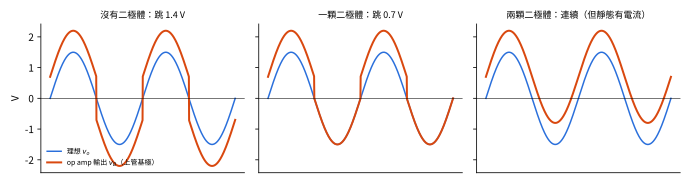

# 第 21 集 · Lec21：推挽輸出級的交越失真與偏壓二極體、簡易音響系統 [▶ 影片](https://www.youtube.com/watch?v=AhkMl7Bk_yw)

← 上一集：[20](20-bjt-current-boost-class-ab-output.md) ｜ [總目錄](../README.md) ｜ 下一集：[電子學（二）01](../E2/01-pn-junction-intro.md) →

> **課程**：電子學（一），陽明交大 電子物理系，112 學年度 — 第 21 集
> **講者**：陳振芳 老師
> **來源**：YouTube 錄影逐字稿（1:04:35，人工字幕）＋ Sedra & Smith《Microelectronic Circuits》7th ed. §12.3–12.4
> **標記說明**：`【口頭】` 老師口頭補充；`【課本補充】` 課本有、課堂沒講；`[▶ mm:ss]` 影片時間點

---

## 目錄

- [0. 這堂課要做什麼](#0-這堂課要做什麼)
- [1. 複習：推挽輸出級怎麼工作](#1-複習推挽輸出級怎麼工作)
- [2. 過零點：op amp 輸出要瞬間跳 1.4 V](#2-過零點op-amp-輸出要瞬間跳-14-v)
- [3. 跳不過去：交越失真](#3-跳不過去交越失真)
- [4. 加一顆二極體：只跳 0.7 V](#4-加一顆二極體只跳-07-v)
- [5. 加兩顆二極體：不用跳，但靜態一直耗電](#5-加兩顆二極體不用跳但靜態一直耗電)
- [6. 簡易音響系統](#6-簡易音響系統)
- [7. 一頁速查表](#7-一頁速查表)
- [8. 與後續集數的連結](#8-與後續集數的連結)

---

## 0. 這堂課要做什麼

1. 上一集的推挽輸出級在**過零點**有一個看不到的問題：op amp 輸出要瞬間跳 1.4 V，做不到 → 失真。
2. 在兩顆 BJT 的基極之間加二極體，縮小（或消除）這個跳躍；代價是靜態功耗。
3. 把整學期學過的東西串成一個簡易音響系統。

---

## 1. 複習：推挽輸出級怎麼工作

[▶ 00:09](https://youtu.be/AhkMl7Bk_yw?t=9)

（電路見[上一集第 7 節](20-bjt-current-boost-class-ab-output.md#7-npn--pnp推挽輸出級)。）喇叭只有 4、8 Ω，目的就是讓大電流流過、功率才大；輸出級是**電流放大器**。

- npn 導通：B 比 E 高 0.7 V、電流順箭頭；$i_E = (1+\beta)i_B$，$\beta$ 約 50～200。[▶ 02:12](https://youtu.be/AhkMl7Bk_yw?t=132)
- 正半週：猜 $Q_1$ 導通 → 有回授迴路 → 亦步亦趨 → $v_o = v_i$；電流 $v_o/R_L$ 往下，方向對 ✓。1 V／10 Ω = 100 mA，$\beta = 99$ 時 op amp 只要出 1 mA。[▶ 05:48](https://youtu.be/AhkMl7Bk_yw?t=348)
- 負半週：$Q_1$ 的電流方向會反，不可能導通 → 換 pnp $Q_2$ 導通。[▶ 08:22](https://youtu.be/AhkMl7Bk_yw?t=502)
- 一顆導通時，兩基極同電位、兩射極同電位 → 另一顆的 B–E 必定反向 → **不會同時導通**，「我導通你就不導通，兩個互補」。[▶ 10:28](https://youtu.be/AhkMl7Bk_yw?t=628)

---

## 2. 過零點：op amp 輸出要瞬間跳 1.4 V

[▶ 14:45](https://youtu.be/AhkMl7Bk_yw?t=885)

**假設**輸出 $v_o$ 真的是一個完美的 sin 波，反推 op amp 的輸出（兩顆 BJT 的基極電壓）$v_B$ 要長什麼樣：

- 正半週 $Q_1$ 導通：$v_B = v_o + 0.7$。
- 負半週 $Q_2$ 導通：$v_B = v_o - 0.7$。[▶ 15:46](https://youtu.be/AhkMl7Bk_yw?t=946)

所以在 $v_o$ 的**過零點**（zero crossing point），$v_B$ 必須瞬間從 +0.7 跳到 −0.7（或反過來），也就是 **quantum drop／quantum jump 1.4 V**，完全不給時間。[▶ 17:24](https://youtu.be/AhkMl7Bk_yw?t=1044)

---

## 3. 跳不過去：交越失真

[▶ 19:00](https://youtu.be/AhkMl7Bk_yw?t=1140)

上週才講過：op amp 輸出的變化速度有上限。

- 接成電壓追隨器時頻寬 $= \omega_t = 10^6$ → 起始斜率 $= v_i\omega_t$，1 V 時就是 $10^6$ V/s = **1 V/μs**。[▶ 22:40](https://youtu.be/AhkMl7Bk_yw?t=1360)
- 741 的 slew rate 也約 $10^6$ V/s，兩個限制差不多。[▶ 24:49](https://youtu.be/AhkMl7Bk_yw?t=1489)

跳 1.4 V 至少要 **約 1.4 μs**。這段時間內 $v_o$ 不可能是完美的 sin → 過零點附近有**扭曲**（distortion）。[▶ 25:51](https://youtu.be/AhkMl7Bk_yw?t=1551)

- 聲音最高頻約 $10^5$ rad/s，半週期約 30 μs；其中約 1.4 μs 會出問題。[▶ 26:55](https://youtu.be/AhkMl7Bk_yw?t=1615)
- 還沒算 BJT 本身的切換時間：一顆關掉、另一顆打開，不可能接得剛剛好，可能瞬間兩顆都不導通、空接，問題更嚴重。[▶ 28:28](https://youtu.be/AhkMl7Bk_yw?t=1708)

> 【課本補充】§12.3.2 (p. 929)：這個現象叫**交越失真**（crossover distortion）——B 類輸出級在 $|v_I| < 0.5$ V 左右的死區（dead band）兩顆都不導通。放進 op amp 回授後死區被縮小到 $0.5/A_0$，但 op amp 輸出仍要快速穿越這 ±0.7 V，受限於 slew rate。

---

## 4. 加一顆二極體：只跳 0.7 V

[▶ 29:29](https://youtu.be/AhkMl7Bk_yw?t=1769)

在兩顆 BJT 的基極之間串一顆二極體，pnp 的基極經電阻 $R$ 接到 −10 V。

- **電阻 $R$ 一定要有**：二極體要有電流才會導通、才跨 0.7 V；沒有一條往下的路，電流沒地方流（不能逆著箭頭往上），二極體就沒用了。−10 V 很低，所以一定有電流往下流 → 二極體一直導通。[▶ 31:03](https://youtu.be/AhkMl7Bk_yw?t=1863)
- 正半週 $v_B = v_o + 0.7$；負半週 $Q_2$ 的基極 $= v_o - 0.7$，所以 $v_B = v_o - 0.7 + 0.7 = v_o$。[▶ 32:07](https://youtu.be/AhkMl7Bk_yw?t=1927)
- 過零點只要跳 **0.7 V**，約 0.7 μs。還是有一點失真，但時間少一半。[▶ 32:40](https://youtu.be/AhkMl7Bk_yw?t=1960)

---

## 5. 加兩顆二極體：不用跳，但靜態一直耗電

### 5.1 失真消失

[▶ 34:17](https://youtu.be/AhkMl7Bk_yw?t=2057)

兩顆二極體共 1.4 V：負半週 $v_B = v_o - 0.7 + 1.4 = v_o + 0.7$——和正半週一樣，**連續了**。op amp 輸出不需要跳，慢慢跟著走就好 → 沒有過零失真（no zero crossing point distortion）。[▶ 35:50](https://youtu.be/AhkMl7Bk_yw?t=2150)

### 5.2 問題：兩顆同時導通

[▶ 36:52](https://youtu.be/AhkMl7Bk_yw?t=2212)

- 之前一顆導通、另一顆一定不導通（只有 0.7 V，不夠兩顆用）。現在兩基極之間有 1.4 V，**兩顆可以同時導通**，各跨約 0.7 V。
- 沒有聲音時（$v_i = 0$，no voice），$v_o = 0$，但兩顆一直有電流從 +10 V 經 $Q_1$、$Q_2$ 流到 −10 V。這叫**靜態功耗**（quiescent power dissipation）：沒信號也一直浪費電。[▶ 37:56](https://youtu.be/AhkMl7Bk_yw?t=2276)

### 5.3 有信號時發生什麼

[▶ 38:27](https://youtu.be/AhkMl7Bk_yw?t=2307)

偏壓電流 $i = \dfrac{(v_o - 0.7) - (-10)}{R}$。$v_o$ 在 ±1 V 擺動：

$$
i_{\max} = \frac{10.3}{R},
\qquad
i_{\min} = \frac{8.3}{R}
$$

$R = 10$ kΩ → 約 1 mA，上下變一點。【口頭】二極體、BJT 的「0.7 V」只是大概：電流大一點變 0.72、0.73，小一點變 0.68、0.65。正半週時 $Q_1$ 的 B–E 變大（導通更多）、$Q_2$ 變小（導通少一點），兩者總和固定 1.4 V；兩個電流相減就是給喇叭的電流。[▶ 42:34](https://youtu.be/AhkMl7Bk_yw?t=2554)

### 5.4 取捨

[▶ 44:07](https://youtu.be/AhkMl7Bk_yw?t=2647)

- 不在乎功率 → 兩顆二極體，零失真。
- 在乎功率 → 一顆二極體，一點失真。
- 折衷：讓基極間電壓小於 1.4 V（例如 1.2、1.15 V），靜態電流就小很多。要控制這個電壓得用電流源，電路比較複雜；不要用電池（浪費錢）。[▶ 44:39](https://youtu.be/AhkMl7Bk_yw?t=2679)

【口頭】那一點點失真耳朵聽不出來，所以這裡用**一顆二極體**的版本就可以了。[▶ 45:11](https://youtu.be/AhkMl7Bk_yw?t=2711)

> 【課本補充】§12.4 (p. 935)：真正的 **AB 類**就是給兩顆電晶體一個小偏壓 $V_{BB}$（常用兩顆二極體或 $V_{BE}$ 倍增器產生），讓靜態時兩顆都流一個小電流 $I_Q$，交越失真幾乎消失；代價就是靜態功耗 $2V_{CC}I_Q$。老師的「兩顆二極體」版本就是這個。

---

## 6. 簡易音響系統

[▶ 45:42](https://youtu.be/AhkMl7Bk_yw?t=2742)

**1. 麥克風** [▶ 46:12](https://youtu.be/AhkMl7Bk_yw?t=2772)：現在的麥克風裡有一級前置放大（用低雜訊的 JFET，只放大一點點），要加偏壓（例 5 V）。輸出除了聲音 $v_i$，還有電路本身產生、很難避免的**直流**（假設 2 V）。

**2. 擋直流** [▶ 49:19](https://youtu.be/AhkMl7Bk_yw?t=2959)：直接進增益 10 的放大器，2 V 會被放大成 20 V——不可能，卡在天花板（約 12 V）飽和，幾 mV 的聲音就「被掐死」了。→ 串電容擋直流。

- 但 op amp 輸入幾乎沒電流，電容充不到電（要充到明天）→ **加一顆電阻到地**，給直流一條路，幾個 $RC$（不到一秒）就充到 2 V。[▶ 50:50](https://youtu.be/AhkMl7Bk_yw?t=3050)
- 這個 CR 是**高通**：聲音要通過，$1/RC$ 要比聲音最低頻 $10^2$ 還小。[▶ 51:52](https://youtu.be/AhkMl7Bk_yw?t=3112)

**3. 電壓放大** [▶ 47:47](https://youtu.be/AhkMl7Bk_yw?t=2867)：非反相放大器 1 k／9 k，增益 10，$\omega_t = 10^6$ → 頻寬 $10^5$，剛好涵蓋聲音。**不能一級放 100 倍**（頻寬剩 $10^4$，高頻聲音被切掉）→ 串兩級各 10 倍。【口頭】寧願多放幾顆、增益小一點，頻寬才重要；多放幾顆 op amp 反而很便宜。[▶ 53:56](https://youtu.be/AhkMl7Bk_yw?t=3236)

**4. 濾高頻雜訊** [▶ 55:32](https://youtu.be/AhkMl7Bk_yw?t=3332)：電路裡只要有溫度就有雜訊，高頻雜訊一定有 → 加 $R_0C_0$ **低通**，轉折頻率要比 $10^5$ 高（聲音全過），以上的雜訊被切掉。

- 一個 RC 只有 −20 dB/decade，不夠陡（3 倍頻只衰減到 1/3）。兩個 RC 直接串會互相影響（負載效應），轉折點會往內縮，要重算。[▶ 58:39](https://youtu.be/AhkMl7Bk_yw?t=3519)
- 更好的做法：把第二個 RC 放在**兩級 op amp 之間**。op amp 輸入電阻 ∞ → 後面接什麼都不影響前面；輸出電阻 0 → 接什麼負載輸出都不變。所以每個 RC 都不受干擾，可以直接用同樣的值。[▶ 59:13](https://youtu.be/AhkMl7Bk_yw?t=3553)

**5. 輸出級** [▶ 1:01:16](https://youtu.be/AhkMl7Bk_yw?t=3676)：幾伏的信號進推挽輸出級，BJT 提供大電流推喇叭。要更大功率、一顆 BJT 的 $\beta$ 不夠時，可以兩顆疊起來（$\beta^2$，100×100），但偏壓要調整，不要讓它們全部同時導通。[▶ 1:01:46](https://youtu.be/AhkMl7Bk_yw?t=3706)

**還缺**：**自動增益控制**（automatic gain control, AGC）——聲音太大時會超出範圍被切頂。要用回授，等講 MOS 時再說。[▶ 1:02:50](https://youtu.be/AhkMl7Bk_yw?t=3770)

【口頭】這學期做了好幾個大系統：心電圖量測、自動街燈、解微分方程、音響——都是把前面學的拿來用。二極體、電晶體其實都提到了；下學期會從物理好好重講 MOS、BJT。[▶ 1:03:20](https://youtu.be/AhkMl7Bk_yw?t=3800)

---

## 7. 一頁速查表

| 項目 | 內容 | 關鍵 |
|---|---|---|
| 推挽過零點 | $v_B$ 要從 $v_o + 0.7$ 跳到 $v_o - 0.7$ | 跳 1.4 V |
| 跳躍時間 | 約 1.4 μs（1 V/μs） | 頻寬 $\omega_t$、slew rate |
| 一顆偏壓二極體 | 跳 0.7 V，約 0.7 μs | 必須有 $R$ 到 −10 V 讓二極體導通 |
| 兩顆偏壓二極體 | 不用跳，無過零失真 | 兩顆 BJT 同時導通 |
| 靜態功耗 | 沒信號也有 $+10 \to -10$ 的電流 | 取捨：失真 vs 功耗 |
| 偏壓電流 | $\dfrac{(v_o - 0.7) + 10}{R}$，$R$=10 kΩ ≈ 1 mA | |
| 麥克風直流 | 用 C + R（高通）擋掉 | $1/RC < 10^2$ |
| 每級增益 | ≤ 10（$\omega_t = 10^6$，頻寬 $10^5$） | 增益 100 頻寬只剩 $10^4$ |
| 雜訊低通 | $1/R_0C_0 > 10^5$；多級放在 op amp 之間 | $R_i = \infty$、$R_o = 0$ 隔離 |
| 更大電流 | BJT 疊兩顆（$\beta^2$） | |

---

## 8. 與後續集數的連結

| 本集觀念 | 後面在哪裡用到 |
|---|---|
| A、B、AB 類、交越失真、效率 | 電子學（四）第 10 章高功率輸出級 |
| 二極體的 0.7 V 不是常數 | 電子學（二）第 3 章 P-N 介面、二極體模型 |
| BJT 物理、$\beta$ | 電子學（三）第 5 章 BJT |
| 自動增益控制、回授 | 電子學（三）第 8 章負回授 |
| 下一門課 | [電子學（二）第 01 集：P-N 介面](../E2/01-pn-junction-intro.md) |

---

## 附：本集一句話總結

> **推挽輸出級在過零點要求 op amp 輸出瞬間跳 1.4 V，受限於頻寬與迴轉率（約 1 V/μs）而產生交越失真；基極之間加一顆二極體只要跳 0.7 V，加兩顆就完全不用跳，但兩顆 BJT 同時導通、靜態一直耗電。整個音響就是：麥克風 → CR 擋直流 → 兩級 ×10 放大 → RC 濾雜訊 → 推挽輸出級 → 喇叭。**

---

*筆記依據陳振芳老師「電子學（一）」112 學年度 Lec21 錄影逐字稿（人工字幕，1:04:35）與 Sedra & Smith《Microelectronic Circuits》7th ed. 整理。*
