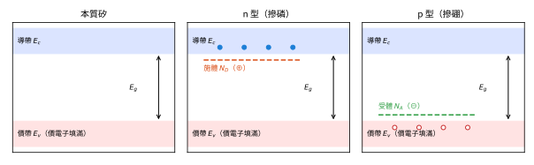
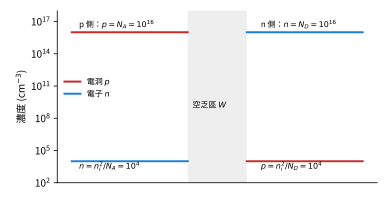
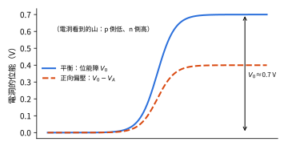

# 第 01 集 · Lec01：半導體、漂移與擴散電流、P-N 介面的內建電位 [▶ 影片](https://www.youtube.com/watch?v=XPQRcZkoK8g)

← 上一集：[電子學（一）21](../E1/21-class-ab-diodes-simple-audio-system.md) ｜ [總目錄](../README.md) ｜ 下一集：[02](02-pn-junction-diode-current.md) →

> **課程**：電子學（二），陽明交大 電子物理系，112 學年度 — 第 01 集
> **講者**：陳振芳 老師
> **來源**：YouTube 錄影逐字稿（1:12:32，whisper）＋ Sedra & Smith《Microelectronic Circuits》7th ed. §3.1–3.4
> **標記說明**：`【口頭】` 老師口頭補充；`【課本補充】` 課本有、課堂沒講；`⚠️ 逐字稿缺字` whisper 聽錯，依課本修正；`[▶ mm:ss]` 影片時間點

---

## 目錄

- [0. 這堂課要做什麼](#0-這堂課要做什麼)
- [1. 本質矽：幾乎不導電](#1-本質矽幾乎不導電)
- [2. 摻雜：n 型與 p 型](#2-摻雜n-型與-p-型)
- [3. 能帶圖](#3-能帶圖)
- [4. 漂移電流與遷移率](#4-漂移電流與遷移率)
- [5. 擴散電流與愛因斯坦關係式](#5-擴散電流與愛因斯坦關係式)
- [6. P-N 介面：空乏區與位能障](#6-p-n-介面空乏區與位能障)
- [7. 平衡時電流為零 → 內建電位公式](#7-平衡時電流為零--內建電位公式)
- [8. 加正向偏壓](#8-加正向偏壓)
- [9. 一頁速查表](#9-一頁速查表)
- [10. 與後續集數的連結](#10-與後續集數的連結)

---

## 0. 這堂課要做什麼

這學期上 MOS 和 BJT 的基本電路，兩者都需要半導體物理，所以從**第三章 P-N 介面**開始（電子學一第 14 集講過一部分），一路講到 P-N 光偵測器，再進 MOS、BJT。[▶ 00:00](https://youtu.be/XPQRcZkoK8g?t=0)

本集：本質矽 → 摻雜 → 兩種電流（漂移、擴散）→ P-N 介面的內建電位 $V_0 = V_T\ln(N_AN_D/n_i^2)$ → 加正向偏壓。

---

## 1. 本質矽：幾乎不導電

[▶ 00:31](https://youtu.be/XPQRcZkoK8g?t=31)

- 矽最外圍 8 個位置、只有 4 個電子；和旁邊 4 顆矽共用 → **共價鍵**（covalent bond），8 個位置填滿。共價鍵上的是**價電子**（valence electron），被拉得緊緊的、不能動。[▶ 03:04](https://youtu.be/XPQRcZkoK8g?t=184)
- 單晶矽：原子濃度約 $10^{23}$ cm⁻³ 量級。
- 室溫下少數電子能量夠高、解離 → **自由電子**（free electron），濃度 $n$；留下的空位叫**電洞**（hole），濃度 $p$。旁邊的價電子能藉空位移動，等效成電洞帶正電在動。[▶ 04:05](https://youtu.be/XPQRcZkoK8g?t=245)
- 濃度太低（和原子數差十幾個數量級），加電場量不到電流 → 像玻璃一樣是絕緣體。這叫**本質半導體**（intrinsic），$n = p = n_i$。[▶ 07:11](https://youtu.be/XPQRcZkoK8g?t=431)

$$
np = n_i^2 \approx 10^{20}\ \text{cm}^{-6}
$$

> ⚠️ 逐字稿缺字 [▶ 04:35](https://youtu.be/XPQRcZkoK8g?t=275)：whisper 寫「10 的十四方」，但老師接著說 $n_i^2 \approx 10^{20}$，所以應是 $n_i \approx 10^{10}$ cm⁻³。【課本補充】§3.1 (p. 138)：室溫矽 $n_i = 1.5\times10^{10}$ cm⁻³，原子濃度 $5\times10^{22}$ cm⁻³。

---

## 2. 摻雜：n 型與 p 型

[▶ 08:13](https://youtu.be/XPQRcZkoK8g?t=493)

【口頭】摻雜（dope）是整個半導體、IC 發展最重要的關鍵；方法很簡單：高溫下讓雜質自己擴散進去。

**n 型**：摻五價的**磷**（P）。多出的電子沒有位置，室溫就跑掉 → 每加一顆產生一個自由電子，磷變成固定的正離子。磷叫**施體**（donor），濃度 $N_D$。[▶ 09:44](https://youtu.be/XPQRcZkoK8g?t=584)

$$
n \approx N_D,\qquad p = \frac{n_i^2}{N_D}
$$

例：$N_D = 10^{16}$ → $p = 10^{20}/10^{16} = 10^4$。到處都是電子，空位全被填滿，電洞變得非常少。$np = n_i^2$ 叫**質量作用定律**（mass action law）。電子是**多數載子**（majority carrier），電洞是**少數載子**（minority carrier）。[▶ 11:20](https://youtu.be/XPQRcZkoK8g?t=680)

**p 型**：摻三價的**硼**（B），少一個電子 → 空位 → 電洞；硼變成固定的負離子。硼叫**受體**（acceptor），濃度 $N_A$。[▶ 16:55](https://youtu.be/XPQRcZkoK8g?t=1015)

$$
p \approx N_A,\qquad n = \frac{n_i^2}{N_A}
$$

例：$N_A = 10^{17}$ → $n = 10^3$。

【口頭】畫圖時只畫會影響電性的東西：固定離子（⊕／⊖）和自由載子，其他中性的都不畫。[▶ 12:21](https://youtu.be/XPQRcZkoK8g?t=741)

---

## 3. 能帶圖

[▶ 12:52](https://youtu.be/XPQRcZkoK8g?t=772)

一顆原子的電子佔的是一個一個能階；兩顆靠近時能階分裂，很多顆組成晶體就變成**能帶**（energy band）。

- 下面填滿價電子的叫**價帶**（valence band），上面的叫**導帶**（conduction band），中間不能有電子的叫**能隙**（energy gap）。矽約 1.1 eV（老師說「1 點多 eV」）。[▶ 14:24](https://youtu.be/XPQRcZkoK8g?t=864)
- n 型：施體能階在導帶下方一點點（差距小於室溫能量 $kT$），室溫就解離 → 導帶裡很多自由電子。[▶ 15:25](https://youtu.be/XPQRcZkoK8g?t=925)
- p 型：受體能階在價帶上方一點點，室溫下價電子跳上去 → 價帶裡很多電洞。[▶ 19:29](https://youtu.be/XPQRcZkoK8g?t=1169)

---

## 4. 漂移電流與遷移率

[▶ 21:32](https://youtu.be/XPQRcZkoK8g?t=1292)

半導體的電流有兩種：**漂移**（drift）和**擴散**（diffusion）。

**漂移**：加電場 $E$（每單位電荷受的力），電洞受力 $F = qE$。電洞在材料裡其實是波，當成粒子看要用**等效質量** $m^*$（effective mass）。[▶ 23:04](https://youtu.be/XPQRcZkoK8g?t=1384)

它被加速，但會撞到矽原子；撞完往哪個方向隨機，平均起來動量歸零。兩次碰撞的平均時間 $\tau$（mean free time），每秒撞 $1/\tau$ 次，每次失去動量 $m^*v$。牛頓第二定律：[▶ 24:40](https://youtu.be/XPQRcZkoK8g?t=1480)

$$
m^*\frac{dv}{dt} = qE - \frac{m^*v}{\tau}
$$

穩態（$dv/dt = 0$）：[▶ 28:20](https://youtu.be/XPQRcZkoK8g?t=1700)

$$
v_{ss} = \frac{q\tau}{m^*}E \equiv \mu E
$$

$\mu$ 叫**遷移率**（mobility）——穩態速度和電場成正比的比例常數。【口頭】做半導體材料，第一件要量的就是它（用霍爾量測 Hall measurement），越大越好。矽的電子約 1000 多、電洞約它的三分之一（cm²/V·s）。[▶ 30:24](https://youtu.be/XPQRcZkoK8g?t=1824)

**電流密度** [▶ 30:54](https://youtu.be/XPQRcZkoK8g?t=1854)：體積 $Ax$ 內的電洞 $pAx$，在時間 $x/v$ 內全部通過截面 $A$ →

$$
\text{通量（flux）} = \frac{pAx}{(x/v)\,A} = p\,v,
\qquad
J_p = q\,p\,v = q\,p\,\mu_p E
$$

（像高速公路的車流量：濃度 × 速度。）電子同理，總漂移電流：[▶ 34:37](https://youtu.be/XPQRcZkoK8g?t=2077)

$$
J_\text{drift} = q\,(p\,\mu_p + n\,\mu_n)\,E
$$

> 【課本補充】§3.3.1 (p. 142)：矽 $\mu_n = 1350$、$\mu_p = 480$ cm²/V·s。

---

## 5. 擴散電流與愛因斯坦關係式

[▶ 35:07](https://youtu.be/XPQRcZkoK8g?t=2107)

濃度一邊高一邊低，粒子撞來撞去就往低的地方跑（像捷運擠滿的車廂往空車廂移動）。電流和濃度斜率成正比，比例常數叫**擴散常數**（diffusion constant）$D$：

$$
J_n = q\,D_n\frac{dn}{dx},
\qquad
J_p = -q\,D_p\frac{dp}{dx}
$$

[▶ 36:10](https://youtu.be/XPQRcZkoK8g?t=2170)

方向：以向右為正。電子往低濃度跑，但帶負電，所以電流方向和斜率同號（不加負號）；電洞帶正電，電流往低濃度方向，要加**負號**。[▶ 37:44](https://youtu.be/XPQRcZkoK8g?t=2264)

**總電流** [▶ 39:16](https://youtu.be/XPQRcZkoK8g?t=2356)：

$$
J_n = q\,n\,\mu_n E + q\,D_n\frac{dn}{dx},
\qquad
J_p = q\,p\,\mu_p E - q\,D_p\frac{dp}{dx}
$$

$\mu$ 和 $D$ 都來自碰撞，應該有關係。1905–06 年愛因斯坦用分子動力學導出：[▶ 40:18](https://youtu.be/XPQRcZkoK8g?t=2418)

$$
\frac{D_n}{\mu_n} = \frac{D_p}{\mu_p} = \frac{kT}{q} = V_T \approx 0.025\ \text{V}\ (\text{室溫})
$$

**愛因斯坦關係式**（Einstein relation）；$k$ 是波茲曼常數。

---

## 6. P-N 介面：空乏區與位能障

[▶ 41:52](https://youtu.be/XPQRcZkoK8g?t=2512)

一邊擴散五價、一邊擴散三價，形成 **P-N 介面**（pn junction）：

1. **擴散**：n 側電子往 p 側跑，p 側電洞往 n 側跑。
2. **結合**（recombine）：自由電子填進空位變成價電子，不能動 → 兩者都「消失」。[▶ 43:25](https://youtu.be/XPQRcZkoK8g?t=2605)
3. 介面附近只剩固定的離子：n 側正、p 側負。像平行電容板 → **內建電場**（built-in field），從 n 指向 p。[▶ 44:29](https://youtu.be/XPQRcZkoK8g?t=2669)
4. 這塊沒有自由載子的區域叫**空乏區**（depletion region），寬度 $W$。

**位能障** [▶ 47:02](https://youtu.be/XPQRcZkoK8g?t=2822)：電洞想過去，被電場推回來；要把它推過去必須施力、做正功 → 電洞在 n 側的位能比 p 側高 $V_0$。電子同理也要爬山。這座山是阻擋擴散的**位能障**（potential barrier）。

**能帶圖** [▶ 52:22](https://youtu.be/XPQRcZkoK8g?t=3142)：能隙固定，只能選一種載子畫；習慣畫**電子**的能量（「電子比較大」），所以導帶、價帶在介面一起彎；電洞的能量要**倒過來看**——對電洞來說也是要爬山，不是溜滑梯。[▶ 55:34](https://youtu.be/XPQRcZkoK8g?t=3334)

（能帶圖見[電子學（一）第 14 集](../E1/14-pn-photodetector-diode-model.md#4-位能障與能帶圖)。）

---

## 7. 平衡時電流為零 → 內建電位公式

[▶ 57:05](https://youtu.be/XPQRcZkoK8g?t=3425)

以電洞為例：

1. 剛接上時沒有電場，只有擴散項 $-qD_p\,dp/dx$。
2. 擴散 → 結合 → 電場產生，漂移項開始**抵抗**擴散。
3. 漂移越來越大，直到兩項相等：**穩態**，$J_p = 0$。[▶ 59:39](https://youtu.be/XPQRcZkoK8g?t=3579)

$$
q\,p\,\mu_p E = q\,D_p\frac{dp}{dx}
\;\Longrightarrow\;
E = \frac{D_p}{\mu_p}\cdot\frac{1}{p}\frac{dp}{dx}
$$

用 $E = -dV/dx$、$D_p/\mu_p = V_T$，從 p 側（點 1）積到 n 側（點 2）：[▶ 1:01:42](https://youtu.be/XPQRcZkoK8g?t=3702)

$$
-(V_2 - V_1) = V_T\ln\frac{p_2}{p_1}
\;\Longrightarrow\;
V_0 = V_T\ln\frac{p_1}{p_2}
$$

$p_1 = N_A$（p 側多數）、$p_2 = n_i^2/N_D$（n 側少數）：[▶ 1:06:53](https://youtu.be/XPQRcZkoK8g?t=4013)

$$
\boxed{V_0 = V_T\ln\frac{N_A N_D}{n_i^2}}
$$

**例**：$N_A = N_D = 10^{16}$ → $V_0 = 0.025\ln\dfrac{10^{16}}{10^4} = 0.025 \times 27.6 \approx 0.69$ V，約 **0.7 V**。[▶ 1:04:18](https://youtu.be/XPQRcZkoK8g?t=3858)

【口頭】只要把 p 和 n 接在一起，材料裡**自己**就產生一座約 0.7 V 的電位山。1950 年代 Bell Labs 三個人做出第一顆電晶體，靠的就是這件事：從外面加電場改變山的高度，就改變電流。老師在 Bell Labs 做過很多實驗想在材料裡造一座山，「做了老半天發現沒有比這個好」；矽的製程已經能做到奈米等級又控制得很好——整個半導體發展的關鍵就在這裡。[▶ 1:04:51](https://youtu.be/XPQRcZkoK8g?t=3891)

> 【課本補充】§3.4.2 (p. 151)：同一個公式 $V_0 = V_T\ln(N_AN_D/n_i^2)$，矽在室溫典型值 0.6～0.9 V。

---

## 8. 加正向偏壓

[▶ 1:07:56](https://youtu.be/XPQRcZkoK8g?t=4076)

外加 $V_A$，**p 接正、n 接負** = **正向偏壓**（forward bias）。

- p、n 兩側載子多、電阻小；空乏區沒載子、電阻最大 → 電壓**幾乎全跨在空乏區**（像串聯電阻，電流處處一樣）。[▶ 1:08:59](https://youtu.be/XPQRcZkoK8g?t=4139)
- 外加電場方向和內建電場**相反** → 電場減小 → 山變矮：

$$
V_0 \;\to\; V_0 - V_A
$$

接下來要導出加了偏壓之後的電流——【口頭】老師說會照當年 Shockley 的手稿推（他在 Bell Labs 時手稿就放在辦公室櫥櫃裡）。[▶ 1:11:06](https://youtu.be/XPQRcZkoK8g?t=4266)

---

## 9. 一頁速查表

| 項目 | 公式 | 關鍵 |
|---|---|---|
| 本質濃度 | $n = p = n_i \approx 10^{10}$ cm⁻³ | 太少，不導電 |
| 質量作用定律 | $np = n_i^2 \approx 10^{20}$ | |
| n 型 | $n \approx N_D$，$p = n_i^2/N_D$ | 施體（磷）帶正電 |
| p 型 | $p \approx N_A$，$n = n_i^2/N_A$ | 受體（硼）帶負電 |
| 穩態漂移速度 | $v = \mu E$，$\mu = q\tau/m^*$ | 加速 vs 碰撞 |
| 漂移電流 | $J = q(p\mu_p + n\mu_n)E$ | 通量 = 濃度 × 速度 |
| 擴散電流 | $J_n = qD_n\,dn/dx$，$J_p = -qD_p\,dp/dx$ | 電洞加負號 |
| 愛因斯坦 | $D/\mu = V_T = kT/q \approx 25$ mV | |
| 內建電位 | $V_0 = V_T\ln(N_AN_D/n_i^2)$ ≈ 0.7 V | $J_p = 0$：漂移 = 擴散 |
| 正向偏壓 | 山 $V_0 \to V_0 - V_A$ | 電壓跨在空乏區 |

---

## 10. 與後續集數的連結

| 本集觀念 | 後面在哪裡用到 |
|---|---|
| 漂移 + 擴散、$J_p = 0$ | 下一集：加偏壓後的少數載子注入、二極體電流 $I_s(e^{V/V_T}-1)$ |
| 位能障 | 二極體、BJT、MOSFET 都靠控制這座山 |
| 遷移率 $\mu$ | 第 4 章 MOSFET 的 $k_n' = \mu_nC_{ox}$ |
| 少數載子 | BJT 的基極注入 |

---

## 附：本集一句話總結

> **本質矽載子太少不導電，摻磷得電子、摻硼得電洞（$np = n_i^2$）；電流有漂移 $q\,n\mu E$ 和擴散 $qD\,dn/dx$ 兩種，$D/\mu = V_T$；P-N 接在一起後擴散、結合出只剩離子的空乏區和內建電場，平衡時漂移抵消擴散，得到內建電位 $V_0 = V_T\ln(N_AN_D/n_i^2) \approx 0.7$ V，正向偏壓把它壓低成 $V_0 - V_A$。**

---

*筆記依據陳振芳老師「電子學（二）」112 學年度 Lec01 錄影逐字稿（whisper，1:12:32）與 Sedra & Smith《Microelectronic Circuits》7th ed. 整理。*
