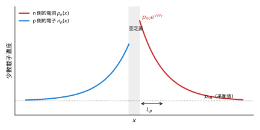

# 第 02 集 · Lec02：正向偏壓的少數載子注入與二極體電流方程 [▶ 影片](https://www.youtube.com/watch?v=VnCInA68d6Q)

← 上一集：[01](01-pn-junction-intro.md) ｜ [總目錄](../README.md) ｜ 下一集：[03](03-diode-log-exp-amplifier-rectifier.md) →

> **課程**：電子學（二），陽明交大 電子物理系，112 學年度 — 第 02 集
> **講者**：陳振芳 老師
> **來源**：YouTube 錄影逐字稿（48:27，whisper）＋ Sedra & Smith《Microelectronic Circuits》7th ed. §3.4–3.5
> **標記說明**：`【口頭】` 老師口頭補充；`【課本補充】` 課本有、課堂沒講；`[▶ mm:ss]` 影片時間點

---

## 目錄

- [0. 這堂課要做什麼](#0-這堂課要做什麼)
- [1. 複習：空乏區怎麼長到穩態](#1-複習空乏區怎麼長到穩態)
- [2. 複習：內建電位](#2-複習內建電位)
- [3. 正向偏壓：少數載子在邊界跳升](#3-正向偏壓少數載子在邊界跳升)
- [4. 連續方程：一邊跑一邊被吃掉](#4-連續方程一邊跑一邊被吃掉)
- [5. 擴散長度與濃度分布](#5-擴散長度與濃度分布)
- [6. 電流：二極體方程](#6-電流二極體方程)
- [7. 一頁速查表](#7-一頁速查表)
- [8. 與後續集數的連結](#8-與後續集數的連結)

---

## 0. 這堂課要做什麼

照 Shockley 當年的推導，從漂移擴散方程推出二極體的電流電壓關係：

$$
I = I_s\left(e^{V/V_T} - 1\right)
$$

---

## 1. 複習：空乏區怎麼長到穩態

[▶ 00:00](https://youtu.be/VnCInA68d6Q?t=0)

（摻雜、n 型 p 型見上一集。）$N_A = N_D = 10^{16}$ → 兩側多數 $10^{16}$、少數 $10^4$。

- 電洞電流 $J_p = qp\mu_pE - qD_p\dfrac{dp}{dx}$：介面處 $dp/dx$ 是很大的負值 → 電洞往 n 側擴散。電子同理往 p 側。[▶ 04:07](https://youtu.be/VnCInA68d6Q?t=247)
- 一開始沒有電場，只有擴散；擴散 → 結合 → 留下離子 → 電場出現，方向和擴散相反（**抵抗**擴散）。[▶ 06:37](https://youtu.be/VnCInA68d6Q?t=397)
- 電場還不夠大 → 繼續擴散 → 空乏區變寬、電荷變多 → 電場變大；同時空乏區變寬讓濃度斜率 $dp/dx$ 變小 → 擴散項變小。[▶ 08:13](https://youtu.be/VnCInA68d6Q?t=493)
- 很快兩項相等 → **穩態**，$J_p = J_n = 0$。[▶ 10:17](https://youtu.be/VnCInA68d6Q?t=617)

電場在空乏區中間最大、兩邊緣為 0。

---

## 2. 複習：內建電位

[▶ 11:48](https://youtu.be/VnCInA68d6Q?t=708)

$J_p = 0$，$E = -dV/dx$，愛因斯坦關係 $D_p/\mu_p = V_T$：

$$
-dV = V_T\,\frac{dp}{p}
\quad\Longrightarrow\quad
V_0 = V_T\ln\frac{p(x_1)}{p(x_2)} = V_T\ln\frac{p_{\text{多數}}}{p_{\text{少數}}}
$$

$10^{16}/10^4$ → 0.69 V。【口頭】電洞從 p 側推到 n 側要做正功，所以 n 側電位較高；電子也一樣要爬山。這是一座 barrier，到了穩態大家都過不去、沒有電流。[▶ 18:59](https://youtu.be/VnCInA68d6Q?t=1139)

---

## 3. 正向偏壓：少數載子在邊界跳升

[▶ 20:33](https://youtu.be/VnCInA68d6Q?t=1233)

p 接正、n 接負加 $V_A$；電壓幾乎全跨在空乏區，和內建電場相反 → 山變 $V_0 - V_A$。[▶ 22:05](https://youtu.be/VnCInA68d6Q?t=1325)

平衡時的關係 $V_0 = V_T\ln\dfrac{p(x_1)}{p(x_2)}$ 現在左邊變小了。Shockley 的假設：[▶ 23:39](https://youtu.be/VnCInA68d6Q?t=1419)

- **多數載子幾乎不變**（量太大，注入一點看不出來）。
- **少數載子變化很大**——在空乏區邊緣跳升。

要讓式子成立，n 側邊緣（空乏區右邊界，取為 $x = 0$）的電洞濃度必須乘上 $e^{V_A/V_T}$：[▶ 24:40](https://youtu.be/VnCInA68d6Q?t=1480)

$$
V_0 - V_A = V_T\ln\frac{p_{p}}{p_{n0}\,e^{V_A/V_T}}
\quad\Longrightarrow\quad
\boxed{p_n(0) = p_{n0}\,e^{V_A/V_T}}
$$

（分母多了 $e^{V_A/V_T}$，取 log 後正好減掉 $V_A$。）$p_{n0}$ 是 n 側原本的少數載子濃度（例 $10^4$）。【口頭】這套假設五六十年來都對。[▶ 25:41](https://youtu.be/VnCInA68d6Q?t=1541)

---

## 4. 連續方程：一邊跑一邊被吃掉

[▶ 27:44](https://youtu.be/VnCInA68d6Q?t=1664)

注入 n 側的電洞往右擴散，但 n 側到處是電子，電洞一邊跑一邊被**結合**掉 → 濃度越往右越低。

取一小段 $x$ 到 $x + dx$、截面積 $A$：每秒進來 $J_p(x)A/q$ 顆、出去 $J_p(x+dx)A/q$ 顆。例：進 100、出 95 → 裡面每秒被吃掉 5 顆。[▶ 29:48](https://youtu.be/VnCInA68d6Q?t=1788)

**生命期**（lifetime）$\tau_p$ 描述「被吃掉」：【口頭】像教室裡每個人的壽命 80 年，每年消失 1/80；80 個人的教室每年消失 1 個人。所以每秒消失的電洞數 = 裡面的超額電洞數 ÷ $\tau_p$。[▶ 31:28](https://youtu.be/VnCInA68d6Q?t=1888)

要扣掉原本就有的 $p_{n0}$（那是一直產生、一直消失的平衡量，不是從外面注入的）：[▶ 34:31](https://youtu.be/VnCInA68d6Q?t=2071)

$$
\big[J_p(x) - J_p(x+dx)\big]A = q\,\frac{(p - p_{n0})\,A\,dx}{\tau_p}
\quad\Longrightarrow\quad
-\frac{dJ_p}{dx} = q\,\frac{p - p_{n0}}{\tau_p}
$$

n 側（空乏區外）**沒有電場**，只有擴散：$J_p = -qD_p\,dp/dx$。代入：[▶ 37:10](https://youtu.be/VnCInA68d6Q?t=2230)

$$
D_p\tau_p\,\frac{d^2p}{dx^2} = p - p_{n0}
$$

---

## 5. 擴散長度與濃度分布

[▶ 38:13](https://youtu.be/VnCInA68d6Q?t=2293)

$D_p\tau_p$ 的單位是長度平方，定義**擴散長度**（diffusion length）：

$$
L_p = \sqrt{D_p\tau_p}
$$

$$
L_p^2\,\frac{d^2(p - p_{n0})}{dx^2} = p - p_{n0}
$$

（$p_{n0}$ 是常數，微分是 0，所以左邊可以順便減掉。）猜 $p - p_{n0} = A e^{sx}$ → $L_p^2 s^2 = 1$ → $s = \pm 1/L_p$。正的會跑到天上去、回不到 $p_{n0}$，所以取負的：[▶ 40:47](https://youtu.be/VnCInA68d6Q?t=2447)

$$
p - p_{n0} = A\,e^{-x/L_p}
$$

邊界條件 $x = 0$：$A = p_{n0}(e^{V_A/V_T} - 1)$：[▶ 42:25](https://youtu.be/VnCInA68d6Q?t=2545)

$$
p_n(x) = p_{n0} + p_{n0}\left(e^{V_A/V_T} - 1\right)e^{-x/L_p}
$$

【口頭】走一個擴散長度，超額載子大約只剩三成多（掉了六七成），這就是 diffusion length 的意思。[▶ 43:25](https://youtu.be/VnCInA68d6Q?t=2605)

---

## 6. 電流：二極體方程

[▶ 43:57](https://youtu.be/VnCInA68d6Q?t=2637)

最後要的是電流，不是濃度。取 $x = 0$ 那個面：

$$
J_p = -qD_p\left.\frac{dp}{dx}\right|_{x=0}
= \frac{qD_p\,p_{n0}}{L_p}\left(e^{V_A/V_T} - 1\right)
$$

（微分跑出 $-1/L_p$，和前面的負號負負得正，電流往右。）[▶ 44:58](https://youtu.be/VnCInA68d6Q?t=2698)

電子在 p 側同樣解出 $J_n = \dfrac{qD_n\,n_{p0}}{L_n}(e^{V_A/V_T} - 1)$，但那是**另一個面**（空乏區左邊界）。【口頭】電流一定要在同一個面加；空乏區很窄，假設電子電流在兩邊界一樣（除非材料缺陷很多），就可以加起來。[▶ 45:29](https://youtu.be/VnCInA68d6Q?t=2729)

乘上截面積 $A$：[▶ 47:01](https://youtu.be/VnCInA68d6Q?t=2821)

$$
\boxed{I = I_s\left(e^{V/V_T} - 1\right)},
\qquad
I_s = qA\left(\frac{D_p\,p_{n0}}{L_p} + \frac{D_n\,n_{p0}}{L_n}\right)
$$

$I_s$ 叫**飽和電流**（saturation current），非常小。這就是二極體電流（電流從 p 流向 n）。

> 【課本補充】§3.5.2 (p. 160)：代入 $p_{n0} = n_i^2/N_D$、$n_{p0} = n_i^2/N_A$，$I_s = Aqn_i^2\left(\dfrac{D_p}{L_pN_D} + \dfrac{D_n}{L_nN_A}\right)$。$I_s \propto n_i^2$，所以對溫度非常敏感（溫度每升 5 °C 約加倍）。

下一集：打光，做光偵測器。

---

## 7. 一頁速查表

| 項目 | 公式 | 關鍵 |
|---|---|---|
| 內建電位 | $V_0 = V_T\ln(p_{\text{多}}/p_{\text{少}})$ | $J_p = 0$ |
| 邊界少數載子 | $p_n(0) = p_{n0}e^{V/V_T}$ | 多數不變、少數跳升 |
| 連續方程 | $-\dfrac{dJ_p}{dx} = q\dfrac{p - p_{n0}}{\tau_p}$ | 進 − 出 = 結合掉的 |
| 擴散方程 | $L_p^2\dfrac{d^2p}{dx^2} = p - p_{n0}$ | 空乏區外沒電場 |
| 擴散長度 | $L_p = \sqrt{D_p\tau_p}$ | |
| 濃度分布 | $p_{n0} + p_{n0}(e^{V/V_T} - 1)e^{-x/L_p}$ | 取衰減解 |
| 電洞電流 | $\dfrac{qD_pp_{n0}}{L_p}(e^{V/V_T}-1)$ | $x = 0$ 處斜率 |
| 二極體方程 | $I = I_s(e^{V/V_T} - 1)$ | 兩種載子相加 |
| 飽和電流 | $I_s = qA(D_pp_{n0}/L_p + D_nn_{p0}/L_n)$ | $\propto n_i^2$ |

---

## 8. 與後續集數的連結

| 本集觀念 | 後面在哪裡用到 |
|---|---|
| 二極體方程 | 下一集反向偏壓、光偵測器；第 4 章之前的二極體電路 |
| 少數載子注入、擴散 | BJT：射極注入基極的少數載子擴散到集極 |
| $I_s \propto n_i^2$ | 溫度特性 |

---

## 附：本集一句話總結

> **正向偏壓把位能障壓低 $V_A$，多數載子幾乎不變，少數載子在空乏區邊緣跳升 $e^{V_A/V_T}$ 倍；這些注入的少數載子一邊擴散一邊被結合，以擴散長度 $L = \sqrt{D\tau}$ 指數衰減，取邊界的擴散電流、兩種載子相加，就得到 $I = I_s(e^{V/V_T}-1)$。**

---

*筆記依據陳振芳老師「電子學（二）」112 學年度 Lec02 錄影逐字稿（whisper，48:27）與 Sedra & Smith《Microelectronic Circuits》7th ed. 整理。*
