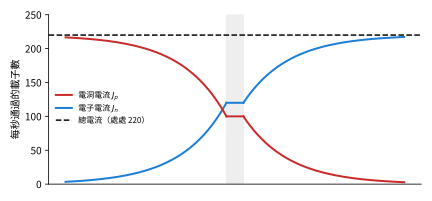
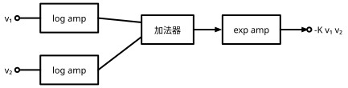
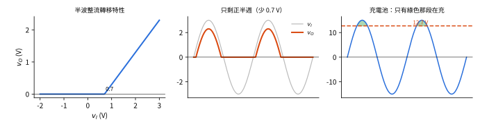

# 第 03 集 · Lec03：電流在各截面的分配、log／exp 放大器、乘法器、半波整流 [▶ 影片](https://www.youtube.com/watch?v=chpgNwwXXFc)

← 上一集：[02](02-pn-junction-diode-current.md) ｜ [總目錄](../README.md) ｜ 下一集：[04](04-superdiode-precision-peak-rectifier.md) →

> **課程**：電子學（二），陽明交大 電子物理系，112 學年度 — 第 03 集
> **講者**：陳振芳 老師
> **來源**：YouTube 錄影逐字稿（1:05:05，whisper）＋ Sedra & Smith《Microelectronic Circuits》7th ed. §3.5、§4.3、§4.5
> **標記說明**：`【口頭】` 老師口頭補充；`【課本補充】` 課本有、課堂沒講；`[▶ mm:ss]` 影片時間點

---

## 目錄

- [0. 這堂課要做什麼](#0-這堂課要做什麼)
- [1. 總電流處處相同：電子電流與電洞電流的分配](#1-總電流處處相同電子電流與電洞電流的分配)
- [2. 二極體方程與它的 log 形式](#2-二極體方程與它的-log-形式)
- [3. log 放大器](#3-log-放大器)
- [4. exp 放大器](#4-exp-放大器)
- [5. 類比乘法器、除法器、開根號](#5-類比乘法器除法器開根號)
- [6. 乘法器的校正](#6-乘法器的校正)
- [7. 整流：二極體的兩段式模型](#7-整流二極體的兩段式模型)
- [8. 例：用整流對電池充電](#8-例用整流對電池充電)
- [9. 一頁速查表](#9-一頁速查表)
- [10. 與後續集數的連結](#10-與後續集數的連結)

---

## 0. 這堂課要做什麼

1. 回答上課同學的問題：用不同截面算電流會一樣嗎？——畫出電子、電洞電流在各處的分配。
2. 用二極體的指數特性做 **log 放大器**、**exp 放大器**，組合成類比**乘法器**、除法器、開根號。
3. 二極體當整流用：兩段式模型、半波整流、充電池。

---

## 1. 總電流處處相同：電子電流與電洞電流的分配

[▶ 00:00](https://youtu.be/chpgNwwXXFc?t=0)

上一集：n 側電洞濃度 $p_n(x) = p_{n0} + p_{n0}(e^{V/V_T}-1)e^{-x/L_p}$；空乏區外沒有電場，電流只有擴散 $-qD_p\,dp/dx$。

- 在每個截面取斜率 → **電洞電流從邊界的值（例 100）往右指數衰減到 0**。p 側的電子電流同理（例 120，電子跑得比較快）。[▶ 05:07](https://youtu.be/chpgNwwXXFc?t=307)
- 空乏區很窄，假設電子電流穿過它不變 → 在 $x = 0$ 截面總電流 $= 100 + 120 = 220$。[▶ 08:16](https://youtu.be/chpgNwwXXFc?t=496)
- **穩態時總電流處處相同**：若某處進出不同，電荷就會累積、電壓隨時間改變，就不是穩態。[▶ 10:19](https://youtu.be/chpgNwwXXFc?t=619)
- 所以電洞電流往右掉多少，電子電流就要升多少。原因：例如 $0$ 到 $x'$ 之間電洞從 100 剩 40，被吃掉 60 顆——和它們結合的也是 60 顆電子，所以電子必須從右邊補 60 → 電子電流在 $x'$ 處是 $120 + 60 = 180$，$180 + 40 = 220$。[▶ 12:55](https://youtu.be/chpgNwwXXFc?t=775)

【口頭】用哪個截面算答案都一樣；最好算的是空乏區兩邊界。[▶ 16:34](https://youtu.be/chpgNwwXXFc?t=994)

---

## 2. 二極體方程與它的 log 形式

[▶ 17:35](https://youtu.be/chpgNwwXXFc?t=1055)

$$
I = I_s\left(e^{V/V_T} - 1\right),
\qquad
I_s = Aq\left(\frac{D_pp_{n0}}{L_p} + \frac{D_nn_{p0}}{L_n}\right) \sim 10^{-12}\text{～}10^{-15}\ \text{A}
$$

0.6～0.8 V 附近電流急遽上升（μA 到 mA）；反向位能障變高、沒有電流 → **整流**。【口頭】所有半導體元件、IC、電子電路都從這裡開始：一邊摻五價、一邊摻三價，中間產生一座電位山，外加電壓改變山的高度就調變電流；這套是 1940 年代 Shockley 導的，到現在都對。[▶ 20:08](https://youtu.be/chpgNwwXXFc?t=1208)

倒過來寫：[▶ 20:40](https://youtu.be/chpgNwwXXFc?t=1240)

$$
V = V_T\ln\left(\frac{I}{I_s} + 1\right)
$$

這是 log 關係——可以做 log 放大器。但電路處理用電壓比較容易，所以要先把輸入電壓轉成電流（V→I 轉換器）。

---

## 3. log 放大器

**第一個嘗試** [▶ 21:43](https://youtu.be/chpgNwwXXFc?t=1303)：V→I 轉換器（$v_\text{in}$ 接正端、$R$ 到地）把回授的負載換成二極體。電流 $v_\text{in}/R$ 流過二極體得到 $V_T\ln(\cdot)$，但輸出 $= v_\text{in} + V_T\ln(\cdot)$，多了一項線性的 $v_\text{in}$——不是純 log。[▶ 23:46](https://youtu.be/chpgNwwXXFc?t=1426)

**改成反相接法** [▶ 24:47](https://youtu.be/chpgNwwXXFc?t=1487)：正端接地，$v_\text{in}$ 經 $R$ 接負端，**二極體放在回授**。

- 先假設二極體導通 → 有回授迴路 → 亦步亦趨 → 負端 0 V。
- 電流 $v_\text{in}/R$ 流不進 op amp，全部流過二極體 → 二極體跨 $V_T\ln\left(\dfrac{v_\text{in}}{RI_s} + 1\right)$。
- 輸出 $= 0 - $ 二極體電壓：[▶ 26:19](https://youtu.be/chpgNwwXXFc?t=1579)

$$
v_o = -V_T\ln\frac{v_\text{in}}{R\,I_s}
$$

（$I_s$ 很小，$+1$ 可忽略。）負號不喜歡就後面接一個反相器。[▶ 28:23](https://youtu.be/chpgNwwXXFc?t=1703)

**限制**：二極體要導通，電流必須往右 → $v_\text{in} \ge 0$。$v_\text{in} < 0$ 時二極體不導通、沒有回授、亦步亦趨不成立，電路沒用。[▶ 27:20](https://youtu.be/chpgNwwXXFc?t=1640)

---

## 4. exp 放大器

[▶ 29:26](https://youtu.be/chpgNwwXXFc?t=1766)

把二極體和電阻**對調**：二極體在輸入、$R$ 在回授。

負端 0 V（一定有 $R$ 回授，亦步亦趨一直成立）→ 二極體跨 $v_\text{in}$ → 電流 $I_s(e^{v_\text{in}/V_T} - 1)$ 全部流過 $R$：

$$
v_o = -R\,I_s\,e^{v_\text{in}/V_T}
$$

（$e^{v_\text{in}/V_T}$ 動輒 $10^{11}$ 以上，$-1$ 可忽略。）[▶ 30:29](https://youtu.be/chpgNwwXXFc?t=1829)

**最怕飽和** [▶ 31:02](https://youtu.be/chpgNwwXXFc?t=1862)：電流稍大，$IR$ 就超過約 −13 V（±15 V 電源的 741），op amp 飽和「就等於死掉了」。$R = 1$ kΩ 時電流最多約 10 mA；0.1 kΩ 約 100 mA；0.01 kΩ 約 1000 mA。所以 $R$ 通常取小一點，而且可操作的範圍很窄。log 放大器沒這個問題（二極體最多跨零點幾伏）。[▶ 33:06](https://youtu.be/chpgNwwXXFc?t=1986)

---

## 5. 類比乘法器、除法器、開根號

### 5.1 乘法器

[▶ 33:36](https://youtu.be/chpgNwwXXFc?t=2016)

兩個 log 放大器 → 反相加法器 → exp 放大器：

$$
-V_T\ln\frac{v_1}{R_1I_{s1}} - V_T\ln\frac{v_2}{R_1I_{s2}}
\;\xrightarrow{\text{反相加法}}\;
V_T\ln\frac{v_1v_2}{R_1^2I_{s1}I_{s2}}
$$

（每顆二極體的 $I_s$ 都不一樣。）log 相加 = 相乘。再進 exp 放大器（回授 $R_2$、二極體 $I_{s3}$），exp 和 log 消掉：[▶ 36:41](https://youtu.be/chpgNwwXXFc?t=2201)

$$
v_o = -\frac{R_2\,I_{s3}}{R_1^2\,I_{s1}I_{s2}}\,v_1v_2 \equiv -K\,v_1v_2
$$

**避免飽和** [▶ 39:16](https://youtu.be/chpgNwwXXFc?t=2356)：$R_2$ 要很小、$R_1$ 要很大；輸入不能太大（7 V × 8 V 一定死），太大要先衰減成 0.7、0.8 V，乘完再放大。

【口頭】沒有 MOS、BJT 時只好這樣做；有了它們乘法器可以做得更簡單。[▶ 38:14](https://youtu.be/chpgNwwXXFc?t=2294)

### 5.2 除法器

[▶ 40:50](https://youtu.be/chpgNwwXXFc?t=2450)

op amp 正端接地，$v_x$ 經 $R_1$ 進負端；回授路徑是「乘法器（輸入 $v_y$ 和 $v_o$）+ $R_2$」。負端 0 V，兩支電流相等：

$$
\frac{v_x}{R_1} = \frac{K\,v_y\,v_o}{R_2}
\quad\Longrightarrow\quad
v_o = \frac{R_2}{K R_1}\cdot\frac{v_x}{v_y}
$$

### 5.3 開根號

[▶ 42:52](https://youtu.be/chpgNwwXXFc?t=2572)

乘法器兩個輸入都接 $v_o$：$\dfrac{v_\text{in}}{R_1} = \dfrac{K v_o^2}{R_2}$ → $v_o = \sqrt{\dfrac{R_2}{KR_1}v_\text{in}}$（square root）。

【口頭】再加積分器、微分器……類比的數學運算幾乎什麼都做得出來。[▶ 43:54](https://youtu.be/chpgNwwXXFc?t=2634)

---

## 6. 乘法器的校正

[▶ 44:25](https://youtu.be/chpgNwwXXFc?t=2665)

$K$ 裡有三顆二極體的 $I_s$，不可能一顆顆量出來。做法：**校正**（calibration）。

乘法器輸出 $v_i = -Kv_1v_2 + C$（$C$ 是電路不完美多出來的常數）接到差動放大器的負輸入，正輸入接一個自己可調的 $V_R$：[▶ 47:29](https://youtu.be/chpgNwwXXFc?t=2849)

$$
v_o = \frac{R_2}{R_1}(V_R - v_i) = \frac{R_2}{R_1}(V_R - C) + \frac{R_2}{R_1}K\,v_1v_2
$$

1. 調 $V_R = C$，第一項消掉。
2. 輸入已知電壓（例 0.6 V、0.4 V），調可變電阻 $R_2/R_1$ 直到輸出等於正確的乘積 → $\dfrac{R_2}{R_1}K = 1$。[▶ 49:31](https://youtu.be/chpgNwwXXFc?t=2971)

得到 $v_o = v_1v_2$。完全不用知道 $K$ 是多少。

---

## 7. 整流：二極體的兩段式模型

[▶ 50:36](https://youtu.be/chpgNwwXXFc?t=3036)

$I_s = 10^{-14}$ A 時：0.6 V 約 0.2 mA，0.8 V 約 1000 mA——電壓變 0.2 V，電流差好幾個數量級。【口頭】所以要控制二極體的工作點要用**電流**控制，不能用電壓。[▶ 52:09](https://youtu.be/chpgNwwXXFc?t=3129)

當整流用時，簡化成兩段：[▶ 53:42](https://youtu.be/chpgNwwXXFc?t=3222)

| 狀態 | 條件 |
|---|---|
| 導通（on） | $V_D = 0.7$ V，且 $I \ge 0$（順向） |
| 不導通（off） | $I = 0$，且 $V_D \le 0.7$ V |

分析方法：**猜**一種，再驗證條件。[▶ 54:43](https://youtu.be/chpgNwwXXFc?t=3283)

**半波整流**（$v_I$ 經二極體接 $R$ 到地）：

- 猜導通：$v_O = v_I - 0.7$，電流 $(v_I - 0.7)/R \ge 0$ → 條件 $v_I \ge 0.7$。[▶ 55:13](https://youtu.be/chpgNwwXXFc?t=3313)
- 猜不導通：電流 0 → $v_O = 0$，二極體跨 $v_I \le 0.7$ → 條件 $v_I \le 0.7$。[▶ 56:45](https://youtu.be/chpgNwwXXFc?t=3405)

正半週通過（少 0.7 V；輸入很大時看不出來）、負半週全被擋掉。[▶ 57:46](https://youtu.be/chpgNwwXXFc?t=3466)

> 【課本補充】§4.3.5 (p. 193) 把這個叫**定電壓降模型**（constant-voltage-drop model），$V_D = 0.7$ V；§4.5.1 (p. 208) 半波整流。

---

## 8. 例：用整流對電池充電

[▶ 58:50](https://youtu.be/chpgNwwXXFc?t=3530)

車上 12 V 充電電池（有方向性，接反會爆炸）。車輪轉動切割磁力線產生交流 $v_s = 15\sin\omega t$ V，經二極體和 $R$ 對電池充電。

- 導通時二極體陽極 $= 12 + 0.7$ V，充電電流 $i = \dfrac{15\sin\omega t - 12.7}{R} \ge 0$ → 只有 $v_s > 12.7$ V 時才充。[▶ 1:00:23](https://youtu.be/chpgNwwXXFc?t=3623)
- 一個週期裡只有很短一段在充電，**效率很差**。[▶ 1:02:29](https://youtu.be/chpgNwwXXFc?t=3749)

**改進** [▶ 1:03:03](https://youtu.be/chpgNwwXXFc?t=3783)：先把交流轉成**直流**（略高於 12 V，太高會浪費在電阻上），就能隨時充電。而且車速有快有慢，電壓大小會變，還要加回授電路穩住。→ 下一集：交流變直流。

> 【課本補充】Example 4.1 (p. 178)：24 V 峰值的正弦經二極體對 12 V 電池充電，求導通角與峰值電流——同一個問題。

---

## 9. 一頁速查表

| 項目 | 公式／做法 | 關鍵 |
|---|---|---|
| 總電流 | 穩態時每個截面相同 | 電洞被吃多少，電子就補多少 |
| 二極體 log 形式 | $V = V_T\ln(I/I_s + 1)$ | |
| log 放大器 | $v_o = -V_T\ln\dfrac{v_\text{in}}{RI_s}$ | 二極體在回授；$v_\text{in} > 0$ |
| exp 放大器 | $v_o = -RI_se^{v_\text{in}/V_T}$ | $R$ 在回授；容易飽和，$R$ 取小 |
| 乘法器 | log + log → 加 → exp：$-Kv_1v_2$ | $K = R_2I_{s3}/(R_1^2I_{s1}I_{s2})$ |
| 除法器 | 乘法器放回授：$\propto v_x/v_y$ | |
| 開根號 | 乘法器兩輸入都接 $v_o$ | |
| 校正 | 差動放大器調 $V_R = C$、調 $R_2/R_1$ 使 $K$ 抵消 | 不用知道 $K$ |
| 定電壓降模型 | on：0.7 V 且 $I\ge0$；off：$I = 0$ 且 $V_D\le0.7$ | 猜了再驗證 |
| 半波整流 | $v_O = \max(v_I - 0.7, 0)$ | |
| 充電池 | 只有 $v_s > V_B + 0.7$ 時充 | 效率差 → 先轉直流 |

---

## 10. 與後續集數的連結

| 本集觀念 | 後面在哪裡用到 |
|---|---|
| 交流轉直流 | 下一集：峰值整流（濾波電容）、漣波 |
| 定電壓降模型 | 之後所有二極體電路 |
| 乘法器 | AM 調變／解調（老師預告） |
| op amp 飽和限制 | exp 放大器、乘法器的設計 |

---

## 附：本集一句話總結

> **穩態時 P-N 二極體每個截面的總電流相同，電洞電流衰減多少電子電流就補多少；利用 $V = V_T\ln(I/I_s)$，二極體放回授是 log 放大器、放輸入是 exp 放大器，log + log 再 exp 就是乘法器（再延伸出除法、開根號，並用差動放大器校正掉未知的 $K$）；當整流用時用 0.7 V 的兩段式模型，半波整流對電池充電效率很差，要先把交流變直流。**

---

*筆記依據陳振芳老師「電子學（二）」112 學年度 Lec03 錄影逐字稿（whisper，1:05:05）與 Sedra & Smith《Microelectronic Circuits》7th ed. 整理。*
