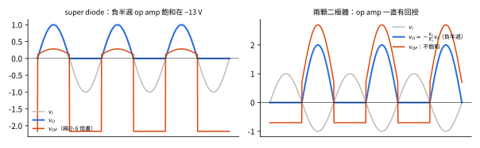
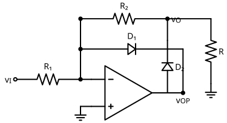
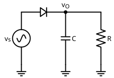
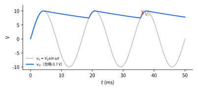

# 第 04 集 · Lec04：super diode、高頻用的精密整流、峰值整流與漣波 [▶ 影片](https://www.youtube.com/watch?v=yORswHkK7A4)

← 上一集：[03](03-diode-log-exp-amplifier-rectifier.md) ｜ [總目錄](../README.md) ｜ 下一集：[05](05-full-wave-bridge-rectifier.md) →

> **課程**：電子學（二），陽明交大 電子物理系，112 學年度 — 第 04 集
> **講者**：陳振芳 老師
> **來源**：YouTube 錄影逐字稿（1:08:48，whisper）＋ Sedra & Smith《Microelectronic Circuits》7th ed. §4.5
> **標記說明**：`【口頭】` 老師口頭補充；`【課本補充】` 課本有、課堂沒講；`[▶ mm:ss]` 影片時間點

---

## 目錄

- [0. 這堂課要做什麼](#0-這堂課要做什麼)
- [1. 複習：兩段式模型與半波整流](#1-複習兩段式模型與半波整流)
- [2. super diode：把 0.7 V 消掉](#2-super-diode把-07-v-消掉)
- [3. super diode 的弱點：負半週掉進沼澤](#3-super-diode-的弱點負半週掉進沼澤)
- [4. 加增益也一樣](#4-加增益也一樣)
- [5. 兩顆二極體的精密整流：高頻也能用](#5-兩顆二極體的精密整流高頻也能用)
- [6. 峰值整流：交流變直流](#6-峰值整流交流變直流)
- [7. 漣波與導通角](#7-漣波與導通角)
- [8. 一頁速查表](#8-一頁速查表)
- [9. 與後續集數的連結](#9-與後續集數的連結)

---

## 0. 這堂課要做什麼

1. 用 op amp 把整流的 0.7 V 消掉：**super diode**。
2. 它在負半週會讓 op amp 飽和，只能用在低頻；改成兩顆二極體的電路就能用在高頻。
3. **峰值整流**（peak rectifier）：二極體 + 電容把交流變直流，算漣波和導通角。

---

## 1. 複習：兩段式模型與半波整流

[▶ 00:00](https://youtu.be/yORswHkK7A4?t=0)

二極體 0.6 V 約 0.2 mA、0.8 V 約 1000 mA，差 4 個數量級。整流時不在乎這一點變化 → 兩段式：

- 導通：$V_D = 0.7$ V，$I \ge 0$。
- 不導通：$I = 0$，$V_D \le 0.7$ V。

半波整流：$v_I > 0.7$ 時 $v_O = v_I - 0.7$，否則 0。輸入十幾伏時少 0.7 V 看不出來；但只有 1 V 時就剩 0.3 V，差太多。[▶ 06:49](https://youtu.be/yORswHkK7A4?t=409)

---

## 2. super diode：把 0.7 V 消掉

[▶ 07:21](https://youtu.be/yORswHkK7A4?t=441)

把二極體**埋進 op amp 的回授迴路**：$v_I$ 接正端，op amp 輸出經二極體到 $v_O$，$v_O$ 接負載 $R$ 並回授到負端。

**猜導通** [▶ 07:51](https://youtu.be/yORswHkK7A4?t=471)：$v_{OP} = v_O + 0.7$，代入 $A_d(v_I - v_O) = v_O + 0.7$：

$$
v_O = \frac{A_d}{1 + A_d}v_I - \frac{0.7}{1 + A_d} \approx v_I
$$

0.7 V 被無窮大的增益除掉了。驗證：負端不吃電流，$R$ 上電流 $v_I/R \ge 0$ → 條件 $v_I \ge 0$。[▶ 09:24](https://youtu.be/yORswHkK7A4?t=564)

**猜不導通** [▶ 10:59](https://youtu.be/yORswHkK7A4?t=659)：沒電流 → $v_O = 0$；二極體跨 $v_{OP} - 0 = A_d v_I \le 0.7$ → $v_I \le 0.7/A_d \approx 0$。

所以 $v_I \ge 0$ 時 $v_O = v_I$，$v_I < 0$ 時 $v_O = 0$——**整流，而且沒有 0.7 V**。

---

## 3. super diode 的弱點：負半週掉進沼澤

[▶ 12:59](https://youtu.be/yORswHkK7A4?t=779)

不導通時 $v_{OP} = A_d(v_I - 0)$，$v_I$ 再怎麼小都是負的，乘無窮大 → 負無窮大。實際上 op amp（±15 V 電源）**飽和在約 −13 V**。【口頭】飽和就像車子開進沼澤，要爬出來需要時間。[▶ 15:02](https://youtu.be/yORswHkK7A4?t=902)

- 正半週：$v_{OP} = v_O + 0.7$，比輸出高 0.7 V，正常。
- 負半週：$v_{OP}$ 一下掉到 −13 V，掉進沼澤。每個週期都在「開進沼澤、爬出來」。[▶ 17:36](https://youtu.be/yORswHkK7A4?t=1056)

**頻率限制** [▶ 18:39](https://youtu.be/yORswHkK7A4?t=1119)：假設爬出沼澤要 $\Delta t = 0.1$ ms。輸入轉正之後，這段時間 op amp 還沒恢復，輸出一直是 0；如果週期比 $\Delta t$ 還短，正半週根本出不來。要正常整流：

$$
T \gg \Delta t
\quad\Longrightarrow\quad
\omega < \frac{1}{\Delta t} = 10^4\ \text{rad/s}
$$

【口頭】super diode 沒有 0.7 V 很好，但頻率不能太高——$10^5$、$10^6$、$10^7$ 根本沒有整流。[▶ 24:14](https://youtu.be/yORswHkK7A4?t=1454)

---

## 4. 加增益也一樣

[▶ 25:45](https://youtu.be/yORswHkK7A4?t=1545)

回授路徑加 $R_1$、$R_2$（非反相放大）：導通時有回授 → 亦步亦趨 → $v_O = (1 + R_2/R_1)v_I$，正半週整流 + 放大。

但負半週二極體不導通 → **沒有回授迴路** → 亦步亦趨不成立 → op amp 只是一個比較器，還是飽和在 −13 V。【口頭】op amp 只要沒有負回授，輸入差再小都會飽和。[▶ 28:20](https://youtu.be/yORswHkK7A4?t=1700)

---

## 5. 兩顆二極體的精密整流：高頻也能用

[▶ 30:27](https://youtu.be/yORswHkK7A4?t=1827)

想法：**不能讓兩顆二極體同時不導通**——一定有一顆導通，op amp 就一直有負回授、不會飽和。輸入改從負端進。

**$v_I > 0$** [▶ 31:58](https://youtu.be/yORswHkK7A4?t=1918)：猜 $D_1$ on、$D_2$ off。

- $D_1$ 提供回授 → 負端 0 V。
- $D_2$ off → $R_2$、$R$ 那一路沒電流 → $v_O = 0$。
- 電流 $v_I/R_1$ 流過 $D_1$ 到 op amp 輸出 → 方向對要 $v_I > 0$ ✓；$v_{OP} = -0.7$ V，$D_2$ 跨負的 → off ✓。

**$v_I < 0$** [▶ 35:08](https://youtu.be/yORswHkK7A4?t=2108)：猜 $D_2$ on、$D_1$ off。

- $D_2$ + $R_2$ 提供回授 → 負端 0 V → 就是反相放大器：

$$
v_O = -\frac{R_2}{R_1}v_I > 0
$$

- $D_2$ 電流方向對要 $v_I < 0$ ✓；$v_{OP} = v_O + 0.7 > 0$，$D_1$ 反向 → off ✓。

**結果** [▶ 39:47](https://youtu.be/yORswHkK7A4?t=2387)：正半週輸出 0，負半週翻上來並放大 $R_2/R_1$ 倍——還是整流（整負半週），沒有 0.7 V。

**關鍵**：$v_{OP}$ 只在 −0.7 V 和 $v_O + 0.7$ 之間，**從不飽和**，所以可以用到 $10^5$、$10^6$ 的頻率（再高 op amp 的頻寬也會出問題）。[▶ 42:19](https://youtu.be/yORswHkK7A4?t=2539)

| 電路 | 0.7 V | 頻率 |
|---|---|---|
| 單顆二極體 | 有 | 高頻 OK |
| super diode | 沒有 | 只能低頻（op amp 會飽和） |
| 兩顆二極體精密整流 | 沒有 | 高頻 OK |

[▶ 43:21](https://youtu.be/yORswHkK7A4?t=2601)

> 【課本補充】§4.5.5 (p. 219) 叫**精密半波整流**（precision half-wave rectifier）；課本也指出 super diode 在負半週 op amp 飽和、恢復需要時間，改良電路加第二顆二極體讓回授一直存在。

---

## 6. 峰值整流：交流變直流

### 6.1 再看充電池

[▶ 43:54](https://youtu.be/yORswHkK7A4?t=2634)

（上一集）15 V 交流經二極體對 12 V 電池充電：只有超過 12.7 V 的那一小段（例 360° 裡的 10°）在充，效率很差；而且車速變化讓 $V_p$ 時大時小。→ 要先變成**直流電源**（DC power supply）。【口頭】任何電路做實驗都需要直流電源，它從 60 Hz 交流來。[▶ 47:27](https://youtu.be/yORswHkK7A4?t=2847)

### 6.2 變壓器

[▶ 48:30](https://youtu.be/yORswHkK7A4?t=2910)

市電 110 V rms，峰值約 155 V、60 Hz。用**變壓器**（transformer）降壓：鐵心把磁通量關在裡面，兩邊磁通量相同；感應電動勢 $= N\,d\Phi/dt$：

$$
\frac{V_2}{V_1} = \frac{N_2}{N_1}
$$

選適當的圈數比，得到例如 $V_p = 10$ V 的 60 Hz 正弦。[▶ 50:34](https://youtu.be/yORswHkK7A4?t=3034)

### 6.3 二極體 + 電容

[▶ 51:06](https://youtu.be/yORswHkK7A4?t=3066)

（先忽略 0.7 V，最後再減；或用 super diode——60 Hz 很低，用簡單的二極體就可以。）

**沒有負載時** [▶ 52:09](https://youtu.be/yORswHkK7A4?t=3129)：$t = 0$ 電容沒電荷。

- 二極體導通 → $v_O = v_I$，充電電流 $C\,dv_I/dt \ge 0$ → 只要**輸入在上升**就導通。
- 輸入過峰值開始下降 → 二極體反向 off → 電容的電荷**無處可漏** → $v_O$ 停在 $V_p$。[▶ 55:50](https://youtu.be/yORswHkK7A4?t=3350)

但沒有負載的電源「只是好看的」——一定要接負載 $R$（後面要用的電路）。[▶ 57:25](https://youtu.be/yORswHkK7A4?t=3445)

**有負載時** [▶ 58:26](https://youtu.be/yORswHkK7A4?t=3506)：二極體 off 的時候電容經 $R$ 放電，$v_O$ 以 $RC$ 指數下降；等輸入又上升到追上 $v_O$，二極體再導通、充回 $V_p$。一直重複。

---

## 7. 漣波與導通角

### 7.1 漣波

[▶ 1:00:30](https://youtu.be/yORswHkK7A4?t=3630)

放電掉下去的量叫**漣波**（ripple）$V_r$。好的電源導通時間 $\Delta t \ll T$，所以放電時間 ≈ 整個週期 $T$：

$$
V_p - V_r = V_p\,e^{-T/RC} \approx V_p\left(1 - \frac{T}{RC}\right)
\quad\Longrightarrow\quad
V_r = V_p\,\frac{T}{RC}
$$

前提 $T \ll RC$（漣波要小，不然拿去丟掉）。負載 $R$ 不夠大，就要 $C$ 很大。[▶ 1:02:00](https://youtu.be/yORswHkK7A4?t=3720)

**例** [▶ 1:02:41](https://youtu.be/yORswHkK7A4?t=3761)：$C = 100\ \mu$F、$R = 10$ kΩ → $RC = 1$ s；$T = 1/60$ s；$V_p = 10$ V：

$$
V_r = 10 \times \frac{1/60}{1} = \frac16\ \text{V}
$$

### 7.2 導通角

[▶ 1:03:45](https://youtu.be/yORswHkK7A4?t=3825)

把峰值當時間原點，輸入寫成 $V_p\cos\omega t$。導通開始於 $-\Delta t$，那時輸入 $= V_p - V_r$：

$$
V_p\cos(\omega\Delta t) = V_p - V_r,
\qquad
1 - \frac{(\omega\Delta t)^2}{2} \approx 1 - \frac{V_r}{V_p}
$$

$$
\omega\Delta t = \sqrt{\frac{2V_r}{V_p}}
$$

例：$\sqrt{2/60} \approx 0.18$ rad ≈ **10°**（360° 中的 10°）→ 確實 $\Delta t \ll T$，前面的近似成立。[▶ 1:05:18](https://youtu.be/yORswHkK7A4?t=3918)

### 7.3 總結

[▶ 1:06:26](https://youtu.be/yORswHkK7A4?t=3986)

- 輸出直流 ≈ $V_p - 0.7$（記得把 0.7 V 減回來），叫**峰值整流**。
- 有負載就多一個漣波 $V_pT/(RC)$。分析時先不管 $R$，求出直流，再把漣波加進來修正。
- 換成 super diode 就沒有 0.7 V；再加 $R_1$、$R_2$ 可以放大 $(1 + R_2/R_1)$ 倍。[▶ 1:07:57](https://youtu.be/yORswHkK7A4?t=4077)

> 【課本補充】§4.5.4 (p. 213)：半波峰值整流 $V_r \approx V_p/(fCR)$、導通角 $\omega\Delta t \approx \sqrt{2V_r/V_p}$，和這裡一樣；課本還算了二極體導通期間的平均與峰值電流，峰值電流會遠大於負載電流。

---

## 8. 一頁速查表

| 項目 | 公式／重點 | 關鍵 |
|---|---|---|
| super diode | $v_O = v_I$（$v_I>0$），0（$v_I<0$） | 0.7 V 被 $A_d$ 除掉 |
| super diode 限制 | 負半週 op amp 飽和 −13 V | 恢復 $\Delta t$ → $\omega < 1/\Delta t$ |
| 精密整流（兩顆二極體） | $v_I>0$：0；$v_I<0$：$-\frac{R_2}{R_1}v_I$ | 一直有回授，不飽和 |
| 變壓器 | $V_2/V_1 = N_2/N_1$ | 磁通量相同 |
| 峰值整流（無負載） | $v_O = V_p - 0.7$ | 輸入上升才導通 |
| 漣波 | $V_r = V_pT/(RC)$ | $T \ll RC$ |
| 導通角 | $\omega\Delta t = \sqrt{2V_r/V_p}$ | cos 展開 |
| 例 | 100 μF、10 kΩ、10 V、60 Hz → $V_r = 1/6$ V、約 10° | |

---

## 9. 與後續集數的連結

| 本集觀念 | 後面在哪裡用到 |
|---|---|
| 半波峰值整流 | 下一集：全波、橋式整流（漣波減半） |
| op amp 飽和恢復時間 | 第 7 章差動對內部才解釋飽和 |
| 漣波 | 穩壓、電源設計；電子學（一）旁路電容 |

---

## 附：本集一句話總結

> **二極體埋進 op amp 回授就是 super diode，沒有 0.7 V，但負半週沒有回授讓 op amp 飽和、只能用在低頻；加第二顆二極體讓回授一直存在就能用在高頻。二極體加電容做峰值整流把交流變直流，有負載時漣波 $V_r = V_pT/RC$、導通角 $\omega\Delta t = \sqrt{2V_r/V_p}$。**

---

*筆記依據陳振芳老師「電子學（二）」112 學年度 Lec04 錄影逐字稿（whisper，1:08:48）與 Sedra & Smith《Microelectronic Circuits》7th ed. 整理。*
