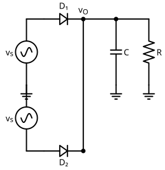
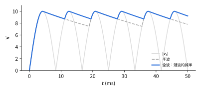
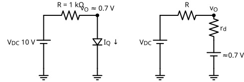
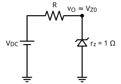

# 第 05 集 · Lec05：並聯大電容、全波與橋式整流、二極體穩壓器 [▶ 影片](https://www.youtube.com/watch?v=Mkt09f7eP2U)

← 上一集：[04](04-superdiode-precision-peak-rectifier.md) ｜ [總目錄](../README.md) ｜ 下一集：[06](06-regulator-loading-op-amp-bjt.md) →

> **課程**：電子學（二），陽明交大 電子物理系，112 學年度 — 第 05 集
> **講者**：陳振芳 老師
> **來源**：YouTube 錄影逐字稿（40:33，whisper）＋ Sedra & Smith《Microelectronic Circuits》7th ed. §4.3–4.5
> **標記說明**：`【口頭】` 老師口頭補充；`【課本補充】` 課本有、課堂沒講；`[▶ mm:ss]` 影片時間點

---

## 目錄

- [0. 這堂課要做什麼](#0-這堂課要做什麼)
- [1. 漣波太大怎麼辦：並聯一顆大電容](#1-漣波太大怎麼辦並聯一顆大電容)
- [2. 全波峰值整流（中心抽頭）](#2-全波峰值整流中心抽頭)
- [3. 橋式整流](#3-橋式整流)
- [4. 用 super diode 做峰值整流](#4-用-super-diode-做峰值整流)
- [5. 穩壓器：二極體的小信號電阻](#5-穩壓器二極體的小信號電阻)
- [6. 漣波變多小](#6-漣波變多小)
- [7. 負載效應](#7-負載效應)
- [8. 三顆二極體與齊納二極體](#8-三顆二極體與齊納二極體)
- [9. 一頁速查表](#9-一頁速查表)
- [10. 與後續集數的連結](#10-與後續集數的連結)

---

## 0. 這堂課要做什麼

1. 減小峰值整流的漣波：並聯大電容、全波整流、橋式整流。
2. **穩壓器**（voltage regulator）：用二極體（或齊納二極體）把漣波壓小，看兩個指標——**漣波小、負載效應小**。

---

## 1. 漣波太大怎麼辦：並聯一顆大電容

[▶ 00:00](https://youtu.be/Mkt09f7eP2U?t=0)

（峰值整流見上一集：輸出 $V_p - 0.7$，有負載時漣波 $V_r = V_pT/RC$，要 $RC \gg T$。分析時先不管 $R$ 求直流，再加漣波。）

- 直流電源後面接的電路通常允許一個範圍（10 V 掉到 9 V、8 V 還能動），但漣波對它來說就是雜訊。[▶ 03:03](https://youtu.be/Mkt09f7eP2U?t=183)
- 動態過程中負載電阻突然變很小 → 漣波很大，10 V 掉到 5 V → 電路不能用。電源不好、電路又抓很大電流時常碰到。[▶ 03:33](https://youtu.be/Mkt09f7eP2U?t=213)
- 【口頭】簡單的方法：**自己並聯一顆大電容**，通常問題就解決了。[▶ 04:05](https://youtu.be/Mkt09f7eP2U?t=245)

**電容並聯相加** [▶ 05:08](https://youtu.be/Mkt09f7eP2U?t=308)：$i = C_1\dfrac{dv}{dt} + C_2\dfrac{dv}{dt} = (C_1 + C_2)\dfrac{dv}{dt}$ → $C = C_1 + C_2$（和電阻相反）。

$$
V_r = \frac{V_pT}{R(C + C')}
$$

電荷多了，被負載拉走一點影響不大。[▶ 06:12](https://youtu.be/Mkt09f7eP2U?t=372)

---

## 2. 全波峰值整流（中心抽頭）

[▶ 06:43](https://youtu.be/Mkt09f7eP2U?t=403)

半波整流只用正半週，負半週全浪費。買一個 **1 對 2 的變壓器**（中心抽頭接地），兩端各得到 $V_p\sin\omega t$，但相位相反；各接一顆二極體到同一個輸出。

- **正半週**：上半繞組正 → $D_1$ 導通，電流從正端出發、充電容、經地回來（一定有去有回）。下半繞組此時是負的，$D_2$ 不導通。[▶ 08:46](https://youtu.be/Mkt09f7eP2U?t=526)
- **負半週**：換下半繞組正 → $D_2$ 導通，**同方向**充電容。[▶ 10:23](https://youtu.be/Mkt09f7eP2U?t=623)

輸出 $V_p - 0.7$；放電只放半個週期，等效頻率變成 120 Hz：[▶ 12:29](https://youtu.be/Mkt09f7eP2U?t=749)

$$
V_r = \frac{V_p}{120\,RC}
$$

漣波**減半**。

---

## 3. 橋式整流

[▶ 13:30](https://youtu.be/Mkt09f7eP2U?t=810)

1 對 1 變壓器加**四顆二極體**：

- 正半週：電流經 $D_1$ → 負載 → $D_3$ 回到另一端。[▶ 14:01](https://youtu.be/Mkt09f7eP2U?t=841)
- 負半週：經 $D_2$ → 負載 → $D_4$ 回來。兩個半週對負載都是**同方向**。[▶ 15:01](https://youtu.be/Mkt09f7eP2U?t=901)
- 每次經過**兩顆**二極體 → 輸出 $V_p - 1.4$ V；漣波一樣是 $V_p/(120RC)$。[▶ 14:31](https://youtu.be/Mkt09f7eP2U?t=871)

> 【課本補充】§4.5.3 (p. 212)：橋式不需要中心抽頭，而且每顆二極體承受的反向峰值電壓（PIV）約為中心抽頭式的一半；代價是多一個二極體壓降。

---

## 4. 用 super diode 做峰值整流

[▶ 16:02](https://youtu.be/Mkt09f7eP2U?t=962)

把二極體換成 super diode → 輸出 $V_p$，沒有 0.7 V。60 Hz 很慢，op amp 掉進沼澤再爬出來也來得及。再加 $R_1$、$R_2$ 可放大成 $(1 + R_2/R_1)V_p$（可調）。輸入頻率很高時才需要上一集的兩顆二極體版本。[▶ 17:06](https://youtu.be/Mkt09f7eP2U?t=1026)

---

## 5. 穩壓器：二極體的小信號電阻

[▶ 18:07](https://youtu.be/Mkt09f7eP2U?t=1087)

直流電源（10 V，有漣波）經電阻 $R = 1$ kΩ 接一顆二極體，從二極體兩端拉出輸出。

- 二極體大約 0.7 V。【口頭】不用算很準，給後面用時在一個範圍就好。[▶ 19:08](https://youtu.be/Mkt09f7eP2U?t=1148)
- 電流 $I_Q = (10 - 0.7)/1\ \text{k} = 9.3$ mA → 二極體的工作點 $Q$。[▶ 19:38](https://youtu.be/Mkt09f7eP2U?t=1178)

**小信號電阻** [▶ 20:39](https://youtu.be/Mkt09f7eP2U?t=1239)：i-v 曲線在 $Q$ 點的斜率倒數：

$$
\frac{1}{r_d} = \left.\frac{di}{dv}\right|_Q = \frac{I_s e^{V_Q/V_T}}{V_T} = \frac{I_Q}{V_T}
\quad\Longrightarrow\quad
r_d = \frac{V_T}{I_Q}
$$

$r_d = 25\ \text{mV}/9.3\ \text{mA} \approx 2.7\ \Omega$——很小，因為曲線很陡。[▶ 22:09](https://youtu.be/Mkt09f7eP2U?t=1329)

所以二極體可以等效成「約 0.7 V 的電池 + 小電阻 $r_d$」，輸出 $v_O \approx 0.7 + r_dI_Q$，還是「大約 0.7 V」。[▶ 23:10](https://youtu.be/Mkt09f7eP2U?t=1390)

好的穩壓器要兩件事：**① small ripple ② small loading effect**。不是要它一定剛好幾伏。[▶ 24:43](https://youtu.be/Mkt09f7eP2U?t=1483)

> 【課本補充】§4.3.7 (p. 195)：二極體小信號電阻 $r_d = V_T/I_D$；§4.3.8 (p. 200) 正是用二極體順向壓降做穩壓的例子。

---

## 6. 漣波變多小

[▶ 25:16](https://youtu.be/Mkt09f7eP2U?t=1516)

輸入漣波 $V_r = 1$ V（10 V 的 10%）。對漣波來說是 $R$ 和 $r_d$ 分壓：

$$
v_{r,\text{out}} = V_r\,\frac{r_d}{R + r_d} = 1 \times \frac{2.7}{1000} = 2.7\ \text{mV}
$$

佔直流 0.7 V 的 $2.7/700 \approx 0.4\%$——從 10% 降到 0.4%。[▶ 26:50](https://youtu.be/Mkt09f7eP2U?t=1610)

要更高的電壓就串多顆：兩顆約 1.4 V、三顆約 2.1 V。

---

## 7. 負載效應

[▶ 27:22](https://youtu.be/Mkt09f7eP2U?t=1642)

輸出接負載 1 kΩ（漣波已經研究過，先不放）。

- 假設輸出下降很小、仍約 0.7 V → 負載拉走 $0.7/1\ \text{k} = 0.7$ mA。
- 二極體電壓不變，二極體電流 $I_Q$ 也不能變 → 這 0.7 mA 只能從 $r_d$ 那邊「借」，造成壓降：[▶ 29:29](https://youtu.be/Mkt09f7eP2U?t=1769)

$$
\Delta v_O = -0.7\ \text{mA}\times 2.7\ \Omega \approx -1.9\ \text{mV}
$$

遠小於 0.7 V，假設成立。但負載 0.1 kΩ 電流大 10 倍、0.01 kΩ 大 100 倍，就不能說不變了。[▶ 30:01](https://youtu.be/Mkt09f7eP2U?t=1801)

---

## 8. 三顆二極體與齊納二極體

### 8.1 三顆二極體（約 2.1 V）

[▶ 30:31](https://youtu.be/Mkt09f7eP2U?t=1831)

- $I_Q = (10 - 2.1)/1\ \text{k} = 7.9$ mA，每顆 $r_d = 25/7.9 \approx 3\ \Omega$，三顆共約 9 Ω。
- 漣波：$1\ \text{V} \times 9/1000 = 9$ mV，佔 2.1 V 約 0.4%。[▶ 32:37](https://youtu.be/Mkt09f7eP2U?t=1957)
- 負載 1 kΩ：拉 2.1 mA，下降 $2.1 \times 9 \approx 19$ mV；0.1 kΩ 就是 190 mV，很嚴重。[▶ 33:41](https://youtu.be/Mkt09f7eP2U?t=2021)

【口頭】沒有人設計電路要求「一定要 2.1 V」，兩伏上下一點都能動；真那樣設計就賣不出去。[▶ 33:07](https://youtu.be/Mkt09f7eP2U?t=1987)

### 8.2 齊納（崩潰）二極體

[▶ 34:43](https://youtu.be/Mkt09f7eP2U?t=2083)

買一顆**崩潰二極體**（breakdown diode），倒過來接，讓它操作在反向崩潰區。崩潰電壓 $V_{Z0}$（例 5 V），崩潰後的斜率倒數 $r_z$（例 1 Ω，很陡）。

- 等效：電池 $V_{Z0}$ 串聯 $r_z$，輸出 $\approx V_{Z0} + r_zI_Q \approx V_{Z0}$。[▶ 35:46](https://youtu.be/Mkt09f7eP2U?t=2146)
- 漣波：$V_r \times \dfrac{r_z}{R + r_z} = 1\ \text{V}\times\dfrac{1}{1000}$——剩**千分之一**。[▶ 36:47](https://youtu.be/Mkt09f7eP2U?t=2207)
- 負載效應一樣是「拉走的電流 × $r_z$」。

**整個電源** [▶ 37:53](https://youtu.be/Mkt09f7eP2U?t=2273)：整流 + 電容得到 $V_p - 0.7$（漣波大）→ 經 $R$ 接齊納 → 輸出約 $V_{Z0}$，漣波幾乎沒了。

**還剩一個問題** [▶ 38:55](https://youtu.be/Mkt09f7eP2U?t=2335)：負載很小（0.01 kΩ）時拉走大電流，負載效應很大，後面電路可能不能用。→ 下一集：輸出接 op amp，讓電流從 op amp 拉而不是從齊納那邊拉；op amp 電流不夠（約 20 mA）就再加 BJT 放大電流。

> 【課本補充】§4.4 (p. 202)：齊納二極體模型 $V_Z = V_{Z0} + r_zI_Z$；**線性調整率**（line regulation）$= r_z/(R + r_z)$ 就是這裡的漣波比；**負載調整率**（load regulation）$= -(r_z \parallel R)$ 就是負載效應。

---

## 9. 一頁速查表

| 項目 | 公式 | 關鍵 |
|---|---|---|
| 電容並聯 | $C = C_1 + C_2$ | 和電阻相反 |
| 半波漣波 | $V_r = V_p/(60RC)$ | |
| 全波（中心抽頭） | 輸出 $V_p - 0.7$，$V_r = V_p/(120RC)$ | 1 對 2 變壓器 |
| 橋式 | 輸出 $V_p - 1.4$，$V_r = V_p/(120RC)$ | 四顆二極體 |
| super diode 峰值整流 | 輸出 $V_p$（可放大） | 60 Hz 夠慢 |
| 二極體小信號電阻 | $r_d = V_T/I_Q$ | 例 9.3 mA → 2.7 Ω |
| 漣波比 | $r_d/(R + r_d)$ | 例 1 V → 2.7 mV |
| 負載效應 | $\Delta v_O = -I_L r_d$ | 例 0.7 mA → 1.9 mV |
| 齊納 | $V_Z \approx V_{Z0} + r_zI$，漣波 $r_z/(R+r_z)$ | $r_z$ = 1 Ω → 千分之一 |

---

## 10. 與後續集數的連結

| 本集觀念 | 後面在哪裡用到 |
|---|---|
| 負載效應太大 | 下一集：穩壓器加 op amp、BJT |
| 小信號電阻 $r_d = V_T/I$ | BJT 的 $r_e$、$g_m = I_C/V_T$ |
| 工作點 Q + 小信號 | 第 4 章 MOSFET 放大器 |

---

## 附：本集一句話總結

> **漣波可以靠並聯大電容、全波或橋式整流（放電時間減半）壓小；再用二極體或齊納二極體做穩壓器——它在工作點只有很小的小信號電阻 $r_d = V_T/I_Q$（或 $r_z$），所以輸入漣波只剩 $r_d/(R+r_d)$，負載效應是 $I_Lr_d$；負載太重時還要再加 op amp 和 BJT。**

---

*筆記依據陳振芳老師「電子學（二）」112 學年度 Lec05 錄影逐字稿（whisper，40:33）與 Sedra & Smith《Microelectronic Circuits》7th ed. 整理。*
