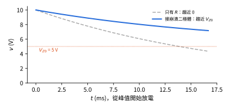
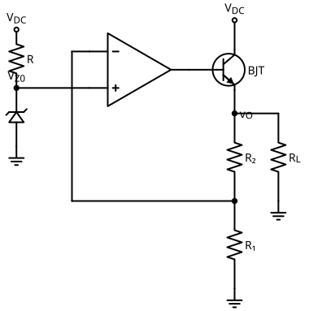
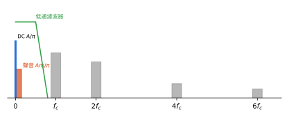

# 第 06 集 · Lec06：齊納穩壓器的漣波與負載、op amp + BJT 供電、AM 解調 [▶ 影片](https://www.youtube.com/watch?v=PHlNjRUoWH4)

← 上一集：[05](05-full-wave-bridge-rectifier.md) ｜ [總目錄](../README.md) ｜ 下一集：[07](07-am-transmitter-receiver-tuner.md) →

> **課程**：電子學（二），陽明交大 電子物理系，112 學年度 — 第 06 集
> **講者**：陳振芳 老師
> **來源**：YouTube 錄影逐字稿（1:44:02，whisper）＋ Sedra & Smith《Microelectronic Circuits》7th ed. §4.4–4.5
> **標記說明**：`【口頭】` 老師口頭補充；`【課本補充】` 課本有、課堂沒講；`⚠️ 逐字稿缺字` whisper 聽錯，已修正；`[▶ mm:ss]` 影片時間點

---

## 目錄

- [0. 這堂課要做什麼](#0-這堂課要做什麼)
- [1. 加崩潰二極體後漣波變小](#1-加崩潰二極體後漣波變小)
- [2. 穩壓器輸出：直流歸直流、交流歸交流](#2-穩壓器輸出直流歸直流交流歸交流)
- [3. 負載效應：負載太重穩壓器就沒了](#3-負載效應負載太重穩壓器就沒了)
- [4. 加 op amp：不要從齊納那裡拉電流](#4-加-op-amp不要從齊納那裡拉電流)
- [5. 加 BJT：op amp 電流不夠](#5-加-bjtop-amp-電流不夠)
- [6. 回答學生問題：電容最小要多大](#6-回答學生問題電容最小要多大)
- [7. AM 調變](#7-am-調變)
- [8. AM 解調：先整流再低通](#8-am-解調先整流再低通)
- [9. 一頁速查表](#9-一頁速查表)
- [10. 與後續集數的連結](#10-與後續集數的連結)

---

## 0. 這堂課要做什麼

1. 完成一個直流電源：峰值整流 → 齊納穩壓 → op amp → BJT。
2. 算出加了齊納後的漣波、負載能拉多少電流、電容最小要多大。
3. 整流的另一個用途：**AM 解調**（AM demodulation）。

---

## 1. 加崩潰二極體後漣波變小

[▶ 00:00](https://youtu.be/PHlNjRUoWH4?t=0)

峰值整流後面接 $R$ 和崩潰（齊納）二極體。二極體不導通時，電容放電**不是趨近 0，而是趨近崩潰電壓 $V_{Z0}$**。[▶ 03:33](https://youtu.be/PHlNjRUoWH4?t=213)

一階電路的寫法：$v(t) = (\text{初值} - \text{終值})e^{-t/RC} + \text{終值}$：[▶ 05:05](https://youtu.be/PHlNjRUoWH4?t=305)

$$
v_O(t) = (V_p - V_{Z0})\,e^{-t/RC} + V_{Z0}
$$

放電時間 ≈ 一個週期 $T$，$e^{-T/RC} \approx 1 - T/RC$：[▶ 06:10](https://youtu.be/PHlNjRUoWH4?t=370)

$$
V_p - V_r = (V_p - V_{Z0})\left(1 - \frac{T}{RC}\right) + V_{Z0}
\quad\Longrightarrow\quad
V_r = (V_p - V_{Z0})\frac{T}{RC}
$$

$$
\frac{V_r}{V_p} = \frac{T}{RC}\left(1 - \frac{V_{Z0}}{V_p}\right)
$$

多了 $\left(1 - V_{Z0}/V_p\right)$ 這一項，漣波變小——因為掉得慢。例：$V_p = 10$ V、$V_{Z0} = 5$ V → 漣波少一半。[▶ 08:43](https://youtu.be/PHlNjRUoWH4?t=523)

**數字** [▶ 09:13](https://youtu.be/PHlNjRUoWH4?t=553)：$R = 1$ kΩ、$C = 100\ \mu$F → $RC = 0.1$ s；$T/RC = 1/6$；乘 1/2 → $1/12$。$V_p = 10$ V 時 $V_r$ 約 1 V——還是很大，所以需要穩壓器。

> 【口頭】這個 $R$ 可以看成「從電容看出去的等效負載」：$R_\text{eff} = \dfrac{V_p}{(V_p - V_{Z0})/R_1} = \dfrac{R_1}{1 - V_{Z0}/V_p}$。$V_p = 10$、$V_{Z0} = 5$、$R_1 = 1$ k → 電流 5 mA → $R_\text{eff} = 2$ kΩ，兩倍，所以漣波減半。代回 $V_r = V_pT/(R_\text{eff}C)$ 就是上面的式子。[▶ 49:05](https://youtu.be/PHlNjRUoWH4?t=2945)

---

## 2. 穩壓器輸出：直流歸直流、交流歸交流

[▶ 10:48](https://youtu.be/PHlNjRUoWH4?t=648)

崩潰二極體：$V_{Z0}$ 例 3 V，崩潰區斜率倒數 $r$ = 1 Ω（很陡）。$I_Q = (10 - 3)/1\ \text{k} = 7$ mA，等效成「$V_{Z0}$ 電池 + 1 Ω」。[▶ 11:48](https://youtu.be/PHlNjRUoWH4?t=708)

【口頭】直流電壓本身準不準不重要，是一個範圍——沒人設計「10.1 V 就不能動」的電路。好的穩壓器兩個條件：**漣波小、負載效應小**。[▶ 14:23](https://youtu.be/PHlNjRUoWH4?t=863)

**直流歸直流、交流歸交流**（線性電路的疊加）：[▶ 15:24](https://youtu.be/PHlNjRUoWH4?t=924)

- 求直流：漣波設 0 → 輸出 ≈ $V_{Z0}$。
- 求交流：兩個直流（10 V、$V_{Z0}$）都設 0（接地）→ 漣波經 $R$、$r$ 分壓：

$$
v_{r,\text{out}} = V_r\,\frac{r}{R + r} = 1\ \text{V}\times\frac{1}{1000} = 1\ \text{mV}
$$

【口頭】1 mV 已經接近電路板的雜訊位準（noise level），等於**沒有漣波**。原因：崩潰曲線這麼陡，電流上下晃，電壓幾乎不動。[▶ 18:31](https://youtu.be/PHlNjRUoWH4?t=1111)

---

## 3. 負載效應：負載太重穩壓器就沒了

[▶ 20:35](https://youtu.be/PHlNjRUoWH4?t=1235)

**$R_L = 1$ kΩ**：假設輸出仍 3 V → 負載拉 3 mA，崩潰二極體剩 $7 - 3 = 4$ mA，工作點沿崩潰線往上移，還在崩潰區 → 輸出仍約 3 V ✓。[▶ 21:41](https://youtu.be/PHlNjRUoWH4?t=1301)

**$R_L = 0.1$ kΩ**（考題）[▶ 23:15](https://youtu.be/PHlNjRUoWH4?t=1395)：

- 假設仍 3 V → 負載拉 30 mA → 二極體要 $7 - 30 = -23$ mA，變成順向電流——但順向最多 0.7 V，不可能是 3 V → **矛盾**。
- 改猜崩潰二極體 off（沒電流，拿掉）→ $v_O = 10\times\dfrac{0.1}{1 + 0.1} \approx 0.9$ V（老師說約 1 V），二極體確實 off ✓。[▶ 25:23](https://youtu.be/PHlNjRUoWH4?t=1523)
- 輸出隨負載變 → **不是穩壓器了**。

**最小負載** [▶ 26:54](https://youtu.be/PHlNjRUoWH4?t=1614)：負載最多拉走 $I_Q$ = 7 mA（二極體剛好 0 電流）：

$$
R_{L,\min} = \frac{V_{Z0}}{I_Q} = \frac{3\ \text{V}}{7\ \text{mA}} \approx 0.43\ \text{k}\Omega
$$

> 【課本補充】§4.4 (p. 202) Example 4.6 也有同樣的檢查：齊納電流不能低於最小值 $I_{ZK}$，否則離開崩潰區。

---

## 4. 加 op amp：不要從齊納那裡拉電流

[▶ 28:25](https://youtu.be/PHlNjRUoWH4?t=1705)

齊納輸出接 op amp 正端，op amp 接成非反相放大（$R_1$、$R_2$ 可調）：

- op amp 輸入不吃電流 → 齊納那邊沒被拉 → 穩穩在 $V_{Z0}$。[▶ 28:58](https://youtu.be/PHlNjRUoWH4?t=1738)
- 有負回授 → 亦步亦趨（virtual short）→ $v_O = (1 + R_2/R_1)V_{Z0}$。[▶ 30:00](https://youtu.be/PHlNjRUoWH4?t=1800)
- 負載電流和 $R_1 + R_2$ 的電流都由 **op amp 提供**。

例：負載 10 mA、$R_1 = 10$ k → 回授路徑約 0.3 mA 可忽略 → op amp 給 10 mA，OK。但負載要 100 mA 時：**741 最多約 ±20 mA** → 不行。【口頭】op amp 擅長加減乘除，不是拿來提供電流的。[▶ 33:05](https://youtu.be/PHlNjRUoWH4?t=1985)

---

## 5. 加 BJT：op amp 電流不夠

[▶ 34:07](https://youtu.be/PHlNjRUoWH4?t=2047)

（學生答出 BJT，電子學（一）用過。）物理之後再講，先拿來用：

- 三隻腳：**射極**（emitter，有箭頭，注入電流）、**基極**（base）、**集極**（collector）。【口頭】射極注入 100 個，99 個被集極抓走，1 個從基極出去（基極很窄）。[▶ 34:37](https://youtu.be/PHlNjRUoWH4?t=2077)
- 導通條件：$V_{BE} \approx 0.7$ V（BE 是 PN 接面）、$V_{CE} \ge 0$（大於約 0.1 V 就夠）。[▶ 35:08](https://youtu.be/PHlNjRUoWH4?t=2108)
- 電流：$I_C = \beta I_B$，$I_E = (1 + \beta)I_B$，$\beta$ 約 50～200（買來不知道確切值，只知道很大）。[▶ 36:39](https://youtu.be/PHlNjRUoWH4?t=2199)

- 負載要 100 mA、$\beta = 100$ → 基極只要 1 mA，op amp 給得起。[▶ 38:11](https://youtu.be/PHlNjRUoWH4?t=2291)
- op amp $A_d$ 無窮大，多減一個 0.7 V 不在乎 → 還是亦步亦趨，$v_O$ 不變。[▶ 39:13](https://youtu.be/PHlNjRUoWH4?t=2353)
- 負載要 5 A → 基極 50 mA，又不行 → **再串一顆 BJT**（兩級放大）：$5000/100/100 = 0.5$ mA。[▶ 40:13](https://youtu.be/PHlNjRUoWH4?t=2413)

【口頭】電流其實不是 BJT 給的，是**集極上面的直流電源**給的，BJT 只是媒介。[▶ 41:46](https://youtu.be/PHlNjRUoWH4?t=2506)

**功率** [▶ 42:47](https://youtu.be/PHlNjRUoWH4?t=2567)：$V_{CE} = 10 - 5 = 5$ V、電流 5 A → $P = 25$ W。小顆黑色三隻腳的 BJT 一定燒掉；要用金屬外殼、散熱好的大功率 BJT。

> 【課本補充】兩顆 BJT 串接放大電流的接法叫**達靈頓**（Darlington）；BJT 物理在 Sedra Ch6，本課老師第 5 章。

---

## 6. 回答學生問題：電容最小要多大

[▶ 45:28](https://youtu.be/PHlNjRUoWH4?t=2728)

【口頭】**漣波的真正來源就是負載效應**：不拉電流，電容不會漏，就沒有漣波。[▶ 51:40](https://youtu.be/PHlNjRUoWH4?t=3100)

### 6.1 齊納那一路

$V_p = 10$ V、$V_{Z0} = 5$ V、$R_1 = 1$ kΩ → 看進去 $R_\text{eff} = 2$ kΩ。

漣波太大 → $V_p - V_r$ 掉到 $V_{Z0}$ → 齊納電流 0，離開崩潰區。[▶ 52:46](https://youtu.be/PHlNjRUoWH4?t=3166)

$$
V_{r,\max} = V_p - V_{Z0} = 5\ \text{V}
$$

$$
\frac{10\cdot\frac{1}{60}}{2\times10^3\,C} < 5
\quad\Longrightarrow\quad
C > \frac{1}{6\times10^4}\ \text{F} \approx 17\ \mu\text{F}
$$

剛好取這個值時，輸出漣波 $5\ \text{V}\times\frac{1}{1000} = 5$ mV——最糟情況；$C$ 越大越好。[▶ 57:28](https://youtu.be/PHlNjRUoWH4?t=3448)

### 6.2 BJT 那一路

[▶ 59:33](https://youtu.be/PHlNjRUoWH4?t=3573)

輸出 5 V、負載 5 Ω → 1 A；$\beta = 100$ → 基極 10 mA（741 給得起）。集極電流約 1 A，從整流電源看進去 $10\ \text{V}/1\ \text{A} = 10\ \Omega$。[▶ 1:03:45](https://youtu.be/PHlNjRUoWH4?t=3825)

BJT 要 $V_{CE} = (V_p - V_r) - V_{Z0} \ge 0$ → $V_r \le 5$ V：[▶ 1:05:18](https://youtu.be/PHlNjRUoWH4?t=3918)

$$
\frac{10\cdot\frac{1}{60}}{10\,C} < 5
\quad\Longrightarrow\quad
C > \frac{1}{300}\ \text{F} \approx 3.3\ \text{mF}
$$

很大！BJT 不導通 → 回授斷掉 → 負載等於空接。$I_C$-$V_{CE}$ 曲線只要 $V_{CE}$ 比 0 大一點就是平的（$I_C = \beta I_B$ 固定），所以 $V_{CE}$ 幾伏都無所謂，只是不能小於 0。[▶ 1:08:23](https://youtu.be/PHlNjRUoWH4?t=4103)

兩路可以接同一個整流電源（10 Ω ∥ 2 kΩ ≈ 10 Ω），但電容要照重的那路取。兩個 $C$ 差 200 倍，正好是負載差的倍數。[▶ 1:11:29](https://youtu.be/PHlNjRUoWH4?t=4289)

---

## 7. AM 調變

[▶ 1:13:39](https://youtu.be/PHlNjRUoWH4?t=4419)

**振幅調變**（amplitude modulation, AM）：

$$
v_{AM}(t) = A\left[1 + m f(t)\right]\sin\omega_c t
$$

- 載波（carrier）$f_c = \omega_c/2\pi$：收音機 AM 約 0.55～1.6 MHz。
- 聲音 $f(t)$：20 Hz～20 kHz；$m < 1$。

**為什麼要乘載波** [▶ 1:16:09](https://youtu.be/PHlNjRUoWH4?t=4569)：

1. 天線尺寸要和波長同一個數量級（約 1/10 波長）才送得出去；聲音頻率太低、波長太長。手機天線很小 → 載波頻率很高（GHz 級）。
2. 不同電台用不同載波才能分開。[▶ 1:18:11](https://youtu.be/PHlNjRUoWH4?t=4691)

> ⚠️ 逐字稿缺字：whisper 寫「上百個 GB」「三百個 GB」，應是 GHz（吉赫）。

**頻譜** [▶ 1:18:42](https://youtu.be/PHlNjRUoWH4?t=4722)：$\sin\cdot\sin$ 積化和差 → 在 $f_c \pm f_m$。例 $f_c = 10^6$ Hz、$f_m$ 最高 $2\times10^4$ Hz → 聲音被搬到 $10^6$ 附近一小段。

**直接低通不行** [▶ 1:22:18](https://youtu.be/PHlNjRUoWH4?t=4938)：AM 信號的頻譜都在 $f_c$ 附近，低頻沒有東西，低通濾波器怎麼取都得到 0。

---

## 8. AM 解調：先整流再低通

[▶ 1:23:49](https://youtu.be/PHlNjRUoWH4?t=5029)

**一個二極體 + 一個電阻整流，再接低通濾波器。**

![左：AM 信號，包絡 A[1+mf(t)] 在 1.5A 和 0.5A 之間；右：整流只留上半，低通後得到 (A/π)[1+mf(t)]](../figures/E2-06-am-rectify.svg)

### 8.1 整流 = 乘一個方波

[▶ 1:27:25](https://youtu.be/PHlNjRUoWH4?t=5245)

整流後的波形 = AM × 方波 $g(t)$：正半週乘 1、負半週乘 0；方波頻率**必須和載波一樣** $\omega_c$。

方波的傅立葉級數（Fourier series）：[▶ 1:29:30](https://youtu.be/PHlNjRUoWH4?t=5370)

$$
g(t) = \frac12 + \frac{2}{\pi}\left(\sin\omega_ct + \frac13\sin3\omega_ct + \frac15\sin5\omega_ct + \cdots\right)
$$

> ⚠️ 逐字稿缺字：whisper 只聽到「1 分之 2」等係數；上式是 0/1 方波的標準展開（含 DC 項 1/2）。老師後面的計算只用到 $\frac{2}{\pi}\sin\omega_ct$ 那一項。

### 8.2 相乘看頻譜

[▶ 1:31:05](https://youtu.be/PHlNjRUoWH4?t=5465)

$\sin\omega_ct \cdot \sin\omega_ct = \frac12(1 - \cos2\omega_ct)$，所以 $\frac{2}{\pi}\sin^2\omega_ct$ 給出低頻項 $\frac{1}{\pi}$：

$$
\text{低頻項} = \frac{A}{\pi}\left[1 + m f(t)\right]
$$

其他項：$\frac13\sin3\omega_ct\cdot\sin\omega_ct$ → $2\omega_c$、$4\omega_c$；$\frac15$ 項 → $4\omega_c$、$6\omega_c$……每一根旁邊都帶著聲音的頻寬。

以下**不是逐字稿內容**，是依上面展開推論的：$g(t)$ 的 $\frac12$ 項乘 AM 還會在 $\omega_c$ 留一份原本的 AM 信號；它在高頻，一樣被低通濾掉，不影響結論。

**低通**（例如 RC）截止頻率取在聲音頻寬之上、$2f_c$ 之下很多 → 留下 DC $A/\pi$ 和聲音 $Am f(t)/\pi$。[▶ 1:36:16](https://youtu.be/PHlNjRUoWH4?t=5776)

### 8.3 低通 = 取平均

[▶ 1:37:50](https://youtu.be/PHlNjRUoWH4?t=5870)

【口頭】數學上低通濾波器就是**取平均**，平均的時間 = 截止頻率的倒數。取一個載波週期 $T$：

$$
\frac{1}{T}\int_0^{T/2} A\sin\omega_ct\,dt
= \frac{A}{\omega_cT}\left[-\cos\omega_ct\right]_0^{T/2}
= \frac{A}{2\pi}(1 + 1) = \frac{A}{\pi}
$$

$A$ 會跟著聲音慢慢變 → 平均值 $= \frac{A}{\pi}[1 + mf(t)]$，和傅立葉的結果一樣。不整流的話正負抵消，平均是 0。[▶ 1:40:24](https://youtu.be/PHlNjRUoWH4?t=6024)

### 8.4 中間加 voltage follower

[▶ 1:42:59](https://youtu.be/PHlNjRUoWH4?t=6179)

整流電路和低通電路直接接起來，九成九會互相干擾（看過去不是無窮大電阻）。中間加一個 **voltage follower**：輸入看進去無窮大、輸出看進去 0 → 互不干擾。之後再放大送喇叭。

---

## 9. 一頁速查表

| 項目 | 公式 | 關鍵 |
|---|---|---|
| 齊納後的漣波 | $V_r/V_p = \frac{T}{RC}\left(1 - \frac{V_{Z0}}{V_p}\right)$ | 放電趨近 $V_{Z0}$ |
| 等效負載 | $R_\text{eff} = R_1/(1 - V_{Z0}/V_p)$ | 例 1 k → 2 k |
| 穩壓後漣波 | $V_r\cdot r/(R + r)$ | 1 V → 1 mV |
| 最小負載 | $R_{L,\min} = V_{Z0}/I_Q$ | 二極體電流 ≥ 0 |
| op amp 穩壓 | $v_O = (1 + R_2/R_1)V_{Z0}$ | 不拉齊納電流；741 ≈ ±20 mA |
| BJT | $I_C = \beta I_B$，$I_E = (1+\beta)I_B$；$V_{BE}\approx0.7$、$V_{CE}\ge0$ | 兩顆串 → $\beta^2$ |
| 最小電容（齊納路） | $V_r \le V_p - V_{Z0}$ | 例 17 μF |
| 最小電容（BJT 路） | $V_{CE} \ge 0$ → $V_r \le V_p - V_{Z0}$ | 例 3.3 mF |
| AM | $A[1 + mf(t)]\sin\omega_ct$ | 載波 0.55–1.6 MHz |
| AM 解調 | 整流 → 低通 → $\frac{A}{\pi}[1 + mf(t)]$ | 半週平均 $A/\pi$ |

---

## 10. 與後續集數的連結

| 本集觀念 | 後面在哪裡用到 |
|---|---|
| BJT $I_C = \beta I_B$、$V_{CE}\ge0$ | 老師第 5 章 BJT（電子學（三）） |
| 直流歸直流、交流歸交流 | 第 4 章 MOSFET 放大器的偏壓與小信號 |
| voltage follower 隔離 | 多級放大器 |

---

## 附：本集一句話總結

> **齊納二極體讓電容放電趨近 $V_{Z0}$，漣波乘上 $(1 - V_{Z0}/V_p)$，經 $r/(R+r)$ 再縮到千分之一；但負載太重會讓齊納離開崩潰區，所以接 op amp 不拉它的電流、再加 BJT（甚至兩顆）提供大電流，電容要大到 $V_{CE}$ 不小於 0。整流也能做 AM 解調：整流等於乘方波，再低通取平均得到 $\frac{A}{\pi}[1+mf(t)]$。**

---

*筆記依據陳振芳老師「電子學（二）」112 學年度 Lec06 錄影逐字稿（whisper，1:44:02）與 Sedra & Smith《Microelectronic Circuits》7th ed. 整理。*
