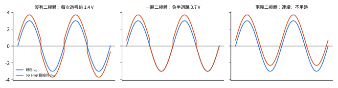
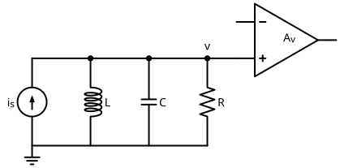
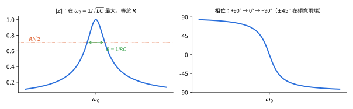

# 第 07 集 · Lec07：AM 發射機、推挽電流放大與交越失真、天線的 LC 共振、收音機調諧 [▶ 影片](https://www.youtube.com/watch?v=IfKIR2wV5aw)

← 上一集：[06](06-regulator-loading-op-amp-bjt.md) ｜ [總目錄](../README.md) ｜ 下一集：[08](08-carrier-extractor-sync-detection-integrator.md) →

> **課程**：電子學（二），陽明交大 電子物理系，112 學年度 — 第 07 集
> **講者**：陳振芳 老師
> **來源**：YouTube 錄影逐字稿（1:15:57，whisper）＋ Sedra & Smith《Microelectronic Circuits》7th ed.
> **標記說明**：`【口頭】` 老師口頭補充；`【課本補充】` 課本有、課堂沒講；`⚠️ 逐字稿缺字` whisper 聽錯，已修正；`[▶ mm:ss]` 影片時間點

---

## 目錄

- [0. 這堂課要做什麼](#0-這堂課要做什麼)
- [1. AM 發射機：產生 AM 信號](#1-am-發射機產生-am-信號)
- [2. 送到天線：要電流才有功率](#2-送到天線要電流才有功率)
- [3. 推挽電流放大與交越失真](#3-推挽電流放大與交越失真)
- [4. 天線是電感：串一顆電容共振](#4-天線是電感串一顆電容共振)
- [5. AM 接收機：並聯 RLC 調諧](#5-am-接收機並聯-rlc-調諧)
- [6. 解調、喇叭](#6-解調喇叭)
- [7. 預告：自動增益控制與 JFET](#7-預告自動增益控制與-jfet)
- [8. 一頁速查表](#8-一頁速查表)
- [9. 與後續集數的連結](#9-與後續集數的連結)

---

## 0. 這堂課要做什麼

用學過的電路兜出一台 **AM 發射機**和 **AM 接收機**：

- 發射：麥克風 → 放大 → 乘法器 → 加法器 → 電流放大 → 天線（LC 共振）。
- 接收：天線 → 並聯 RLC 調諧 → 放大 → 整流 + 低通 → 電流放大 → 喇叭。

---

## 1. AM 發射機：產生 AM 信號

[▶ 00:00](https://youtu.be/IfKIR2wV5aw?t=0)

$$
v_{AM} = A\left[1 + m f(t)\right]\sin\omega_ct
$$

- 載波 0.55～1.6 MHz（每個電台一個頻率）；聲音 20 Hz～20 kHz。天線尺寸要和波長同一數量級（老師這次說約 1/4 波長），所以聲音要搬到高頻。[▶ 01:04](https://youtu.be/IfKIR2wV5aw?t=64)

> ⚠️ 逐字稿缺字：whisper 寫「1.6Mbps」，應是 1.6 MHz。

**各部分從哪來**（都是學過的）：[▶ 02:04](https://youtu.be/IfKIR2wV5aw?t=124)

1. 聲音 $f(t)$：電容式麥克風（內含 JFET 前置放大）→ op amp 放大。
2. 載波 $\sin\omega_ct$：**振盪器**（oscillator），電子學（三）或（四）會講。
3. 相乘：log 放大器 → 相加 → exp 放大器（乘法器）。[▶ 03:38](https://youtu.be/IfKIR2wV5aw?t=218)
4. 再加上載波：**加法器**。

**加法器** [▶ 04:08](https://youtu.be/IfKIR2wV5aw?t=248)：$v_1 = f(t)\sin\omega_ct$ 經 $R_1$、$v_2 = \sin\omega_ct$ 經 $R_2$ 接到正端，op amp 接成非反相放大（$R_3$、$R_4$）。用**疊加原理**（superposition）輪流讓一個輸入為 0：

$$
v_O = \left(1 + \frac{R_4}{R_3}\right)\left[\frac{R_2}{R_1 + R_2}v_1 + \frac{R_1}{R_1 + R_2}v_2\right]
$$

$$
= \underbrace{\left(1 + \frac{R_4}{R_3}\right)\frac{R_1}{R_1 + R_2}}_{A}\left[1 + \underbrace{\frac{R_2}{R_1}}_{m}f(t)\right]\sin\omega_ct
$$

就是 AM 信號。[▶ 06:47](https://youtu.be/IfKIR2wV5aw?t=407)

---

## 2. 送到天線：要電流才有功率

[▶ 07:26](https://youtu.be/IfKIR2wV5aw?t=446)

前面全是電壓處理。天線（負載 $R_L$）要的是**功率**。正弦信號的功率要對一個週期平均：[▶ 09:00](https://youtu.be/IfKIR2wV5aw?t=540)

$$
P = \frac1T\int_0^T V_0\sin\omega t\cdot I_0\sin\omega t\,dt = \frac12V_0I_0 = \frac{V_0^2}{2R_L}
$$

（$\sin^2 = \frac12(1 - \cos2\omega t)$，cos 項積一個週期是 0。）

電壓已經放大到幾伏（受電源限制），**所以 $R_L$ 越小功率越大**——但 op amp 只能給約 ±20 mA，天線要幾 A。→ 需要**電流放大器**（current amplifier）：BJT。[▶ 11:36](https://youtu.be/IfKIR2wV5aw?t=696)

---

## 3. 推挽電流放大與交越失真

### 3.1 兩顆 BJT

[▶ 13:11](https://youtu.be/IfKIR2wV5aw?t=791)

- NPN：$V_{BE} \approx 0.7$ V 導通，電流只能順箭頭往下 → 只管**正半週**。$I_E = (1 + \beta)I_B$，op amp 只要給 $1/\beta$。
- 加一顆 PNP 管**負半週**。一顆導通時另一顆一定不導通（要 1.4 V 才能兩顆同時通）。[▶ 15:48](https://youtu.be/IfKIR2wV5aw?t=948)
- 輸出接回負端 → 亦步亦趨；op amp 無窮大的力量不在乎 0.7 V（像 super diode）。電流還不夠就再串一顆。[▶ 17:22](https://youtu.be/IfKIR2wV5aw?t=1042)

### 3.2 交越失真

[▶ 17:53](https://youtu.be/IfKIR2wV5aw?t=1073)

假設輸出是完美的正弦——可能嗎？看 op amp 要給什麼：

- 正半週 NPN 通：$v_{OP} = v_O + 0.7$。
- 負半週 PNP 通：$v_{OP} = v_O - 0.7$。

過零那一瞬間 $v_{OP}$ 要**瞬間跳 1.4 V**（老師說 quantum drop）。沒有任何電路做得到——要頻寬無窮大、迴轉率（slew rate）無窮大。所以過零處一定會失真（**交越失真**，crossover distortion）。[▶ 20:03](https://youtu.be/IfKIR2wV5aw?t=1203)

### 3.3 加二極體

[▶ 21:34](https://youtu.be/IfKIR2wV5aw?t=1294)

在兩個基極之間串二極體，並掛一個電阻讓二極體**一直有電流、一直導通**（不然不會有 0.7 V）。

| 二極體 | op amp 要跳 | 靜態功耗 |
|---|---|---|
| 0 顆 | 1.4 V | 0 |
| 1 顆 | 0.7 V（失真少一半） | 0 |
| 2 顆 | 0（連續） | **有** |

[▶ 23:06](https://youtu.be/IfKIR2wV5aw?t=1386)

兩顆時正負半週 $v_{OP}$ 都是 $v_O + 0.7$，接得起來，op amp 輕鬆。但兩顆 BJT 從頭到尾都導通 → 還沒有信號就有電流流過 → **靜態功耗**（quiescent power dissipation），浪費電。[▶ 25:48](https://youtu.be/IfKIR2wV5aw?t=1548)

【口頭】上學期的音響用一顆，允許一點失真（耳朵聽不出），換來沒有靜態功耗。看你在不在乎功率。[▶ 27:25](https://youtu.be/IfKIR2wV5aw?t=1645)

> 【課本補充】Sedra Ch12：沒偏壓的推挽叫 **Class B**（有交越失真）；用兩顆二極體預先偏壓的叫 **Class AB**，代價是靜態電流。

### 3.4 合成 power amplifier

[▶ 27:55](https://youtu.be/IfKIR2wV5aw?t=1675)

把 BJT 放進加法器 op amp 的回授迴路裡 → 一個電路同時做**加法、電壓放大、電流放大** → 這就是**功率放大器**（power amplifier）。

---

## 4. 天線是電感：串一顆電容共振

[▶ 29:58](https://youtu.be/IfKIR2wV5aw?t=1798)

天線就是繞線圈：繞越多圈磁場越大，電磁波送得越強。

**電感** [▶ 31:35](https://youtu.be/IfKIR2wV5aw?t=1895)（普通物理）：安培定律 $B\ell = \mu Ni$ → $B = \mu Ni/\ell$；磁通量 $BA$，感應電動勢 $v = N\dfrac{d(BA)}{dt}$：

$$
v = \frac{\mu AN^2}{\ell}\frac{di}{dt} = L\frac{di}{dt},
\qquad
L = \frac{\mu AN^2}{\ell} \propto N^2
$$

**阻抗** [▶ 33:43](https://youtu.be/IfKIR2wV5aw?t=2023)：$v = Ve^{j\omega t}$、$i = Ie^{j\omega t}$ 代入 → $Z_L = j\omega L$。

**算一下** [▶ 35:15](https://youtu.be/IfKIR2wV5aw?t=2115)：$L = 1$ mH，AM 信號在 1 MHz：

$$
|Z_L| = 2\pi\times10^6\times10^{-3} \approx 6\ \text{k}\Omega
$$

6 V / 6 kΩ = 1 mA——比 op amp 自己就能給的 20 mA 還小，前面的電流放大白做了！[▶ 38:52](https://youtu.be/IfKIR2wV5aw?t=2332)

**串一顆電容** [▶ 39:53](https://youtu.be/IfKIR2wV5aw?t=2393)：

$$
Z = j\omega L + \frac{1}{j\omega C} = \frac{1 - \omega^2LC}{j\omega C}
$$

$\omega = \omega_0 = 1/\sqrt{LC}$（**共振頻率**，resonant / oscillation frequency）時 $Z = 0$，功率最大（實際上線圈有電阻，不會真的 0）。調 $LC$ 讓 $\omega_0$ 等於電台載波（例 1 MHz）。聲音邊帶離載波很近，也在共振附近。[▶ 43:02](https://youtu.be/IfKIR2wV5aw?t=2582)

---

## 5. AM 接收機：並聯 RLC 調諧

[▶ 44:34](https://youtu.be/IfKIR2wV5aw?t=2674)

所有電台的電磁波都進到天線。天線本身是電感 $L$；電磁波的作用用**並聯的電流源** $i_s$ 代表。再並一顆 $C$ 和 $R$，取出電壓 $v$ 送進電壓放大器。

**$L \parallel C$** [▶ 47:38](https://youtu.be/IfKIR2wV5aw?t=2858)：

$$
Z_{LC} = \frac{j\omega L\cdot\frac{1}{j\omega C}}{j\omega L + \frac{1}{j\omega C}} = \frac{j\omega L}{1 - \omega^2LC}
$$

$\omega = \omega_0 = 1/\sqrt{LC}$ 時 → 無窮大，三個並聯只剩 $R$，$v = i_sR$ 最大。

**兩邊** [▶ 50:16](https://youtu.be/IfKIR2wV5aw?t=3016)：低頻電感短路、高頻電容短路 → 都是 0。只有共振附近有值 → **帶通**（band-pass）。把 $\omega_0$ 對準要聽的電台（是你去對它）。

### 5.1 頻寬

[▶ 55:36](https://youtu.be/IfKIR2wV5aw?t=3336)

$$
Z = \frac{1}{\frac1R + j\omega C + \frac{1}{j\omega L}}
= \frac{R}{1 + jRC\,\dfrac{\omega^2 - \omega_0^2}{\omega}}
$$

只看 $\omega \approx \omega_0$：$\omega^2 - \omega_0^2 = (\omega + \omega_0)(\omega - \omega_0) \approx 2\omega_0(\omega - \omega_0)$。【口頭】相減的那一項不能直接讓 $\omega = \omega_0$，不然就沒了；其他項可以。[▶ 58:18](https://youtu.be/IfKIR2wV5aw?t=3498)

$$
Z \approx \frac{R}{1 + j\,2RC(\omega - \omega_0)}
$$

- $\omega = \omega_0$：$Z = R$，相位 0°。
- $2RC|\omega - \omega_0| = 1$：$|Z| = R/\sqrt2$，相位 ∓45°。[▶ 1:00:21](https://youtu.be/IfKIR2wV5aw?t=3621)

$$
B = 2\times\frac{1}{2RC} = \frac{1}{RC}
$$

**選 $B$** [▶ 53:30](https://youtu.be/IfKIR2wV5aw?t=3210)：

- 要包住聲音邊帶：$B > 2\omega_{m,\max} = 2\times2\pi\times20$ kHz。
- 又不能大到抓進隔壁電台。

這就是**調諧器**（tuner）。[▶ 55:06](https://youtu.be/IfKIR2wV5aw?t=3306)

> 【課本補充】Sedra §17.12 (p. 1359) 調諧放大器：並聯 RLC 的 $B = 1/RC$、品質因數 $Q = \omega_0RC = \omega_0/B$。

---

## 6. 解調、喇叭

[▶ 1:02:55](https://youtu.be/IfKIR2wV5aw?t=3775)

（上一集的 AM 解調，快速再講。）整流 = 乘一個頻率 $\omega_c$ 的方波；方波傅立葉的 $\frac{2}{\pi}\sin\omega_ct$ 乘上去得 $\frac{1}{\pi}(1 - \cos2\omega_ct)$ → 低通後剩 $\frac{A}{\pi}[1 + mf(t)]$。【口頭】整流其實就是在做**取樣**（sampling）。中間加 voltage follower 隔開。[▶ 1:05:40](https://youtu.be/IfKIR2wV5aw?t=3940)

- 低通 = 取平均；不整流直接平均是 0。[▶ 1:09:21](https://youtu.be/IfKIR2wV5aw?t=4161)
- 直流 $A/\pi$ 不要 → 用電容擋掉，剩聲音 $\frac{Am}{\pi}f(t)$。[▶ 1:10:25](https://youtu.be/IfKIR2wV5aw?t=4225)
- 喇叭要功率 → 又是電流放大（推挽 BJT）。喇叭電阻很小（4 Ω 或 8 Ω），就是為了大電流、大功率；直流一定要擋掉，不然喇叭完蛋。[▶ 1:10:57](https://youtu.be/IfKIR2wV5aw?t=4257)

---

## 7. 預告：自動增益控制與 JFET

[▶ 1:12:00](https://youtu.be/IfKIR2wV5aw?t=4320)

電台信號忽大忽小（遠方、飛機經過）→ 音量忽大忽小。不要自己一直轉旋鈕，讓增益自己調：**自動增益控制**（automatic gain control, AGC）。

- 用非反相放大器，增益 $1 + R_2/R_1$，把 $R_1$ 換成可變的。
- 可變電阻來自 **JFET**（junction FET）：在某個範圍它就是一顆電阻 $R_{DS}$，由電壓控制。[▶ 1:14:37](https://youtu.be/IfKIR2wV5aw?t=4477)
- **峰值偵測器**（peak detector）抓出振幅 $A$ → 積分器 → 控制 $R_{DS}$：$A$ 太大就降增益，太小就升增益。

下一集講 JFET 的物理。

---

## 8. 一頁速查表

| 項目 | 公式／重點 | 關鍵 |
|---|---|---|
| 加法器產生 AM | $A = (1+\frac{R_4}{R_3})\frac{R_1}{R_1+R_2}$，$m = R_2/R_1$ | 疊加原理 |
| 正弦功率 | $P = \frac12V_0I_0 = V_0^2/(2R_L)$ | $\sin^2$ 平均 1/2 |
| 推挽 | NPN 正半週、PNP 負半週 | op amp 只給 $1/\beta$ |
| 交越失真 | 過零 $v_{OP}$ 跳 1.4 V | 2 顆二極體 → 連續但有靜態功耗 |
| 電感 | $L = \mu AN^2/\ell$，$Z = j\omega L$ | 1 mH、1 MHz → 6 kΩ |
| 串聯 LC | $Z = (1 - \omega^2LC)/(j\omega C)$ | $\omega_0$ 時 0 |
| 並聯 LC | $Z = j\omega L/(1 - \omega^2LC)$ | $\omega_0$ 時 ∞ |
| 並聯 RLC 近共振 | $Z \approx R/[1 + j2RC(\omega - \omega_0)]$ | $B = 1/RC$ |
| 選頻寬 | $2\omega_{m,\max} < B <$ 電台間距 | |
| AGC | JFET 當可變電阻 + 峰值偵測 + 積分 | 下一集 |

---

## 9. 與後續集數的連結

| 本集觀念 | 後面在哪裡用到 |
|---|---|
| JFET 可變電阻 | 下一集：JFET 物理 |
| 推挽、Class AB | 電子學（四）輸出級 |
| 振盪器 | 電子學（四）回授與振盪 |
| 並聯 RLC 帶通 | 調諧放大器、濾波器 |

---

## 附：本集一句話總結

> **用 op amp 加法器產生 AM 信號，再用推挽 BJT 提供天線要的大電流（過零點 op amp 要跳 1.4 V 造成交越失真，加兩顆二極體可消除但有靜態功耗）；天線是電感，串一顆電容在 $\omega_0 = 1/\sqrt{LC}$ 共振讓阻抗最小；接收端用並聯 RLC 選台，頻寬 $B = 1/RC$ 要包住聲音又不能抓到隔壁台，再整流、低通、放大送喇叭。**

---

*筆記依據陳振芳老師「電子學（二）」112 學年度 Lec07 錄影逐字稿（whisper，1:15:57）與 Sedra & Smith《Microelectronic Circuits》7th ed. 整理。*
