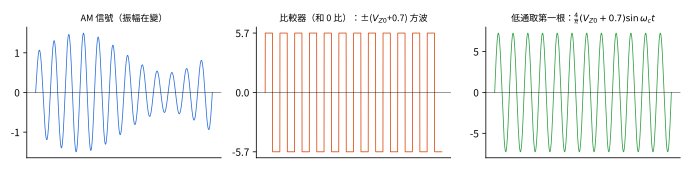
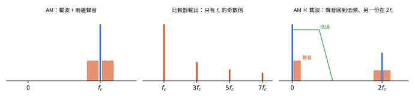
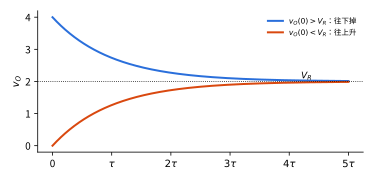

# 第 08 集 · Lec08：另一種 AM 接收機——取出載波再相乘、積分器會「跟著走」 [▶ 影片](https://www.youtube.com/watch?v=zVssLRJE-Bg)

← 上一集：[07](07-am-transmitter-receiver-tuner.md) ｜ [總目錄](../README.md) ｜ 下一集：[09](09-depletion-width-jfet-agc.md) →

> **課程**：電子學（二），陽明交大 電子物理系，112 學年度 — 第 08 集
> **講者**：陳振芳 老師
> **來源**：YouTube 錄影逐字稿（42:08，whisper）＋ Sedra & Smith《Microelectronic Circuits》7th ed.
> **標記說明**：`【口頭】` 老師口頭補充；`【課本補充】` 課本有、課堂沒講；`[▶ mm:ss]` 影片時間點

---

## 目錄

- [0. 這堂課要做什麼](#0-這堂課要做什麼)
- [1. 前端：調諧與放大（複習）](#1-前端調諧與放大複習)
- [2. 載波取出器：比較器 + 低通](#2-載波取出器比較器--低通)
- [3. 和載波相乘：聲音回到低頻](#3-和載波相乘聲音回到低頻)
- [4. 擋直流、電流放大、喇叭](#4-擋直流電流放大喇叭)
- [5. AGC 要什麼零件](#5-agc-要什麼零件)
- [6. 積分器：輸出會跟著參考電壓走](#6-積分器輸出會跟著參考電壓走)
- [7. 一頁速查表](#7-一頁速查表)
- [8. 與後續集數的連結](#8-與後續集數的連結)

---

## 0. 這堂課要做什麼

1. 另一種 AM 接收機：把**載波 $\sin\omega_ct$ 單獨抓出來**，再和 AM 信號相乘，取回聲音。
2. 為 AGC（自動增益控制）做準備：先講**積分器**，下次講 JFET。

---

## 1. 前端：調諧與放大（複習）

[▶ 00:00](https://youtu.be/zVssLRJE-Bg?t=0)

天線（電感 $L$）+ 電磁波（並聯電流源）+ $C$ + $R$ → 共振在 $\omega_0 = 1/\sqrt{LC}$ 時阻抗 $= R$，頻寬 $B = 1/RC$。調 $\omega_0$ 對準電台（例 1 MHz），$B$ 要大於 $2\times20$ kHz、又不能抓到隔壁台。接著電壓放大，得到

$$
v_{AM} = A\left[1 + mf(t)\right]\sin\omega_ct
$$

[▶ 05:10](https://youtu.be/zVssLRJE-Bg?t=310)

---

## 2. 載波取出器：比較器 + 低通

### 2.1 為什麼濾波器做不到

[▶ 06:14](https://youtu.be/zVssLRJE-Bg?t=374)

想只要中間那根載波、不要兩邊的聲音邊帶。但邊帶離載波只有 20 Hz 起跳，**沒有任何濾波器能陡到在這麼近的地方切開**。

### 2.2 比較器

[▶ 07:46](https://youtu.be/zVssLRJE-Bg?t=466)

AM 信號接 op amp，**另一端接 0，不接回授** → 增益太大，就是一個**比較器**（comparator）：比 0 大輸出 $+V_0$，比 0 小輸出 $-V_0$。

- 輸出每次翻轉的時間點 = AM 信號過零的時間點 → 方波頻率**正好是 $\omega_c$**。[▶ 10:53](https://youtu.be/zVssLRJE-Bg?t=653)
- 方波振幅固定 → 振幅（聲音）的資訊**全沒了**，只留頻率。

### 2.3 不能讓 op amp 飽和

[▶ 12:27](https://youtu.be/zVssLRJE-Bg?t=747)

只接 op amp 會飽和在約 ±13 V（老師取 10 V 好寫）。飽和 = 開進沼澤，爬出來要時間；1 MHz 這麼快保證來不及。

解法：買兩顆崩潰二極體背對背接，把輸出**掐住**在 $\pm(V_{Z0} + 0.7)$：一顆崩潰 $V_{Z0}$、另一顆順向 0.7 V。例 $V_{Z0} = 5$ V → 最多 ±5.7 V，op amp 裡面的電晶體不會飽和，可以用到 op amp 頻寬的最高頻率。[▶ 13:31](https://youtu.be/zVssLRJE-Bg?t=811)

> 【課本補充】§4.6.1 (p. 221) 限幅電路（limiter）：背對背齊納限幅在 $\pm(V_Z + 0.7)$。

### 2.4 方波頻譜 → 低通

[▶ 15:05](https://youtu.be/zVssLRJE-Bg?t=905)

振幅 ±1、頻率 $\omega$ 的方波（上下對稱）：

$$
g(t) = \frac{4}{\pi}\left(\sin\omega t + \frac13\sin3\omega t + \frac15\sin5\omega t + \frac17\sin7\omega t + \cdots\right)
$$

振幅變成 $V_{Z0} + 0.7$ 就整個乘上去。頻譜只有 $\omega_c$、$3\omega_c$、$5\omega_c$……**聲音的邊帶沒了**。[▶ 16:43](https://youtu.be/zVssLRJE-Bg?t=1003)

再接低通濾波器只留第一根：

$$
\frac{4}{\pi}(V_{Z0} + 0.7)\sin\omega_ct
$$

比較器 + 低通 = **載波取出器**（carrier extractor）。[▶ 18:48](https://youtu.be/zVssLRJE-Bg?t=1128)

【口頭】比較器只抓頻率、不管振幅——以後 **FM 解調**會用到：FM 的資訊在頻率，振幅被環境干擾忽高忽低是雜訊，過比較器之後振幅固定，雜訊就不見了。[▶ 19:49](https://youtu.be/zVssLRJE-Bg?t=1189)

> 【課本補充】上一集是用 $\frac12 + \frac{2}{\pi}(\cdots)$ 的 0/1 方波（整流）；這裡是 ±1 方波，所以係數是 $\frac{4}{\pi}$、沒有直流項。

---

## 3. 和載波相乘：聲音回到低頻

[▶ 20:51](https://youtu.be/zVssLRJE-Bg?t=1251)

用乘法器把取出的載波和 AM 信號相乘：

$$
A\left[1 + mf(t)\right]\sin\omega_ct\cdot K\sin\omega_ct
= \frac{AK}{2}\left[1 + mf(t)\right]\left(1 - \cos2\omega_ct\right)
$$

頻譜：整包被搬到 $2\omega_c$，**另一份搬回 0 附近**（負頻率不存在，剛好落在低頻）。[▶ 22:23](https://youtu.be/zVssLRJE-Bg?t=1343)

再低通 → $A'\left[1 + mf(t)\right]$，聲音出來了。[▶ 24:28](https://youtu.be/zVssLRJE-Bg?t=1468)

【口頭】這比較接近現在的 AM 接收機，但現代的不從信號裡抓載波，而是**自己有一個很強的振盪器**，一樣是相乘，再搬到**中頻**（intermediate frequency），以後再講。[▶ 25:01](https://youtu.be/zVssLRJE-Bg?t=1501)

> 【課本補充】這種「乘上同頻率載波」的做法叫**同步解調**（synchronous / coherent detection）；上一集的整流 + 低通叫**包絡偵測**（envelope detection）。這兩個名詞老師沒說。

---

## 4. 擋直流、電流放大、喇叭

[▶ 25:32](https://youtu.be/zVssLRJE-Bg?t=1532)

- 串一顆電容擋掉直流 $A'$，剩 $A'mf(t)$。
- 處理信號 99% 是電壓，最後喇叭要功率 → 電流放大器：op amp + NPN/PNP 推挽，加一顆二極體讓 op amp 輕鬆一點、失真小一點。要電壓放大再加 $R_1$、$R_2$（但增益大頻寬會窄）。[▶ 26:35](https://youtu.be/zVssLRJE-Bg?t=1595)
- 輸出再串電容，保證直流不進喇叭；喇叭 4 Ω 或 8 Ω，電流大、功率大。

---

## 5. AGC 要什麼零件

[▶ 27:39](https://youtu.be/zVssLRJE-Bg?t=1659)

換電台時距離不同，信號強度不同 → 音量忽大忽小。要**自動增益控制**（AGC）：

- 抓出振幅（包絡的 peak）：峰值整流差不多就可以。[▶ 29:48](https://youtu.be/zVssLRJE-Bg?t=1788)
- 振幅大 → 增益小；振幅小 → 增益大，讓相乘是常數。
- 需要兩個元件：**積分器**和**JFET**（電壓控制的可變電阻）。今天先講積分器。[▶ 30:18](https://youtu.be/zVssLRJE-Bg?t=1818)

---

## 6. 積分器：輸出會跟著參考電壓走

[▶ 30:48](https://youtu.be/zVssLRJE-Bg?t=1848)

積分器（op amp + 輸入電阻 $R$ + 回授電容 $C$），正端接自己設的參考電壓 $V_R$，**把輸出 $v_O$ 直接拉回輸入電阻那一頭**。

**分析** [▶ 31:49](https://youtu.be/zVssLRJE-Bg?t=1909)：有回授 → 負端 = $V_R$。若 $v_O > V_R$：電流 $(v_O - V_R)/R$ 流進電容充電，輸出往下掉；掉到等於 $V_R$ 就沒電流、停下來。

$$
v_O(t) = V_R - \frac1C\int_0^t\frac{v_O - V_R}{R}\,dt + \frac{q(0)}{C}
$$

（$q(0)$：實驗前電容上可能有的電荷。）積分看不出來就微分：[▶ 34:25](https://youtu.be/zVssLRJE-Bg?t=2065)

$$
\frac{dv_O}{dt} = -\frac{v_O - V_R}{RC}
$$

- $v_O > V_R$ → 斜率負 → 往下掉；$v_O < V_R$ → 往上升。
- 不管從哪裡開始，都以 $\tau = RC$ 指數趨近 $V_R$。

【口頭】積分器做兩件事：**先比大小**（比較器的功能），**再積分**往對的方向修正。[▶ 32:52](https://youtu.be/zVssLRJE-Bg?t=1972)

**跟得上的條件** [▶ 36:28](https://youtu.be/zVssLRJE-Bg?t=2188)：$V_R$ 改變的週期 $T \gg \tau$，也就是

$$
\omega \ll \frac{1}{RC}
$$

$v_O$ 就永遠**亦步亦趨**跟著 $V_R$。【口頭】我跑得比你快十倍，你往哪跑我都在你旁邊。和 op amp 負回授的亦步亦趨同一個觀念——op amp 裡面也有 RC、也有頻寬，輸入頻率在頻寬內就跟得上。[▶ 39:15](https://youtu.be/zVssLRJE-Bg?t=2355)

**加放大器** [▶ 40:48](https://youtu.be/zVssLRJE-Bg?t=2448)：積分器後面再接增益 $A$ 的放大器，$v_O$ 才拉回去 → 積分器輸出是 $v_O/A$：

$$
\frac{dv_O}{dt} = -\frac{A}{RC}(v_O - V_R),
\qquad
\tau = \frac{RC}{A}
$$

時間常數縮小 $A$ 倍，更容易跟上。

---

## 7. 一頁速查表

| 項目 | 公式／重點 | 關鍵 |
|---|---|---|
| 比較器 | op amp 不接回授，和 0 比 | 留頻率、丟振幅 |
| 限幅 | 背對背齊納 → $\pm(V_{Z0} + 0.7)$ | 不飽和才能用在 MHz |
| ±1 方波 | $\frac{4}{\pi}(\sin\omega t + \frac13\sin3\omega t + \cdots)$ | 只有奇次諧波 |
| 載波取出器 | 比較器 + 低通 → $\frac{4}{\pi}(V_{Z0}+0.7)\sin\omega_ct$ | 濾波器切不開邊帶 |
| 相乘解調 | $\sin^2 = \frac12(1 - \cos2\omega_ct)$ | 聲音回到 0 附近 |
| 積分器跟隨 | $\dot v_O = -(v_O - V_R)/RC$ | $\tau = RC$ |
| 跟得上 | $\omega \ll 1/RC$ | |
| 加增益 $A$ | $\tau = RC/A$ | |

---

## 8. 與後續集數的連結

| 本集觀念 | 後面在哪裡用到 |
|---|---|
| 積分器 + JFET | 下一集起：JFET 物理、AGC 電路 |
| 比較器只抓頻率 | FM 解調 |
| 振盪器、中頻 | 電子學（四） |

---

## 附：本集一句話總結

> **濾波器切不開載波和邊帶，所以用比較器（加齊納限幅避免飽和）把 AM 變成頻率 $\omega_c$ 的方波，再低通取出載波；載波和 AM 相乘後聲音回到低頻，低通就得到聲音。AGC 需要的積分器若把輸出拉回輸入，會以 $\tau = RC$（加增益後 $RC/A$）跟著參考電壓走。**

---

*筆記依據陳振芳老師「電子學（二）」112 學年度 Lec08 錄影逐字稿（whisper，42:08）與 Sedra & Smith《Microelectronic Circuits》7th ed. 整理。*
