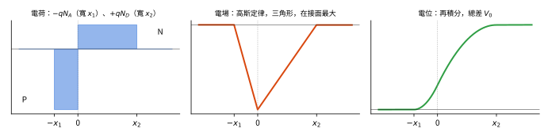
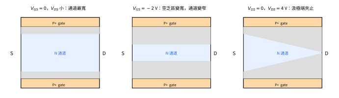
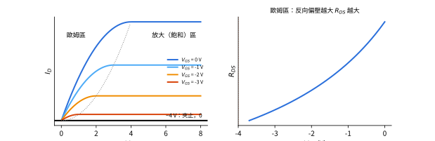

# 第 09 集 · Lec09：空乏區寬度、JFET 的歐姆區與放大區、自動增益控制 [▶ 影片](https://www.youtube.com/watch?v=6bvrTBNAj38)

← 上一集：[08](08-carrier-extractor-sync-detection-integrator.md) ｜ [總目錄](../README.md) ｜ 下一集：[10](10-jfet-pinch-off-saturation.md) →

> **課程**：電子學（二），陽明交大 電子物理系，112 學年度 — 第 09 集
> **講者**：陳振芳 老師
> **來源**：YouTube 錄影逐字稿（1:20:57，whisper）＋ Sedra & Smith《Microelectronic Circuits》7th ed. §3.4–3.5
> **標記說明**：`【口頭】` 老師口頭補充；`【課本補充】` 課本有、課堂沒講；`[▶ mm:ss]` 影片時間點

---

## 目錄

- [0. 這堂課要做什麼](#0-這堂課要做什麼)
- [1. 空乏區寬度](#1-空乏區寬度)
- [2. 加反向偏壓：空乏區變寬](#2-加反向偏壓空乏區變寬)
- [3. JFET 結構與歐姆區](#3-jfet-結構與歐姆區)
- [4. AGC：用 JFET 當可變電阻](#4-agc用-jfet-當可變電阻)
- [5. 峰值偵測器](#5-峰值偵測器)
- [6. 積分器把增益修正到剛好](#6-積分器把增益修正到剛好)
- [7. 小心：開機瞬間閘極正向偏壓](#7-小心開機瞬間閘極正向偏壓)
- [8. 漣波進積分器沒關係](#8-漣波進積分器沒關係)
- [9. JFET 的放大區](#9-jfet-的放大區)
- [10. 一頁速查表](#10-一頁速查表)
- [11. 與後續集數的連結](#11-與後續集數的連結)

---

## 0. 這堂課要做什麼

1. 算 PN 接面的**空乏區寬度**，看反向偏壓怎麼讓它變寬。
2. 用這個原理講 **JFET**（junction field-effect transistor）：閘極反向偏壓控制通道寬度 → 歐姆區是**電壓控制的電阻**。
3. 組出完整的**自動增益控制**（AGC）電路。
4. JFET 的**放大區**（夾止之後電流不隨 $V_{DS}$ 變）。

---

## 1. 空乏區寬度

[▶ 00:30](https://youtu.be/6bvrTBNAj38?t=30)

（複習）P 型摻三價雜質產生電洞、N 型摻五價產生自由電子。接起來後擴散 → 電子和電洞結合變成共價鍵、一起消失 → 留下不動的離子 → 內建電場，和擴散平衡。內建電位：[▶ 03:05](https://youtu.be/6bvrTBNAj38?t=185)

$$
V_0 = V_T\ln\frac{N_AN_D}{n_i^2}
$$

例：兩邊都 $10^{16}\ \text{cm}^{-3}$ → $V_0 \approx 0.69$ V（$V_T = 0.025$ V）。

**電荷 → 電場 → 電位**（普物題）[▶ 04:07](https://youtu.be/6bvrTBNAj38?t=247)：P 側空乏區寬 $x_1$，電荷密度 $-qN_A$；N 側寬 $x_2$，電荷 $+qN_D$。

1. **電中性**：結合前是中性，消失的電荷兩邊一樣多：

$$
N_Ax_1 = N_Dx_2
$$

2. **電場**（高斯定律）[▶ 05:13](https://youtu.be/6bvrTBNAj38?t=313)：高斯面包住從空乏區邊緣到 $x$ 的電荷，$\varepsilon E\,A = qN_A\,x\,A$，面積 $A$ 消掉。電場從 0 線性增加，在接面最大：

$$
|E_{\max}| = \frac{qN_Ax_1}{\varepsilon}
$$

過了接面正電荷開始抵消，回到 0 → 三角形。

3. **電位**（電場積分 = 三角形面積）[▶ 07:19](https://youtu.be/6bvrTBNAj38?t=439)：

$$
V_0 = \frac{qN_A}{2\varepsilon}x_1^2 + \frac{qN_D}{2\varepsilon}x_2^2
$$

兩式聯立解 $x_1$、$x_2$，相加得寬度：[▶ 09:31](https://youtu.be/6bvrTBNAj38?t=571)

$$
W = x_1 + x_2 = \sqrt{\frac{2\varepsilon}{q}\left(\frac{1}{N_A} + \frac{1}{N_D}\right)V_0}
$$

**一邊高濃度** [▶ 10:38](https://youtu.be/6bvrTBNAj38?t=638)：擴散做出來的接面常常 $N_A \gg N_D$ → $1/N_A$ 可忽略 → $W \approx x_2 = \sqrt{2\varepsilon V_0/(qN_D)}$。**空乏區幾乎都在低濃度那一邊**。

> 【課本補充】§3.4.2 (p. 149) 式 (3.26)：$W_{dep} = \sqrt{\frac{2\epsilon_s}{q}\left(\frac{1}{N_A} + \frac{1}{N_D}\right)V_0}$，同一個式子。

---

## 2. 加反向偏壓：空乏區變寬

[▶ 11:39](https://youtu.be/6bvrTBNAj38?t=699)

N 接正、P 接負（反向偏壓 $V_R$）：沒有電流，但外加電壓幾乎全落在空乏區（電阻最大），方向和內建電場一樣 → 電場要變大 → 電荷要變多 → **空乏區變寬**，電位差變成 $V_0 + V_R$。[▶ 13:12](https://youtu.be/6bvrTBNAj38?t=792)

$$
W = \sqrt{\frac{2\varepsilon}{q}\left(\frac{1}{N_A} + \frac{1}{N_D}\right)(V_0 + V_R)}
= W_0\sqrt{1 + \frac{V_R}{V_0}}
$$

和 $V_R$ 成**根號**關係。[▶ 14:45](https://youtu.be/6bvrTBNAj38?t=885)

---

## 3. JFET 結構與歐姆區

### 3.1 結構

[▶ 15:47](https://youtu.be/6bvrTBNAj38?t=947)

一塊 N 型半導體，上下兩邊擴散 $P^+$（兩邊對稱、接在一起）：

- **閘極**（gate, G）：兩個 $P^+$，控制端。
- **源極**（source, S）：電荷的來源。**汲極**（drain, D）：電荷流出去的地方。
- 閘極和通道是 PN 接面，**一定要反向偏壓**：$V_{GS} = 0, -1, -2, \ldots$（P 比 N 低）。正向會導通，就不對了。[▶ 16:50](https://youtu.be/6bvrTBNAj38?t=1010)

### 3.2 歐姆區：通道是一顆電阻

[▶ 18:22](https://youtu.be/6bvrTBNAj38?t=1102)

導電只能走中間沒空乏的 N 型通道（寬 $h$、深 $k$、長 $L$）。只有漂移電流（$V_{DS}$ 小）：[▶ 19:24](https://youtu.be/6bvrTBNAj38?t=1164)

$$
I_D = q\,n\,\mu_n\,\frac{V_{DS}}{L}\cdot kh
$$

關鍵在 $h$ = 總寬度 − 兩倍空乏區寬度：

- $V_{GS} = 0$：空乏區最窄 → $h$ 最大 → $I_D$-$V_{DS}$ 斜率最大。
- $V_{GS} = -2$ V：空乏區變寬 → $h$ 變窄 → 斜率變小。[▶ 22:01](https://youtu.be/6bvrTBNAj38?t=1321)
- $V_{GS} = -4$ V（例）：通道整個沒了，$h = 0$，電流 0。

每一條都是直線，定義電阻 $R_{DS} = V_{DS}/I_D \propto 1/h$：$h$ 大電阻小，$h = 0$ 時無窮大。[▶ 24:36](https://youtu.be/6bvrTBNAj38?t=1476)

這叫**歐姆區**（ohmic region）：JFET 就是一顆**用 $V_{GS}$ 控制的電阻**。[▶ 35:24](https://youtu.be/6bvrTBNAj38?t=2124)

---

## 4. AGC：用 JFET 當可變電阻

[▶ 26:08](https://youtu.be/6bvrTBNAj38?t=1568)

AM 解調完得到聲音 $Af(t)$（$A$ 含 $m$，$f(t)$ 是 20 Hz–20 kHz 的 sin/cos）。送進非反相放大器，**把 $R_1$ 換成 JFET 的 $R_{DS}$**：[▶ 28:12](https://youtu.be/6bvrTBNAj38?t=1692)

$$
v_O = \left(1 + \frac{R_2}{R_{DS}}\right)Af(t)
$$

- 有回授 → 負端 = 正端 = $Af(t)$ → JFET 的 $V_{DS}$ 就是聲音信號（在 0 附近上下，在歐姆區）。[▶ 29:13](https://youtu.be/6bvrTBNAj38?t=1753)
- $I_D = Af(t)/R_{DS}$，這個電流不進 op amp，流過 $R_2$ → 就是以前的放大器公式，$R_1$ 換成 $R_{DS}$。
- 換電台 $A$ 變大 → 要增益變小（$R_{DS}$ 變大）；$A$ 變小 → 增益變大。[▶ 33:19](https://youtu.be/6bvrTBNAj38?t=1999)

---

## 5. 峰值偵測器

[▶ 35:58](https://youtu.be/6bvrTBNAj38?t=2158)

音量由振幅 $\left(1 + \frac{R_2}{R_{DS}}\right)A$ 決定；直接低通取平均是 0，所以要抓**峰值**。

**峰值整流** [▶ 37:29](https://youtu.be/6bvrTBNAj38?t=2249)：二極體 + 電容充到 $V_p - 0.7$；換成 super diode → 0.7 V 沒了，得到 $V_p$。

**換電台** [▶ 39:32](https://youtu.be/6bvrTBNAj38?t=2372)：

- 振幅變大：二極體導通電阻很小，充電幾乎不要時間 → 馬上跟上。
- 振幅變小：電容沒地方放電 → 停在舊的峰值，抓不到新的 → 不行。

→ **一定要並一個 $R$** 讓它以 $V_pe^{-t/RC}$ 往下掉，掉到碰到新的波形再充電。代價是有**漣波**。$R$ 小：很快抓到新峰值，但漣波大；$R$ 大：漣波小，但換台後掉幾個峰值才抓到——換台稍等一下沒關係。[▶ 43:39](https://youtu.be/6bvrTBNAj38?t=2619)

接到積分器之前加 **voltage follower** 隔開，不然積分器的 $R$ 會和峰值偵測器的 $R$ 扯在一起。[▶ 45:46](https://youtu.be/6bvrTBNAj38?t=2746)

---

## 6. 積分器把增益修正到剛好

[▶ 46:48](https://youtu.be/6bvrTBNAj38?t=2808)

積分器正端接自己設的**參考電壓** $V_R$（想要的音量），負端經 $R_I$ 接峰值。積分器先**比大小**、再**積分**。

峰值太大（$>V_R$）→ 電流 $(\text{峰值} - V_R)/R_I$ 對電容充電 → 輸出（就是 $V_{GS}$）一直往下掉：[▶ 49:22](https://youtu.be/6bvrTBNAj38?t=2962)

$$
V_{GS} = V_R - \frac{1}{C_I}\int\frac{\left(1 + \frac{R_2}{R_{DS}}\right)A - V_R}{R_I}\,dt + \text{常數}
$$

- 只要兩者不相等，積分就**不會停**——修正的力量不會停。[▶ 50:23](https://youtu.be/6bvrTBNAj38?t=3023)
- $V_{GS}$ 往負走 → $R_{DS}$ 變大 → 增益變小 → 峰值變小。
- 一直修正到相等才停（steady state）：[▶ 52:24](https://youtu.be/6bvrTBNAj38?t=3144)

$$
\left(1 + \frac{R_2}{R_{DS}}\right)A = V_R
$$

$V_{GS}$ 停在哪裡（−2.5、−3……）不用管，反正最後振幅就是你設的 $V_R$。【口頭】修正很快，不會超過一秒。設計 1 V 就 1 V、1.2 V 就 1.2 V，只要別讓它飽和。[▶ 54:31](https://youtu.be/6bvrTBNAj38?t=3271)

修正好的聲音再經 power amplifier（推挽 BJT + $R_1$、$R_2$），擋掉直流送喇叭。[▶ 55:31](https://youtu.be/6bvrTBNAj38?t=3331)

---

## 7. 小心：開機瞬間閘極正向偏壓

[▶ 57:05](https://youtu.be/6bvrTBNAj38?t=3425)

$V_R$ 設 2 V，開機時電容沒電荷 → 積分器輸出一開始就是 2 V → 接到 JFET 閘極是**正向偏壓 2 V**。若此時 $V_{DS}$（聲音）剛好是負的，P-N 正向導通，電流從閘極灌進來流過 $R_2$，輸出電壓整個不對。[▶ 58:41](https://youtu.be/6bvrTBNAj38?t=3521)

**解法：閘極前串一顆大電阻** $R_G$（例 10 kΩ）[▶ 1:00:12](https://youtu.be/6bvrTBNAj38?t=3612)：

- 若真有 1 mA，$R_G$ 上就要 10 V，比 2 V 還大，不可能 → 電流很小，2 V 幾乎全落在 $R_G$，閘極還是約 0 V。
- 反向時本來就沒電流，$R_G$ 等於沒加。
- 另外輸入振幅 $A$ 不要太大，太負一樣會導通。[▶ 1:01:46](https://youtu.be/6bvrTBNAj38?t=3706)

---

## 8. 漣波進積分器沒關係

[▶ 1:03:22](https://youtu.be/6bvrTBNAj38?t=3802)

峰值偵測器的漣波（鋸齒）可拆成**直流 $\frac12V_r$** 加一個**平均為 0 的三角波**。

- 直流那一點差異：跟 $V_R$ 比的值差一點，無所謂。
- 三角波：傅立葉展開只有 $\omega, 3\omega, 5\omega, \ldots$（和方波同樣幾根，只是大小不同）。積分器頻率響應 −20 dB/decade，轉折點在 $1/RC$。$RC$ 取大，第一根（最大的）就被壓到 1/10、1/100。[▶ 1:06:28](https://youtu.be/6bvrTBNAj38?t=3988)

【口頭】方波積分變三角波、三角波積分變二次曲線，每積一次振幅都能再小一個數量級。正負都有的波形經過積分器很容易就沒了。[▶ 1:08:40](https://youtu.be/6bvrTBNAj38?t=4120)

---

## 9. JFET 的放大區

[▶ 1:09:42](https://youtu.be/6bvrTBNAj38?t=4182)

$V_{DS}$ 加大（例 $V_{GS} = 0$、$V_{DS} = 4$ V）：

- 源極端：閘極對通道 0 V → 空乏區最窄。
- 汲極端：閘極 0、通道 4 V → **反向偏壓 4 V** → 空乏區非常寬。
- 空乏區**不均勻**，汲極端的路被關起來 → **夾止**（pinch-off）。（例中 $V_{GS} = -4$ V 時整條通道沒了，所以 0 到 4 V 剛好夾止。）[▶ 1:12:50](https://youtu.be/6bvrTBNAj38?t=4370)

**曲線** [▶ 1:13:52](https://youtu.be/6bvrTBNAj38?t=4432)：

- $V_{DS}$ 小：均勻，直線（歐姆區）。
- $V_{DS}$ 變大：前面的路變窄，斜率變小、彎下來。【口頭】像車流，前面路變窄。
- 過夾止點：**變平**。多加的電壓（5、6、7 V……）全堆在夾止那一小段，通道裡 0 到 4 V 的分布沒變 → 電流不變。【口頭】像水流到很窄的地方，速度很快、流量固定。[▶ 1:15:57](https://youtu.be/6bvrTBNAj38?t=4557)

平的那一區叫**放大區**（amplifier region）：**電流只由 $V_{GS}$ 決定，和 $V_{DS}$ 無關**。[▶ 1:17:32](https://youtu.be/6bvrTBNAj38?t=4652)

**放大原理** [▶ 1:18:32](https://youtu.be/6bvrTBNAj38?t=4712)：汲極接電阻 $R_D$ 到 $V_{DD}$。$V_{GS}$ 上的 sin/cos → $I_D$ 跟著變 → $V_{DS} = V_{DD} - I_DR_D$ 上下變化（反相）且放大。$V_{DS}$ 一直在變，但不影響電流。以前麥克風裡的 JFET 前置放大就是這樣。

---

## 10. 一頁速查表

| 項目 | 公式／重點 | 關鍵一步 |
|---|---|---|
| 內建電位 | $V_0 = V_T\ln(N_AN_D/n_i^2)$ | $10^{16}$ → 0.69 V |
| 電中性 | $N_Ax_1 = N_Dx_2$ | |
| 空乏區寬度 | $W = \sqrt{\frac{2\varepsilon}{q}\left(\frac{1}{N_A}+\frac{1}{N_D}\right)V_0}$ | 高斯 → 三角形電場 → 面積 |
| 單邊 | $N_A \gg N_D$：$W \approx \sqrt{2\varepsilon V_0/(qN_D)}$ | 在低濃度側 |
| 反向偏壓 | $W = W_0\sqrt{1 + V_R/V_0}$ | $V_0 \to V_0 + V_R$ |
| JFET 歐姆區 | $I_D = qn\mu_n\frac{V_{DS}}{L}kh$，$R_{DS} \propto 1/h$ | 閘極反向偏壓控制 $h$ |
| AGC 增益 | $1 + R_2/R_{DS}$ | $V_{DS}$ = 聲音 |
| AGC 穩態 | $\left(1 + \frac{R_2}{R_{DS}}\right)A = V_R$ | 積分不停直到相等 |
| 峰值偵測 | super diode + $C \parallel R$ | 要 $R$ 才能往下抓 |
| 防正向 | 閘極串大電阻 $R_G$ | |
| 放大區 | 夾止後 $I_D$ 只看 $V_{GS}$ | $V_{DS}$ 堆在夾止段 |

---

## 11. 與後續集數的連結

| 本集觀念 | 後面在哪裡用到 |
|---|---|
| 空乏區寬度、反向偏壓 | 接面電容；MOSFET 的空乏區 |
| JFET 夾止、放大區 | 第 4 章 MOSFET 的飽和區（同樣的概念） |
| 汲極電阻放大 | MOSFET 共源放大器 |

---

## 附：本集一句話總結

> **由電中性、高斯定律、電場積分得到空乏區寬度 $W \propto \sqrt{V_0 + V_R}$；JFET 用閘極反向偏壓調空乏區、改通道寬度，歐姆區就是電壓控制的電阻 $R_{DS}$，放進 $1 + R_2/R_{DS}$ 的放大器，配上峰值偵測、follower、積分器就成了把振幅修到 $V_R$ 的 AGC；$V_{DS}$ 加大到汲極端夾止後，電流只由 $V_{GS}$ 控制，這是放大區。**

---

*筆記依據陳振芳老師「電子學（二）」112 學年度 Lec09 錄影逐字稿（whisper，1:20:57）與 Sedra & Smith《Microelectronic Circuits》7th ed. 整理。*
