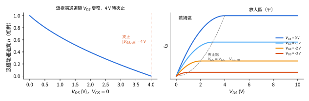

# 第 10 集 · Lec10：JFET 的夾止——為什麼電流會變平 [▶ 影片](https://www.youtube.com/watch?v=hzVbU2kZSLA)

← 上一集：[09](09-depletion-width-jfet-agc.md) ｜ [總目錄](../README.md) ｜ 下一集：[11](11-jfet-amplifier-co2-sensor.md) →

> **課程**：電子學（二），陽明交大 電子物理系，112 學年度 — 第 10 集
> **講者**：陳振芳 老師
> **來源**：YouTube 錄影逐字稿（26:43，whisper）
> **標記說明**：`【口頭】` 老師口頭補充；`[▶ mm:ss]` 影片時間點

---

## 目錄

- [0. 這堂課要做什麼](#0-這堂課要做什麼)
- [1. 複習：閘極電壓控制通道寬度](#1-複習閘極電壓控制通道寬度)
- [2. $V_{DS}$ 變大：通道變得不均勻](#2-v_ds-變大通道變得不均勻)
- [3. 汲極端的反向偏壓](#3-汲極端的反向偏壓)
- [4. 夾止之後：多加的電壓進不去](#4-夾止之後多加的電壓進不去)
- [5. 整組特性曲線](#5-整組特性曲線)
- [6. 一頁速查表](#6-一頁速查表)
- [7. 與後續集數的連結](#7-與後續集數的連結)

---

## 0. 這堂課要做什麼

上一集 JFET 當電阻用（歐姆區）。這次要拿它**放大**，所以要把 $V_{DS}$ 加大，看曲線為什麼會變平。

---

## 1. 複習：閘極電壓控制通道寬度

[▶ 00:32](https://youtu.be/hzVbU2kZSLA?t=32)

源極接地，閘極加反向偏壓 $V_{GS} = 0, -1, -2, \ldots$。空乏區 $W = W_0\sqrt{1 + V_R/V_0}$，反向越大越寬，通道 $h$ 越窄。[▶ 01:33](https://youtu.be/hzVbU2kZSLA?t=93)

$V_{DS}$ 小時：

$$
I_D = qn\mu_n\frac{V_{DS}}{L}kh
$$

$I_D$-$V_{DS}$ 是直線，斜率 $\propto h$。[▶ 03:06](https://youtu.be/hzVbU2kZSLA?t=186)

$V_{GS} = -4$ V（例）時兩邊空乏區碰在一起，$h = 0$、斜率 0——通道被**夾斷**（pinch-off）。這個電壓記成 $V_{GS,\text{off}}$。[▶ 05:10](https://youtu.be/hzVbU2kZSLA?t=310)

---

## 2. $V_{DS}$ 變大：通道變得不均勻

[▶ 06:40](https://youtu.be/hzVbU2kZSLA?t=400)

固定 $V_{GS} = 0$，把 $V_{DS}$ 加到 2 V：

- N 型通道的電位從源極 0 一路升到汲極 2 V（0、0.5、1、1.5、2）。[▶ 07:46](https://youtu.be/hzVbU2kZSLA?t=466)
- $P^+$ 濃度很高，整塊都是 0 V。
- 源極端：閘極對通道反向偏壓 0 → 空乏區窄。
- 汲極端：反向偏壓 2 V → 空乏區寬。

→ 空乏區**不均勻**，通道從源極端很寬、往汲極越來越窄。電流由**最窄的汲極端**決定。[▶ 09:19](https://youtu.be/hzVbU2kZSLA?t=559)

---

## 3. 汲極端的反向偏壓

[▶ 11:20](https://youtu.be/hzVbU2kZSLA?t=680)

$$
\text{源極端：}\ |V_{GS}|,
\qquad
\text{汲極端：}\ |V_{GS}| + V_{DS}
$$

汲極端多了 $V_{DS}$，所以特別大。

**$V_{GS} = 0$ 這一條** [▶ 13:23](https://youtu.be/hzVbU2kZSLA?t=803)：

- $V_{DS}$ 小：$V_{DS}/V_0$ 再開根號，變化很小 → $h$ 幾乎不變 → 斜率固定，看起來是直線。
- $V_{DS}$ 變大：汲極端 $h$ 掉下來 → 斜率變小，曲線往下彎。[▶ 15:58](https://youtu.be/hzVbU2kZSLA?t=958)
- $V_{DS} = 4$ V：汲極端反向偏壓 = 4 V = $|V_{GS,\text{off}}|$ → 汲極端 $h = 0$ → **斜率為 0**（是斜率 0，不是電流 0）。[▶ 17:59](https://youtu.be/hzVbU2kZSLA?t=1079)

---

## 4. 夾止之後：多加的電壓進不去

[▶ 19:01](https://youtu.be/hzVbU2kZSLA?t=1141)

$V_{DS}$ 再加到 10 V：

- 通道裡還是 0、1、2、3、4 V 到夾止點，**一模一樣**。
- 多出來的 6 V 全部堆在夾止點到汲極那**一小段**，電場很大。[▶ 19:31](https://youtu.be/hzVbU2kZSLA?t=1171)
- 電荷一到那裡馬上被掃走，但沒用：每秒來 100 個，你用拉 1 萬個的力量也只有 100 個。所以電流不變，**變平**。[▶ 20:32](https://youtu.be/hzVbU2kZSLA?t=1232)

【口頭】通道變窄不是外面的力量，是你自己加的電壓造成的。已經沒有通道了，不可能再更窄，所以多的電壓加不進通道。達到穩態後再加電壓，什麼狀態都不會變。[▶ 22:05](https://youtu.be/hzVbU2kZSLA?t=1325)

> After pinch-off：多加的 $V_{DS}$ 只累積在汲極端，不進入通道，不影響電流。（老師板書）[▶ 21:34](https://youtu.be/hzVbU2kZSLA?t=1294)

太大會崩潰（breakdown），不好。[▶ 25:42](https://youtu.be/hzVbU2kZSLA?t=1542)

---

## 5. 整組特性曲線

[▶ 23:08](https://youtu.be/hzVbU2kZSLA?t=1388)

夾止條件：汲極端反向偏壓 $= |V_{GS,\text{off}}|$：

$$
|V_{GS}| + V_{DS} = |V_{GS,\text{off}}|
\quad\Longrightarrow\quad
V_{DS,\text{sat}} = V_{GS} - V_{GS,\text{off}}
$$

| $V_{GS}$ | 夾止的 $V_{DS}$ |
|---|---|
| 0 V | 4 V |
| −1 V | 3 V |
| −2 V | 2 V |
| −3 V | 1 V |

把夾止點連起來分成兩區：[▶ 24:42](https://youtu.be/hzVbU2kZSLA?t=1482)

- 左邊小小一塊：**歐姆區**（直線）。上一集工作點在原點附近，信號太大就會跑出去。
- 右邊平的：**放大區**（amplifier region）。

---

## 6. 一頁速查表

| 項目 | 公式／重點 | 關鍵 |
|---|---|---|
| 歐姆區 | $I_D \propto h\,V_{DS}$ | $h$ 由 $V_{GS}$ 決定 |
| 夾斷電壓 | $V_{GS,\text{off}}$（例 −4 V） | $h = 0$ |
| 汲極端反向偏壓 | $\lvert V_{GS}\rvert  + V_{DS}$ | 比源極端多 $V_{DS}$ |
| 夾止點 | $V_{DS,\text{sat}} = V_{GS} - V_{GS,\text{off}}$ | 汲極端 $h = 0$ → 斜率 0 |
| 夾止之後 | 多的電壓堆在汲極端 | 電流不變 |

---

## 7. 與後續集數的連結

| 本集觀念 | 後面在哪裡用到 |
|---|---|
| 夾止、放大區 | 下一集：JFET 放大器；第 4 章 MOSFET 飽和區 $V_{DS} \ge V_{GS} - V_t$ |
| 汲極端決定電流 | MOSFET 通道的漸變近似 |

---

## 附：本集一句話總結

> **$V_{DS}$ 加大後汲極端的反向偏壓變成 $|V_{GS}| + V_{DS}$，通道在汲極端最窄；加到 $V_{GS} - V_{GS,\text{off}}$ 時汲極端夾止、斜率變 0，再多的電壓只堆在汲極端那一小段，電流不再變——這就是 JFET 的放大區。**

---

*筆記依據陳振芳老師「電子學（二）」112 學年度 Lec10 錄影逐字稿（whisper，26:43）整理。*
