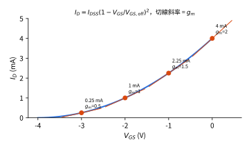
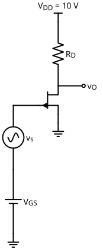
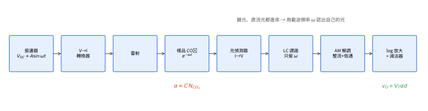

# 第 11 集 · Lec11：JFET 共源放大器（偏壓、$g_m$、增益）、紅外線 CO₂ 感測器 [▶ 影片](https://www.youtube.com/watch?v=WUZxJ5baFOg)

← 上一集：[10](10-jfet-pinch-off-saturation.md) ｜ [總目錄](../README.md) ｜ 下一集：[12](12-mosfet-structure-channel-iv.md) →

> **課程**：電子學（二），陽明交大 電子物理系，112 學年度 — 第 11 集
> **講者**：陳振芳 老師
> **來源**：YouTube 錄影逐字稿（1:25:11，whisper）
> **標記說明**：`【口頭】` 老師口頭補充；`[▶ mm:ss]` 影片時間點

---

## 目錄

- [0. 這堂課要做什麼](#0-這堂課要做什麼)
- [1. 轉移曲線](#1-轉移曲線)
- [2. 直流偏壓：四個例子](#2-直流偏壓四個例子)
- [3. 交流信號：轉導 $g_m$ 與增益](#3-交流信號轉導-g_m-與增益)
- [4. JFET 最大的特色：輸入不用直流偏壓](#4-jfet-最大的特色輸入不用直流偏壓)
- [5. 後級：擋直流、放大、推喇叭](#5-後級擋直流放大推喇叭)
- [6. 紅外線 CO₂ 感測器：物理](#6-紅外線-co₂-感測器物理)
- [7. 紅外線 CO₂ 感測器：電路](#7-紅外線-co₂-感測器電路)
- [8. 校正](#8-校正)
- [9. 一頁速查表](#9-一頁速查表)
- [10. 與後續集數的連結](#10-與後續集數的連結)

---

## 0. 這堂課要做什麼

1. JFET 當放大器：先做**直流偏壓**，再算**交流增益**。這個流程 MOSFET、BJT 完全一樣。
2. 第 3 章最後一個應用：用學過的電路兜出**紅外線 CO₂ 感測器**。

---

## 1. 轉移曲線

[▶ 00:00](https://youtu.be/WUZxJ5baFOg?t=0)

（複習上一集：$V_{GS} = 0, -1, -2, -3$ 各一條 $I_D$-$V_{DS}$ 曲線，$-4$ V 時夾斷；汲極端反向偏壓 $|V_{GS}| + V_{DS}$；夾止後多的電壓堆在汲極端，電流變平。）

只看平的放大區，把每條線的電流對 $V_{GS}$ 畫出來 → 一條二次曲線：[▶ 11:22](https://youtu.be/WUZxJ5baFOg?t=682)

$$
I_D = I_{DSS}\left(1 - \frac{V_{GS}}{V_{GS,\text{off}}}\right)^2
$$

$I_{DSS}$：$V_{GS} = 0$ 時的最大電流。例 $I_{DSS} = 4$ mA、$V_{GS,\text{off}} = -4$ V：[▶ 12:55](https://youtu.be/WUZxJ5baFOg?t=775)

| $V_{GS}$ | $1 - V_{GS}/V_{GS,\text{off}}$ | $I_D$ |
|---|---|---|
| 0 | 1 | 4 mA |
| −1 V | 3/4 | 9/4 mA |
| −2 V | 1/2 | 1 mA |
| −3 V | 1/4 | 1/4 mA |

---

## 2. 直流偏壓：四個例子

[▶ 15:05](https://youtu.be/WUZxJ5baFOg?t=905)

**共源放大器**：源極接地，汲極經 $R_D$ 接 $V_{DD} = 10$ V，閘極接偏壓 $V_{GS}$（加交流信號 $v_s$）。

$V_{DS} = V_{DD} - I_DR_D$，要落在平的區域（不要太靠近歐姆區）：

| $V_{GS}$ | $I_D$ | $R_D$ | $V_{DS}$ |
|---|---|---|---|
| 0 | 4 mA | 1 kΩ | 6 V |
| −1 V | 9/4 mA | 2 kΩ | 5.5 V |
| −2 V | 1 mA | 4 kΩ | 6 V |
| −3 V | 1/4 mA | 16 kΩ | 6 V |

$V_{GS} = 0$ 時閘極什麼都不用加，電流反而最大。[▶ 15:36](https://youtu.be/WUZxJ5baFOg?t=936)

這四個叫**直流偏壓**（DC bias）：先做直流。[▶ 18:46](https://youtu.be/WUZxJ5baFOg?t=1126)

---

## 3. 交流信號：轉導 $g_m$ 與增益

[▶ 19:17](https://youtu.be/WUZxJ5baFOg?t=1157)

電容式麥克風送進幾個 mV 的 $v_s$：$V_{GS} = -2 + v_s$，工作點 $Q$ 在曲線上上下下動 → 汲極有交流電流。

**轉導**（transconductance）：曲線在 $Q$ 點的斜率。電流除以電壓叫 conductance，所以叫轉導；放大不一定是電壓對電壓，四種都可以。[▶ 22:24](https://youtu.be/WUZxJ5baFOg?t=1344)

$$
g_m = \left.\frac{dI_D}{dV_{GS}}\right|_Q = \frac{2I_{DSS}}{|V_{GS,\text{off}}|}\left(1 - \frac{V_{GS}}{V_{GS,\text{off}}}\right)
= \frac{2}{|V_{GS,\text{off}}|}\sqrt{I_{DSS}\,I_D}
$$

（第二個形式把括號換成 $\sqrt{I_D/I_{DSS}}$，比較好算。）本例 $\frac{2}{4}\sqrt{4I_D} = \sqrt{I_D}$（mA/V）：[▶ 24:32](https://youtu.be/WUZxJ5baFOg?t=1472)

$$
i_d = g_m v_s,
\qquad
v_O = V_{DS} - g_mR_D\,v_s
$$

（交流電流流過 $R_D$ 多一個壓降；負號：$v_s$ 正半週時輸出往下。）[▶ 27:09](https://youtu.be/WUZxJ5baFOg?t=1629)

| $I_D$ | $g_m$ | $R_D$ | 增益 $g_mR_D$ |
|---|---|---|---|
| 4 mA | 2 mA/V | 1 kΩ | 2 |
| 9/4 mA | 3/2 mA/V | 2 kΩ | 3 |
| 1 mA | 1 mA/V | 4 kΩ | 4 |
| 1/4 mA | 1/2 mA/V | 16 kΩ | 8 |

[▶ 29:12](https://youtu.be/WUZxJ5baFOg?t=1752)

【口頭】先做直流、再做交流——所有放大器都這樣，MOS、BJT 完全一樣。$V_{DS}$ 上下動不影響電流，所以一定要操作在平的地方。[▶ 29:43](https://youtu.be/WUZxJ5baFOg?t=1783)

---

## 4. JFET 最大的特色：輸入不用直流偏壓

[▶ 30:45](https://youtu.be/WUZxJ5baFOg?t=1845)

$V_{GS} = -1, -2, -3$ 要有偏壓，不會另外買電池，一定是從 10 V 用 $R_1$、$R_2$ 分壓——但電源一定有**漣波**。

麥克風信號只有幾 mV，輸入端混進漣波，聲音就被埋在漣波裡，再放大也只是放大漣波。[▶ 31:47](https://youtu.be/WUZxJ5baFOg?t=1907)

JFET 可以操作在 **$V_{GS} = 0$**：閘極不需要任何電源，輸入端沒有漣波。增益雖然只有 2（因為電流大、$R_D$ 只能小），選 $I_{DSS}$ 小一點的就能大一點。MOS、BJT 輸入都要直流偏壓，所以麥克風裡用 JFET。[▶ 33:22](https://youtu.be/WUZxJ5baFOg?t=2002)

---

## 5. 後級：擋直流、放大、推喇叭

[▶ 34:22](https://youtu.be/WUZxJ5baFOg?t=2062)

- 輸出 $6 - 8v_s$：6 V 太大，直接放大 10 倍就 60 V，飽和。→ 先用**電容擋掉直流**；電容要夠大讓聲音頻率過得去。[▶ 34:54](https://youtu.be/WUZxJ5baFOg?t=2094)
- op amp 放大（一次不夠就兩次，增益太大頻寬會窄）。
- 推挽 BJT（加二極體）提供電流，輸出再串電容擋直流，送喇叭。[▶ 36:56](https://youtu.be/WUZxJ5baFOg?t=2216)
- 大電流其實是 ±10 V 電源提供；這裡電源漣波沒關係，只要不大到 BJT 不能工作。BJT 要好散熱的大金屬包裝。[▶ 38:31](https://youtu.be/WUZxJ5baFOg?t=2311)

---

## 6. 紅外線 CO₂ 感測器：物理

[▶ 39:32](https://youtu.be/WUZxJ5baFOg?t=2372)

樣品室讓空氣進出，用**紅外線**（infrared）打過去——CO₂ 很會吸收紅外線，吸收多少就知道濃度。

**通量**（flux）$\phi$：每單位面積、每單位時間通過的光子數。[▶ 40:32](https://youtu.be/WUZxJ5baFOg?t=2432)

**$\phi = nv$** [▶ 45:17](https://youtu.be/WUZxJ5baFOg?t=2717)：一段長 $L$、截面 $A$ 的柱子裡有 $nLA$ 個光子（$n$ 是光子濃度），最遠的一顆跑完要 $L/v$：

$$
\phi = \frac{nLA}{A\cdot L/v} = nv
$$

不管什麼粒子都一樣：通量 = 濃度 × 速度。

**連續方程** [▶ 48:26](https://youtu.be/WUZxJ5baFOg?t=2906)：取一小塊 $A\,dx$。進來減出去 = 裡面被 CO₂ 吃掉的（每秒進 100 個、出 95 個，5 個被吃掉）：

$$
\left[\phi(x) - \phi(x + dx)\right]A = \frac{n\,A\,dx}{\tau}
$$

$\tau$ 是光子的**生命期**（lifetime）——CO₂ 越濃，$\tau$ 越短：$\tau \propto 1/N_{CO_2}$。[▶ 51:34](https://youtu.be/WUZxJ5baFOg?t=3094)

展開 $\phi(x + dx) = \phi(x) + \frac{d\phi}{dx}dx$，再用 $n = \phi/v$：[▶ 52:34](https://youtu.be/WUZxJ5baFOg?t=3154)

$$
\frac{d\phi}{dx} = -\frac{\phi}{\tau v}
\quad\Longrightarrow\quad
\phi(x) = \phi_0e^{-\alpha x},
\qquad
\alpha = \frac{1}{\tau v}
$$

$\alpha$ 叫**吸收係數**（absorption coefficient）。因為 $\tau \propto 1/N_{CO_2}$：[▶ 57:43](https://youtu.be/WUZxJ5baFOg?t=3463)

$$
\alpha = C\,N_{CO_2}
$$

樣品長 $d$：出來的光 $= \phi_0e^{-\alpha d}$。找出 $\alpha$ 就知道濃度。

【口頭】這和半導體裡少數載子的連續方程一模一樣。[▶ 53:05](https://youtu.be/WUZxJ5baFOg?t=3185)

> ⚠️ 逐字稿缺字：whisper 寫「assumption coefficient」，應是 absorption coefficient。

---

## 7. 紅外線 CO₂ 感測器：電路

**為什麼要調變** [▶ 43:11](https://youtu.be/WUZxJ5baFOg?t=2591)：感測器擋不住其他光（做到只收雷射光成本太高），所有光都進來。→ 給雷射光一個**身份**：用載波頻率（例 10 kHz）調變，接收端只抓那個頻率。和 AM 同一招。

1. **雷射驅動**（V→I 轉換器）[▶ 59:17](https://youtu.be/WUZxJ5baFOg?t=3557)：雷射光子數和**電流**成正比，但調變都用電壓 → 用 op amp 的 V→I 轉換器（電子學（一））。輸入 $V_{DC} + A\sin\omega t$，電流 $= (V_{DC} + A\sin\omega t)/R$。
   - **一定要有直流** [▶ 1:01:56](https://youtu.be/WUZxJ5baFOg?t=3716)：雷射是二極體，工作點在 0 的話交流加不進去（負半週沒電流）。要把工作點 $Q$ 拉到導通區，交流才能在上面上下。
   - 光 = 效率 × 電流 → 直流項 + $\phi_0\sin\omega t$。
2. 穿過樣品：乘 $e^{-\alpha d}$。
3. **光偵測器 + I→V 轉換器**（transimpedance）：光電流轉電壓。進來的有直流光、雜光、我們的光。[▶ 1:05:01](https://youtu.be/WUZxJ5baFOg?t=3901)
4. **並聯 LC 調諧**在 $\omega_0 = 1/\sqrt{LC} = \omega$：共振時並聯阻抗無窮大、輸出 = 輸入，其他頻率被電感（低頻）或電容（高頻）短路 → 只剩 $A'e^{-\alpha d}\sin\omega t$。[▶ 1:07:36](https://youtu.be/WUZxJ5baFOg?t=4056)
5. **AM 解調**：整流 → follower → 低通 → $\dfrac{A'}{\pi}e^{-\alpha d}$。[▶ 1:12:18](https://youtu.be/WUZxJ5baFOg?t=4338)
6. **log 放大器**（二極體在回授）[▶ 1:13:51](https://youtu.be/WUZxJ5baFOg?t=4431)：$v = -V_T\ln\dfrac{v_{in}}{RI_s}$。代入 $v_{in} = Ke^{-\alpha d}$：

$$
v = -V_T\ln\frac{K}{RI_s} + V_T\,\alpha d
$$

log 和 exp 消掉，$\alpha$ 跑下來變成線性項。前面一堆參數（效率、$R$、$I_s$……）全併成常數 $K$。[▶ 1:18:06](https://youtu.be/WUZxJ5baFOg?t=4686)

7. **減法器**：和參考電壓 $V_R$ 相減，增益 $R_2/R_1$：[▶ 1:19:06](https://youtu.be/WUZxJ5baFOg?t=4746)

$$
v_O = \frac{R_2}{R_1}\left(V_T\alpha d - V_T\ln\frac{K}{RI_s} - V_R\right)
$$

---

## 8. 校正

[▶ 1:20:40](https://youtu.be/WUZxJ5baFOg?t=4840)

參數太多、不用知道，靠**校正**（calibration）：

1. 放一個**確定沒有 CO₂** 的樣品（$\alpha = 0$）→ 調 $V_R$（可正可負）讓 $v_O = 0$，常數項抵消。[▶ 1:21:10](https://youtu.be/WUZxJ5baFOg?t=4870)
2. 放一個**已知濃度**的樣品 → 調 $R_2/R_1$ 讓 $v_O$ 等於那個濃度值。[▶ 1:22:11](https://youtu.be/WUZxJ5baFOg?t=4931)

之後 $v_O \propto \alpha \propto N_{CO_2}$，放樣品進來就讀出濃度。這就是產品。

---

## 9. 一頁速查表

| 項目 | 公式／重點 | 關鍵 |
|---|---|---|
| 轉移曲線 | $I_D = I_{DSS}(1 - V_{GS}/V_{GS,\text{off}})^2$ | 放大區 |
| 直流偏壓 | $V_{DS} = V_{DD} - I_DR_D$ | 要在平的區域 |
| 轉導 | $g_m = \frac{2}{\lvert V_{GS,\text{off}}\rvert }\sqrt{I_{DSS}I_D}$ | 對 $V_{GS}$ 微分 |
| 增益 | $v_o = -g_mR_Dv_s$ | 例 2、3、4、8 倍 |
| JFET 特色 | $V_{GS} = 0$ 就能放大 | 輸入沒有電源漣波 |
| 通量 | $\phi = nv$ | |
| 吸收 | $\phi = \phi_0e^{-\alpha x}$，$\alpha = 1/(\tau v) = CN_{CO_2}$ | 連續方程 |
| 調變 | 載波 + 直流偏壓 | 雷射要直流才加得進交流 |
| log 放大 | $-V_T\ln(Ke^{-\alpha d}/RI_s)$ → $V_T\alpha d$ + 常數 | 線性化 |
| 校正 | 零濃度調 $V_R$；已知濃度調 $R_2/R_1$ | |

---

## 10. 與後續集數的連結

| 本集觀念 | 後面在哪裡用到 |
|---|---|
| 先直流偏壓、再小信號 $g_m$ | 下一集起第 4 章 MOSFET 放大器 |
| 共源放大器增益 $-g_mR_D$ | MOSFET 共源放大器 |
| 連續方程 | 半導體元件物理 |

---

## 附：本集一句話總結

> **JFET 放大區的電流 $I_D = I_{DSS}(1 - V_{GS}/V_{GS,\text{off}})^2$；先選 $V_{GS}$、$R_D$ 做直流偏壓，再用 $g_m = dI_D/dV_{GS}$ 算出增益 $-g_mR_D$，而且 $V_{GS} = 0$ 就能放大、輸入不必接有漣波的電源。CO₂ 感測器則是 $\phi = \phi_0e^{-\alpha d}$、$\alpha \propto N_{CO_2}$，配上調變、V→I、I→V、LC 調諧、AM 解調、log 放大與減法器，最後靠兩點校正讀出濃度。**

---

*筆記依據陳振芳老師「電子學（二）」112 學年度 Lec11 錄影逐字稿（whisper，1:25:11）整理。*
