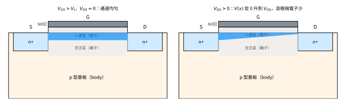
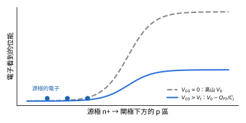

# 第 12 集 · Lec12：MOSFET 的結構、通道怎麼形成、電流公式推導 [▶ 影片](https://www.youtube.com/watch?v=jN8nku7TcuQ)

← 上一集：[11](11-jfet-amplifier-co2-sensor.md) ｜ [總目錄](../README.md) ｜ 下一集：[13](13-mosfet-threshold-triode-saturation.md) →

> **課程**：電子學（二），陽明交大 電子物理系，112 學年度 — 第 12 集
> **講者**：陳振芳 老師
> **來源**：YouTube 錄影逐字稿（48:27，whisper）＋ Sedra & Smith《Microelectronic Circuits》7th ed. §5.1
> **標記說明**：`【口頭】` 老師口頭補充；`【課本補充】` 課本有、課堂沒講；`⚠️ 逐字稿缺字` whisper 聽錯，已修正；`[▶ mm:ss]` 影片時間點

---

## 目錄

- [0. 這堂課要做什麼](#0-這堂課要做什麼)
- [1. 結構](#1-結構)
- [2. 複習：PN 接面的位能山](#2-複習pn-接面的位能山)
- [3. 背對背的二極體：不加閘極沒有電流](#3-背對背的二極體不加閘極沒有電流)
- [4. 閘極電荷分兩群：$Q_{P1}$ 和 $Q_{P2}$](#4-閘極電荷分兩群q_p1-和-q_p2)
- [5. 臨界電壓 $V_t$](#5-臨界電壓-v_t)
- [6. 推導 $I_D$](#6-推導-i_d)
- [7. 一頁速查表](#7-一頁速查表)
- [8. 與後續集數的連結](#8-與後續集數的連結)

---

## 0. 這堂課要做什麼

進入第 4 章 **MOSFET**（metal-oxide-semiconductor field-effect transistor，金屬氧化物半導體場效電晶體），先講最重要的 **n 通道增強型**：

1. 結構。
2. 閘極電壓怎麼讓電子通道出現（老師用「降低源極 PN 接面的位能山」來解釋）。
3. 從平行板電容推出電流公式。

---

## 1. 結構

[▶ 00:32](https://youtu.be/jN8nku7TcuQ?t=32)

1. 一塊 **P 型基板**（substrate / body，底座），有一隻腳。
2. 表面氧化、開窗，擴散兩塊 **$N^+$**：**源極**（source, S）和**汲極**（drain, D）。濃度比 P 高。[▶ 01:02](https://youtu.be/jN8nku7TcuQ?t=62)
3. 中間長一層**氧化層**（SiO₂），上面鍍金屬當**閘極**（gate, G）。

$N^+$ 和 P 之間各是一個 PN 接面——整個關鍵就在這裡。

---

## 2. 複習：PN 接面的位能山

[▶ 02:34](https://youtu.be/jN8nku7TcuQ?t=154)

- N 側很多自由電子、P 側很多電洞 → 擴散 → 結合後一起消失 → 留下離子，形成空乏區和電場，和擴散平衡（steady state）。
- 電場積分 = 電位：對電洞是一座高 $V_0$ 的山（約 0.7 V，$n_i = 10^{10}$）；對電子也是一座山，方向相反。這叫**位能障**（potential barrier）。[▶ 06:10](https://youtu.be/jN8nku7TcuQ?t=370)
- **正向偏壓**：送進來的正、負電荷和空乏區邊緣的離子中和 → 空乏區變窄 → 電荷、電場、電位都變小 → 山變成 $V_0 - V_F$ → 電子開始跑過去。[▶ 07:44](https://youtu.be/jN8nku7TcuQ?t=464)

---

## 3. 背對背的二極體：不加閘極沒有電流

[▶ 12:21](https://youtu.be/jN8nku7TcuQ?t=741)

S、D、body 都接地。源極—基板、基板—汲極是**兩顆背對背的二極體**，加 $V_{DS}$ 一定有一顆反向 → 沒有電流。

要讓源極的電子過來，就要讓源極那邊的山變小（等於加正向偏壓）。但這是**平面結構**（planar），電壓只能從上面加。上面加了又不能讓電流從閘極流下去 → 中間放**氧化層**擋住，上面才是閘極。[▶ 13:24](https://youtu.be/jN8nku7TcuQ?t=804)

---

## 4. 閘極電荷分兩群：$Q_{P1}$ 和 $Q_{P2}$

[▶ 14:27](https://youtu.be/jN8nku7TcuQ?t=867)

閘極加正電壓 $V_{GS}$ → 氧化層下送來一堆正電荷 $Q_P$（被氧化層擋住）。P 型裡的電洞被排斥，往兩個方向跑：

- **$Q_{P1}$：往下跑**。表面的電洞跑掉，留下帶負電的受體離子（空乏）。底下是中性的，跑多少就要留多少。[▶ 16:31](https://youtu.be/jN8nku7TcuQ?t=991)
- **$Q_{P2}$：往旁邊跑**，跑到源極 PN 接面的空乏區，和那裡的離子中和 → 空乏區變窄——**等效上就是對源極接面加了正向偏壓**。[▶ 18:35](https://youtu.be/jN8nku7TcuQ?t=1115)

$$
Q_P = Q_{P1} + Q_{P2}
$$

PN 接面兩邊有正負電荷，就是一個**平行板電容** $C_j$。$Q_{P2}$ 讓山變矮：[▶ 25:53](https://youtu.be/jN8nku7TcuQ?t=1553)

$$
V_0 \;\to\; V_0 - \frac{Q_{P2}}{C_j}
$$

山變矮 → 源極的電子可以過來 → 在表面形成一層 **n 型通道**（N-type channel）。汲極那邊一樣。[▶ 27:58](https://youtu.be/jN8nku7TcuQ?t=1678)

過來的電子不會被 P 吃掉：閘極下面這一塊是空乏區，**沒有自由電洞**，電洞在更下面。[▶ 31:06](https://youtu.be/jN8nku7TcuQ?t=1866)

> 【課本補充】§5.1.3 (p. 250) 的說法是：閘極的正電荷把表面電洞推走、形成空乏區，再把電子（從 $n^+$ 源極、汲極來）吸引到表面，形成**反轉層**（inversion layer）——表面從 P 型「反轉」成 N 型。老師用源極接面位能山降低來描述電子怎麼進來，兩種說法是同一件事的兩個角度。

---

## 5. 臨界電壓 $V_t$

[▶ 29:32](https://youtu.be/jN8nku7TcuQ?t=1772)

$V_{GS}$ 只有一部分用來降山，要加到某個值以上通道才形成——就像二極體要 0.6、0.7 V 才真的有電流。這個值叫**臨界電壓**（threshold voltage）$V_t$：

$$
n \propto V_{GS} - V_t,
\qquad
V_{GS} > V_t\ \text{才有通道}
$$

$V_t$ 和氧化層厚度、摻雜濃度有關，很複雜；我們只拿來用。[▶ 30:36](https://youtu.be/jN8nku7TcuQ?t=1836)

> ⚠️ 逐字稿缺字：whisper 寫「stretch hold」「水球」「所謂」，都是 threshold（臨界）。

---

## 6. 推導 $I_D$

### 6.1 通道電荷：平行板電容

[▶ 32:14](https://youtu.be/jN8nku7TcuQ?t=1934)

通道長 $L$（$x = 0$ 在源極、$x = L$ 在汲極）、寬 $W$。閘極金屬是**等電位**，處處 $V_{GS}$。通道電位 $V(x)$ 從源極 0 升到汲極 $V_{DS}$。[▶ 34:52](https://youtu.be/jN8nku7TcuQ?t=2092)

所以氧化層兩邊的電位差**不均勻**：源極端 $V_{GS}$、汲極端 $V_{GS} - V_{DS}$ → 電子濃度源極端多、汲極端少。（電子其實都在表面，圖上用深度 $k$ 表示濃度只是畫法。）[▶ 36:57](https://youtu.be/jN8nku7TcuQ?t=2217)

取一小段 $dx$。單位面積的氧化層電容：

$$
C_{ox} = \frac{\varepsilon_{ox}}{t_{ox}}
$$

電容 × 電位差 = 電荷（電位差要先扣掉 $V_t$）：[▶ 39:34](https://youtu.be/jN8nku7TcuQ?t=2374)

$$
C_{ox}\,W\,dx\,\left[V_{GS} - V_t - V(x)\right] = q\,n\,(k\,W\,dx)
$$

### 6.2 電流：漂移

[▶ 41:08](https://youtu.be/jN8nku7TcuQ?t=2468)

靠外加電場推，漂移電流遠大於擴散，擴散不管。電流密度 × 橫截面 $kW$（負號只代表方向，拿掉）：

$$
I_D = q\,n\,\mu_n\,\frac{dV}{dx}\,kW
$$

把 6.1 的 $qnk = C_{ox}(V_{GS} - V_t - V)$ 代進來：[▶ 43:47](https://youtu.be/jN8nku7TcuQ?t=2627)

$$
I_D\,dx = \mu_nC_{ox}W\left(V_{GS} - V_t - V\right)dV
$$

### 6.3 積分

[▶ 44:17](https://youtu.be/jN8nku7TcuQ?t=2657)

穩態時電流處處一樣（不然會累積電荷），$I_D$ 和 $x$ 無關，可以拿出來。$x$ 從 0 積到 $L$，$V$ 從 0 積到 $V_{DS}$：

$$
I_D\,L = \mu_nC_{ox}W\left[(V_{GS} - V_t)V_{DS} - \frac12V_{DS}^2\right]
$$

$$
\boxed{\,I_D = \mu_nC_{ox}\frac{W}{L}\left[(V_{GS} - V_t)V_{DS} - \frac12V_{DS}^2\right]\,}
$$

[▶ 45:49](https://youtu.be/jN8nku7TcuQ?t=2749)

老師把 $\mu C W/L$ 記成一個參數 $k$（單位 mA/V²）：$\mu$、$C_{ox}$ 是製程給的，$W$、$L$ 是你自己畫佈局（layout）決定的。[▶ 46:19](https://youtu.be/jN8nku7TcuQ?t=2779)

【口頭】這個式子和 JFET 的長得一模一樣——都是通道往汲極越來越窄。[▶ 47:54](https://youtu.be/jN8nku7TcuQ?t=2874)

> 【課本補充】§5.1.5 (p. 256) 式 (5.14)：$i_D = k_n'\dfrac{W}{L}\left[(v_{GS} - V_t)v_{DS} - \frac12v_{DS}^2\right]$，$k_n' = \mu_nC_{ox}$ 叫**製程跨導參數**（process transconductance parameter），$k_n = k_n'(W/L)$。課本把 $V_{GS} - V_t$ 叫**過驅電壓**（overdrive voltage）$V_{OV}$。

---

## 7. 一頁速查表

| 項目 | 公式／重點 | 關鍵 |
|---|---|---|
| 結構 | P 基板 + 兩塊 $N^+$（S、D）+ SiO₂ + 閘極金屬 | 背對背二極體 |
| 閘極電荷 | $Q_P = Q_{P1}$（往下，空乏）$+ Q_{P2}$（往旁，降山） | |
| 降山 | $V_0 \to V_0 - Q_{P2}/C_j$ | 等效正向偏壓 |
| 臨界電壓 | $V_{GS} > V_t$ 才有通道，$n \propto V_{GS} - V_t$ | |
| 氧化層電容 | $C_{ox} = \varepsilon_{ox}/t_{ox}$（單位面積） | |
| 通道電荷 | $C_{ox}W\,dx\,(V_{GS} - V_t - V(x))$ | 汲極端少 |
| 電流 | $I_D = \mu_nC_{ox}\frac{W}{L}\left[(V_{GS}-V_t)V_{DS} - \frac12V_{DS}^2\right]$ | $I_D$ 與 $x$ 無關，積分 |

---

## 8. 與後續集數的連結

| 本集觀念 | 後面在哪裡用到 |
|---|---|
| 電流公式 | 下一集：特性曲線、夾止、飽和區 $I_D = \frac12k(V_{GS}-V_t)^2$ |
| 通道往汲極變窄 | 和 JFET 夾止同一件事 |
| $V_t$、$C_{ox}$ | 偏壓設計、通道長度調變 |

---

## 附：本集一句話總結

> **NMOS 是 P 基板上兩塊 $N^+$ 加氧化層和閘極；閘極正電荷一部分往下空乏表面、一部分降低源極接面的位能山，$V_{GS} > V_t$ 時源極電子進來形成通道。通道電荷由平行板電容 $C_{ox}(V_{GS} - V_t - V(x))$ 給出，代入漂移電流並沿通道積分，得到 $I_D = \mu_nC_{ox}\frac{W}{L}\left[(V_{GS}-V_t)V_{DS} - \frac12V_{DS}^2\right]$。**

---

*筆記依據陳振芳老師「電子學（二）」112 學年度 Lec12 錄影逐字稿（whisper，48:27）與 Sedra & Smith《Microelectronic Circuits》7th ed. 整理。*
