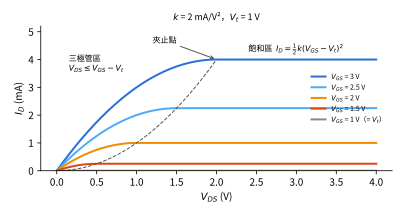
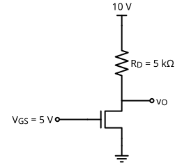

# 第 13 集 · Lec13：臨界電壓再講清楚、三極管區與飽和區、第一個 MOS 電路題 [▶ 影片](https://www.youtube.com/watch?v=DrotA7S31JY)

← 上一集：[12](12-mosfet-structure-channel-iv.md) ｜ [總目錄](../README.md) ｜ 下一集：[14](14-mosfet-load-line-vtc.md) →

> **課程**：電子學（二），陽明交大 電子物理系，112 學年度 — 第 13 集
> **講者**：陳振芳 老師
> **來源**：YouTube 錄影逐字稿（1:13:28，whisper）＋ Sedra & Smith《Microelectronic Circuits》7th ed. §5.1–5.3
> **標記說明**：`【口頭】` 老師口頭補充；`【課本補充】` 課本有、課堂沒講；`[▶ mm:ss]` 影片時間點

---

## 目錄

- [0. 這堂課要做什麼](#0-這堂課要做什麼)
- [1. 臨界電壓：電子「才開始」進來](#1-臨界電壓電子才開始進來)
- [2. 扣掉 $V_t$：只剩電子的平行板電容](#2-扣掉-v_t只剩電子的平行板電容)
- [3. $V_{DS}$ 很小：均勻通道，不用積分](#3-v_ds-很小均勻通道不用積分)
- [4. $V_{DS}$ 變大：積分（複習）](#4-v_ds-變大積分複習)
- [5. 夾止與飽和](#5-夾止與飽和)
- [6. 兩個區域整理](#6-兩個區域整理)
- [7. 電路符號](#7-電路符號)
- [8. 例題：猜飽和、猜錯了](#8-例題猜飽和猜錯了)
- [9. 一頁速查表](#9-一頁速查表)
- [10. 與後續集數的連結](#10-與後續集數的連結)

---

## 0. 這堂課要做什麼

上週太匆忙，這次把**臨界電壓**講清楚，再把電流公式在三極管區、飽和區整理好，做第一個 MOS 直流電路題。

---

## 1. 臨界電壓：電子「才開始」進來

[▶ 00:31](https://youtu.be/DrotA7S31JY?t=31)

**PN 接面就是一個電容** [▶ 02:05](https://youtu.be/DrotA7S31JY?t=125)：空乏區兩邊 $+Q$、$-Q$。高斯定律 $\varepsilon EA = Q$ → $E = Q/(\varepsilon A)$；電位 $V_0 = Ed$：

$$
V_0 = \frac{Q}{\varepsilon A/d} = \frac{Q}{C_j},
\qquad
C_j = \frac{\varepsilon A}{d}
$$

【口頭】電容沒什麼：高斯定律得電場、電場乘距離得電位，電位和電荷的比值就是電容。[▶ 04:37](https://youtu.be/DrotA7S31JY?t=277)

閘極加 $V_{GS}$，正電荷 $Q_P$ 停在氧化層下；電洞一部分往下（$Q_{P1}$）、一部分往旁邊（$Q_{P2}$）。$Q_{P2}$ 到源極接面，造成和內建電場**相反**的電場 → 接面總電荷減少：[▶ 08:44](https://youtu.be/DrotA7S31JY?t=524)

$$
V_0 \;\to\; \frac{Q - Q_{P2}}{C_j} = V_0 - \frac{Q_{P2}}{C_j}
$$

$Q_{P2}/C_j$ 大到接近 $V_0$ → 擋電子的山沒了。[▶ 11:50](https://youtu.be/DrotA7S31JY?t=710)

**定義**：這時的 $V_{GS}$ 叫**臨界電壓** $V_t$——$N^+$ 的電子**開始**（begins）進到 P 區。注意是「才剛開始」，這時還沒有像樣的通道。（$V_t$ 的公式在半導體元件物理會詳細導，這裡不導。）[▶ 13:25](https://youtu.be/DrotA7S31JY?t=805)

$V_{GS}$ 再加大，**比 $V_t$ 多出來的部分全部用來形成通道**——一個像樣的（considerable）n 通道。底下的離子不再變。[▶ 17:10](https://youtu.be/DrotA7S31JY?t=1030)

---

## 2. 扣掉 $V_t$：只剩電子的平行板電容

[▶ 20:47](https://youtu.be/DrotA7S31JY?t=1247)

$V_t$ 這一部分對應底下那一團**離子**（$Q_{P1}$ 空乏出來的），和導電無關。所以：

$$
V_{GS} = \underbrace{V_t}_{\text{離子}} + \underbrace{(V_{GS} - V_t)}_{\text{通道電子}}
$$

例 $V_{GS} = 3$ V、$V_t = 1$ V → 2 V 用來調變電子。把離子和 $V_t$ 一起扣掉，氧化層電容兩邊就只剩閘極電荷和**通道電子**——這就是上一集推電流時「底下明明有離子，為什麼沒寫」的原因。[▶ 22:26](https://youtu.be/DrotA7S31JY?t=1346)

---

## 3. $V_{DS}$ 很小：均勻通道，不用積分

[▶ 25:04](https://youtu.be/DrotA7S31JY?t=1504)

閘極金屬等電位 $V_{GS} - V_t$（扣掉後）。源極端電位差 $V_{GS} - V_t$，汲極端 $V_{GS} - V_t - V_{DS}$。

$V_{DS} \ll V_{GS} - V_t$ → 兩端一樣 → 電子濃度**均勻**（uniform n channel）。整片平行板：[▶ 28:41](https://youtu.be/DrotA7S31JY?t=1721)

$$
C_{ox}\,WL\,(V_{GS} - V_t) = q\,n\,(kWL)
$$

電場均勻 $= V_{DS}/L$，漂移電流：[▶ 30:46](https://youtu.be/DrotA7S31JY?t=1846)

$$
I_D = q\,n\,\mu_n\frac{V_{DS}}{L}\,kW
= \mu_nC_{ox}\frac{W}{L}(V_{GS} - V_t)\,V_{DS}
$$

不用積分。$C_{ox} = \varepsilon_{ox}/t_{ox}$ 由氧化層厚度決定；$W$、$L$ 做 IC 設計時自己畫（layout）。[▶ 32:50](https://youtu.be/DrotA7S31JY?t=1970)

---

## 4. $V_{DS}$ 變大：積分（複習）

[▶ 33:54](https://youtu.be/DrotA7S31JY?t=2034)

通道不再均勻，取一小段 $dx$，電位 $V(x)$ 從 0 到 $V_{DS}$（上一集的推導）：

$$
I_D = k\left[(V_{GS} - V_t)V_{DS} - \frac12V_{DS}^2\right],
\qquad
k = \mu_nC_{ox}\frac{W}{L}
$$

和第 3 節比，多了 $-\frac12V_{DS}^2$——就是通道往汲極變窄造成的。$V_{DS}$ 小時這項可忽略，兩式一致。[▶ 43:05](https://youtu.be/DrotA7S31JY?t=2585)

---

## 5. 夾止與飽和

[▶ 44:06](https://youtu.be/DrotA7S31JY?t=2646)

- 一開始 $V_{DS}$ 小：斜率 $k(V_{GS} - V_t)$——$V_{GS}$ 越大，通道越濃，越陡。
- 慢慢彎下來，到斜率 0 的點：[▶ 45:08](https://youtu.be/DrotA7S31JY?t=2708)

$$
\frac{dI_D}{dV_{DS}} = k\left[(V_{GS} - V_t) - V_{DS}\right] = 0
\quad\Longrightarrow\quad
V_{DS} = V_{GS} - V_t
$$

代回汲極端電位差 $V_{GS} - V_t - V_{DS} = 0$ → 汲極端電子濃度 0 → **夾止**（pinch-off）。[▶ 47:14](https://youtu.be/DrotA7S31JY?t=2834)

之後再加的 $V_{DS}$ 都進不去通道，堆在汲極端（電場很大，太大會崩潰）。電流不會往下掉（掉下來通道又會出現），也不會再升 → **平的**。和 JFET 完全一樣。[▶ 48:47](https://youtu.be/DrotA7S31JY?t=2927)

$V_{GS} = V_t$ 的曲線貼在地上：通道「才開始」，等於沒有。[▶ 52:20](https://youtu.be/DrotA7S31JY?t=3140)

---

## 6. 兩個區域整理

[▶ 59:28](https://youtu.be/DrotA7S31JY?t=3568)

**三極管區**（triode region，曲線往上那段）：

$$
I_D = k\left[(V_{GS} - V_t)V_{DS} - \frac12V_{DS}^2\right],
\qquad
V_{DS} \le V_{GS} - V_t
$$

$V_{DS}$ 很小時是直線 → MOS 不再是放大器，而是一顆**電阻**：[▶ 54:23](https://youtu.be/DrotA7S31JY?t=3263)

$$
R_{DS} = \frac{1}{k(V_{GS} - V_t)}
$$

**飽和區**（saturation region，平的那段，**放大用**）：把 $V_{DS} = V_{GS} - V_t$ 代進去，之後都不變：[▶ 1:00:31](https://youtu.be/DrotA7S31JY?t=3631)

$$
I_D = \frac12k(V_{GS} - V_t)^2,
\qquad
V_{DS} \ge V_{GS} - V_t
$$

和 $V_{DS}$ 無關。【口頭】三極管區的式子可以不用背，飽和區放大一定要記得。輸出電流和輸入電壓是二次方關係（JFET 也一樣）。[▶ 1:03:07](https://youtu.be/DrotA7S31JY?t=3787)

**好記的判斷法** [▶ 1:04:10](https://youtu.be/DrotA7S31JY?t=3850)：$V_{DS} \ge V_{GS} - V_t$ ⇔ $V_D - V_S \ge V_G - V_S - V_t$ ⇔

$$
V_D \ge V_G - V_t
$$

把閘極電壓減 $V_t$ 畫過去，看汲極有沒有比它高。有 → 飽和；沒有 → 回三極管區。

> 【課本補充】Sedra 把 $V_{GS} - V_t$ 叫 $V_{OV}$（過驅電壓），飽和區 $i_D = \frac12k_n'\frac{W}{L}V_{OV}^2$（式 5.21 附近）。老師的 $k$ 已經包含 $W/L$。

---

## 7. 電路符號

[▶ 55:57](https://youtu.be/DrotA7S31JY?t=3357)

- 閘極畫成一條和通道隔開的線——看起來就像氧化層平行板。**閘極沒有電流**。
- 箭頭畫在**源極**上，代表電流方向；不要畫在汲極。[▶ 56:58](https://youtu.be/DrotA7S31JY?t=3418)
- n 通道：載子是電子，**從 S 出發到 D**（S = source，載子的來源）；電流方向和載子相反，從 D 流到 S。
- 標 $V_{GS}$、$V_{DS}$、$I_D$。

---

## 8. 例題：猜飽和、猜錯了

[▶ 1:06:16](https://youtu.be/DrotA7S31JY?t=3976)

源極接地，汲極經 $R_D = 5$ kΩ 接 10 V，閘極接 5 V。$k = 2$ mA/V²、$V_t = 1$ V。

**猜飽和** [▶ 1:07:49](https://youtu.be/DrotA7S31JY?t=4069)：

$$
I_D = \frac12\cdot2\cdot(5 - 1)^2 = 16\ \text{mA},
\qquad
V_D = 10 - 16\times5 = -70\ \text{V}
$$

檢查：$V_G - V_t = 4$ V，$V_D = -70$ V 沒有比它高 → **猜錯**。而且汲極最低就是 0（地）、最高 10 V，不可能 −70 V。答案不能寫 16 mA 或 −70 V。[▶ 1:09:24](https://youtu.be/DrotA7S31JY?t=4164)

**改猜三極管區** [▶ 1:10:29](https://youtu.be/DrotA7S31JY?t=4229)：二次項麻煩，先忽略，MOS 就是電阻：

$$
R_{DS} = \frac{1}{2\times(5 - 1)} = \frac18\ \text{k}\Omega
$$

$$
v_O = 10\times\frac{1/8}{5 + 1/8} \approx 0.25\ \text{V}
$$

檢查忽略合不合理：$V_{DS} = 0.25 \ll V_{GS} - V_t = 4$ ✓（也確實在三極管區）。[▶ 1:12:05](https://youtu.be/DrotA7S31JY?t=4325)

以下**不是逐字稿內容**，是依三極管區完整公式驗算的：$I_D = 2(4v_O - v_O^2/2)$、$v_O = 10 - 5I_D$ → $5v_O^2 - 41v_O + 10 = 0$ → $v_O \approx 0.252$ V，$I_D \approx 1.95$ mA。和近似值幾乎一樣。

> 【課本補充】§5.3 (p. 276) 的例題都是同樣流程：假設一個區域 → 算 → 檢查條件 → 不對就換另一個區域。

---

## 9. 一頁速查表

| 項目 | 公式／重點 | 關鍵 |
|---|---|---|
| 接面電容 | $C_j = \varepsilon A/d$，$V_0 = Q/C_j$ | 高斯定律 |
| 臨界電壓 | 山被 $Q_{P2}/C_j$ 削平，電子才開始進來 | 多出來的 $V_{GS} - V_t$ 才形成通道 |
| 小 $V_{DS}$ | $I_D = k(V_{GS}-V_t)V_{DS}$ | 均勻通道 |
| 三極管區 | $I_D = k[(V_{GS}-V_t)V_{DS} - \frac12V_{DS}^2]$，$V_{DS} \le V_{GS}-V_t$ | 小 $V_{DS}$ → $R_{DS} = 1/k(V_{GS}-V_t)$ |
| 夾止 | $dI_D/dV_{DS} = 0$ → $V_{DS} = V_{GS}-V_t$ | 汲極端濃度 0 |
| 飽和區 | $I_D = \frac12k(V_{GS}-V_t)^2$，$V_{DS} \ge V_{GS}-V_t$ | 放大用 |
| 判斷 | $V_D \ge V_G - V_t$ → 飽和 | |
| $k$ | $\mu_nC_{ox}W/L$（mA/V²） | |
| 解題 | 猜飽和 → 驗證 → 錯就猜三極管 | |

---

## 10. 與後續集數的連結

| 本集觀念 | 後面在哪裡用到 |
|---|---|
| 飽和區公式 | 下一集起：偏壓設計、小信號 $g_m$ |
| 猜區域再驗證 | 所有 MOS 直流分析 |
| $R_{DS}$ | MOS 當開關、數位反相器 |

---

## 附：本集一句話總結

> **$V_t$ 是源極接面的山被閘極電荷削平、電子剛開始進來的電壓，多出來的 $V_{GS} - V_t$ 才形成通道；$V_{DS}$ 小時通道均勻、$I_D = k(V_{GS}-V_t)V_{DS}$，變大後要積分，到 $V_{DS} = V_{GS} - V_t$ 汲極端夾止，之後飽和 $I_D = \frac12k(V_{GS}-V_t)^2$；解題先猜飽和，用 $V_D \ge V_G - V_t$ 檢查，錯了就改三極管區。**

---

*筆記依據陳振芳老師「電子學（二）」112 學年度 Lec13 錄影逐字稿（whisper，1:13:28）與 Sedra & Smith《Microelectronic Circuits》7th ed. 整理。*
