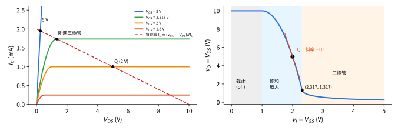

# 第 14 集 · Lec14：MOS 電路——什麼時候在飽和、負載線、轉移特性與增益 [▶ 影片](https://www.youtube.com/watch?v=lNsKqN4uVqI)

← 上一集：[13](13-mosfet-threshold-triode-saturation.md) ｜ [總目錄](../README.md) ｜ 下一集：[15](15-mosfet-small-signal-bias-coupling-cap.md) →

> **課程**：電子學（二），陽明交大 電子物理系，112 學年度 — 第 14 集
> **講者**：陳振芳 老師
> **來源**：YouTube 錄影逐字稿（46:21，whisper）＋ Sedra & Smith《Microelectronic Circuits》7th ed.
> **標記說明**：`【口頭】` 老師口頭補充；`【課本補充】` 課本有、課堂沒講；`[▶ mm:ss]` 影片時間點

---

## 目錄

- [0. 這堂課要做什麼](#0-這堂課要做什麼)
- [1. 符號：基板接源極，不能倒過來用](#1-符號基板接源極不能倒過來用)
- [2. 公式複習](#2-公式複習)
- [3. 例 1：閘極 5 V（複習）](#3-例-1閘極-5-v複習)
- [4. 例 2：閘極 2 V——在飽和](#4-例-2閘極-2-v在飽和)
- [5. 加到多少會掉進三極管區](#5-加到多少會掉進三極管區)
- [6. 負載線](#6-負載線)
- [7. 電壓轉移特性與增益](#7-電壓轉移特性與增益)
- [8. 一頁速查表](#8-一頁速查表)
- [9. 與後續集數的連結](#9-與後續集數的連結)

---

## 0. 這堂課要做什麼

同一個電路（$R_D = 5$ kΩ、$V_{DD} = 10$ V、$k = 2$ mA/V²、$V_t = 1$ V）改變輸入電壓，看 MOS 在哪一區，畫出**負載線**和**電壓轉移特性**，找出能放大的地方和增益。

---

## 1. 符號：基板接源極，不能倒過來用

[▶ 00:00](https://youtu.be/lNsKqN4uVqI?t=0)

- 閘極是氧化層，沒有電流。箭頭在源極，載子（電子）從 S 到 D，電流方向相反 → n 通道。
- 第四隻腳 **body 接到源極** → 結構**不對稱**，源極和汲極**不能對調**。[▶ 01:02](https://youtu.be/lNsKqN4uVqI?t=62)

以下**不是逐字稿內容**，是依結構推論的（逐字稿這段斷斷續續）：body 接源極時，body（P）和汲極（$N^+$）之間是一顆二極體；若倒過來接，這顆二極體會正向導通，電流不經通道就流過去，所以只能照箭頭方向用。

---

## 2. 公式複習

[▶ 02:35](https://youtu.be/lNsKqN4uVqI?t=155)

| 區域 | 條件 | 電流 |
|---|---|---|
| 三極管 | $V_{DS} \le V_{GS} - V_t$ | $k\left[(V_{GS}-V_t)V_{DS} - \frac12V_{DS}^2\right]$ |
| 飽和（放大） | $V_{DS} \ge V_{GS} - V_t$（$V_D \ge V_G - V_t$） | $\frac12k(V_{GS}-V_t)^2$ |
| 小 $V_{DS}$ | | 電阻 $R_{DS} = 1/[k(V_{GS}-V_t)]$，由 $V_{GS}$ 控制 |

夾止點在汲極端。[▶ 03:37](https://youtu.be/lNsKqN4uVqI?t=217)

---

## 3. 例 1：閘極 5 V（複習）

[▶ 09:15](https://youtu.be/lNsKqN4uVqI?t=555)

猜飽和 → 16 mA → $V_D = -70$ V，不比 4 V 大 → 錯。改三極管、忽略二次項 → $R_{DS} = 1/8$ kΩ → $v_O \approx 0.25$ V，$I_D \approx 10/5 = 2$ mA。0.25 這麼小，一定在三極管區。[▶ 13:58](https://youtu.be/lNsKqN4uVqI?t=838)

---

## 4. 例 2：閘極 2 V——在飽和

[▶ 15:00](https://youtu.be/lNsKqN4uVqI?t=900)

猜飽和：

$$
I_D = \frac12\cdot2\cdot(2 - 1)^2 = 1\ \text{mA},
\qquad
V_D = 10 - 1\times5 = 5\ \text{V}
$$

檢查：$V_G - V_t = 1$ V，$V_D = 5$ V 比它大 ✓ → 飽和，對了。[▶ 16:33](https://youtu.be/lNsKqN4uVqI?t=993)

【口頭】這裡的 $k$ 只是題目給的。實際去電子零件行買，根本不知道 $k$ 是多少，查型號的資料表（data sheet）也只找得到一些圖。[▶ 15:30](https://youtu.be/lNsKqN4uVqI?t=930)

**結論** [▶ 17:03](https://youtu.be/lNsKqN4uVqI?t=1023)：要放大（飽和區），$V_{GS}$ 一定要比 $V_t$ 大（不然沒有通道、不導通），但**只能大一點點**——加太大電流就大，$R_D$ 上掉很多，$V_D$ 低到比 $V_G - V_t$ 還低，就跳出飽和區了。

---

## 5. 加到多少會掉進三極管區

[▶ 19:40](https://youtu.be/lNsKqN4uVqI?t=1180)

從 2 V 往上加，剛好從飽和進入三極管區的那一點就是**夾止點**：$V_{DS} = V_{GS} - V_t$。交界上用飽和公式也對：[▶ 21:42](https://youtu.be/lNsKqN4uVqI?t=1302)

$$
V_{DS} = 10 - 5\cdot\frac12\cdot2(V_{GS} - 1)^2 = V_{GS} - 1
$$

令 $u = V_{GS} - 1$：$5u^2 + u - 10 = 0$

$$
u = \frac{-1 + \sqrt{1 + 200}}{10} = \frac{-1 + \sqrt{201}}{10} \approx 1.317
$$

（負根不要：$V_{GS} - V_t$ 為負就沒有通道。）[▶ 23:49](https://youtu.be/lNsKqN4uVqI?t=1429)

$$
V_{GS} \approx 2.317\ \text{V},
\qquad
v_O = V_{GS} - V_t \approx 1.317\ \text{V}
$$

只從 2 V 多加 0.317 V，輸出就從 5 V 掉到 1.317 V。【口頭】老師當場先寫成 2.317，再更正答案 $u$ 是 1.317，$V_{GS}$ 才是 2.317。[▶ 24:52](https://youtu.be/lNsKqN4uVqI?t=1492)

---

## 6. 負載線

[▶ 32:44](https://youtu.be/lNsKqN4uVqI?t=1964)

把閘極改名 $v_I$、汲極改名 $v_O$。外面的電路一定要滿足：

$$
V_{DS} = V_{DD} - I_DR_D
$$

畫在 $I_D$-$V_{DS}$ 圖上是一條直線——**負載線**（load line）：[▶ 34:17](https://youtu.be/lNsKqN4uVqI?t=2057)

- $I_D = 0$：$V_{DS} = V_{DD} = 10$ V。
- $V_{DS} = 0$：$I_D = V_{DD}/R_D = 2$ mA。

工作點只能在這條線上跑，不能跳出去。$v_I$ 從 0 慢慢加，工作點沿負載線從右下往左上走。[▶ 35:20](https://youtu.be/lNsKqN4uVqI?t=2120)

---

## 7. 電壓轉移特性與增益

[▶ 36:21](https://youtu.be/lNsKqN4uVqI?t=2181)

以 $v_I$ 為橫軸、$v_O$ 為縱軸：

1. **截止**（off）：$v_I < V_t = 1$ V，沒有通道、沒有電流，$v_O = 10$ V。MOS 可以當作拔掉。[▶ 36:51](https://youtu.be/lNsKqN4uVqI?t=2211)
2. **飽和**：1 V 到 2.317 V，$v_O$ **掉得很厲害**。
3. **三極管**：2.317 V 以後，$v_O$ 只再掉一點點；到 5 V 時約 0.25 V。[▶ 38:27](https://youtu.be/lNsKqN4uVqI?t=2307)

**哪裡能放大** [▶ 40:01](https://youtu.be/lNsKqN4uVqI?t=2401)：$v_I = $ 直流 + 小小的 sin。在飽和區中間，曲線最陡、最直（線性）→ 輸出在直流上多一個放大的 sin，**相位相反**。靠近兩端曲線會彎 → 波形頭尾被壓扁。截止區、三極管區斜率不對，沒有用。

**增益 = $Q$ 點的斜率** [▶ 43:06](https://youtu.be/lNsKqN4uVqI?t=2586)：飽和區

$$
v_O = V_{DD} - R_D\cdot\frac12k(v_I - V_t)^2
$$

$$
\frac{dv_O}{dv_I} = -kR_D(V_I - V_t)
$$

$Q$ 取 $V_I = 2$ V（$v_O = 5$ V）：$-2\times5\times1 = -10$，**放大 10 倍、反相**。[▶ 45:41](https://youtu.be/lNsKqN4uVqI?t=2741)

> 【課本補充】Sedra §7.1 (p. 368) 同樣用電壓轉移特性（VTC）說明 MOS 放大器：$A_v = -k_n V_{OV}R_D$；並建議 $Q$ 點放在飽和段中間，讓信號上下都有空間。

---

## 8. 一頁速查表

| 項目 | 公式／重點 | 關鍵 |
|---|---|---|
| 符號 | body 接源極，S、D 不能對調 | |
| 例 2 | $v_I = 2$ V → 1 mA、$v_O = 5$ V | 飽和 ✓ |
| 飽和的代價 | $V_{GS}$ 只能比 $V_t$ 大一點點 | |
| 夾止點 | $V_{DD} - R_D\frac12k(V_{GS}-V_t)^2 = V_{GS} - V_t$ | 例 2.317 V、1.317 V |
| 負載線 | $V_{DS} = V_{DD} - I_DR_D$ | 端點 10 V、2 mA |
| 轉移特性 | 截止 → 飽和（陡）→ 三極管（平） | |
| 增益 | $dv_O/dv_I = -kR_D(V_I - V_t)$ | 例 −10 |

---

## 9. 與後續集數的連結

| 本集觀念 | 後面在哪裡用到 |
|---|---|
| 增益 $-kR_DV_{OV}$ | 下一集起：小信號模型 $g_m = kV_{OV}$，增益 $-g_mR_D$ |
| 負載線、Q 點 | 偏壓設計 |
| 截止 / 三極管兩端 | 數位反相器（開關） |

---

## 附：本集一句話總結

> **body 接源極的 NMOS 不能倒用；同一個 $R_D$ 電路，閘極 2 V 在飽和（1 mA、5 V），加到 2.317 V 就夾止進入三極管區；工作點只能沿負載線 $V_{DS} = V_{DD} - I_DR_D$ 走，轉移特性分截止、飽和、三極管三段，只有飽和段中間能放大，增益是斜率 $-kR_D(V_I - V_t)$，例 −10。**

---

*筆記依據陳振芳老師「電子學（二）」112 學年度 Lec14 錄影逐字稿（whisper，46:21）與 Sedra & Smith《Microelectronic Circuits》7th ed. 整理。*
