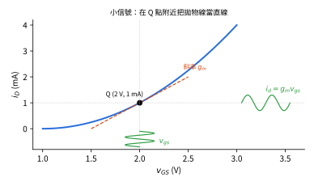

# 第 15 集 · Lec15：直流 + 交流、小信號近似與 $g_m$、分壓偏壓與耦合電容 [▶ 影片](https://www.youtube.com/watch?v=kRQ3JbgioUY)

← 上一集：[14](14-mosfet-load-line-vtc.md) ｜ [總目錄](../README.md) ｜ 下一集：[16](16-mosfet-bias-stability-source-resistor.md) →

> **課程**：電子學（二），陽明交大 電子物理系，112 學年度 — 第 15 集
> **講者**：陳振芳 老師
> **來源**：YouTube 錄影逐字稿（1:18:51，whisper）＋ Sedra & Smith《Microelectronic Circuits》7th ed.
> **標記說明**：`【口頭】` 老師口頭補充；`【課本補充】` 課本有、課堂沒講；`[▶ mm:ss]` 影片時間點

---

## 目錄

- [0. 這堂課要做什麼](#0-這堂課要做什麼)
- [1. 直流加交流：展開飽和區公式](#1-直流加交流展開飽和區公式)
- [2. 小信號近似](#2-小信號近似)
- [3. 直流歸直流、交流歸交流](#3-直流歸直流交流歸交流)
- [4. 轉導 $g_m$](#4-轉導-g_m)
- [5. 把電路拆成直流電路和交流電路](#5-把電路拆成直流電路和交流電路)
- [6. 例題：設計 1 mA、增益 −10](#6-例題設計-1-ma增益-10)
- [7. 分壓偏壓：不要多買一台電源](#7-分壓偏壓不要多買一台電源)
- [8. 耦合電容：直流擋住、交流放行](#8-耦合電容直流擋住交流放行)
- [9. 電容要多大](#9-電容要多大)
- [10. 信號源有內阻：為什麼用 MΩ](#10-信號源有內阻為什麼用-mω)
- [11. 一頁速查表](#11-一頁速查表)
- [12. 與後續集數的連結](#12-與後續集數的連結)

---

## 0. 這堂課要做什麼

MOS 電路一定先做**直流偏壓**（DC bias），再看**交流**（AC）信號。今天把這套方法講完整：小信號近似、$g_m$、直流電路 / 交流電路怎麼拆，再用分壓電阻 + 耦合電容做出實際的偏壓。

---

## 1. 直流加交流：展開飽和區公式

[▶ 00:32](https://youtu.be/kRQ3JbgioUY?t=32)

共源電路，設計在飽和區（平的地方）：$i_D = \frac12k(v_{GS} - V_t)^2$，和 $V_{DS}$ 無關。

**符號習慣** [▶ 03:39](https://youtu.be/kRQ3JbgioUY?t=219)：小寫字母大寫下標 = 全部（$i_D$、$v_{GS}$）；大寫大寫 = 直流（$I_D$、$V_{GS}$）；小寫小寫 = 交流（$i_d$、$v_{gs}$）。

$$
I_D + i_d = \frac12k\left(V_{GS} + v_{gs} - V_t\right)^2
= \frac12k(V_{GS} - V_t)^2 + k(V_{GS} - V_t)v_{gs} + \frac12kv_{gs}^2
$$

[▶ 04:41](https://youtu.be/kRQ3JbgioUY?t=281)

---

## 2. 小信號近似

[▶ 05:13](https://youtu.be/kRQ3JbgioUY?t=313)

假設平方項遠小於一次項：

$$
\frac12v_{gs}^2 \ll (V_{GS} - V_t)v_{gs}
\quad\Longrightarrow\quad
|v_{gs}| \ll 2(V_{GS} - V_t)
$$

「遠小於」老師取差一個數量級：$|v_{gs}| \le 0.2(V_{GS} - V_t)$。例 $V_{GS} = 2$、$V_t = 1$ → sin 振幅在 0.2 V 以下就好。這叫**小信號近似**（small-signal approximation）。[▶ 06:14](https://youtu.be/kRQ3JbgioUY?t=374)

平方項拿掉，二次式就變成**線性**（linearity）。

---

## 3. 直流歸直流、交流歸交流

[▶ 07:48](https://youtu.be/kRQ3JbgioUY?t=468)

$$
I_D + i_d = \underbrace{\frac12k(V_{GS} - V_t)^2}_{\text{和時間無關}} + \underbrace{k(V_{GS} - V_t)v_{gs}}_{\sin/\cos}
$$

要對**所有時間 $t$** 都成立（$t$ 有無窮多個），只有一種可能：

$$
I_D = \frac12k(V_{GS} - V_t)^2,
\qquad
i_d = k(V_{GS} - V_t)\,v_{gs}
$$

[▶ 08:50](https://youtu.be/kRQ3JbgioUY?t=530)

【口頭】沒有小信號近似就會多跑出一個二次方，直流交流分不開。[▶ 10:23](https://youtu.be/kRQ3JbgioUY?t=623)

---

## 4. 轉導 $g_m$

[▶ 11:55](https://youtu.be/kRQ3JbgioUY?t=715)

交流輸出電流 ÷ 交流輸入電壓 = 電流 / 電壓 = conductance，又是輸入對輸出（trans），所以叫**轉導**（transconductance）：

$$
g_m = \frac{i_d}{v_{gs}} = k(V_{GS} - V_t) = \sqrt{2kI_D}
$$

（第二個形式：$I_D = \frac12k(V_{GS}-V_t)^2$ 開根號代入。）[▶ 15:29](https://youtu.be/kRQ3JbgioUY?t=929)

- 幾何意義：轉移曲線在 $Q$ 點的**斜率**。[▶ 14:27](https://youtu.be/kRQ3JbgioUY?t=867)
- **交流的放大倍數由直流偏壓決定**。
- 信號要夠小，不然曲線不是直線，波形就變形。

---

## 5. 把電路拆成直流電路和交流電路

[▶ 16:29](https://youtu.be/kRQ3JbgioUY?t=989)

每個地方的電壓、電流都是直流 + 交流，所以一個電路拆成兩個：

- **直流電路**（DC circuit）：拿掉所有**交流**源（電壓源短路）。[▶ 19:02](https://youtu.be/kRQ3JbgioUY?t=1142)
- **交流電路**（AC circuit）：拿掉所有**直流**源——包括頭上的 $V_{DD}$（變成接地）。【口頭】通常大家會忘記頭上這個。[▶ 20:36](https://youtu.be/kRQ3JbgioUY?t=1236)

交流電路裡 MOS 只剩 $i_d = g_mv_{gs}$，閘極沒有電流：

$$
v_o = -g_mR_D\,v_{gs}
$$

（$V_{DD}$ 拿掉了，$R_D$ 上頭是 0，所以 $v_o = 0 - i_dR_D$。）兩個電路的答案相加就是全部。[▶ 23:14](https://youtu.be/kRQ3JbgioUY?t=1394)

【口頭】怕忘記也可以把 $i_d = g_mv_{gs}$ 想成一顆 $1/g_m$ 的「電阻」，閘極那邊用虛線表示沒有電流。不用背什麼模型。[▶ 25:19](https://youtu.be/kRQ3JbgioUY?t=1519)

> 【課本補充】§7.2.1 (p. 383)：小信號條件 $v_{gs} \ll 2V_{OV}$、$g_m = k_n'\frac{W}{L}V_{OV} = \sqrt{2k_n'\frac{W}{L}I_D} = 2I_D/V_{OV}$；第三個形式老師沒寫。

---

## 6. 例題：設計 1 mA、增益 −10

[▶ 26:52](https://youtu.be/kRQ3JbgioUY?t=1612)

$V_{DD} = 10$ V、$k = 2$ mA/V²、$V_t = 1$ V（要算一定要知道 $k$、$V_t$）。

**直流** [▶ 27:52](https://youtu.be/kRQ3JbgioUY?t=1672)：設計 $I_D = 1$ mA → $\frac12\cdot2(V_{GS} - 1)^2 = 1$ → $V_{GS} = 2$ V。$R_D = 5$ kΩ → $V_D = 10 - 5 = 5$ V。檢查 $V_D = 5 \ge V_G - V_t = 1$ ✓ 飽和。

**為什麼 5 V** [▶ 30:29](https://youtu.be/kRQ3JbgioUY?t=1829)：交流信號在 5 V 上下擺。往上最多到 10 V（擺 5 V），往下不能低於 1 V（擺 4 V），否則掉進三極管區、波形底部被壓扁。最好在中間，差一點沒關係。

**交流** [▶ 33:05](https://youtu.be/kRQ3JbgioUY?t=1985)：$g_m = 2\times(2 - 1) = 2$ mA/V（或 $\sqrt{2\cdot2\cdot1} = 2$）。

$$
\frac{v_o}{v_s} = -g_mR_D = -2\times5 = -10
$$

負號 = 相位差 180°。全部：$v_O = 5 - 10v_s$。[▶ 35:09](https://youtu.be/kRQ3JbgioUY?t=2109)

---

## 7. 分壓偏壓：不要多買一台電源

[▶ 37:12](https://youtu.be/kRQ3JbgioUY?t=2232)

閘極要 2 V，再買一台 2 V 直流電源？【口頭】整個電路不到 20 塊，一台直流電源就超過 500 塊——貴的是電源。所以從已經有的 10 V **分壓**：$R_1 : R_2 = 8 : 2$。80 k/20 k 或 8 M/2 M 都可以，這裡用 **8 MΩ、2 MΩ**（理由見第 10 節）。叫**固定輸入電壓偏壓**（constant input voltage bias）。[▶ 38:45](https://youtu.be/kRQ3JbgioUY?t=2325)

**信號不能直接接上去** [▶ 40:18](https://youtu.be/kRQ3JbgioUY?t=2418)：閘極要維持 2 V + $v_s$。直接把 $v_s$ 接到閘極，閘極就被釘成 $v_s$，2 V 不見了，直流全變。

---

## 8. 耦合電容：直流擋住、交流放行

[▶ 42:24](https://youtu.be/kRQ3JbgioUY?t=2544)

中間串一顆電容 $C$，讓它充電。

**直流電路**（拿掉 $v_s$）[▶ 43:59](https://youtu.be/kRQ3JbgioUY?t=2639)：$t = 0$ 電容沒電荷，電流從 10 V 經 $R_1$ 流進電容充電；電容電壓上升 → 電流變小……一直到電容沒電流 → **穩態**：$i_C = C\,dv/dt = 0$，電容可以看成**開路**。開路後就是 8 M、2 M 分壓 → 閘極 2 V。[▶ 49:18](https://youtu.be/kRQ3JbgioUY?t=2958)

電容自己充到 2 V，等於放了一顆 2 V 的電池。

**時間常數怎麼算** [▶ 51:58](https://youtu.be/kRQ3JbgioUY?t=3118)：充電等於放電，用放電算比較簡單：

1. 拿掉輸入源（10 V 接地）。
2. 把電容當成電壓 $V_x$，看它往外放電的路徑，求 $V_x/I_x$。
3. $\tau = C\cdot V_x/I_x$。

這裡往外看是 $R_1 \parallel R_2$：

$$
\tau = C\,(R_1 \parallel R_2) = C\times1.6\ \text{M}\Omega
$$

【口頭】不管多大，都發生在開關按下去的一秒之內。[▶ 55:39](https://youtu.be/kRQ3JbgioUY?t=3339)

---

## 9. 電容要多大

[▶ 57:13](https://youtu.be/kRQ3JbgioUY?t=3433)

**交流電路**（拿掉 10 V）：電容會擋直流，但**不可以擋交流**。交流正半週充、負半週放；如果半個週期遠短於充放電時間，根本來不及充，電容上沒電荷、電壓 0 → $v_s$ 全部過去：[▶ 59:45](https://youtu.be/kRQ3JbgioUY?t=3585)

$$
\frac{T}{2} \ll \tau
\quad\Longleftrightarrow\quad
\frac{1}{\omega C} \ll R_1 \parallel R_2
$$

$1/\omega C$ 就是電容等效阻抗的大小——**電容阻抗遠小於它往外看的電阻**，電容等於**短路**。[▶ 1:02:22](https://youtu.be/kRQ3JbgioUY?t=3742)

**數字** [▶ 1:05:00](https://youtu.be/kRQ3JbgioUY?t=3900)：聲音 20 Hz–20 kHz，$\omega$ 約 $10^2$ 到 $10^5$；要對最低頻也成立：

$$
C \gg \frac{1}{10^2\times1.6\times10^6} \approx 6\ \text{nF}
$$

取大幾倍都可以。【口頭】如果 $R_1 \parallel R_2$ 小三個數量級（kΩ），電容就要 μF 等級，越大越難找。[▶ 1:06:35](https://youtu.be/kRQ3JbgioUY?t=3995)

結果：閘極直流 2 V（電容跨 2 V）+ 交流 $v_s$（電容跨 0）→ $v_O = 5 - 10v_s$。課本常寫「$C = \infty$」，這裡算出來是 > 6 nF。[▶ 1:11:45](https://youtu.be/kRQ3JbgioUY?t=4305)

---

## 10. 信號源有內阻：為什麼用 MΩ

[▶ 1:12:49](https://youtu.be/kRQ3JbgioUY?t=4369)

信號源有內阻 $R_s = 1$ kΩ：

- 時間常數：$\tau = C(R_s + R_1 \parallel R_2) = C(1\ \text{k} + 1.6\ \text{M}) \approx C\times1.6$ M，沒差。[▶ 1:14:23](https://youtu.be/kRQ3JbgioUY?t=4463)
- 交流：電容短路後，$R_s$ 和 $R_1 \parallel R_2$ 分壓：

$$
v_{gs} = v_s\frac{R_1 \parallel R_2}{R_s + R_1 \parallel R_2} \approx v_s
$$

MΩ 比 kΩ 大太多，幾乎不衰減，增益還是 −10。[▶ 1:16:55](https://youtu.be/kRQ3JbgioUY?t=4615)

【口頭】這就是一開始取 MΩ 的原因：預先防備不知道 $R_s$ 多大。如果都是 kΩ 級、同樣大小，信號就衰減一半。[▶ 1:17:56](https://youtu.be/kRQ3JbgioUY?t=4676)

---

## 11. 一頁速查表

| 項目 | 公式／重點 | 關鍵一步 |
|---|---|---|
| 小信號近似 | $\lvert v_{gs}\rvert  \ll 2(V_{GS}-V_t)$（取 $\le 0.2(V_{GS}-V_t)$） | 丟掉 $\frac12kv_{gs}^2$ |
| 直流 | $I_D = \frac12k(V_{GS}-V_t)^2$ | 和 $t$ 無關的項 |
| 轉導 | $g_m = k(V_{GS}-V_t) = \sqrt{2kI_D}$ | sin/cos 項 |
| 拆電路 | 直流：拿掉交流源；交流：拿掉直流源（含 $V_{DD}$） | |
| 共源增益 | $v_o/v_{gs} = -g_mR_D$ | 例 −10 |
| 擺幅 | 上到 $V_{DD}$，下到 $V_G - V_t$ | $Q$ 放中間 |
| 分壓偏壓 | $V_G = V_{DD}R_2/(R_1+R_2)$ | 省一台電源 |
| 耦合電容 τ | $\tau = C(R_s + R_1 \parallel R_2)$ | 用放電求 |
| 電容大小 | $1/(\omega_{\min}C) \ll R_1 \parallel R_2$ | 例 > 6 nF |
| 信號衰減 | $(R_1 \parallel R_2)/(R_s + R_1 \parallel R_2)$ | 用 MΩ 就 ≈ 1 |

---

## 12. 與後續集數的連結

| 本集觀念 | 後面在哪裡用到 |
|---|---|
| 拆直流 / 交流電路 | 之後所有 MOS、BJT 放大器 |
| $g_m$、增益 $-g_mR_D$ | 共源、共閘、源極隨耦器 |
| 耦合電容的時間常數 | 低頻響應（第 10 章頻率響應） |

---

## 附：本集一句話總結

> **把 $i_D = \frac12k(v_{GS}-V_t)^2$ 展開成直流 + 交流，在 $|v_{gs}| \ll 2(V_{GS}-V_t)$ 的小信號近似下直流歸直流、交流歸交流，得到 $g_m = k(V_{GS}-V_t) = \sqrt{2kI_D}$ 和增益 $-g_mR_D$；實際偏壓用 MΩ 級分壓電阻從 $V_{DD}$ 取得，再用耦合電容擋直流、放交流，電容阻抗要遠小於 $R_1 \parallel R_2$（例 > 6 nF）。**

---

*筆記依據陳振芳老師「電子學（二）」112 學年度 Lec15 錄影逐字稿（whisper，1:18:51）與 Sedra & Smith《Microelectronic Circuits》7th ed. 整理。*
