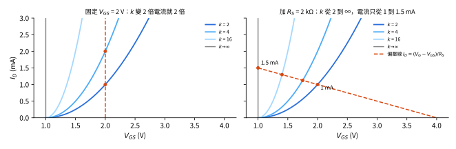

# 第 16 集 · Lec16：偏壓穩定性——源極電阻 $R_S$ 與旁路電容 [▶ 影片](https://www.youtube.com/watch?v=5M6wBsOZwUM)

← 上一集：[15](15-mosfet-small-signal-bias-coupling-cap.md) ｜ [總目錄](../README.md) ｜ 下一集：[17](17-mosfet-drain-feedback-current-source-bias.md) →

> **課程**：電子學（二），陽明交大 電子物理系，112 學年度 — 第 16 集
> **講者**：陳振芳 老師
> **來源**：YouTube 錄影逐字稿（45:10，whisper）＋ Sedra & Smith《Microelectronic Circuits》7th ed. §7.4
> **標記說明**：`【口頭】` 老師口頭補充；`【課本補充】` 課本有、課堂沒講；`[▶ mm:ss]` 影片時間點

---

## 目錄

- [0. 這堂課要做什麼](#0-這堂課要做什麼)
- [1. 問題：每顆 MOS 的 $k$ 都不一樣](#1-問題每顆-mos-的-k-都不一樣)
- [2. 加源極電阻 $R_S$](#2-加源極電阻-r_s)
- [3. 為什麼穩：圖解與負回授](#3-為什麼穩圖解與負回授)
- [4. 代價：交流增益掉很多](#4-代價交流增益掉很多)
- [5. 旁路電容：兩個都要](#5-旁路電容兩個都要)
- [6. 一頁速查表](#6-一頁速查表)
- [7. 與後續集數的連結](#7-與後續集數的連結)

---

## 0. 這堂課要做什麼

上一集的偏壓在數學上沒問題，但實際做起來不行：每顆 MOS 的 $k$ 都不同。今天加一顆**源極電阻** $R_S$ 讓直流穩定，再加**旁路電容**把交流增益救回來。

---

## 1. 問題：每顆 MOS 的 $k$ 都不一樣

[▶ 00:00](https://youtu.be/5M6wBsOZwUM?t=0)

上一集：$k = 2$、$V_t = 1$、閘極分壓 2 V、$R_D = 5$ kΩ → 1 mA、$V_D = 5$ V。耦合電容讓直流 2 V 不被信號吃掉。

但 $k$ 你根本不知道——不同的 MOS 有不同的 $k$，範圍很大。[▶ 03:37](https://youtu.be/5M6wBsOZwUM?t=217)

**換一顆 $k = 4$** [▶ 04:41](https://youtu.be/5M6wBsOZwUM?t=281)：$V_{GS}$ 還是 2 V → $I_D = \frac12\cdot4\cdot1 = 2$ mA → $V_D = 10 - 10 = 0$ V，比 $V_G - V_t = 1$ 還低 → 跳出飽和區，不能放大。

$V_{GS}$ 固定時 $I_D \propto k$：

$$
\frac{\Delta I_D}{I_D} = \frac{\Delta k}{k}
$$

$k$ 從 2 到 ∞，電流就從 1 mA 到 ∞。【口頭】假設做電子實驗，每組電路一樣、MOS 不一樣，只有拿到 $k = 2$ 的那組能做。**穩定性**（stability）非常差——數學練習可以，真的做不行。[▶ 06:11](https://youtu.be/5M6wBsOZwUM?t=371)

---

## 2. 加源極電阻 $R_S$

[▶ 08:15](https://youtu.be/5M6wBsOZwUM?t=495)

源極和地之間加 $R_S = 2$ kΩ。先用 $k = 2$ 設計 1 mA：$V_{GS} = 2$ V、$V_S = 1\times2 = 2$ V → 閘極要 $V_G = 4$ V → 分壓改 6 MΩ / 4 MΩ。源極多了 2 V，$R_D$ 改 4 kΩ → $V_D = 6$ V。[▶ 09:17](https://youtu.be/5M6wBsOZwUM?t=557)

閘極迴路（直流）一定滿足：[▶ 13:27](https://youtu.be/5M6wBsOZwUM?t=807)

$$
V_G = V_{GS} + I_DR_S
\quad\Longrightarrow\quad
4 = V_{GS} + 2I_D
$$

**$k \to \infty$** [▶ 11:53](https://youtu.be/5M6wBsOZwUM?t=713)：$I_D = \frac12k(V_{GS} - V_t)^2$ 要是有限值，$V_{GS}$ 必須趨近 $V_t = 1$ V：

$$
I_D = \frac{4 - 1}{2} = 1.5\ \text{mA}
$$

$k$ 從 2 到 ∞，電流只從 **1 mA 變到 1.5 mA**——幾乎不變。[▶ 15:01](https://youtu.be/5M6wBsOZwUM?t=901)

---

## 3. 為什麼穩：圖解與負回授

**圖解** [▶ 16:02](https://youtu.be/5M6wBsOZwUM?t=962)：畫 $I_D$-$V_{GS}$ 轉移曲線，$k$ 越大越陡。

- 固定 $V_{GS}$：偏壓線是**垂直線**，曲線變陡，交點一路往上跑。
- 有 $R_S$：偏壓線 $I_D = (V_G - V_{GS})/R_S$ 是**斜線**（$I_D = 0$ 時 $V_{GS} = 4$ V），曲線再陡，交點也只在 1～1.5 mA 之間。[▶ 18:06](https://youtu.be/5M6wBsOZwUM?t=1086)

**負回授** [▶ 19:39](https://youtu.be/5M6wBsOZwUM?t=1179)：電流想變大 → $I_DR_S$ 變大 → $V_G$ 不變，所以 $V_{GS}$ 被迫變小 → 電流又降下來。上升回授回來造成下降——這就是**負回授**的概念。

$R_S$ 改善直流穩定性（$R_S$ improves DC stability）。隨便加一兩 kΩ 馬上好很多。【口頭】實際設計要讓電路不管 $k$ 怎麼變，電流電壓都幾乎不變。[▶ 21:15](https://youtu.be/5M6wBsOZwUM?t=1275)

---

## 4. 代價：交流增益掉很多

[▶ 22:15](https://youtu.be/5M6wBsOZwUM?t=1335)

交流電路：拿掉所有直流源，耦合電容夠大當短路，$R_1 \parallel R_2$（MΩ 級）不影響。$g_m$ 從直流算：$k = 2$、1 mA → $g_m = \sqrt{2\cdot2\cdot1} = 2$ mA/V。[▶ 25:48](https://youtu.be/5M6wBsOZwUM?t=1548)

**$1/g_m$ 模型** [▶ 26:55](https://youtu.be/5M6wBsOZwUM?t=1615)：$i = g_mv$ 也可以寫成 $v = i/g_m$——把 MOS 看成閘極到源極之間一顆 $1/g_m$ 的電阻（閘極不吃電流，電流從汲極進來）。$v_s$ 跨在 $1/g_m$ 和 $R_S$ 串聯上：

$$
i = \frac{v_s}{1/g_m + R_S},
\qquad
v_o = -iR_D
$$

$$
\frac{v_o}{v_s} = -\frac{R_D}{1/g_m + R_S} = -\frac{g_mR_D}{1 + g_mR_S}
$$

[▶ 28:59](https://youtu.be/5M6wBsOZwUM?t=1739)

$R_S = 0$ 時就是 $-g_mR_D$。現在：

$$
-\frac{2\times4}{1 + 2\times2} = -1.6
$$

【口頭】做了老半天等於沒有放大。$1/g_m = 0.5$ kΩ，$R_S = 2$ kΩ 大得多，信號大半都跨在 $R_S$ 上——底下這段不會放大，浪費掉了。[▶ 30:37](https://youtu.be/5M6wBsOZwUM?t=1837)

> 【課本補充】$1 + g_mR_S$ 叫**源極退化**（source degeneration）因子；它降低增益，但也讓增益比較不受 $g_m$ 影響、線性範圍變大（Sedra §7.3.4）。

---

## 5. 旁路電容：兩個都要

[▶ 32:07](https://youtu.be/5M6wBsOZwUM?t=1927)

$R_S$ 並聯一顆**旁路電容** $C_S$（bypass capacitor）。

**直流**：電容充到 2 V 後就開路，等於沒加 → $R_S$ 還在，**直流穩定性不變**。[▶ 33:07](https://youtu.be/5M6wBsOZwUM?t=1987)

**交流**：要讓 $C_S$ 對信號是**短路**——電容阻抗遠小於它往外看的電阻。[▶ 35:10](https://youtu.be/5M6wBsOZwUM?t=2110)

求往外看的電阻（記得**信號源拿掉**，用放電想）[▶ 37:14](https://youtu.be/5M6wBsOZwUM?t=2234)：

- 往上看 MOS：閘極交流接地，加 $V_x$ 在源極，電流 $g_mV_x$ → 電阻 $1/g_m$。
- 往下看 $R_S$。
- 兩者並聯。

$$
\frac{1}{\omega C_S} \ll \frac{1}{g_m}\parallel R_S = 0.5\ \text{k} \parallel 2\ \text{k} = 0.4\ \text{k}\Omega
$$

聲音取最低 $\omega \approx 10^2$：[▶ 41:22](https://youtu.be/5M6wBsOZwUM?t=2482)

$$
C_S \gg \frac{1}{10^2\times400} = 25\ \mu\text{F}
$$

（比耦合電容的 6 nF 大很多，因為往外看的電阻小很多。）

$C_S$ 短路 → $R_S$ 對交流消失 → $v_s$ 全部跨在 $v_{gs}$ 上：[▶ 42:22](https://youtu.be/5M6wBsOZwUM?t=2542)

$$
\frac{v_o}{v_s} = -g_mR_D = -2\times4 = -8
$$

增益回來了（比上一集的 −10 小，只是因為 $R_D$ 取小了讓 $V_D$ 在中間）。**直流穩定、交流增益也沒掉**。[▶ 43:57](https://youtu.be/5M6wBsOZwUM?t=2637)

---

## 6. 一頁速查表

| 項目 | 公式／重點 | 關鍵 |
|---|---|---|
| 固定 $V_{GS}$ | $\Delta I_D/I_D = \Delta k/k$ | 很不穩 |
| 加 $R_S$ | $V_G = V_{GS} + I_DR_S$ | 斜偏壓線 |
| $k \to \infty$ | $V_{GS} \to V_t$，$I_D \to (V_G - V_t)/R_S$ | 例 1～1.5 mA |
| 穩定原因 | $I_D\uparrow \Rightarrow V_{GS}\downarrow$ | 負回授 |
| $1/g_m$ 模型 | 閘源間看成 $1/g_m$ | |
| 有 $R_S$ 的增益 | $-g_mR_D/(1 + g_mR_S)$ | 例 −1.6 |
| 旁路電容 | $1/(\omega C_S) \ll (1/g_m)\parallel R_S$ | 例 ≫ 25 μF |
| 加 $C_S$ 後 | 直流穩、增益 $-g_mR_D$ | 例 −8 |

---

## 7. 與後續集數的連結

| 本集觀念 | 後面在哪裡用到 |
|---|---|
| 源極退化 $1 + g_mR_S$ | 共源放大器、回授（電子學（四）） |
| 往源極看進去是 $1/g_m$ | 共閘、源極隨耦器 |
| 旁路電容 | 低頻響應的極點 |

---

## 附：本集一句話總結

> **每顆 MOS 的 $k$ 都不同，固定 $V_{GS}$ 時電流跟著 $k$ 成正比亂跑；加源極電阻 $R_S$ 形成負回授，偏壓線變斜，$k$ 從 2 到 ∞ 電流只變 1～1.5 mA；但交流增益變成 $-g_mR_D/(1+g_mR_S)$ 掉很多，所以再並一顆旁路電容（$1/\omega C_S \ll (1/g_m)\parallel R_S$），直流穩定、交流增益也回到 $-g_mR_D$。**

---

*筆記依據陳振芳老師「電子學（二）」112 學年度 Lec16 錄影逐字稿（whisper，45:10）與 Sedra & Smith《Microelectronic Circuits》7th ed. 整理。*
