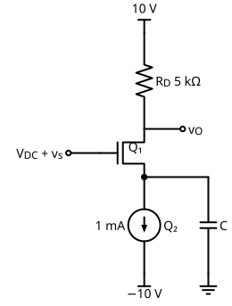

# 第 17 集 · Lec17：汲極回授偏壓、定電流源（電流鏡）偏壓 [▶ 影片](https://www.youtube.com/watch?v=uDq1_xmBrTA)

← 上一集：[16](16-mosfet-bias-stability-source-resistor.md) ｜ [總目錄](../README.md) ｜ 下一集：[18](18-common-gate-common-drain.md) →

> **課程**：電子學（二），陽明交大 電子物理系，112 學年度 — 第 17 集
> **講者**：陳振芳 老師
> **來源**：YouTube 錄影逐字稿（1:17:18，whisper）＋ Sedra & Smith《Microelectronic Circuits》7th ed.
> **標記說明**：`【口頭】` 老師口頭補充；`【課本補充】` 課本有、課堂沒講；`[▶ mm:ss]` 影片時間點

---

## 目錄

- [0. 這堂課要做什麼](#0-這堂課要做什麼)
- [1. 汲極回授偏壓](#1-汲極回授偏壓)
- [2. 交流：信號從回授路徑漏光](#2-交流信號從回授路徑漏光)
- [3. 加 $R_G$：直流不變、交流擋住](#3-加-r_g直流不變交流擋住)
- [4. 定電流源：電流鏡](#4-定電流源電流鏡)
- [5. 用定電流源偏壓共源放大器](#5-用定電流源偏壓共源放大器)
- [6. 直流：負電源與穩定性](#6-直流負電源與穩定性)
- [7. 交流：$k$ 決定增益、電流源決定偏壓](#7-交流k-決定增益電流源決定偏壓)
- [8. 拿掉電容：輸入直流的允許範圍](#8-拿掉電容輸入直流的允許範圍)
- [9. 一頁速查表](#9-一頁速查表)
- [10. 與後續集數的連結](#10-與後續集數的連結)

---

## 0. 這堂課要做什麼

再看兩種直流穩定的偏壓：

1. **汲極回授**：從汲極拉電阻回閘極。
2. **定電流源偏壓**：用電流鏡做出 1 mA 的電流源，IC 裡幾乎都這樣偏壓。

---

## 1. 汲極回授偏壓

[▶ 00:30](https://youtu.be/uDq1_xmBrTA?t=30)

閘極直接從汲極拉過來（閘極沒有電流 → $V_G = V_D$）。$k = 2$、$V_t = 1$，設計 1 mA：$V_{GS} = 2$ V → $V_D = 2$ V → $R_D = (10 - 2)/1 = 8$ kΩ。[▶ 01:32](https://youtu.be/uDq1_xmBrTA?t=92)

- **一定在飽和**：$V_D = V_G > V_G - V_t$，永遠差一個 $V_t$。[▶ 02:35](https://youtu.be/uDq1_xmBrTA?t=155)
- **擺幅**：往上到 10 V 可擺 8 V；往下不能低於 $V_G - V_t = 1$ V，只能擺 1 V。增益 10 倍的話，輸入不能超過 0.1 V。[▶ 03:37](https://youtu.be/uDq1_xmBrTA?t=217)

**穩定性** [▶ 04:41](https://youtu.be/uDq1_xmBrTA?t=281)：$k \to \infty$ 時 $V_{GS} \to V_t = 1$ V：

$$
I_D = \frac{10 - 1}{8} = \frac98\ \text{mA}
$$

$k$ 從 2 到 ∞，電流只從 1 到 9/8 mA——很穩。原因一樣是負回授：$k$ 變大電流想變大 → $R_D$ 壓降變大 → $V_D = V_G$ 變小 → 電流又變小。[▶ 06:47](https://youtu.be/uDq1_xmBrTA?t=407)

---

## 2. 交流：信號從回授路徑漏光

[▶ 07:17](https://youtu.be/uDq1_xmBrTA?t=437)

信號源（內阻 $R_s$）要經**耦合電容**接進來，不然 2 V 會被吃掉；電容夠大對交流短路。

**若閘極直接接汲極**：從輸入看進去的電阻 $R_{in}$（加 $V$ 求 $I$）[▶ 14:59](https://youtu.be/uDq1_xmBrTA?t=899)：

- 往下：MOS 電流 $g_mV$ → 電阻 $1/g_m$。
- 往上：$R_D$（$V_{DD}$ 交流接地）。
- 往閘極：無窮大。

$$
R_{in} = \frac{1}{g_m}\parallel R_D,
\qquad
\frac{v_o}{v_s} = \frac{(1/g_m)\parallel R_D}{R_s + (1/g_m)\parallel R_D} < 1
$$

增益小於 1——沒有放大。信號從回授這條路漏光了。[▶ 18:44](https://youtu.be/uDq1_xmBrTA?t=1124)

---

## 3. 加 $R_G$：直流不變、交流擋住

[▶ 19:46](https://youtu.be/uDq1_xmBrTA?t=1186)

回授路徑串一顆大電阻 $R_G = 10$ MΩ。

**直流**：這條路沒有電流（閘極是氧化層），再大都沒影響，$g_m$ 還是 2 mA/V。[▶ 20:47](https://youtu.be/uDq1_xmBrTA?t=1247)

**交流** [▶ 21:21](https://youtu.be/uDq1_xmBrTA?t=1281)：閘極電壓 $V$，汲極 $v_o \approx -g_mR_DV$（$R_G$ 上的電流只有 μA 級，遠小於 $g_mV$ 的 mA 級，先忽略）。$R_G$ 上的電流：

$$
I = \frac{V - v_o}{R_G} = \frac{V(1 + g_mR_D)}{R_G},
\qquad
R_{in} = \frac{R_G}{1 + g_mR_D}
$$

$\frac{10\ \text{M}}{1 + 2\times8} \approx 0.6$ MΩ（老師說約 1 MΩ 等級）。$R_s$ 頂多幾 kΩ → $V \approx v_s$：[▶ 24:28](https://youtu.be/uDq1_xmBrTA?t=1468)

$$
\frac{v_o}{v_s} = -g_mR_D = -16
$$

**檢查假設** [▶ 26:00](https://youtu.be/uDq1_xmBrTA?t=1560)：$\frac{V(1 + g_mR_D)}{R_G} \ll g_mV$ ⇔ $R_G \gg R_D$（MΩ ≫ 8 kΩ）✓。

唯一缺點：往下只能擺 1 V，增益 16 → 輸入要小於 1/16 V，不然尾巴被切掉。[▶ 27:04](https://youtu.be/uDq1_xmBrTA?t=1624)

> 【課本補充】$R_{in} = R_G/(1 + g_mR_D)$ 是**米勒效應**（Miller effect）的形式：跨在增益 $-A$ 兩端的阻抗，從輸入看進去被除以 $1 + A$（Sedra §10.3.3, p. 732）。

---

## 4. 定電流源：電流鏡

[▶ 28:36](https://youtu.be/uDq1_xmBrTA?t=1716)

左邊一顆 MOS 閘極接汲極（diode-connected），經 8 kΩ 接 10 V → 2 V、1 mA（就是第 1 節的電路）。這個 2 V 完全由它自己決定，也不會有任何交流。

把這個 2 V 拉去接第二顆 MOS 的閘極：同樣 $k$、同樣 $V_t$、在飽和 → **也是 1 mA**，而且和汲極電壓無關 → **定電流源**（constant current source）。[▶ 30:11](https://youtu.be/uDq1_xmBrTA?t=1811)

- 條件：第二顆要在飽和：$V_D \ge V_G - V_t = 1$ V。[▶ 31:14](https://youtu.be/uDq1_xmBrTA?t=1874)
- 閘極不吃電流 → 可以一直往右接，每一顆都是 1 mA 的電流源。[▶ 33:17](https://youtu.be/uDq1_xmBrTA?t=1997)
- 一定要有那條「閘極接汲極」的線，不然沒有電壓，全部不會動。[▶ 36:26](https://youtu.be/uDq1_xmBrTA?t=2186)

【口頭】IC 裡做在旁邊的 MOS 可以做到 $k$ 幾乎一樣。$W$、$L$ 是你自己畫的：$L$ 都一樣、$W$ 畫兩倍，電流就兩倍。IC 設計用電流控制會好很多。這個電路叫**電流鏡**（current mirror）。[▶ 34:18](https://youtu.be/uDq1_xmBrTA?t=2058)

---

## 5. 用定電流源偏壓共源放大器

[▶ 39:33](https://youtu.be/uDq1_xmBrTA?t=2373)

$Q_1$ 是共源放大器（$R_D = 5$ kΩ），源極底下接電流鏡做的 1 mA 電流源（$Q_2$）。直流偏壓已經由電流源決定，**不需要 $R_1$、$R_2$**。[▶ 41:08](https://youtu.be/uDq1_xmBrTA?t=2468)

**但這樣不會放大** [▶ 41:38](https://youtu.be/uDq1_xmBrTA?t=2498)：源極那條路被電流源掐死，只有直流 1 mA、交流電流 0 → $v_o$ 永遠 5 V。

**改**：源極接一顆電容到地，交流電流從電容走。[▶ 43:42](https://youtu.be/uDq1_xmBrTA?t=2622)

---

## 6. 直流：負電源與穩定性

[▶ 44:12](https://youtu.be/uDq1_xmBrTA?t=2652)

一開始 $Q_1$ 沒通道，電流源的 1 mA 只能從電容抽 → 源極電壓往下 → $V_{GS}$ 增加 → 超過 $V_t$ 開始導通 → 一直到 $Q_1$ 的電流 = 1 mA、電容沒電流 → 穩態：$V_{GS} = 2$ V。[▶ 45:13](https://youtu.be/uDq1_xmBrTA?t=2713)

**檢查電流源有沒有在飽和** [▶ 49:18](https://youtu.be/uDq1_xmBrTA?t=2958)：閘極 0 V → 源極 −2 V。若電流源底下接地，$Q_2$ 汲極 −2 V 比閘極 2 V − 1 還低 → **不飽和，全錯**。

→ 底下改接 **−10 V**（參考那顆的電阻改接地：0 − 8 = −8 V 是 $Q_2$ 閘極）。$Q_2$ 要 $V_D \ge -8 - 1 = -9$ V，而 $V_D = -2$ V ✓。[▶ 50:21](https://youtu.be/uDq1_xmBrTA?t=3021)

【口頭】不一定要 −10 V，但一定要夠低。

**穩定性** [▶ 53:56](https://youtu.be/uDq1_xmBrTA?t=3236)：參考電流 $k$ 從 2 到 ∞ 只從 1 到 9/8 mA，而 $Q_1$ 的電流就是電流源給的，**和 $Q_1$ 自己的 $k$ 無關**。直流穩定性非常好。

---

## 7. 交流：$k$ 決定增益、電流源決定偏壓

[▶ 55:29](https://youtu.be/uDq1_xmBrTA?t=3329)

交流電路：電流源（直流）開路、$V_{DD}$ 接地、電容夠大短路 → $v_{gs} = v_s$：

$$
\frac{v_o}{v_s} = -g_mR_D,
\qquad
g_m = \sqrt{2kI_D}
$$

- $k = 2$：$g_m = 2$ → −10。
- $k = 200$：$g_m = \sqrt{2\cdot200\cdot1} = 20$ → **−100**，多一個數量級。[▶ 59:04](https://youtu.be/uDq1_xmBrTA?t=3544)

**兩件事分開了** [▶ 1:00:40](https://youtu.be/uDq1_xmBrTA?t=3640)：前面的電路，$k$ 同時決定直流偏壓和交流增益；這個電路，**$Q_1$ 的 $k$ 控制交流增益，底下的電流源控制直流偏壓**，完全分開（separate）。

**電容要多大** [▶ 1:01:43](https://youtu.be/uDq1_xmBrTA?t=3703)：信號源拿掉，從電容往外看：電流源開路，往上看 MOS 源極是 $1/g_m = 0.5$ kΩ：

$$
\frac{1}{\omega C} \ll \frac{1}{g_m}
\quad\Longrightarrow\quad
C \gg \frac{1}{10^2\times500} = 20\ \mu\text{F}
$$

電容一定要有，否則沒有交流電流、也沒有增益。【口頭】這樣偏壓比 $R_1$、$R_2$ 好；IC 的偏壓都類似這樣。[▶ 1:06:28](https://youtu.be/uDq1_xmBrTA?t=3988)

---

## 8. 拿掉電容：輸入直流的允許範圍

[▶ 1:06:58](https://youtu.be/uDq1_xmBrTA?t=4018)

信號從前一級來時常帶直流 $V_{DC}$。電路正常操作 = $Q_1$、$Q_2$ 都在飽和。（$k = 2$、$V_t = 1$）[▶ 1:09:34](https://youtu.be/uDq1_xmBrTA?t=4174)

- **$Q_2$ 飽和**：$Q_1$ 源極 $= V_{DC} - 2$，要 $\ge V_{G2} - V_t = -9$：$V_{DC} \ge -7$ V。[▶ 1:11:08](https://youtu.be/uDq1_xmBrTA?t=4268)
- **$Q_1$ 飽和**：汲極 5 V，要 $\ge V_{DC} - 1$：$V_{DC} \le 6$ V。[▶ 1:12:11](https://youtu.be/uDq1_xmBrTA?t=4331)

$$
-7\ \text{V} \le V_{DC} \le 6\ \text{V}
$$

範圍很大，0 也在裡面，所以前一級的直流直接接進來也可以。[▶ 1:13:14](https://youtu.be/uDq1_xmBrTA?t=4394)

【口頭】IC 裡不要用大電容——晶片按面積算錢，20 μF 太大。現在的 IC 電源大多是 0 到 5 V，不是 ±10 V；作業：電源改 5 V/0 V、$k = 200$，自己算 $V_{DC}$ 的範圍和增益。[▶ 1:14:50](https://youtu.be/uDq1_xmBrTA?t=4490)

> 【課本補充】§8.2.1 (p. 512)：基本 MOS 電流鏡 $I_O = I_{REF}\dfrac{(W/L)_2}{(W/L)_1}$，就是老師說的「$L$ 一樣、$W$ 兩倍電流兩倍」。

---

## 9. 一頁速查表

| 項目 | 公式／重點 | 關鍵 |
|---|---|---|
| 汲極回授 | $V_G = V_D$，一定飽和 | 下擺只有 $V_t$ |
| 穩定性 | $k\to\infty$：$I_D \to (V_{DD} - V_t)/R_D$ | 例 1～9/8 mA |
| 直接回授的 $R_{in}$ | $(1/g_m)\parallel R_D$ | 增益 < 1 |
| 加 $R_G$ | $R_{in} = R_G/(1 + g_mR_D)$，增益 $-g_mR_D$ | 例 −16 |
| 電流鏡 | 同 $V_{GS}$、同 $k$ → 同電流 | 輸出要飽和 |
| 電流源偏壓 | 源極接電流源 + 電容到地 | 沒電容沒增益 |
| 分工 | $k$ → 增益；電流源 → 偏壓 | $k = 200$ → −100 |
| 電容 | $1/(\omega C) \ll 1/g_m$ | 例 ≫ 20 μF |
| 輸入直流範圍 | $Q_1$、$Q_2$ 都飽和 | 例 −7～6 V |

---

## 10. 與後續集數的連結

| 本集觀念 | 後面在哪裡用到 |
|---|---|
| 電流鏡、電流源偏壓 | 差動對、IC 放大器（電子學（三）、（四）） |
| 米勒形式 $R_G/(1 + A)$ | 頻率響應的米勒效應 |
| 輸入直流範圍 | 共模輸入範圍 |

---

## 附：本集一句話總結

> **汲極回授偏壓讓 MOS 永遠飽和、電流幾乎不隨 $k$ 變（1～9/8 mA），但回授路徑要串大電阻 $R_G$ 才不會把信號漏光（$R_{in} = R_G/(1+g_mR_D)$、增益 $-g_mR_D$）；更好的是用電流鏡做定電流源偏壓，源極接電容讓交流通過，直流偏壓由電流源決定、交流增益由 $k$ 決定，輸入直流只要讓兩顆都飽和就能直接接。**

---

*筆記依據陳振芳老師「電子學（二）」112 學年度 Lec17 錄影逐字稿（whisper，1:17:18）與 Sedra & Smith《Microelectronic Circuits》7th ed. 整理。*
