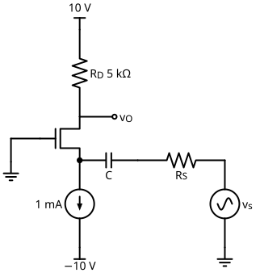
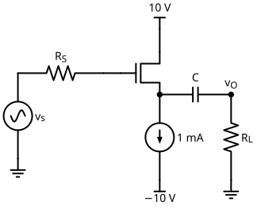

# 第 18 集 · Lec18：共閘放大器（電流緩衝）與共汲放大器（電壓隨耦器） [▶ 影片](https://www.youtube.com/watch?v=Ul-dTlnWldY)

← 上一集：[17](17-mosfet-drain-feedback-current-source-bias.md) ｜ [總目錄](../README.md) ｜ 下一集：[19](19-three-configurations-cascade-power.md) →

> **課程**：電子學（二），陽明交大 電子物理系，112 學年度 — 第 18 集
> **講者**：陳振芳 老師
> **來源**：YouTube 錄影逐字稿（46:06，whisper）＋ Sedra & Smith《Microelectronic Circuits》7th ed. §7.3.5–7.3.6
> **標記說明**：`【口頭】` 老師口頭補充；`【課本補充】` 課本有、課堂沒講；`[▶ mm:ss]` 影片時間點

---

## 目錄

- [0. 這堂課要做什麼](#0-這堂課要做什麼)
- [1. 共閘：電路與直流](#1-共閘電路與直流)
- [2. 共閘：交流增益](#2-共閘交流增益)
- [3. 共閘的本領：抓電流、送電流](#3-共閘的本領抓電流送電流)
- [4. 共汲：電路與直流](#4-共汲電路與直流)
- [5. 共汲的本領：電壓送得出去](#5-共汲的本領電壓送得出去)
- [6. 三種組態比較](#6-三種組態比較)
- [7. 一頁速查表](#7-一頁速查表)
- [8. 與後續集數的連結](#8-與後續集數的連結)

---

## 0. 這堂課要做什麼

上一集做完**共源**（common source, CS）。今天另外兩種，都用電流鏡做的 1 mA 定電流源偏壓：

- **共閘**（common gate, CG）：閘極接地，源極進、汲極出。
- **共汲**（common drain, CD）：汲極接 $V_{DD}$，閘極進、源極出。

---

## 1. 共閘：電路與直流

[▶ 00:30](https://youtu.be/Ul-dTlnWldY?t=30)

閘極交流、直流都接地（共用）。源極底下接 1 mA 電流源（電流鏡：參考那顆 8 kΩ、接 −10 V），信號經電容和 $R_S$ 接到源極；汲極經 $R_D = 5$ kΩ 接 10 V 輸出。[▶ 01:01](https://youtu.be/Ul-dTlnWldY?t=61)

**直流** [▶ 05:07](https://youtu.be/Ul-dTlnWldY?t=307)：電流源一開始從電容和 MOS 抽電荷，源極電壓下降，$V_{GS}$ 超過 $V_t$ 後導通，到 MOS 電流 = 1 mA、電容沒電流為止。$k = 2$ → $V_{GS} = 2$ V → 源極 −2 V。電流鏡那顆要飽和：$-2 \ge -8 - 1$ ✓。[▶ 08:12](https://youtu.be/Ul-dTlnWldY?t=492)

電容一定要：沒有它，信號源會把源極拉到 0 V。[▶ 09:47](https://youtu.be/Ul-dTlnWldY?t=587)

---

## 2. 共閘：交流增益

[▶ 10:17](https://youtu.be/Ul-dTlnWldY?t=617)

交流電路：拿掉所有直流源（$V_{DD}$、電流源），電容夠大短路——$\frac{1}{\omega C} \ll R_S + \frac{1}{g_m}$，帶最低頻率。[▶ 11:49](https://youtu.be/Ul-dTlnWldY?t=709)

從源極看進 MOS（閘極接地）是 $1/g_m$。源極電壓 $v$ 由 $R_S$ 和 $1/g_m$ 分壓，電流 $i = g_mv$ 全部流過 $R_D$：[▶ 14:22](https://youtu.be/Ul-dTlnWldY?t=862)

$$
i = \frac{v_s}{R_S + 1/g_m},
\qquad
v_o = iR_D
$$

$$
\frac{v_o}{v_s} = \frac{g_mR_D}{1 + g_mR_S}
$$

**正號**：同相。比共源的 $g_mR_D$ 小。[▶ 16:30](https://youtu.be/Ul-dTlnWldY?t=990)

若 $g_mR_S \gg 1$（$1/g_m \ll R_S$）：

$$
\frac{v_o}{v_s} \approx \frac{R_D}{R_S}
$$

例 $R_S = 0.5$ kΩ：$k = 2$ 的 $1/g_m = 0.5$ kΩ 不夠小；取 $k = 200$ → $g_m = 20$ mA/V、$1/g_m = 0.05$ kΩ，比 $R_S$ 小一個數量級。[▶ 18:33](https://youtu.be/Ul-dTlnWldY?t=1113)

---

## 3. 共閘的本領：抓電流、送電流

[▶ 19:34](https://youtu.be/Ul-dTlnWldY?t=1174)

輸入電阻只有 $1/g_m$（很小）→ 如果信號源是電壓源，電壓幾乎全跨在 $R_S$ 上，**共閘不是拉電壓的**。共源從閘極看進去是無窮大，才是拉電壓。[▶ 20:05](https://youtu.be/Ul-dTlnWldY?t=1205)

**改成電流源** [▶ 20:36](https://youtu.be/Ul-dTlnWldY?t=1236)：信號源用電流源 $i_s$ 並聯 $R_S$（例如光偵測器，強度和電流成正比）。電流往哪走？$R_S = 0.5$ kΩ vs. $1/g_m = 0.05$ kΩ → 幾乎全部流進 MOS，再全部流到輸出：

$$
i_o \approx i_s
$$

和 $R_S$ 無關、也和 $R_D$ 無關。【口頭】這最好，因為信號源是別人接進來的，你不知道它的 $R_S$ 多少。驗算：$v_o/R_D = v_s/R_S = i_s$，和第 2 節一致。[▶ 22:43](https://youtu.be/Ul-dTlnWldY?t=1363)

**等效模型** [▶ 25:17](https://youtu.be/Ul-dTlnWldY?t=1517)：

- 輸入：電阻 $R_{in} = 1/g_m \approx 0$。
- 輸出：電流源 $i_s$，輸出電阻 $R_{out}$——令輸入電流 0，MOS 沒電流，從輸出加電壓也沒電流 → $R_{out} = \infty$。[▶ 26:56](https://youtu.be/Ul-dTlnWldY?t=1616)

所以共閘把一個**不理想的電流源**（並聯 $R_S$）變成**理想電流源**（並聯 ∞），增益 1。叫**電流緩衝器**（current buffer）。[▶ 30:03](https://youtu.be/Ul-dTlnWldY?t=1803)

【口頭】沒有共閘、直接把 0.5 kΩ 內阻的電流源接 5 kΩ 負載，電流大部分從內阻流掉，出不去。不是「電流一定要出來」，它不出來就是不出來。增益不在乎，可以用別的電路放大。[▶ 31:41](https://youtu.be/Ul-dTlnWldY?t=1901)

---

## 4. 共汲：電路與直流

[▶ 33:16](https://youtu.be/Ul-dTlnWldY?t=1996)

汲極直接接 $V_{DD}$（交流接地，共用）；信號從閘極進，源極接 1 mA 電流源，經電容輸出到負載 $R_L$。

**直流** [▶ 34:20](https://youtu.be/Ul-dTlnWldY?t=2060)：一樣靠電流源抽到 MOS 電流 = 1 mA。$k = 200$ → $V_{GS} = 1 + \sqrt{2/200} = 1.1$ V，源極 −1.1 V。$g_m = \sqrt{2\cdot200\cdot1} = 20$ mA/V。[▶ 35:51](https://youtu.be/Ul-dTlnWldY?t=2151)

---

## 5. 共汲的本領：電壓送得出去

[▶ 36:52](https://youtu.be/Ul-dTlnWldY?t=2212)

交流：閘極不吃電流 → $v_g = v_s$。從源極往上看 MOS 是 $1/g_m$，和 $R_L$ 分壓：

$$
v_o = v_s\frac{R_L}{1/g_m + R_L}
$$

$1/g_m = 50\ \Omega \ll R_L$ → $v_o \approx v_s$。輸出跟著輸入走：**電壓隨耦器**（voltage follower）。[▶ 38:54](https://youtu.be/Ul-dTlnWldY?t=2334)

【口頭】增益 1 有什麼了不起？很了不起。內阻 0.5 kΩ 的信號源直接接 5 kΩ……若 $R_L$ 更小，電壓根本過不來。共汲輸入看進去無窮大，電壓全部進來；輸出端只有 $1/g_m$，$R_L$ 再小電壓也出得去。電壓 × 電流 = 功率，沒有這個電路做不到大功率，喇叭聲音才會大。[▶ 40:27](https://youtu.be/Ul-dTlnWldY?t=2427)

**等效模型** [▶ 43:00](https://youtu.be/Ul-dTlnWldY?t=2580)：

- 輸入電阻 ∞。
- 輸出：開路電壓 $v_s$，串聯 $R_{out} = 1/g_m \approx 0$。

把**不理想的電壓源**（串聯 $R_S$）變成**理想電壓源**（串聯 0），增益 1，和負載無關。叫**電壓緩衝器**（voltage buffer）。[▶ 45:03](https://youtu.be/Ul-dTlnWldY?t=2703)

> 【課本補充】§7.3.6 (p. 442)：源極隨耦器 $A_v = \dfrac{R_L}{R_L + 1/g_m}$、$R_{out} = 1/g_m$；§7.3.5 (p. 439)：共閘 $R_{in} = 1/g_m$，電流增益約 1，稱 current buffer。

---

## 6. 三種組態比較

| | 共源 CS | 共閘 CG | 共汲 CD |
|---|---|---|---|
| 輸入 / 輸出 | 閘 / 汲 | 源 / 汲 | 閘 / 源 |
| $R_{in}$ | ∞ | $1/g_m$（小） | ∞ |
| $R_{out}$ | $R_D$ | ∞（理想電流源） | $1/g_m$（小） |
| 增益 | $-g_mR_D$（電壓） | 電流 ≈ 1；電壓 $\frac{g_mR_D}{1+g_mR_S}$ | 電壓 ≈ 1 |
| 用途 | 電壓放大 | 電流緩衝 | 電壓緩衝、推負載 |

【口頭】三個電路都很重要。

---

## 7. 一頁速查表

| 項目 | 公式 | 關鍵 |
|---|---|---|
| 從源極看進 MOS（閘接地） | $1/g_m$ | |
| 共閘電壓增益 | $g_mR_D/(1 + g_mR_S)$ → $R_D/R_S$ | 同相 |
| 共閘電流 | $i_o \approx i_s$（$1/g_m \ll R_S$） | 理想電流源 |
| 共汲增益 | $R_L/(R_L + 1/g_m) \approx 1$ | |
| 共汲輸出電阻 | $1/g_m$ | 理想電壓源 |
| $k = 200$、1 mA | $V_{GS} = 1.1$ V、$g_m = 20$ mA/V、$1/g_m = 50\ \Omega$ | |

---

## 8. 與後續集數的連結

| 本集觀念 | 後面在哪裡用到 |
|---|---|
| 共閘 | 疊接（cascode）放大器 |
| 源極隨耦器 | 輸出級、多級放大器 |
| $R_{in}$、$R_{out}$ 模型 | 下一集：串接多級的分析 |

---

## 附：本集一句話總結

> **共閘從源極進、輸入電阻只有 $1/g_m$、輸出電阻無窮大，把有內阻的電流源變成理想電流源（電流增益 1）；共汲從閘極進、源極出，輸入電阻無窮大、輸出電阻 $1/g_m$，把有內阻的電壓源變成理想電壓源（電壓增益 1），讓小負載也拿得到電壓和功率。**

---

*筆記依據陳振芳老師「電子學（二）」112 學年度 Lec18 錄影逐字稿（whisper，46:06）與 Sedra & Smith《Microelectronic Circuits》7th ed. 整理。*
