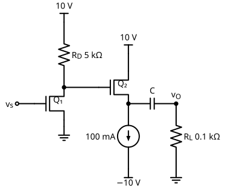

# 第 19 集 · Lec19：三種組態的理想模型、多級串接、為什麼要源極隨耦器推喇叭 [▶ 影片](https://www.youtube.com/watch?v=S_lzqgbCRJI)

← 上一集：[18](18-common-gate-common-drain.md) ｜ [總目錄](../README.md) ｜ 下一集：[20](20-remove-capacitors-complementary-bridge.md) →

> **課程**：電子學（二），陽明交大 電子物理系，112 學年度 — 第 19 集
> **講者**：陳振芳 老師
> **來源**：YouTube 錄影逐字稿（1:15:32，whisper）＋ Sedra & Smith《Microelectronic Circuits》7th ed.
> **標記說明**：`【口頭】` 老師口頭補充；`【課本補充】` 課本有、課堂沒講；`⚠️ 待確認` 查不清楚；`[▶ mm:ss]` 影片時間點

---

## 目錄

- [0. 這堂課要做什麼](#0-這堂課要做什麼)
- [1. 三種組態 = 三種理想放大器](#1-三種組態--三種理想放大器)
- [2. 共源接共源：耦合電容 + 直流路徑](#2-共源接共源耦合電容--直流路徑)
- [3. 不用電容直接接](#3-不用電容直接接)
- [4. 共源直接推喇叭：沒有功率](#4-共源直接推喇叭沒有功率)
- [5. 共源 + 共汲：功率多 2500 倍](#5-共源--共汲功率多-2500-倍)
- [6. IC 裡不能有大電容](#6-ic-裡不能有大電容)
- [7. 共源直接接共閘：電容可以拿掉](#7-共源直接接共閘電容可以拿掉)
- [8. 一頁速查表](#8-一頁速查表)
- [9. 與後續集數的連結](#9-與後續集數的連結)
- [⚠️ 待確認清單](#️-待確認清單)

---

## 0. 這堂課要做什麼

1. 把共源、共閘、共汲整理成三種**理想放大器模型**。
2. 把它們串起來用：兩級共源、共源推喇叭、共源 + 共汲、共源 + 共閘。
3. 看哪裡可以把電容拿掉（IC 裡電容不能大）。

---

## 1. 三種組態 = 三種理想放大器

[▶ 00:00](https://youtu.be/S_lzqgbCRJI?t=0)

（偏壓都用電流鏡定電流源 + 大電容讓交流短路。）

**等效模型怎麼求** [▶ 04:09](https://youtu.be/S_lzqgbCRJI?t=249)：電流源並聯 $R_o$ 的模型——

- 電流源 = 把輸出**短路**量到的電流（short-circuit current）。
- $R_o$ = 輸入信號設 0，從輸出往回看的電阻。

| 組態 | 輸入抓什麼 | $R_{in}$ | 輸出 | $R_{out}$ | 名字 |
|---|---|---|---|---|---|
| 共源 | 電壓 | ∞ | 電流 $g_mv$ | ∞ | 理想**轉導放大器**（transconductance amplifier） |
| 共閘 | 電流 | $1/g_m \approx 0$ | 電流 $i$（×1） | ∞ | 理想**電流放大器**（current follower） |
| 共汲 | 電壓 | ∞ | 電壓 $v$（×1） | $1/g_m \approx 0$ | 理想**電壓放大器**（voltage follower） |

[▶ 10:21](https://youtu.be/S_lzqgbCRJI?t=621)

- 共源：$v = 0$ 時 MOS 沒電流，往回看無窮大（這裡把 $R_D$ 當外面的負載）。
- 共閘：要用**電流源**信號；$R_{in}$ 只要遠小於 $R_s$ 就好。[▶ 14:00](https://youtu.be/S_lzqgbCRJI?t=840)
- 共汲：輸出開路電壓 = $v$；$v = 0$ 時從源極加 $V_x$，電流 $g_mV_x$ → $R_{out} = 1/g_m$。[▶ 25:33](https://youtu.be/S_lzqgbCRJI?t=1533)

【口頭】輸入端「短路一定抓電流、開路一定抓電壓」，不可能反過來。電壓、電流排列組合有四種放大器；信號源是什麼你沒辦法選，就要配合它。[▶ 19:14](https://youtu.be/S_lzqgbCRJI?t=1154)

例：共汲用 100 mA、$k = 200$ → $g_m = \sqrt{2\cdot200\cdot100} = 200$ mA/V → $1/g_m = 5\ \Omega$，負載只要遠大於 5 Ω 就是理想電壓隨耦。[▶ 21:54](https://youtu.be/S_lzqgbCRJI?t=1314)

> 【課本補充】Sedra §1.5 的四種放大器模型：電壓、電流、轉導、轉阻放大器，理想時 $R_{in}$、$R_{out}$ 各是 0 或 ∞。

---

## 2. 共源接共源：耦合電容 + 直流路徑

[▶ 30:48](https://youtu.be/S_lzqgbCRJI?t=1848)

兩級一樣的共源（$k = 2$、1 mA、$R_D = 5$ kΩ）。第一級汲極直流 5 V，第二級閘極要 0 V（源極 −2 V、電流鏡接 −10 V 才飽和）。[▶ 32:18](https://youtu.be/S_lzqgbCRJI?t=1938)

- 直接接，兩邊直流打架 → 中間放**電容**，讓它自己跨掉 5 V 的差。[▶ 32:49](https://youtu.be/S_lzqgbCRJI?t=1969)
- 但閘極是氧化層，電容沒有路可以充電 → 第二級閘極要接一顆 **$R_G$ 到地**，提供直流路徑（provide a DC path）。[▶ 34:56](https://youtu.be/S_lzqgbCRJI?t=2096)
- $R_G$ 取 MΩ：交流時第一級的信號電流看到 5 kΩ 和 1 MΩ，差三個數量級，幾乎不分流，增益不打折。充電再慢也是一秒內。[▶ 35:56](https://youtu.be/S_lzqgbCRJI?t=2156)

$$
A_v = (-g_mR_D)(-g_mR_D) = (-10)(-10) = 100
$$

[▶ 40:11](https://youtu.be/S_lzqgbCRJI?t=2411)

---

## 3. 不用電容直接接

[▶ 42:11](https://youtu.be/S_lzqgbCRJI?t=2531)

也可以，但要調偏壓。直接接時第二級閘極 = 5 V；第一級要飽和，往下只能擺到 $5 - 4 = 1$ V 的空間（老師說往上很大、往下只有 1 V），上面大也沒用，正弦被下面限制住。→ 兩級的直流都要調一下讓擺幅對稱。好處：第二級閘極已經 5 V，它的電流鏡可以接地，不用 −10 V。[▶ 43:16](https://youtu.be/S_lzqgbCRJI?t=2596)

【口頭】也可以只用一級、把 $k$ 取大得到大增益，但基本原則：**增益大的，頻寬會窄**。[▶ 45:53](https://youtu.be/S_lzqgbCRJI?t=2753)

---

## 4. 共源直接推喇叭：沒有功率

[▶ 46:56](https://youtu.be/S_lzqgbCRJI?t=2816)

要大電流，負載一定要小。喇叭只有 4 Ω、8 Ω，這裡用 $R_L = 0.1$ kΩ 方便算。$R_D$ 還是要（給直流 5 V），喇叭經電容接（直流不能灌進喇叭，不然振膜壓到底就壞）。[▶ 47:28](https://youtu.be/S_lzqgbCRJI?t=2848)

交流：$R_D$ 和 $R_L$ 並聯 ≈ 0.1 kΩ：[▶ 50:32](https://youtu.be/S_lzqgbCRJI?t=3032)

$$
v_o \approx -g_m(R_D \parallel R_L)v_s \approx -2\times0.1\,v_s = -0.2v_s
$$

設計的 −10 倍變成 −0.2。電流 $i_o = v_o/R_L = 2v_s$（mA，$v_s$ 以 V 計）。正弦功率要對週期平均（$\sin^2$ 平均 1/2）：[▶ 52:37](https://youtu.be/S_lzqgbCRJI?t=3157)

$$
P = \frac12\cdot0.2v_s\cdot2v_s = 0.2v_s^2
$$

$v_s$ 才幾 mV → 幾乎沒有功率。**共源只能當電壓放大器，前提是負載要大**；電流一被拉出去，電壓就沒了，功率也沒了。[▶ 54:15](https://youtu.be/S_lzqgbCRJI?t=3255)

---

## 5. 共源 + 共汲：功率多 2500 倍

[▶ 55:15](https://youtu.be/S_lzqgbCRJI?t=3315)

共源後面直接接共汲（100 mA、$k = 200$），共汲經電容推喇叭。

**直流** [▶ 57:20](https://youtu.be/S_lzqgbCRJI?t=3440)：$100 = \frac12\cdot200(V_{GS} - 1)^2$ → $V_{GS} = 2$ V；$Q_2$ 閘極 5 V（直接接）→ 源極 3 V；電流源底下 −10 V，差 13 V 夠高。電容讓喇叭直流 0 V。

**交流** [▶ 58:23](https://youtu.be/S_lzqgbCRJI?t=3503)：第一級 $-10v_s$；$1/g_m = 5\ \Omega \ll 100\ \Omega$，全部跟過去：

$$
v_o = -10v_s,
\qquad
i_o = \frac{-10v_s}{0.1} = -100v_s,
\qquad
P = \frac12\cdot10\cdot100\,v_s^2 = 500v_s^2
$$

和直接接的 $0.2v_s^2$ 比，**功率 × 2500**。[▶ 1:00:56](https://youtu.be/S_lzqgbCRJI?t=3656)

【口頭】共汲讓電壓過得去，除以小電阻就是大電流 → **功率放大**（power amplification）。共源最多是電壓放大器，共汲才能推喇叭。[▶ 1:02:31](https://youtu.be/S_lzqgbCRJI?t=3751)

---

## 6. IC 裡不能有大電容

[▶ 1:04:05](https://youtu.be/S_lzqgbCRJI?t=3845)

輸出電容要對交流短路：往外看是 $R_L + 1/g_m \approx 0.1$ kΩ，很小 → $C \gg \frac{1}{10^2\times100} = 100\ \mu$F。做實驗可以，放進手機不行。[▶ 1:05:07](https://youtu.be/S_lzqgbCRJI?t=3907)

【口頭】IC 設計的電容一般不能大於 nF 等級（20 μF、100 μF 差太遠）；電阻大也不行（要繞很長）。所以要想辦法把電容拿掉。[▶ 1:06:10](https://youtu.be/S_lzqgbCRJI?t=3970)

---

## 7. 共源直接接共閘：電容可以拿掉

[▶ 1:07:14](https://youtu.be/S_lzqgbCRJI?t=4034)

共源後面接共閘時，對交流一定要給一條路；試著把共源的源極直接接到共閘的源極。拿掉電容後，這個電路**左右對稱**：兩顆 $k$ 一樣、電流一樣 → $V_{GS}$ 一樣、兩個源極都是 −2 V，電容兩邊沒有電位差，根本不用電容。[▶ 1:09:45](https://youtu.be/S_lzqgbCRJI?t=4185)

兩個 1 mA 電流源合成一個 **2 mA** 的電流鏡：$k = 2$ → $V_{GS} = 1 + \sqrt2 \approx 2.4$ V。[▶ 1:12:53](https://youtu.be/S_lzqgbCRJI?t=4373)

以下**不是逐字稿內容**，是依電流鏡算的：參考電阻 $= (10 - 2.4)/2\ \text{mA} = 3.8$ kΩ。

> ⚠️ 待確認：whisper 這段聽成「7.6 除以 2 kΩ……放 7.6 kΩ」，數字對不起來（7.6 V / 2 mA = 3.8 kΩ）；也可能參考那邊是不同的接法。影片 [▶ 1:13:54](https://youtu.be/S_lzqgbCRJI?t=4434) 待查。

交流信號的分析在影片最後才開始，下一集接著講。[▶ 1:14:57](https://youtu.be/S_lzqgbCRJI?t=4497)

> 【課本補充】兩個源極接在一起、共用一個電流源，就是**差動對**（differential pair）的形狀（Sedra Ch9，電子學（三））。

---

## 8. 一頁速查表

| 項目 | 公式／重點 | 關鍵 |
|---|---|---|
| 模型參數 | 電流源 = 短路電流；$R_o$ = 輸入設 0 往回看 | |
| 共源 | 轉導放大器，$R_{in} = R_{out} = \infty$ | |
| 共閘 | 電流隨耦器，$R_{in} \approx 0$、$R_{out} = \infty$ | |
| 共汲 | 電壓隨耦器，$R_{in} = \infty$、$R_{out} = 1/g_m$ | |
| 兩級共源 | 電容 + $R_G$（MΩ）到地，$A_v = 100$ | 直流路徑 |
| 共源推喇叭 | $-g_m(R_D\parallel R_L)$ ≈ −0.2，$P = 0.2v_s^2$ | |
| 共源 + 共汲 | $v_o = -10v_s$，$P = 500v_s^2$ | ×2500 |
| 正弦功率 | $P = \frac12V_oI_o$ | |
| IC 電容 | nF 等級以下 | 要拿掉電容 |
| 共源 + 共閘 | 對稱 → 不用電容，共用 2 mA 電流源 | 差動對 |

---

## 9. 與後續集數的連結

| 本集觀念 | 後面在哪裡用到 |
|---|---|
| 共源 + 共閘直接接 | 下一集交流分析；差動對 |
| 共汲推負載 | 輸出級（電子學（四）） |
| 增益 vs. 頻寬 | 第 10 章頻率響應 |

---

## 附：本集一句話總結

> **共源是理想轉導放大器、共閘是電流隨耦器、共汲是電壓隨耦器；多級串接時用電容隔直流、閘極接大 $R_G$ 給直流路徑；共源直接推小負載幾乎沒有功率，後面接共汲（$1/g_m$ 很小）功率就多 2500 倍；IC 裡不能放大電容，所以要設計成像共源接共閘那樣對稱、可以直接接的電路。**

---

## ⚠️ 待確認清單

1. 第 7 節 2 mA 電流鏡的參考電阻：逐字稿「7.6 kΩ」vs. 計算的 3.8 kΩ。

---

*筆記依據陳振芳老師「電子學（二）」112 學年度 Lec19 錄影逐字稿（whisper，1:15:32）與 Sedra & Smith《Microelectronic Circuits》7th ed. 整理。*
