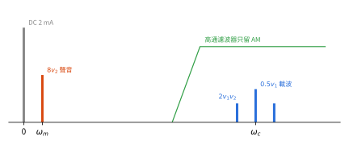

# 第 21 集 · Lec21：MOS 在歐姆區當 AM 調變器、用電流鏡砍掉直流電流、PMOS [▶ 影片](https://www.youtube.com/watch?v=e1-8zBvfmLU)

← 上一集：[20](20-remove-capacitors-complementary-bridge.md) ｜ [總目錄](../README.md) ｜ 下一集：[22](22-pmos-current-sources-cmos-amplifier.md) →

> **課程**：電子學（二），陽明交大 電子物理系，112 學年度 — 第 21 集
> **講者**：陳振芳 老師
> **來源**：YouTube 錄影逐字稿（1:15:41，whisper）＋ Sedra & Smith《Microelectronic Circuits》7th ed.
> **標記說明**：`【口頭】` 老師口頭補充；`【課本補充】` 課本有、課堂沒講；`[▶ mm:ss]` 影片時間點

---

## 目錄

- [0. 這堂課要做什麼](#0-這堂課要做什麼)
- [1. 歐姆區的工作點](#1-歐姆區的工作點)
- [2. 兩個信號相乘：AM](#2-兩個信號相乘am)
- [3. 把電流抓出來：I→V 轉換器](#3-把電流抓出來iv-轉換器)
- [4. 直流電流太大：用電流鏡砍掉](#4-直流電流太大用電流鏡砍掉)
- [5. PMOS](#5-pmos)
- [6. PMOS 共源放大器](#6-pmos-共源放大器)
- [7. PMOS 電流鏡偏壓與輸入直流範圍](#7-pmos-電流鏡偏壓與輸入直流範圍)
- [8. 一頁速查表](#8-一頁速查表)
- [9. 與後續集數的連結](#9-與後續集數的連結)

---

## 0. 這堂課要做什麼

1. MOS 不放大，改工作在**三極管區的歐姆區**，用它把兩個信號**相乘**，做出 AM 信號。
2. 直流電流太大怎麼砍——電流鏡。
3. 開始講 **PMOS**（p 通道），之後要用在 CMOS。

---

## 1. 歐姆區的工作點

[▶ 01:05](https://youtu.be/e1-8zBvfmLU?t=65)

三極管區：

$$
i_D = k\left[(v_{GS} - V_t)v_{DS} - \frac12v_{DS}^2\right]
$$

$v_{DS}$ 很小時把平方項丟掉：要求 $V_{GS} - V_t \gg \frac12V_{DS}$。交流比直流小很多，工作點 $Q$ 用直流判斷就好。[▶ 02:38](https://youtu.be/e1-8zBvfmLU?t=158)

例（$k = 2$、$V_t = 1$）：閘極 5 V，汲極經 5 kΩ 接 10 V。$R_{DS} = \frac{1}{k(V_{GS}-V_t)} = \frac18$ kΩ → $V_{DS} \approx 0.25$ V、$I_D \approx 2$ mA。檢查：$4 \gg 0.125$ ✓，在歐姆區（離夾止的 4 V 很遠）。[▶ 06:17](https://youtu.be/e1-8zBvfmLU?t=377)

---

## 2. 兩個信號相乘：AM

[▶ 08:21](https://youtu.be/e1-8zBvfmLU?t=501)

閘極加載波 $v_1$、汲極加聲音 $v_2$（都經電容接進來，不然直流 5 V、0.25 V 會被吃掉）：[▶ 09:23](https://youtu.be/e1-8zBvfmLU?t=563)

$$
v_{GS} = 5 + v_1,
\qquad
v_{DS} = 0.25 + v_2
$$

$$
i_D = k(v_{GS} - V_t)v_{DS} = 2(4 + v_1)(0.25 + v_2)
= \underbrace{2}_{\text{DC}} + \underbrace{8v_2}_{\text{聲音}} + \underbrace{0.5\left(1 + 4v_2\right)v_1}_{\text{AM}}
$$

[▶ 10:58](https://youtu.be/e1-8zBvfmLU?t=658)

最後一項就是 $A[1 + mf(t)]\sin\omega_ct$：$v_1$ 是載波（高頻），$v_2$ 是聲音，$m$ 可以做得很小。頻譜：DC、$\omega_m$、$\omega_c$、$\omega_c \pm \omega_m$。後面接**高通濾波器**只留 AM。[▶ 12:35](https://youtu.be/e1-8zBvfmLU?t=755)

---

## 3. 把電流抓出來：I→V 轉換器

[▶ 18:09](https://youtu.be/e1-8zBvfmLU?t=1089)

上面的算法前提是 MOS 底下接地。電流要抓出來 → 接 op amp 的 **I→V 轉換器**（電流進負端、回授電阻 $R$）：負端是虛接地，等效上還是地，前面的計算都不變；輸出 $-Ri_D$，再接高通（電容 + 電阻）。[▶ 18:45](https://youtu.be/e1-8zBvfmLU?t=1125)

---

## 4. 直流電流太大：用電流鏡砍掉

[▶ 21:55](https://youtu.be/e1-8zBvfmLU?t=1315)

直流 2 mA 遠大於 AM 項。想放大 AM 就要 $R$ 大，但 $R$ 也把 2 mA 放大：$2\ \text{mA}\times R$ 超過十幾伏 op amp 就飽和，所以 $R$ 最多 5 kΩ，AM 就很小。——和以前「直流沒拿掉，先把直流放大到飽和」同一個問題。[▶ 22:25](https://youtu.be/e1-8zBvfmLU?t=1345)

電壓用電容砍；**電流要用電流鏡砍**：另做一個也是 2 mA 的電路，用電流鏡從同一個節點把 2 mA 抽走。[▶ 24:57](https://youtu.be/e1-8zBvfmLU?t=1497)

- 例：參考那邊 $k = 4$ 才剛好 2 mA（老師改用 $k = 4$ 免得算出 $\sqrt2$），電流鏡接 −10 V。[▶ 28:03](https://youtu.be/e1-8zBvfmLU?t=1683)
- 問題：$k$ 很難控制，兩邊電流不一定剛好一樣，砍不乾淨。[▶ 30:38](https://youtu.be/e1-8zBvfmLU?t=1838)
- 解法：讓兩條路關鍵節點的**電壓一定相等**——把參考那邊拉到同一個 op amp 的虛短路上，亦步亦趨：你 −1 我也 −1，不一定要是 0。電路一樣、電壓一樣，直流就一定一樣，砍得乾淨，剩下 AM，再經高通。[▶ 34:44](https://youtu.be/e1-8zBvfmLU?t=2084)

【口頭】這比砍電壓複雜一點，但做得到。[▶ 37:21](https://youtu.be/e1-8zBvfmLU?t=2241)

---

## 5. PMOS

[▶ 38:22](https://youtu.be/e1-8zBvfmLU?t=2302)

一個 P、一個 N 合起來叫 **CMOS**，是 MOS 最重要的電路，所以要講 PMOS。

**結構** [▶ 38:53](https://youtu.be/e1-8zBvfmLU?t=2333)：N 型基板 + 兩塊 $P^+$。基板和源極接在一起（不對稱）。

- 閘極加**負**電壓才吸引電洞形成 p 通道 → $V_t$ 是負的（例 −1 V）。[▶ 39:54](https://youtu.be/e1-8zBvfmLU?t=2394)
- $V_{DS}$ 也要負，才能把電洞從源極拉到汲極。

**公式：全部掛絕對值** [▶ 41:27](https://youtu.be/e1-8zBvfmLU?t=2487)：物理一樣，只是符號反過來：

$$
I_D = \frac12k\left(V_{SG} - |V_t|\right)^2,
\qquad
V_{SD} \ge V_{SG} - |V_t|
$$

【口頭】下標寫成 $SG$、$SD$ 就不用掛絕對值；$V_t$ 一定要掛。[▶ 43:02](https://youtu.be/e1-8zBvfmLU?t=2582)

**飽和條件好記法** [▶ 49:20](https://youtu.be/e1-8zBvfmLU?t=2960)：$V_S - V_D \ge V_S - V_G - |V_t|$ ⇔

$$
V_D \le V_G + |V_t|
$$

閘極電壓**往上**加 $|V_t|$，汲極要比它低。（NMOS 是往下減、汲極要比它高。）

**符號** [▶ 45:06](https://youtu.be/e1-8zBvfmLU?t=2706)：PMOS 大多放在 NMOS 頭上、汲極和汲極接在一起，所以習慣把源極畫在上面。電流和電洞同方向，從源極流進、汲極流出，箭頭指向裡面。源極（和 N 基板）接**系統最高電壓**，P-N 接面才不會導通。[▶ 46:40](https://youtu.be/e1-8zBvfmLU?t=2800)

> 【課本補充】§5.1.7 (p. 261)：PMOS 的 $V_{tp}$ 為負、$i_D = \frac12k_p'\frac{W}{L}(v_{SG} - |V_{tp}|)^2$；同尺寸下 $\mu_p$ 約為 $\mu_n$ 的 0.25–0.5 倍，所以 PMOS 較少單獨使用。

---

## 6. PMOS 共源放大器

[▶ 52:00](https://youtu.be/e1-8zBvfmLU?t=3120)

源極接 10 V，汲極經 $R_D$ 接地，從汲極輸出。$k = 2$、$|V_t| = 1$，設計 1 mA：$V_{SG} = 2$ V → 閘極 8 V（$R_1$ 2 MΩ、$R_2$ 8 MΩ 分壓）。$R_D = 5$ kΩ → $V_D = 5$ V。[▶ 53:02](https://youtu.be/e1-8zBvfmLU?t=3182)

檢查：$V_D = 5 \le V_G + |V_t| = 9$ ✓ 飽和。[▶ 54:05](https://youtu.be/e1-8zBvfmLU?t=3245)

**交流** [▶ 55:07](https://youtu.be/e1-8zBvfmLU?t=3307)：$g_m = \sqrt{2\cdot2\cdot1} = 2$ mA/V。電容短路、拿掉直流源。

【口頭】常有人問：$v_s$ 是對地量的，而閘極對地也是 $v_s$（源極交流接地），所以 $v_{sg}$ 就從源極往閘極畫。不要把 $v_s$ 畫到 $R_s$ 中間那種會變的節點去算，那是解完才知道的。[▶ 58:07](https://youtu.be/e1-8zBvfmLU?t=3487)

$$
v_o = -g_mR_Dv_s = -10v_s
$$

（閘極比源極高時電流往上流，所以負號一樣。）全部 $v_O = 5 - 10v_s$。擺幅：天花板是 $V_G + |V_t| = 9$ V（超過就離開飽和），地板 0 V。[▶ 1:02:16](https://youtu.be/e1-8zBvfmLU?t=3736)

---

## 7. PMOS 電流鏡偏壓與輸入直流範圍

[▶ 1:03:19](https://youtu.be/e1-8zBvfmLU?t=3799)

NMOS 共源用電流源偏壓時電流源在**底下**；PMOS 共源的電流源在**頭上**：PMOS 源極接 PMOS 電流鏡（10 V），$R_D$ 接到 −10 V。[▶ 1:05:26](https://youtu.be/e1-8zBvfmLU?t=3926)

- PMOS 電流鏡：參考那顆 $V_{SG} = 2$ V → 閘極 8 V，參考電阻 8 V/1 mA = 8 kΩ 到地。$k$ 再大電流也只到 9/8 mA。[▶ 1:06:29](https://youtu.be/e1-8zBvfmLU?t=3989)
- 一定要用 **P 型**電流鏡放頭上、N 型放底下，電流方向才對。[▶ 1:08:33](https://youtu.be/e1-8zBvfmLU?t=4113)
- 放大管源極要接電容到地讓交流通過（和 NMOS 版一樣）。[▶ 1:12:10](https://youtu.be/e1-8zBvfmLU?t=4330)

**輸入直流範圍**（兩顆都要飽和，$k = 2$）[▶ 1:11:40](https://youtu.be/e1-8zBvfmLU?t=4300)：放大管源極 $= V_{DC} + 2$。

- 電流鏡那顆：汲極（$V_{DC} + 2$）$\le$ 閘極 8 + 1 = 9 → $V_{DC} \le 7$ V。[▶ 1:13:42](https://youtu.be/e1-8zBvfmLU?t=4422)
- 放大管：$V_D \le V_{DC} + 1$；$V_D = -10 + 5 = -5$ V → $V_{DC} \ge -6$ V。

$$
-6\ \text{V} \le V_{DC} \le 7\ \text{V}
$$

（老師提醒：和以前 NMOS 版的結果一樣，一邊差 7、一邊差 6。）[▶ 1:15:15](https://youtu.be/e1-8zBvfmLU?t=4515)

---

## 8. 一頁速查表

| 項目 | 公式／重點 | 關鍵 |
|---|---|---|
| 歐姆區 | $i_D \approx k(v_{GS} - V_t)v_{DS}$ | $V_{GS}-V_t \gg \frac12V_{DS}$ |
| 調變器 | $2(4+v_1)(0.25+v_2)$ → AM 項 $0.5(1+4v_2)v_1$ | 相乘 |
| 抓電流 | I→V 轉換器，虛接地 | 再接高通 |
| 砍直流電流 | 電流鏡抽走；兩邊節點電壓要相等 | 接同一個虛短路 |
| PMOS 電流 | $\frac12k(V_{SG} - \lvert V_t\rvert )^2$ | 全部掛絕對值 |
| PMOS 飽和 | $V_D \le V_G + \lvert V_t\rvert $ | 往上加 |
| PMOS 接法 | 源極、基板接最高電壓 | |
| PMOS 共源 | 增益 $-g_mR_D$（例 −10） | 天花板 $V_G + \lvert V_t\rvert $ |
| 輸入直流範圍 | 例 −6～7 V | 兩顆都飽和 |

---

## 9. 與後續集數的連結

| 本集觀念 | 後面在哪裡用到 |
|---|---|
| PMOS + NMOS | 下一集起：CMOS 反相器、CMOS 放大器 |
| 電流鏡砍直流電流 | 主動負載、差動對 |
| 歐姆區相乘 | 混頻器（mixer） |

---

## 附：本集一句話總結

> **MOS 在歐姆區 $i_D \approx k(v_{GS}-V_t)v_{DS}$，閘極放載波、汲極放聲音就把兩者相乘得到 AM，再用 I→V 轉換器抓出電流、高通濾掉其他項；直流電流太大會讓 op amp 飽和，要用電流鏡抽掉，並讓兩邊節點電壓相等才砍得乾淨。PMOS 的公式全部掛絕對值，源極接最高電壓，飽和條件是 $V_D \le V_G + |V_t|$。**

---

*筆記依據陳振芳老師「電子學（二）」112 學年度 Lec21 錄影逐字稿（whisper，1:15:41）與 Sedra & Smith《Microelectronic Circuits》7th ed. 整理。*
