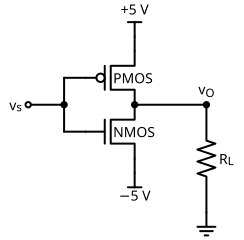

# 第 22 集 · Lec22：PMOS 共源與 P 型電流源、IC 的電流源偏壓網路、CMOS 放大器 [▶ 影片](https://www.youtube.com/watch?v=nmRyHJhJkgo)

← 上一集：[21](21-mos-ohmic-modulator-pmos.md) ｜ [總目錄](../README.md) ｜ 下一集：[23](23-cmos-inverter-pwm-early-effect.md) →

> **課程**：電子學（二），陽明交大 電子物理系，112 學年度 — 第 22 集
> **講者**：陳振芳 老師
> **來源**：YouTube 錄影逐字稿（40:35，whisper）＋ Sedra & Smith《Microelectronic Circuits》7th ed.
> **標記說明**：`【口頭】` 老師口頭補充；`【課本補充】` 課本有、課堂沒講；`[▶ mm:ss]` 影片時間點

---

## 目錄

- [0. 這堂課要做什麼](#0-這堂課要做什麼)
- [1. 複習：NMOS 共源 + N 型電流源](#1-複習nmos-共源--n-型電流源)
- [2. PMOS 共源 + P 型電流源](#2-pmos-共源--p-型電流源)
- [3. IC 裡的電流源網路](#3-ic-裡的電流源網路)
- [4. 用佈局調 $k$](#4-用佈局調-k)
- [5. CMOS 放大器](#5-cmos-放大器)
- [6. 一頁速查表](#6-一頁速查表)
- [7. 與後續集數的連結](#7-與後續集數的連結)

---

## 0. 這堂課要做什麼

把 NMOS、PMOS 兩種電流源偏壓對照清楚，看 IC 裡怎麼用一個參考電流產生一整串電流源，最後把 PMOS 和 NMOS 疊起來，做出不用電容的 **CMOS 放大器**。

---

## 1. 複習：NMOS 共源 + N 型電流源

[▶ 00:32](https://youtu.be/nmRyHJhJkgo?t=32)

$R_D = 5$ kΩ 接 10 V，源極接 N 型電流鏡（1 mA，參考那顆 $k = 2$ → 2 V、接 −10 V）。IC 設計時電流鏡兩顆要做成一樣。[▶ 02:09](https://youtu.be/nmRyHJhJkgo?t=129)

- 直流：閘極 0 → 源極 −2 V；放大管飽和（汲極 5 ≥ −1）、電流鏡飽和（−2 ≥ −9）。輸入直流可上到 6 V、往下到 −7 V。[▶ 03:39](https://youtu.be/nmRyHJhJkgo?t=219)
- 交流：源極要接電容到地，交流電流才有路走。[▶ 05:42](https://youtu.be/nmRyHJhJkgo?t=342)
- 電流鏡 $k \to \infty$ 也只到 9/8 mA → 直流由底下的電流鏡控制；交流 $g_m$ 由放大管的 $k$ 控制：$k = 2$ 增益 10，$k = 200$ 增益 100。[▶ 08:16](https://youtu.be/nmRyHJhJkgo?t=496)

---

## 2. PMOS 共源 + P 型電流源

[▶ 09:48](https://youtu.be/nmRyHJhJkgo?t=588)

PMOS 畫法：S 和 D 對調，源極在上，箭頭指進源極。電流源在**頭上**，用 **P 型電流鏡**（接 10 V，參考那顆 $V_{SG} = 2$ V → 閘極 8 V，8 kΩ 到地）。$R_D = 5$ kΩ 接到 −10 V → 輸出 −5 V。[▶ 11:19](https://youtu.be/nmRyHJhJkgo?t=679)

**直流檢查**（$k = 2$、$|V_t| = 1$）[▶ 13:20](https://youtu.be/nmRyHJhJkgo?t=800)：

- 放大管閘極 0 V、$V_{SG} = 2$ → 源極 2 V。基板接源極，閘極要比它低才有 p 通道。
- 電流鏡那顆：$V_D \le V_G + |V_t| = 8 + 1 = 9$；$V_D = 2$ ✓（差 7 V）。【口頭】PMOS 減 $V_t$ 時 $V_t$ 是負的，負負得正，所以反而往上加。[▶ 15:56](https://youtu.be/nmRyHJhJkgo?t=956)
- 放大管：$V_D = -5 \le 0 + 1$ ✓（差 6 V）。

輸入直流：往上不能讓源極超過 9 → $V_{DC} \le 7$ V；往下差 6 V → $V_{DC} \ge -6$ V。[▶ 18:00](https://youtu.be/nmRyHJhJkgo?t=1080)

---

## 3. IC 裡的電流源網路

[▶ 19:00](https://youtu.be/nmRyHJhJkgo?t=1140)

- 電流源在電路**底下** → 用 **N 型**電流鏡（底下接夠低的電壓）。
- 電流源在電路**頭上** → 用 **P 型**電流鏡。[▶ 20:01](https://youtu.be/nmRyHJhJkgo?t=1201)

兩種都要時，乾脆把參考支路接在一起：一顆 P 型參考接 10 V、一顆 N 型參考接 −10 V，串在同一條 1 mA 路上（$k = 2$ 時兩顆各 2 V，中間電阻 16 kΩ）。[▶ 21:34](https://youtu.be/nmRyHJhJkgo?t=1294)

- P 那邊的閘極電壓拉出去給上面的電路當電流源；N 那邊拉出去給下面的電路。
- 閘極**不拉電流**，所以可以一直拉、一直接：共源、共閘、共汲……參考那邊完全沒感覺。但那條閘極線一定要有，電壓要拉過去。[▶ 23:08](https://youtu.be/nmRyHJhJkgo?t=1388)
- 每一顆都要檢查飽和：N 型的汲極要 $\ge -8 - 1 = -9$ V，P 型的汲極要 $\le 8 + 1 = 9$ V——這些電壓由接上去的電路決定，所以接好後要逐一檢查。[▶ 25:13](https://youtu.be/nmRyHJhJkgo?t=1513)

【口頭】這就是典型 IC 電路的偏壓方式，電子學（三）、（四）還會看到很多。[▶ 31:25](https://youtu.be/nmRyHJhJkgo?t=1885)

---

## 4. 用佈局調 $k$

[▶ 26:16](https://youtu.be/nmRyHJhJkgo?t=1576)

上一集共汲要 100 mA，不是 1 mA。所有閘極都是同一個 2 V，那就把那顆的 $k$ 做成 100 倍，電流就 100 倍。[▶ 26:47](https://youtu.be/nmRyHJhJkgo?t=1607)

$k = \mu C_{ox}W/L$。【口頭】$\mu$ 很難控制（和材料純度、濃度都有關），但 $W$、$L$ 是你自己畫的**佈局**（layout）：同一個 $L$，$W$ 兩倍 $k$ 就兩倍，十倍就十倍。[▶ 27:18](https://youtu.be/nmRyHJhJkgo?t=1638)

所以「共源 1 mA + 共汲 100 mA」用同一組參考電流鏡，就是共汲那顆電流源的 $W$ 畫 100 倍。[▶ 29:54](https://youtu.be/nmRyHJhJkgo?t=1794)

> 【課本補充】§8.2.2 電流導引（current steering）：一個參考電流經 N 型、P 型電流鏡分配到各級，輸出電流按 $(W/L)$ 比例縮放。

---

## 5. CMOS 放大器

[▶ 31:56](https://youtu.be/nmRyHJhJkgo?t=1916)

**CMOS**（complementary MOS）= 一顆 P + 一顆 N 做在一起：PMOS 在上、NMOS 在下，**汲極接汲極**、**閘極接閘極**。電源 ±5 V，$k = 2$，$V_t$ 一個 +1、一個 −1。輸入直接接（沒有電容）。[▶ 32:26](https://youtu.be/nmRyHJhJkgo?t=1946)

**直流**（輸入 0 V）[▶ 33:30](https://youtu.be/nmRyHJhJkgo?t=2010)：NMOS $V_{GS} = 5$、PMOS $V_{SG} = 5$，各差 5 V——以前單顆加這麼大早就跳出飽和了。

$$
I_D = \frac12\cdot2\cdot(5 - 1)^2 = 16\ \text{mA}
$$

上下都 16 mA → 負載沒有電流 → 輸出 0 V。檢查：NMOS 汲極 0 ≥ 0 − 1 ✓；PMOS 汲極 0 ≤ 0 + 1 ✓（只差 1 V，但是對的）。電流這麼大還在飽和。[▶ 34:31](https://youtu.be/nmRyHJhJkgo?t=2071)

$$
g_m = \sqrt{2\cdot2\cdot16} = 8\ \text{mA/V}
$$

**交流** [▶ 36:04](https://youtu.be/nmRyHJhJkgo?t=2164)：拿掉 ±5 V（記得兩個都要拿掉）。兩個源極交流接地，閘極都是 $v_s$ → 兩顆都產生 $g_mv_s$ 的電流，在輸出端方向一致、加起來流進 $R_L$：[▶ 37:41](https://youtu.be/nmRyHJhJkgo?t=2261)

$$
v_o = -2g_mR_Lv_s
$$

例：增益 160 倍（$2\times8\times R_L$，對應 $R_L = 10$ kΩ）。$R_L$ 放多大增益就多大。[▶ 38:44](https://youtu.be/nmRyHJhJkgo?t=2324)

【口頭】增益很大時 $v_s$ 必須非常小，不然輸出一下就出飽和區（PMOS 那邊只有 1 V 的空間）。這個電路**看不到電容**，就是一個 CMOS 放大器。下禮拜講 MOS 最重要的電路：CMOS 數位電路。[▶ 39:14](https://youtu.be/nmRyHJhJkgo?t=2354)

---

## 6. 一頁速查表

| 項目 | 公式／重點 | 關鍵 |
|---|---|---|
| NMOS 飽和 | $V_D \ge V_G - V_t$ | 往下減 |
| PMOS 飽和 | $V_D \le V_G + \lvert V_t\rvert $ | 往上加 |
| 電流源位置 | 底下用 N 型、頭上用 P 型電流鏡 | |
| 電流源網路 | P、N 參考串在同一路，閘極電壓拉出去 | 閘極不拉電流 |
| 調電流 | 同 $L$，$W$ 畫幾倍電流就幾倍 | layout |
| CMOS 直流 | 輸入 0：各 16 mA、輸出 0 | 兩顆都飽和 |
| CMOS 交流 | $v_o = -2g_mR_Lv_s$ | 不用電容 |

---

## 7. 與後續集數的連結

| 本集觀念 | 後面在哪裡用到 |
|---|---|
| CMOS | 下一集起：CMOS 反相器（數位） |
| 電流源網路、電流導引 | 電子學（三）差動放大器、（四）運算放大器內部 |
| PMOS 主動負載 | CMOS 放大器 |

---

## 附：本集一句話總結

> **PMOS 共源用頭上的 P 型電流鏡偏壓，飽和條件是 $V_D \le V_G + |V_t|$；IC 裡把 P、N 參考支路串在一起，閘極電壓拉出去就能給整串電路當電流源，要不同電流就把 $W$ 畫成不同倍數；PMOS、NMOS 汲極接汲極、閘極接閘極就是 CMOS 放大器，輸入 0 時兩顆都飽和，增益 $-2g_mR_L$，而且不用任何電容。**

---

*筆記依據陳振芳老師「電子學（二）」112 學年度 Lec22 錄影逐字稿（whisper，40:35）與 Sedra & Smith《Microelectronic Circuits》7th ed. 整理。*
