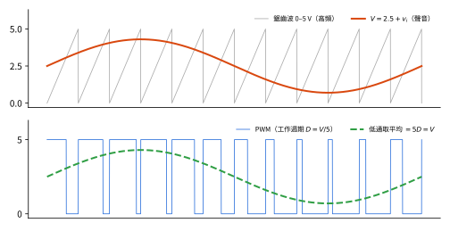
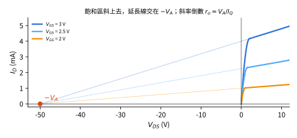

# 第 23 集 · Lec23：CMOS 反相器、脈寬調變（PWM）推喇叭、Early 效應與 $r_o$ [▶ 影片](https://www.youtube.com/watch?v=hitfo6UxFnk)

← 上一集：[22](22-pmos-current-sources-cmos-amplifier.md) ｜ [總目錄](../README.md) ｜ 下一集：[24](24-intrinsic-gain-ic-design-floating-output.md) →

> **課程**：電子學（二），陽明交大 電子物理系，112 學年度 — 第 23 集
> **講者**：陳振芳 老師
> **來源**：YouTube 錄影逐字稿（1:26:52，whisper）＋ Sedra & Smith《Microelectronic Circuits》7th ed.
> **標記說明**：`【口頭】` 老師口頭補充；`【課本補充】` 課本有、課堂沒講；`⚠️ 逐字稿缺字` whisper 聽錯，已修正；`[▶ mm:ss]` 影片時間點

---

## 目錄

- [0. 這堂課要做什麼](#0-這堂課要做什麼)
- [1. CMOS 反相器](#1-cmos-反相器)
- [2. 反相器就是開關，而且不耗功率](#2-反相器就是開關而且不耗功率)
- [3. 脈寬調變 PWM](#3-脈寬調變-pwm)
- [4. 推喇叭、再用低通還原](#4-推喇叭再用低通還原)
- [5. Early 效應：飽和區其實斜上去](#5-early-效應飽和區其實斜上去)
- [6. $r_o$ 的模型與設計](#6-r_o-的模型與設計)
- [7. 例：共源放大器考慮 $r_o$](#7-例共源放大器考慮-r_o)
- [8. 一頁速查表](#8-一頁速查表)
- [9. 與後續集數的連結](#9-與後續集數的連結)

---

## 0. 這堂課要做什麼

1. MOS 最重要的電路：**CMOS 反相器**（CMOS inverter）。
2. 用比較器 + 反相器做出 **PWM**，以數位方式推喇叭，電晶體幾乎不耗功率。
3. 開始 IC 設計：**Early 效應**（通道長度調變）和輸出電阻 $r_o$。

---

## 1. CMOS 反相器

[▶ 00:30](https://youtu.be/hitfo6UxFnk?t=30)

PMOS 在上（源極接 $V_{DD} = 5$ V）、NMOS 在下（源極接 0 V），閘極相連當輸入、汲極相連當輸出，接負載 $R_L$。數位電路：低 = 0 V、高 = 5 V。（現在電源大多 5 V 以下，不是 ±10 V。）[▶ 01:31](https://youtu.be/hitfo6UxFnk?t=91)

$|V_t| = 1$ V，$k$ 取大一點：$k = 250$ mA/V²（好算）。[▶ 03:34](https://youtu.be/hitfo6UxFnk?t=214)

**輸入 0 V** [▶ 04:04](https://youtu.be/hitfo6UxFnk?t=244)：

- NMOS：$V_{GS} = 0 < V_t$ → off，拉斷。
- PMOS：$V_{SG} = 5$ V，猜三極管區（歐姆區）→ 一顆電阻：

$$
R_{DS} = \frac{1}{k(V_{SG} - |V_t|)} = \frac{1}{250\times4}\ \text{k}\Omega = 1\ \Omega
$$

- 輸出 $= 5\times\dfrac{R_L}{R_{DS} + R_L} \approx 5$ V（負載就算 10 Ω 也遠大於 1 Ω）。[▶ 06:41](https://youtu.be/hitfo6UxFnk?t=401)
- 驗證三極管：PMOS 汲極 5 V 沒有比 $V_G + |V_t| = 1$ V 低 → 不在飽和 ✓。[▶ 07:42](https://youtu.be/hitfo6UxFnk?t=462)

**輸入 5 V** [▶ 12:58](https://youtu.be/hitfo6UxFnk?t=778)：PMOS off、NMOS 導通 1 Ω → 輸出 0 V；有大電流灌進來它也能抓走（sink）。

低進高出、高進低出 → **反相器**。

> 【課本補充】§14.3 (p. 1114)：CMOS 反相器的靜態功耗為 0（任何時候總有一顆 off，沒有直流路徑），只在切換時耗電。

---

## 2. 反相器就是開關，而且不耗功率

[▶ 08:14](https://youtu.be/hitfo6UxFnk?t=494)

- 導通那顆幾乎短路 → 5 V 整個送到負載，電流 $5/R_L$ 可以很大，只看 $R_L$。電流其實是**電源**提供的。[▶ 09:18](https://youtu.be/hitfo6UxFnk?t=558)
- MOS 本身：$V_{SD} = I_O R_{DS} \approx 0$ → 瞬間功率 $V_{SD}I_O \approx 0$ → **不用管散熱**，不需要特殊包裝，尺寸可以很小。[▶ 10:51](https://youtu.be/hitfo6UxFnk?t=651)
- 看起來就是一個**開關**：輸入低接 5 V、輸入高接地。[▶ 15:02](https://youtu.be/hitfo6UxFnk?t=902)

---

## 3. 脈寬調變 PWM

[▶ 16:05](https://youtu.be/hitfo6UxFnk?t=965)

除了 AM、FM，又一種調變：**脈寬調變**（pulse-width modulation, PWM）——方波的**寬度**被信號調變。

**電路** [▶ 17:08](https://youtu.be/hitfo6UxFnk?t=1028)：

1. **比較器**：要 0 到 5 V 輸出、夠快的 op amp（不是 741），因為要在遠高於聲音的頻率操作。
2. 一端接高頻**鋸齒波**（0→5 V，例 $10^7$ Hz 等級，比聲音快兩個數量級以上）。
3. 另一端接信號 $V$（0～5 V）。

比較後得到方波：高的時間 $T_1$、低的時間 $T_2$，週期 $T = T_1 + T_2$。**工作週期**（duty cycle）$D = T_1/T$。由鋸齒波的幾何比例，比較器輸出 $D = 1 - V/5$；再接 CMOS 反相器高低對調：[▶ 22:51](https://youtu.be/hitfo6UxFnk?t=1371)

$$
D = \frac{V}{5}
$$

**聲音是正負的** [▶ 28:06](https://youtu.be/hitfo6UxFnk?t=1686)：加 2.5 V 偏壓 $V = 2.5 + v_i$，$|v_i| \le 2.5$：

$$
D = \frac{2.5 + v_i}{5} = \frac12 + \frac{v_i}{5}
$$

$v_i = 0$ 時是對稱方波（$D = 1/2$）；$v_i$ 正時變寬、負時變窄。調變的信號要很慢：聲音頻率（最高約 $10^5$）遠小於 PWM 頻率。[▶ 29:46](https://youtu.be/hitfo6UxFnk?t=1786)

---

## 4. 推喇叭、再用低通還原

[▶ 35:31](https://youtu.be/hitfo6UxFnk?t=2131)

CMOS 反相器輸出 0/5 V 的 PWM，可以提供很大電流（大功率），而 MOS 本身功率 0。

**還原**：數位信號最後要轉回類比才能送喇叭——**低通濾波器 = 取平均**：[▶ 37:34](https://youtu.be/hitfo6UxFnk?t=2254)

$$
\overline{v} = \frac1T\int_0^{T_1}5\,dt = 5D = 5\left(\frac12 + \frac{v_i}{5}\right) = 2.5 + v_i
$$

完全回來了，信號沒有損失。再把 2.5 V 直流砍掉 → $v_i$，送喇叭。[▶ 40:08](https://youtu.be/hitfo6UxFnk?t=2408)

**為什麼一定要 PWM** [▶ 41:41](https://youtu.be/hitfo6UxFnk?t=2501)：如果輸出是 sin/cos（類比放大），電源電壓減掉輸出電壓就是電晶體上的壓差，不可能是 0，乘上大電流就是大功率 → 兩顆電晶體要特別包裝，手機放不進去。PWM 時電晶體不是全開（壓差 ≈ 0）就是全關（電流 0）。

【口頭】數位信號有很多類比沒有的好處，最後還是要還原回類比。中間是很高頻的方波，低通後只剩低頻的聲音。[▶ 43:15](https://youtu.be/hitfo6UxFnk?t=2595)

> 【課本補充】這種用 PWM + 開關推負載的功率放大器叫 **D 類放大器**（Class D）；老師沒用這個名詞。

---

## 5. Early 效應：飽和區其實斜上去

[▶ 44:16](https://youtu.be/hitfo6UxFnk?t=2656)

開始講一點 IC 設計。

夾止點：$V_{DS} = V_{GS} - V_t$，汲極端通道剛好沒有。之前說多加的 $V_{DS}$ 全堆在汲極端、電流不變；實際上那裡電場越來越大，夾止範圍往源極擴張 → **有效通道長度** $L$ 變成 $L - \Delta L$。[▶ 47:52](https://youtu.be/hitfo6UxFnk?t=2872)

$$
I_D = \frac12\mu C_{ox}\frac{W}{L - \Delta L}(V_{GS} - V_t)^2
\approx \frac12\mu C_{ox}\frac{W}{L}(V_{GS} - V_t)^2\left(1 + \frac{\Delta L}{L}\right)
$$

$\Delta L$ 很小，而且應該和多加的電壓成正比；夾止前那一小段可忽略，就說 $\Delta L \propto V_{DS}$。[▶ 50:56](https://youtu.be/hitfo6UxFnk?t=3056)

$$
\frac{\Delta L}{L} = \frac{V_{DS}}{V_A},
\qquad
I_D = I_Q\left(1 + \frac{V_{DS}}{V_A}\right)
$$

- $I_Q = \frac12k(V_{GS} - V_t)^2$：沒有 Early 效應時的電流（以前的 $I_D$）。[▶ 53:04](https://youtu.be/hitfo6UxFnk?t=3184)
- $V_A$：**Early 電壓**（early voltage）。$V_{DS} = -V_A$ 時 $I_D = 0$ → 各條飽和線往回延長交在 $-V_A$。[▶ 54:06](https://youtu.be/hitfo6UxFnk?t=3246)

> ⚠️ 逐字稿缺字：whisper 寫「二粒費」「惡立肺」「early fax」，都是 Early effect（Early 效應）。

> 【課本補充】§5.2.4 (p. 271)：$i_D = \frac12k_n'\frac{W}{L}(v_{GS} - V_t)^2(1 + \lambda v_{DS})$，$\lambda = 1/V_A$；$V_A = V_A'L$，$V_A'$ 由製程決定（約 5～50 V/μm）。

---

## 6. $r_o$ 的模型與設計

[▶ 56:08](https://youtu.be/hitfo6UxFnk?t=3368)

$$
I_D = I_Q + \frac{V_{DS}}{V_A/I_Q} = I_Q + \frac{V_{DS}}{r_o},
\qquad
r_o = \frac{V_A}{I_Q}
$$

**模型** [▶ 1:01:48](https://youtu.be/hitfo6UxFnk?t=3708)：MOS = 原來沒有 Early 效應的電流 $I_Q$，加一顆 $r_o$ **跨在 D、S 之間**。以前就是 $r_o = \infty$（平的線）。【口頭】這只是模型，一顆 MOS 不會真的有兩條路。

**$V_A$ 由佈局決定** [▶ 1:04:25](https://youtu.be/hitfo6UxFnk?t=3865)：$V_A = V_A'L$，$V_A'$ 是半導體廠（台積電）給的參數，這裡用 5 V/μm。（有的書寫 $V_A'$，符號各書不同。）

【口頭】IC 設計的基本原則：不要做大電阻、大電容——面積就是錢；一個大電容的面積可以做上千顆 MOS。之後會用 **MOS 的 $r_o$ 當大電阻**（當負載），因為 $r_o$ 可以很大。[▶ 1:07:29](https://youtu.be/hitfo6UxFnk?t=4049)

**設計例** [▶ 1:13:26](https://youtu.be/hitfo6UxFnk?t=4406)：要 $I_Q = 1$ mA、偏壓 2 V、$V_t = 1$ → $k = 2$ mA/V²。

- $k = \mu C_{ox}\frac{W}{L}$：$\mu C_{ox}$ 去問製程（例 0.1 mA/V²）——【口頭】它不是精確定值，遷移率和材料濃度、純度都有關。→ $W/L = 20$。[▶ 1:14:26](https://youtu.be/hitfo6UxFnk?t=4466)
- 自己選 $L = 10\ \mu$m → $W = 200\ \mu$m。
- $V_A = 5\times10 = 50$ V → $r_o = 50/1 = 50$ kΩ。[▶ 1:17:01](https://youtu.be/hitfo6UxFnk?t=4621)

---

## 7. 例：共源放大器考慮 $r_o$

[▶ 1:09:37](https://youtu.be/hitfo6UxFnk?t=4177)

（不考慮 Early：$R_D = 5$ kΩ、10 V、1 mA → 5 V；增益 $-g_mR_D = -10$。）

**直流** [▶ 1:12:21](https://youtu.be/hitfo6UxFnk?t=4341)：多一顆 $r_o = 50$ kΩ 跨在 D、S。輸出不再是 5 V——5 V 時 $r_o$ 會多吃一點電流。用**疊加原理**（線性）：[▶ 1:20:08](https://youtu.be/hitfo6UxFnk?t=4808)

- 只有 $V_{DD}$（$I_Q$ 開路）：$V_{DD}\dfrac{r_o}{R_D + r_o}$。
- 只有 $I_Q$（$V_{DD}$ 接地）：$-I_Q(R_D\parallel r_o)$。

$$
V_O = V_{DD}\frac{r_o}{R_D + r_o} - I_Q(R_D\parallel r_o)
= 10\times\frac{50}{55} - 1\times4.55 \approx 4.5\ \text{V}
$$

（老師說「4 點多伏」。）用疊加的好處：複雜時看得出哪一項在變。[▶ 1:22:46](https://youtu.be/hitfo6UxFnk?t=4966)

**交流** [▶ 1:24:21](https://youtu.be/hitfo6UxFnk?t=5061)：$g_m$ 用沒有 Early 效應的 $I_Q$ 算，還是 2 mA/V；$r_o$ 和 $R_D$ 並聯：

$$
A_v = -g_m(R_D \parallel r_o) = -2\times4.55 \approx -9.1
$$

**影響不大**：$R_D$ 太小，$r_o$ 很大。[▶ 1:25:54](https://youtu.be/hitfo6UxFnk?t=5154) → 下一集把 $R_D$ 換成定電流源，增益就變成 $-g_mr_o$。

---

## 8. 一頁速查表

| 項目 | 公式／重點 | 關鍵 |
|---|---|---|
| CMOS 反相器 | 輸入 0 → 輸出 5；輸入 5 → 輸出 0 | 開關 |
| 導通電阻 | $R_{DS} = 1/[k(V_{SG}-\lvert V_t\rvert )]$ | 例 1 Ω |
| MOS 功率 | $V_{SD}I \approx 0$ | 不用散熱 |
| PWM | $D = V/5$；$V = 2.5 + v_i$ → $D = \frac12 + \frac{v_i}{5}$ | 鋸齒波 + 比較器 + 反相器 |
| 還原 | 低通 = 平均 $= 5D = 2.5 + v_i$ | 砍 2.5 V |
| Early 效應 | $I_D = I_Q(1 + V_{DS}/V_A)$ | 有效 $L$ 變短 |
| Early 電壓 | $V_A = V_A'L$（例 5 V/μm × 10 μm = 50 V） | 佈局決定 |
| 輸出電阻 | $r_o = V_A/I_Q$，跨在 D、S | 例 50 kΩ |
| 共源 + $r_o$ | 直流用疊加；$A_v = -g_m(R_D\parallel r_o)$ | 例 −9.1 |

---

## 9. 與後續集數的連結

| 本集觀念 | 後面在哪裡用到 |
|---|---|
| $r_o$ 當大電阻 | 下一集：電流源負載，增益 $-g_mr_o$ |
| CMOS 反相器 | 數位電路、電子學（四） |
| 疊加原理 | 複雜偏壓分析 |

---

## 附：本集一句話總結

> **CMOS 反相器是一個導通電阻只有約 1 Ω 的開關，送得出大電流而本身幾乎不耗功率；用鋸齒波比較器 + 反相器把聲音變成工作週期 $D = \frac12 + \frac{v_i}{5}$ 的 PWM 去推喇叭，再用低通取平均就還原。Early 效應讓飽和區斜上去：$I_D = I_Q(1 + V_{DS}/V_A)$，等效為 D、S 間一顆 $r_o = V_A/I_Q$，$V_A = V_A'L$ 由佈局決定。**

---

*筆記依據陳振芳老師「電子學（二）」112 學年度 Lec23 錄影逐字稿（whisper，1:26:52）與 Sedra & Smith《Microelectronic Circuits》7th ed. 整理。*
