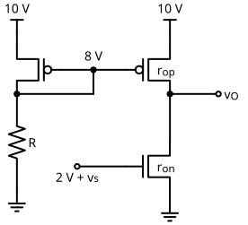

# 第 24 集 · Lec24：IC 設計例題——本質增益 $g_mr_o$、PMOS 電流源負載、輸出直流是飄的 [▶ 影片](https://www.youtube.com/watch?v=f28FcoikRAg)

← 上一集：[23](23-cmos-inverter-pwm-early-effect.md) ｜ [總目錄](../README.md) ｜ 下一集：[25](25-amplification-window-output-trim.md) →

> **課程**：電子學（二），陽明交大 電子物理系，112 學年度 — 第 24 集
> **講者**：陳振芳 老師
> **來源**：YouTube 錄影逐字稿（47:42，whisper）＋ Sedra & Smith《Microelectronic Circuits》7th ed. Ch8
> **標記說明**：`【口頭】` 老師口頭補充；`【課本補充】` 課本有、課堂沒講；`[▶ mm:ss]` 影片時間點

---

## 目錄

- [0. 這堂課要做什麼](#0-這堂課要做什麼)
- [1. 複習：Early 效應模型](#1-複習early-效應模型)
- [2. 例 1：理想電流源負載，增益 100](#2-例-1理想電流源負載增益-100)
- [3. 本質增益 $g_mr_o$](#3-本質增益-g_mr_o)
- [4. 例 2：PMOS 電流源負載](#4-例-2pmos-電流源負載)
- [5. 電流鏡也要重新設計](#5-電流鏡也要重新設計)
- [6. 輸出直流電壓控制不了](#6-輸出直流電壓控制不了)
- [7. 一頁速查表](#7-一頁速查表)
- [8. 與後續集數的連結](#8-與後續集數的連結)

---

## 0. 這堂課要做什麼

用 Early 效應的 $r_o$ 做兩個 IC 設計題：給定增益，算出每顆 MOS 的 $W$、$L$。最後發現一個大問題：這種高增益電路的**輸出直流電壓**根本控制不了。

---

## 1. 複習：Early 效應模型

[▶ 00:00](https://youtu.be/f28FcoikRAg?t=0)

- $I_Q = \frac12k(V_{GS} - V_t)^2$：沒有 Early 效應的電流。
- D、S 之間掛一顆 $r_o = V_A/I_Q$，$V_A = V_A'L$。
- 這個模型**直流、交流都用**。[▶ 03:02](https://youtu.be/f28FcoikRAg?t=182)

---

## 2. 例 1：理想電流源負載，增益 100

[▶ 03:32](https://youtu.be/f28FcoikRAg?t=212)

上一集用電阻 $R_D$ 增益會掉下來；改成**定電流源** $I$ 當負載（先假設理想）。

規格：$I_Q = 1$ mA、閘極偏壓 2 V、增益 −100。製程參數：$V_A' = 5$ V/μm、$\mu_nC_{ox} = 0.1$ mA/V²、$V_t = 1$ V。[▶ 04:36](https://youtu.be/f28FcoikRAg?t=276)

1. $1 = \frac12k(2 - 1)^2$ → $k = 2$ mA/V² → $W/L = 2/0.1 = 20$。[▶ 06:43](https://youtu.be/f28FcoikRAg?t=403)
2. $g_m = \sqrt{2\cdot2\cdot1} = 2$ mA/V。
3. 交流：理想電流源開路，$V_{DD}$ 接地，負載只剩 $r_o$：[▶ 08:17](https://youtu.be/f28FcoikRAg?t=497)

$$
A_v = -g_mr_o = -100
\quad\Longrightarrow\quad
r_o = 50\ \text{k}\Omega
$$

4. $V_A = r_oI_Q = 50$ V → $L = 50/5 = 10\ \mu$m，$W = 20\times10 = 200\ \mu$m。[▶ 09:51](https://youtu.be/f28FcoikRAg?t=591)
5. 直流：要輸出 5 V，電流源要多給 $r_o$ 吃的那份：

$$
I = I_Q + \frac{V_O}{r_o} = 1 + \frac{5}{50} = 1.1\ \text{mA}
$$

[▶ 11:26](https://youtu.be/f28FcoikRAg?t=686)

---

## 3. 本質增益 $g_mr_o$

[▶ 12:31](https://youtu.be/f28FcoikRAg?t=751)

負載已經是無窮大（理想電流源），最後只剩 MOS 自己的 $r_o$：

$$
|A_v|_{\max} = g_mr_o
$$

這是**一顆 MOS 能給的最大增益**。外面再接負載電阻只會並聯、變小。【口頭】如果 $g_mr_o$ 只有 1，這顆 MOS 就沒有意義。$r_o$ 不是外加的電阻——IC 裡外加大電阻成本太高——是 MOS 自己的。[▶ 13:01](https://youtu.be/f28FcoikRAg?t=781)

> 【課本補充】Sedra §8.3.1 (p. 525) 把 $A_0 = g_mr_o$ 叫**本質增益**（intrinsic gain）；$A_0 = \dfrac{2V_A'L}{V_{OV}}$，$L$ 越長越大。

---

## 4. 例 2：PMOS 電流源負載

[▶ 14:04](https://youtu.be/f28FcoikRAg?t=844)

電流源在放大管**頭上** → 用 **P 型**電流鏡。電流鏡那邊閘極固定（例 8 V）。先分清楚：下面那顆 NMOS 是放大管，上面 PMOS 是電流源。[▶ 15:08](https://youtu.be/f28FcoikRAg?t=908)

規格：兩顆都 $I_Q = 1$ mA、增益還是 −100、輸出 5 V。多一個參數：$\mu_pC_{ox} = 0.1/3$ mA/V²（電洞跑得慢，約差 3 倍）。$|V_t|$ 都是 1 V。[▶ 17:10](https://youtu.be/f28FcoikRAg?t=1030)

**直流** [▶ 18:43](https://youtu.be/f28FcoikRAg?t=1123)：NMOS $V_{GS} = 2$、PMOS $V_{SG} = 10 - 8 = 2$ → 兩顆 $k$ 都要 2。輸出 5 V：兩顆上下各跨 5 V、電流一樣 → 兩顆 $r_o$ 必須一樣。[▶ 20:48](https://youtu.be/f28FcoikRAg?t=1248)

**交流** [▶ 21:48](https://youtu.be/f28FcoikRAg?t=1308)：拿掉 2 V、8 V、10 V（都接地）。PMOS 閘極和源極交流都是 0 → $v_{sg} = 0$ → 它的 $g_m$ 項是 0，只剩 $r_{op}$。【口頭】因為它就是電流源，電流源交流等於開路。[▶ 23:22](https://youtu.be/f28FcoikRAg?t=1402)

$$
A_v = -g_m(r_{on}\parallel r_{op}) = -100
\quad\Longrightarrow\quad
r_{on}\parallel r_{op} = 50\ \text{k}\Omega,
\quad
r_o = 100\ \text{k}\Omega
$$

[▶ 24:56](https://youtu.be/f28FcoikRAg?t=1496)

$V_A = 100$ V → **兩顆 $L = 20\ \mu$m**。[▶ 25:57](https://youtu.be/f28FcoikRAg?t=1557)

- NMOS：$W/L = 2/0.1 = 20$ → $W = 400\ \mu$m。
- PMOS：$W/L = 2/(0.1/3) = 60$ → $W = 60\times20 = 1200\ \mu$m。[▶ 27:29](https://youtu.be/f28FcoikRAg?t=1649)

【口頭】兩個 $k$ 要一樣時，PMOS 的寬度通常是 NMOS 的三倍左右，因為遷移率差三倍。[▶ 29:02](https://youtu.be/f28FcoikRAg?t=1742)

---

## 5. 電流鏡也要重新設計

[▶ 30:04](https://youtu.be/f28FcoikRAg?t=1804)

8 V 從電流鏡來（不可能再放一顆電池）。參考 PMOS 和負載 PMOS 做一樣：$L = 20\ \mu$m、$W = 1200\ \mu$m、$k = 2$ → $V_{SG} = 2$ V。[▶ 31:37](https://youtu.be/f28FcoikRAg?t=1897)

參考那顆也有 $r_o = 100$ kΩ，跨 $V_{SD} = 2$ V（閘極接汲極）→ 多一份電流 $2/100 = 0.02$ mA。【口頭】一定要拉「閘極到汲極」那條線，不能拉到輸出端。[▶ 33:12](https://youtu.be/f28FcoikRAg?t=1992)

以下**不是逐字稿內容**，是依上面的數字算的：參考電流 $1 + 0.02 = 1.02$ mA，參考電阻 $R = 8\ \text{V}/1.02\ \text{mA} \approx 7.84$ kΩ。（逐字稿只說「R 要放這麼多，因為 Early 效應多跑出來的電流」。）[▶ 33:42](https://youtu.be/f28FcoikRAg?t=2022)

---

## 6. 輸出直流電壓控制不了

[▶ 35:17](https://youtu.be/f28FcoikRAg?t=2117)

把輸出直流用**疊加原理**寫出來：[▶ 36:53](https://youtu.be/f28FcoikRAg?t=2213)

- 兩個電流都 0（兩顆 MOS 拿掉）：$V_{DD}\dfrac{r_{on}}{r_{on} + r_{op}}$。
- 只有 $I_{QP}$（往輸出灌）：$+I_{QP}(r_{on}\parallel r_{op})$。
- 只有 $I_{QN}$（從輸出抽）：$-I_{QN}(r_{on}\parallel r_{op})$。

$$
V_O = V_{DD}\frac{r_{on}}{r_{on} + r_{op}} + \left(I_{QP} - I_{QN}\right)(r_{on}\parallel r_{op})
$$

[▶ 41:28](https://youtu.be/f28FcoikRAg?t=2488)

每個參數都會影響，最嚴重的是第二項：$r_{on}\parallel r_{op} = 50$ kΩ 很大，兩個電流只要差一點點就放大很多。[▶ 42:01](https://youtu.be/f28FcoikRAg?t=2521)

**數字** [▶ 44:08](https://youtu.be/f28FcoikRAg?t=2648)：$I_{QP} \propto k$，$k$ 差 1% → $\Delta I_{QP} = 0.01$ mA →

$$
\Delta V_O = 0.01\ \text{mA}\times50\ \text{k}\Omega = 0.5\ \text{V}
$$

（$r_o$ 也會跟著變一點，但主要是這項。）[▶ 45:10](https://youtu.be/f28FcoikRAg?t=2710)

【口頭】$k$ 裡的遷移率和材料純度有關，電子會撞雜質、撞矽原子，控制到 1% 以內很難。你說設計 5 V，做完去量絕對不是 5 V。輸出直流是**飄的**（floating）——不是你要它多少就多少。先有這個概念，後面才知道怎麼處理。[▶ 46:50](https://youtu.be/f28FcoikRAg?t=2810)

> 【課本補充】這就是為什麼高增益 CMOS 放大器一定要放在**負回授**迴路裡（或用共模回授）來定住直流工作點；Sedra §8.3 也提到電流源負載放大器的輸出直流對元件不匹配非常敏感。

---

## 7. 一頁速查表

| 項目 | 公式／重點 | 關鍵 |
|---|---|---|
| 設計流程 | $I_Q$ → $k$ → $W/L$；增益 → $r_o$ → $V_A$ → $L$ | |
| 理想電流源負載 | $A_v = -g_mr_o$ | 本質增益 |
| 例 1 | $r_o = 50$ k、$L = 10\ \mu$m、$W = 200\ \mu$m、$I = 1.1$ mA | |
| PMOS 電流源負載 | $A_v = -g_m(r_{on}\parallel r_{op})$ | PMOS 交流只剩 $r_{op}$ |
| 例 2 | $r_o = 100$ k、$L = 20\ \mu$m；$W_n = 400$、$W_p = 1200\ \mu$m | $\mu_p \approx \mu_n/3$ |
| 輸出直流 | $V_{DD}\frac{r_{on}}{r_{on}+r_{op}} + (I_{QP}-I_{QN})(r_{on}\parallel r_{op})$ | 疊加 |
| 敏感度 | $k$ 差 1% → $\Delta V_O = 0.5$ V | floating |

---

## 8. 與後續集數的連結

| 本集觀念 | 後面在哪裡用到 |
|---|---|
| 輸出直流飄 | 下一集：怎麼定住直流（回授） |
| 本質增益 | 疊接放大器、運算放大器設計 |
| 主動負載 | 差動放大器（電子學（三）） |

---

## 附：本集一句話總結

> **電流源當負載時共源增益只剩 $-g_mr_o$，這是一顆 MOS 的本質增益；給定增益就能從 $r_o = V_A/I_Q$、$V_A = V_A'L$ 定出 $L$，再由 $k$ 定出 $W$（PMOS 要寬約三倍）；但這種電路的輸出直流 $= V_{DD}\frac{r_{on}}{r_{on}+r_{op}} + (I_{QP}-I_{QN})(r_{on}\parallel r_{op})$，兩個電流差 1% 就飄 0.5 V，根本控制不了。**

---

*筆記依據陳振芳老師「電子學（二）」112 學年度 Lec24 錄影逐字稿（whisper，47:42）與 Sedra & Smith《Microelectronic Circuits》7th ed. 整理。*
