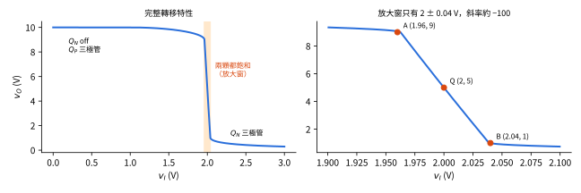

# 第 25 集 · Lec25：高增益放大器的「放大窗」、完整轉移特性、用外接電阻把輸出調回來 [▶ 影片](https://www.youtube.com/watch?v=skj_8pW17ck)

← 上一集：[24](24-intrinsic-gain-ic-design-floating-output.md) ｜ [總目錄](../README.md) ｜ 下一集：[26](26-short-circuit-current-cascode.md) →

> **課程**：電子學（二），陽明交大 電子物理系，112 學年度 — 第 25 集
> **講者**：陳振芳 老師
> **來源**：YouTube 錄影逐字稿（1:23:46，whisper）＋ Sedra & Smith《Microelectronic Circuits》7th ed.
> **標記說明**：`【口頭】` 老師口頭補充；`[▶ mm:ss]` 影片時間點

---

## 目錄

- [0. 這堂課要做什麼](#0-這堂課要做什麼)
- [1. 複習：設計與飄移的輸出](#1-複習設計與飄移的輸出)
- [2. 放大窗只有 ±0.04 V](#2-放大窗只有-004-v)
- [3. 完整的轉移特性](#3-完整的轉移特性)
- [4. 放大區的方程式與兩個轉折點](#4-放大區的方程式與兩個轉折點)
- [5. 輸入差 0.01 V，輸出差 1 V](#5-輸入差-001-v輸出差-1-v)
- [6. 把電流鏡電阻拉到外面來調](#6-把電流鏡電阻拉到外面來調)
- [7. 一頁速查表](#7-一頁速查表)
- [8. 與後續集數的連結](#8-與後續集數的連結)

---

## 0. 這堂課要做什麼

上一集的高增益放大器（NMOS 共源 + PMOS 電流源負載，增益 −100）輸出直流是飄的。今天把它的完整轉移特性畫出來，看到能放大的輸入範圍只有一點點；最後給一個實際的解法——把電流鏡的電阻拉到晶片外面調。

---

## 1. 複習：設計與飄移的輸出

[▶ 00:00](https://youtu.be/skj_8pW17ck?t=0)

（上一集）$I_Q = 1$ mA、$k = 2$、$V_A' = 5$ V/μm。增益 $-g_m(r_{on}\parallel r_{op}) = -100$ → $r_o = 100$ kΩ → $L = 20\ \mu$m；NMOS $W/L = 20$、PMOS $W/L = 60$。【口頭】負載用的是 MOS 自己的 $r_o$，IC 裡不能放大電阻。[▶ 07:53](https://youtu.be/skj_8pW17ck?t=473)

輸出直流（疊加）：

$$
V_O = V_{DD}\frac{r_{on}}{r_{on} + r_{op}} + (I_{QP} - I_{QN})(r_{on}\parallel r_{op})
$$

電流差一點點乘 50 kΩ → 往上往下都不知道，**很難控制**（very difficult），是 floating voltage。[▶ 24:34](https://youtu.be/skj_8pW17ck?t=1474)

---

## 2. 放大窗只有 ±0.04 V

[▶ 27:10](https://youtu.be/skj_8pW17ck?t=1630)

PMOS 閘極 8 V、NMOS 閘極 2 V，設計輸出 5 V。

- PMOS 飽和：$V_O \le 8 + 1 = 9$ V。
- NMOS 飽和：$V_O \ge 2 - 1 = 1$ V。

理想上下各留 4 V。[▶ 28:14](https://youtu.be/skj_8pW17ck?t=1694)

只讓輸入變（一次只改一個參數）：Q 點斜率 −100 這麼陡，輸出要從 5 掉到 1 只要輸入多 $4/100 = 0.04$ V；要升到 9 只要少 0.04 V。[▶ 30:49](https://youtu.be/skj_8pW17ck?t=1849)

$$
\text{放大窗（amplification window）：}\ 2 \pm 0.04\ \text{V}
$$

超出就跳出飽和區，掉進三極管區（只剩一顆小電阻），不能放大。【口頭】增益越高越容易出問題、越難控制；所以後面要嘛把電阻拉出來調，要嘛接回授電路。[▶ 35:01](https://youtu.be/skj_8pW17ck?t=2101)

---

## 3. 完整的轉移特性

[▶ 37:37](https://youtu.be/skj_8pW17ck?t=2257)

把 $v_I$ 從 0 掃到很大（大訊號，不是 sin/cos）。圖解：PMOS 的 $I$-$V_{SD}$ 只有一條（$V_{SG}$ 固定 2 V），翻過來疊在 NMOS 的 $I$-$V_{DS}$ 上（兩個電壓相加 10 V、電流相等），交點就是工作點。[▶ 38:42](https://youtu.be/skj_8pW17ck?t=2322)

1. $v_I < V_t$：$Q_N$ off（拉斷），$Q_P$ 在三極管區當電阻，沒電流 → $v_O = 10$ V。[▶ 45:29](https://youtu.be/skj_8pW17ck?t=2729)
2. $v_I$ 增加到 A 點之前：$Q_N$ 飽和但 $Q_P$ 還在三極管，輸出從 10 慢慢到 9。
3. **A 到 B**：兩顆都飽和，白色線只要增加一點點，輸出就掉很快。[▶ 49:34](https://youtu.be/skj_8pW17ck?t=2974)
4. B 之後：$Q_N$ 進三極管，輸出接近 0，不太動。

【口頭】只有兩顆都飽和才能放大；其他區域沒有斜度。[▶ 52:42](https://youtu.be/skj_8pW17ck?t=3162)

---

## 4. 放大區的方程式與兩個轉折點

[▶ 53:13](https://youtu.be/skj_8pW17ck?t=3193)

兩顆都飽和，含 Early 效應，電流相等：

$$
\frac12k(V_{SG} - 1)^2\left(1 + \frac{10 - V_O}{V_A}\right) = \frac12k(v_I - 1)^2\left(1 + \frac{V_O}{V_A}\right)
$$

$V_{SG} = 2$、$V_A = 100$ V（$L = 20\ \mu$m）。[▶ 55:48](https://youtu.be/skj_8pW17ck?t=3348)

- **A 點**：$V_O = 9$ → $v_I \approx 1.96$ V。[▶ 57:50](https://youtu.be/skj_8pW17ck?t=3470)
- **B 點**：$Q_N$ 剛夾止，$V_O = v_I - V_t$ → $v_I \approx 2.04$ V。[▶ 58:50](https://youtu.be/skj_8pW17ck?t=3530)

和剛剛用斜率估的差不多（不會百分之百一樣）。窗口 1.96～2.04 V，中心 2 V 對 5 V。[▶ 1:00:21](https://youtu.be/skj_8pW17ck?t=3621)

以下**不是逐字稿內容**，是把上式數值解出來驗算的：$v_I = 1.96$ V → $V_O \approx 9.06$ V；$v_I = 2.04$ V → $V_O \approx 0.99$ V，和老師的估計一致。

---

## 5. 輸入差 0.01 V，輸出差 1 V

[▶ 1:02:26](https://youtu.be/skj_8pW17ck?t=3746)

全部設計好好的（$r_o$ 都 100 k）輸出 5 V。輸入多 0.01 V：NMOS 電流增加、往下流 → 輸出下降。

小變化就是微分，也就是小信號：0.01 V 夠小（$\le 0.2(V_{GS} - V_t) = 0.2$ V），二次項可拿掉，當成「交流」來算：[▶ 1:05:05](https://youtu.be/skj_8pW17ck?t=3905)

$$
\Delta V_O = -g_m(r_{on}\parallel r_{op})\times0.01 = -100\times0.01 = -1\ \text{V}
$$

輸出從 5 V 變 **4 V**。同樣地，PMOS 閘極的 8 V 往下掉一點點，電流變大，輸出就往上跑很多。[▶ 1:09:14](https://youtu.be/skj_8pW17ck?t=4154)

---

## 6. 把電流鏡電阻拉到外面來調

[▶ 1:11:20](https://youtu.be/skj_8pW17ck?t=4280)

8 V 來自 PMOS 電流鏡：參考那顆經電阻 $R$ 接地。（參考那顆也有 Early 效應，電流是 $1 + 2/100$ mA；【口頭】輸出本來就飄，算這麼仔細沒用，忽略 Early 效應，$R \approx 8$ kΩ。）[▶ 1:12:52](https://youtu.be/skj_8pW17ck?t=4372)

參考支路：

$$
10 = V_{SG} + I_QR
$$

$R$ 變 $R + \Delta R$，$I_Q$、$V_{SG}$ 跟著變；10 V 不變。小量乘小量丟掉，且 $\Delta V_{SG} = \Delta I_Q/g_m$：[▶ 1:14:56](https://youtu.be/skj_8pW17ck?t=4496)

$$
0 = \frac{\Delta I_Q}{g_m} + \Delta I_Q\,R + I_Q\,\Delta R
\quad\Longrightarrow\quad
\Delta I_Q = -\frac{I_Q\,\Delta R}{1/g_m + R}
$$

$1/g_m = 0.5$ kΩ ≪ $R = 8$ kΩ → $\dfrac{\Delta I_Q}{I_Q} \approx -\dfrac{\Delta R}{R}$：$R$ 調 1%，電流變 1%（反向）。[▶ 1:18:09](https://youtu.be/skj_8pW17ck?t=4689)

鏡像到負載 PMOS：$\Delta I_{QP} = -0.01$ mA（NMOS 不變）：

$$
\Delta V_O = \Delta I_{QP}\,(r_{on}\parallel r_{op}) = -0.01\times50 = -0.5\ \text{V}
$$

[▶ 1:20:47](https://youtu.be/skj_8pW17ck?t=4847)

**做法**：IC 設計時把這顆 $R$ 的兩隻腳拉出來（pin），做成**外接電阻**（external），做完量一量再調。【口頭】台積電做出來一量太高，就調一下；太低再調；也許一次不完全回到你要的，再繼續調，一定可以調回來。[▶ 1:21:49](https://youtu.be/skj_8pW17ck?t=4909)

---

## 7. 一頁速查表

| 項目 | 公式／重點 | 關鍵 |
|---|---|---|
| 飽和範圍 | $1 \le V_O \le 9$ V | $V_G - V_t$、$V_G + \lvert V_t\rvert $ |
| 放大窗 | $2 \pm 0.04$ V（4 V / 100） | 增益越高越窄 |
| 轉移特性 | off → $Q_P$ 三極管 → 兩顆飽和 → $Q_N$ 三極管 | 只有中間能放大 |
| 放大區方程 | $(V_{SG}-1)^2(1+\frac{10-V_O}{V_A}) = (v_I-1)^2(1+\frac{V_O}{V_A})$ | A 1.96、B 2.04 |
| 輸入小變化 | $\Delta V_O = A_v\Delta v_I$（0.01 V → −1 V） | 微分 = 小信號 |
| 調電流鏡 | $\Delta I_Q/I_Q \approx -\Delta R/R$ | $R \gg 1/g_m$ |
| 輸出修正 | $\Delta V_O = \Delta I_{QP}(r_{on}\parallel r_{op})$（1% → 0.5 V） | 外接電阻 |

---

## 8. 與後續集數的連結

| 本集觀念 | 後面在哪裡用到 |
|---|---|
| 放大窗、輸出飄 | 負回授定工作點（op amp） |
| 微分 = 小信號 | 所有靈敏度分析 |
| 外接調整 | 實際 IC 的 trim |

---

## 附：本集一句話總結

> **增益 −100 的共源 + 電流源負載放大器，輸出只能在 1～9 V 之間（兩顆都飽和），對應的輸入放大窗只有 2 ± 0.04 V，輸入差 0.01 V 輸出就差 1 V；完整轉移特性分 off、兩顆飽和、三極管三段，只有中間能放大。實務上把電流鏡的電阻拉到晶片外，調 1% 電流就改 1%、輸出改 0.5 V，做完量了再調回來。**

---

*筆記依據陳振芳老師「電子學（二）」112 學年度 Lec25 錄影逐字稿（whisper，1:23:46）與 Sedra & Smith《Microelectronic Circuits》7th ed. 整理。*
