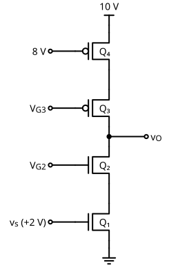

# 第 26 集 · Lec26：短路電流 × 輸出電阻、疊接（cascode）放大器與疊接電流源 [▶ 影片](https://www.youtube.com/watch?v=sx3PIipqKv4)

← 上一集：[25](25-amplification-window-output-trim.md) ｜ [總目錄](../README.md) ｜ 下一集：[電子學（三）第 01 集](../E3/01-pn-junction-review-bjt-intro.md) →

> **課程**：電子學（二），陽明交大 電子物理系，112 學年度 — 第 26 集
> **講者**：陳振芳 老師
> **來源**：YouTube 錄影逐字稿（1:00:26，whisper）＋ Sedra & Smith《Microelectronic Circuits》7th ed. §8.5
> **標記說明**：`【口頭】` 老師口頭補充；`【課本補充】` 課本有、課堂沒講；`[▶ mm:ss]` 影片時間點

---

## 目錄

- [0. 這堂課要做什麼](#0-這堂課要做什麼)
- [1. 短路電流 × 輸出電阻](#1-短路電流--輸出電阻)
- [2. 疊接放大器：短路電流](#2-疊接放大器短路電流)
- [3. 疊接放大器：輸出電阻](#3-疊接放大器輸出電阻)
- [4. 面積比一比](#4-面積比一比)
- [5. 疊接電流源負載](#5-疊接電流源負載)
- [6. 直流偏壓：$V_{G2}$、$V_{G3}$ 的範圍](#6-直流偏壓v_g2v_g3-的範圍)
- [7. 偏壓電壓從哪來](#7-偏壓電壓從哪來)
- [8. 一頁速查表](#8-一頁速查表)
- [9. 與後續集數的連結](#9-與後續集數的連結)

---

## 0. 這堂課要做什麼

1. 一個求交流增益的好方法：**短路電流 × 輸出電阻**。
2. 用它分析**疊接放大器**（cascode）：增益變成 $(g_mr_o)^2$，而且面積小一萬倍。
3. MOS 到這裡結束，下次開始 BJT。

---

## 1. 短路電流 × 輸出電阻

[▶ 00:00](https://youtu.be/sx3PIipqKv4?t=0)

**只用在交流電路。** 從輸出端看回去，整個電路可以換成電流源 $i_{sc}$ 並聯 $R_{out}$（諾頓等效）：

$$
v_o = i_{sc}\,R_{out}
$$

- $i_{sc}$：把輸出**短路**，量流出來的電流。裡面都不要動。[▶ 02:03](https://youtu.be/sx3PIipqKv4?t=123)
- $R_{out}$：讓 $i_{sc} = 0$——等於**信號源設 0**——從輸出加 $V_x$ 求 $I_x$。[▶ 03:10](https://youtu.be/sx3PIipqKv4?t=190)

【口頭】殺雞何必用牛刀？等一下複雜的電路就知道好用。[▶ 03:41](https://youtu.be/sx3PIipqKv4?t=221)

**驗算：共源 + PMOS 電流源負載** [▶ 04:14](https://youtu.be/sx3PIipqKv4?t=254)：

- 短路：$r_{on}$、$r_{op}$ 兩端都 0，沒電流 → $i_{sc} = -g_mv_s$。
- $v_s = 0$：MOS 電流源 0 → $R_{out} = r_{on}\parallel r_{op}$。

$v_o = -g_m(r_{on}\parallel r_{op})v_s$，和上一集一樣。[▶ 09:29](https://youtu.be/sx3PIipqKv4?t=569)

---

## 2. 疊接放大器：短路電流

[▶ 10:00](https://youtu.be/sx3PIipqKv4?t=600)

共源 $Q_1$ 頭上**疊**一顆共閘 $Q_2$（閘極接直流電壓），負載先用理想電流源。這叫**疊接**（cascode）。[▶ 10:33](https://youtu.be/sx3PIipqKv4?t=633)

交流：$Q_2$ 閘極接地、電流源開路。

**短路電流** [▶ 12:41](https://youtu.be/sx3PIipqKv4?t=761)：$Q_1$ 產生 $g_{m1}v_s$。到了 $Q_1$ 汲極，它可以往下走 $r_{o1}$，或往上走進 $Q_2$ 的源極。往上看：$1/g_{m2}$ 和 $r_{o2}$（輸出短路接地）並聯。分流：

$$
i_{sc} = -g_{m1}v_s\,\frac{r_{o1}}{r_{o1} + \left(\frac{1}{g_{m2}}\parallel r_{o2}\right)}
$$

$g_mr_o$ 是一顆 MOS 的最大增益，一定 $\gg 1$ → $r_o \gg 1/g_m$ → 分母後面那項只剩 $1/g_m$，又遠小於 $r_{o1}$：[▶ 16:18](https://youtu.be/sx3PIipqKv4?t=978)

$$
i_{sc} \approx -g_{m1}v_s
$$

電流 99% 全部流出來——因為上面是**共閘**，從源極看進去只有 $1/g_m$。[▶ 17:54](https://youtu.be/sx3PIipqKv4?t=1074)

---

## 3. 疊接放大器：輸出電阻

[▶ 19:56](https://youtu.be/sx3PIipqKv4?t=1196)

**最重要的部分。** 信號源拿掉，$Q_1$ 的電流源沒了，只剩 $r_{o1}$。從輸出加 $V_x$，電流 $I_x$：

- $I_x$ 往下全部流過 $r_{o1}$ → $Q_2$ 源極電壓 $= I_xr_{o1}$。[▶ 21:00](https://youtu.be/sx3PIipqKv4?t=1260)
- $Q_2$ 閘極接地 → $v_{gs2} = -I_xr_{o1}$ → $Q_2$ 的電流源產生 $g_{m2}I_xr_{o1}$，和 $I_x$ 一起流過 $r_{o2}$。[▶ 21:32](https://youtu.be/sx3PIipqKv4?t=1292)

$$
V_x = I_xr_{o1} + \left(I_x + g_{m2}r_{o1}I_x\right)r_{o2}
$$

$$
R_{out} = r_{o1} + r_{o2} + g_{m2}r_{o2}r_{o1} \approx (g_{m2}r_{o2})\,r_{o1}
$$

[▶ 23:05](https://youtu.be/sx3PIipqKv4?t=1385)

$r_o$ 本來就很大（例 100 kΩ），又乘上一個 $g_mr_o$。

$$
\frac{v_o}{v_s} = -g_{m1}r_{o1}\cdot g_{m2}r_{o2} = -(g_mr_o)^2
$$

一顆 MOS 最大是 $g_mr_o$，疊兩顆變平方。例 $g_m = 2$ mA/V、$r_o = 100$ kΩ：$g_mr_o = 200$ → 增益 $4\times10^4$。[▶ 25:10](https://youtu.be/sx3PIipqKv4?t=1510)

【口頭】再疊一顆就再乘 $g_mr_o$，越來越大。這個結果和以前的觀念完全一樣：電流全部抓出來，乘上一個很大的電阻。[▶ 26:44](https://youtu.be/sx3PIipqKv4?t=1604)

> 【課本補充】§8.5.2 (p. 547)：MOS 疊接 $R_o \approx (g_{m2}r_{o2})r_{o1}$，$A_v = -g_{m1}R_o \approx -(g_mr_o)^2 = -A_0^2$。

---

## 4. 面積比一比

[▶ 28:18](https://youtu.be/sx3PIipqKv4?t=1698)

**疊接**（$I = 1$ mA、$k = 2$、$V_A' = 5$ V/μm、$\mu_nC_{ox} = 0.1$ mA/V²）：$r_o = 100$ k → $V_A = 100$ V → $L = 20\ \mu$m；$W/L = 20$ → $W = 400\ \mu$m。兩顆：[▶ 29:20](https://youtu.be/sx3PIipqKv4?t=1760)

$$
A_{cascode} = 2\times20\times400 = 1.6\times10^4\ \mu\text{m}^2
$$

**單顆共源做到同樣 $4\times10^4$** [▶ 30:54](https://youtu.be/sx3PIipqKv4?t=1854)：$g_m = 2$ → $r_o = 2\times10^4$ kΩ → $V_A = 2\times10^4$ V → $L = 4000\ \mu$m，$W = 20L = 8\times10^4\ \mu$m：

$$
A_{CS} = 4000\times8\times10^4 = 3.2\times10^8\ \mu\text{m}^2
$$

**大 2 萬倍**（老師說「一萬倍還有 2」）。面積就是成本，當然用兩顆疊接。【口頭】疊接會自己把 $r_o$ 加成變很大，電流不變，增益就大。[▶ 34:35](https://youtu.be/sx3PIipqKv4?t=2075)

---

## 5. 疊接電流源負載

[▶ 35:39](https://youtu.be/sx3PIipqKv4?t=2139)

負載不能放電阻；放一顆 PMOS 也不夠大（底下已經 $g_mr_o\cdot r_o$ 了）。上面也疊兩顆 PMOS（$Q_3$、$Q_4$）：**疊接電流源負載**（cascode current load）。頭上一定要 P，電流方向才對；閘極都固定電壓。[▶ 36:09](https://youtu.be/sx3PIipqKv4?t=2169)

- 短路電流：一樣 $-g_{m1}v_s$ 全部出來（不管上面畫多少）。[▶ 37:42](https://youtu.be/sx3PIipqKv4?t=2262)
- 輸出電阻：往下 $(g_{m2}r_{o2})r_{o1}$，往上同理 $(g_{m3}r_{o3})r_{o4}$（交流模型 N、P 都一樣），並聯。[▶ 39:47](https://youtu.be/sx3PIipqKv4?t=2387)

$$
A_v = -g_{m1}\left[(g_{m2}r_{o2}r_{o1})\parallel(g_{m3}r_{o3}r_{o4})\right]
$$

參數一樣時並聯少一半：$2\times10^4$。[▶ 41:24](https://youtu.be/sx3PIipqKv4?t=2484)

再疊一層又乘 $g_mr_o = 200$ → $2\times10^6$，但電源要從 10 V 改 15 V。做這麼大幹嘛？——記得 op amp：增益很大，放進**負回授**，好處就都跑出來了。[▶ 41:56](https://youtu.be/sx3PIipqKv4?t=2516)

---

## 6. 直流偏壓：$V_{G2}$、$V_{G3}$ 的範圍

[▶ 42:59](https://youtu.be/sx3PIipqKv4?t=2579)

設計輸出 5 V，所有 MOS 都要飽和（$V_t = 1$，1 mA 時 $V_{GS} \approx 2$ V；Early 效應的電流很小，差不多）。

**放大部分** [▶ 44:35](https://youtu.be/sx3PIipqKv4?t=2675)：

- $Q_2$ 飽和：$5 \ge V_{G2} - 1$ → $V_{G2} \le 6$。
- $Q_1$ 汲極 $= V_{G2} - 2$，要 $\ge V_{G1} - V_t = 1$ → $V_{G2} \ge 3$。

$$
3 \le V_{G2} \le 6
$$

**往下擺幅** $= 5 - (V_{G2} - 1)$：取 6 擺幅 0（不能用），取 3 擺幅 3 V → **往 3 靠比較好**。[▶ 47:10](https://youtu.be/sx3PIipqKv4?t=2830)

**負載部分**（$Q_4$ 閘極 8 V）[▶ 48:13](https://youtu.be/sx3PIipqKv4?t=2893)：

- $Q_4$ 汲極 $= V_{G3} + 2$，要 $\le 8 + 1$ → $V_{G3} \le 7$。
- $Q_3$ 飽和：$5 \le V_{G3} + 1$ → $V_{G3} \ge 4$。

$$
4 \le V_{G3} \le 7
$$

取 7 往上擺幅 3 V、取 4 擺幅 0 → **往 7 靠比較好**。【口頭】只要在範圍內都 OK，不是一定要多少。[▶ 50:48](https://youtu.be/sx3PIipqKv4?t=3048)

---

## 7. 偏壓電壓從哪來

[▶ 51:50](https://youtu.be/sx3PIipqKv4?t=3110)

用電流鏡疊出來（$k$ 都一樣、1 mA，每顆約 2 V）：

- P 側：10 V 往下一顆二極體接法的 PMOS → 8 V（給 $Q_4$）；再一顆 → 6 V。【口頭】6 V 給 $Q_3$ 也可以，離 7 差一點，擺幅 2 V。[▶ 52:24](https://youtu.be/sx3PIipqKv4?t=3144)
- N 側：從地往上一顆 → 2 V（給 $Q_1$ 的參考）；再一顆 → 4 V，剛好在 $V_{G2}$ 的範圍（3～6）內，拉過去給 $Q_2$。[▶ 54:31](https://youtu.be/sx3PIipqKv4?t=3271)
- 注意：$Q_1$ 的閘極有輸入信號，不能隨便從那裡拉。[▶ 55:31](https://youtu.be/sx3PIipqKv4?t=3331)
- 中間電阻（例 6 − 4 = 2 V / 1 mA = 2 kΩ）。【口頭】把 Early 效應再算進去再準也沒用，IC 本來就有誤差。

這些閘極電壓再拉出去，又可以做成**疊接電流源**：往下看 $r_o\cdot g_mr_o$，非常大，幾乎是理想電流源，比單顆的 $r_o$ 理想得多。上面給上面的電路用、下面給下面的用。[▶ 57:35](https://youtu.be/sx3PIipqKv4?t=3455)

【口頭】我們的目的是要做一個 op amp。MOS 到這裡結束，下次開始 BJT。[▶ 1:00:08](https://youtu.be/sx3PIipqKv4?t=3608)

---

## 8. 一頁速查表

| 項目 | 公式／重點 | 關鍵 |
|---|---|---|
| 短路電流法 | $v_o = i_{sc}R_{out}$ | $R_{out}$：信號源設 0 |
| 共源 + 電流源負載 | $-g_m(r_{on}\parallel r_{op})$ | 驗算 |
| 疊接 $i_{sc}$ | $\approx -g_{m1}v_s$ | 共閘入口只有 $1/g_m$ |
| 疊接 $R_{out}$ | $r_{o1} + r_{o2} + g_{m2}r_{o2}r_{o1} \approx g_mr_o\cdot r_o$ | |
| 疊接增益 | $-(g_mr_o)^2$（例 $4\times10^4$） | |
| 面積 | 疊接 $1.6\times10^4$ vs. 單顆 $3.2\times10^8\ \mu\text{m}^2$ | 差 2 萬倍 |
| 疊接負載 | $-g_m[(g_mr_or_o)\parallel(g_mr_or_o)]$（例 $2\times10^4$） | |
| 偏壓範圍 | $3 \le V_{G2} \le 6$（靠 3）、$4 \le V_{G3} \le 7$（靠 7） | 擺幅 |
| 疊接電流源 | 輸出電阻 $g_mr_o\cdot r_o$ | 近理想 |

---

## 9. 與後續集數的連結

| 本集觀念 | 後面在哪裡用到 |
|---|---|
| 高增益 + 負回授 | op amp 設計（電子學（四）） |
| 短路電流法 | BJT 放大器、差動放大器 |
| 疊接 | BJT 疊接、折疊疊接（folded cascode） |

---

## 附：本集一句話總結

> **交流增益可以用短路電流 × 輸出電阻來算；共源上面疊一顆共閘，短路電流還是 $-g_mv_s$，但輸出電阻變成 $g_mr_o\cdot r_o$，增益變 $(g_mr_o)^2$，同樣增益的面積比單顆小兩萬倍；負載也用疊接電流源，偏壓閘極電壓要放在讓擺幅最大的那一端，這些電壓用一串二極體接法的 MOS 疊出來。**

---

*筆記依據陳振芳老師「電子學（二）」112 學年度 Lec26 錄影逐字稿（whisper，1:00:26）與 Sedra & Smith《Microelectronic Circuits》7th ed. 整理。*
