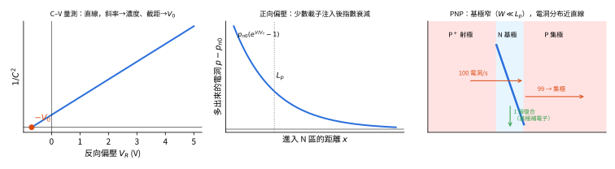

# 第 01 集 · Lec01：PN 接面總複習（內建電位、空乏電容、注入電流）與 BJT 的起點 [▶ 影片](https://www.youtube.com/watch?v=Ci73jQqtSU8)

← 上一集：[電子學（二）第 26 集](../E2/26-short-circuit-current-cascode.md) ｜ [總目錄](../README.md) ｜ 下一集：[02](02-bjt-currents-characteristics-small-signal.md) →

> **課程**：電子學（三）前導課程，陽明交大 電子物理系，113 學年度 — 第 01 集
> **講者**：陳振芳 老師
> **來源**：YouTube 錄影逐字稿（1:49:16，whisper）＋ Sedra & Smith《Microelectronic Circuits》7th ed. Ch3、Ch6
> **標記說明**：`【口頭】` 老師口頭補充；`【課本補充】` 課本有、課堂沒講；`⚠️ 逐字稿缺字` whisper 聽錯，已修正；`[▶ mm:ss]` 影片時間點

---

## 目錄

- [0. 這堂課要做什麼](#0-這堂課要做什麼)
- [1. 擴散、結合、內建電場](#1-擴散結合內建電場)
- [2. 內建電位 $V_0$](#2-內建電位-v_0)
- [3. 空乏區寬度與反向偏壓](#3-空乏區寬度與反向偏壓)
- [4. 空乏電容與 C–V 量測](#4-空乏電容與-cv-量測)
- [5. 正向偏壓：少數載子注入](#5-正向偏壓少數載子注入)
- [6. 連續方程與擴散長度](#6-連續方程與擴散長度)
- [7. 二極體電流](#7-二極體電流)
- [8. 單邊接面與 BJT 的起點](#8-單邊接面與-bjt-的起點)
- [9. 一頁速查表](#9-一頁速查表)
- [10. 與後續集數的連結](#10-與後續集數的連結)

---

## 0. 這堂課要做什麼

【口頭】電子學（一）、（二）講完二極體、op amp、MOS，基礎還差 **BJT**（雙極性接面電晶體，bipolar junction transistor）。電子學（三）先花一個多月把 BJT 上完。[▶ 00:32](https://youtu.be/Ci73jQqtSU8?t=32)

BJT 就是 NPN 或 PNP，基礎是 PN 接面，所以先把 PN 接面從頭整理一次，最後走到 BJT。

---

## 1. 擴散、結合、內建電場

[▶ 02:08](https://youtu.be/Ci73jQqtSU8?t=128)

- 摻三價雜質 → P 型（電洞多，雜質離子帶負電）；摻五價 → N 型（自由電子多，離子帶正電）。
- 電流兩項：**漂移**（drift，靠電場，參數是遷移率 $\mu$）和**擴散**（diffusion，靠濃度差，參數是擴散係數 $D$；濃度隨距離下降時擴散往正方向，所以公式有負號）。[▶ 04:11](https://youtu.be/Ci73jQqtSU8?t=251)

$$
J_p = q\mu_ppE - qD_p\frac{dp}{dx}
$$

- 載子濃度：$np = n_i^2$（矽 $n_i = 10^{10}\ \text{cm}^{-3}$）。P 側 $p = 10^{16}$ → $n = 10^{20}/10^{16} = 10^4$。[▶ 06:45](https://youtu.be/Ci73jQqtSU8?t=405)
- 接起來：電洞往 N 擴散、電子往 P 擴散 → 在接面碰到就**復合**（recombination），一起消失 → 留下淨正、負離子 → 產生電場，方向**抵抗擴散**。[▶ 08:51](https://youtu.be/Ci73jQqtSU8?t=531)
- 很快兩項相等，達到穩態，中間是沒有自由載子的**空乏區**。[▶ 14:00](https://youtu.be/Ci73jQqtSU8?t=840)

【口頭】電場的定義是**單位正電荷**受的力，正電荷就是電洞——這個電場把電洞推回去，對電子則是另一個方向。[▶ 11:25](https://youtu.be/Ci73jQqtSU8?t=685)

> ⚠️ 逐字稿缺字：whisper 寫「10 的 40 次方」，依 $np = n_i^2$ 應為 $10^4$。

---

## 2. 內建電位 $V_0$

[▶ 15:36](https://youtu.be/Ci73jQqtSU8?t=936)

穩態時 $J_p = 0$：$q\mu_ppE = qD_p\dfrac{dp}{dx}$。$E = -dV/dx$，再用**愛因斯坦關係**（Einstein relation）$D_p/\mu_p = V_T = kT/q \approx 0.025$ V（室溫，沒時間推，先接受）：[▶ 18:43](https://youtu.be/Ci73jQqtSU8?t=1123)

$$
-\frac{dV}{dx} = V_T\frac{1}{p}\frac{dp}{dx}
\quad\Longrightarrow\quad
V_2 - V_1 = V_T\ln\frac{p_1}{p_2}
$$

$p_1 = N_A$（P 側）、$p_2 = n_i^2/N_D$（N 側）：[▶ 21:46](https://youtu.be/Ci73jQqtSU8?t=1306)

$$
V_0 = V_T\ln\frac{N_AN_D}{n_i^2}
$$

例 $10^{16}$、$10^{15}$ → 約 0.6～0.7 V，N 側比 P 側高。[▶ 22:53](https://youtu.be/Ci73jQqtSU8?t=1373)

- 電洞看到一座山擋著過不去；電子看到的山把圖倒過來畫就是。從電子推也得到同一個式子（因為 $np$ 是定值）。[▶ 24:55](https://youtu.be/Ci73jQqtSU8?t=1495)

【口頭】整個半導體的應用就在這裡：在一塊晶片裡某個地方**做出一座山**，再想辦法把它降下來讓電流過去。[▶ 28:34](https://youtu.be/Ci73jQqtSU8?t=1714)

---

## 3. 空乏區寬度與反向偏壓

[▶ 29:08](https://youtu.be/Ci73jQqtSU8?t=1748)

（電子學（二）第 9 集的推導）電中性 $N_Ax_1 = N_Dx_2$；高斯定律得三角形電場；積分得 $V_0 = \frac{q}{2\varepsilon}(N_Ax_1^2 + N_Dx_2^2)$。解出：[▶ 40:04](https://youtu.be/Ci73jQqtSU8?t=2404)

$$
W = x_1 + x_2 = \sqrt{\frac{2\varepsilon}{q}\,\frac{N_A + N_D}{N_AN_D}\,V_0}
$$

**反向偏壓** $V_R$（P 接負、N 接正）：電壓幾乎全跨在空乏區，電場和內建同方向 → 電荷要變多 → 空乏區變寬，電位差 $V_0 + V_R$，山變高，電流更難過去。[▶ 41:07](https://youtu.be/Ci73jQqtSU8?t=2467)

---

## 4. 空乏電容與 C–V 量測

[▶ 45:18](https://youtu.be/Ci73jQqtSU8?t=2718)

在反向偏壓 $V_R$ 上再加一點點 $\Delta V_R$（其實就是 sin/cos 小信號）：兩邊各多一小條電荷，$\Delta Q = qN_D\Delta x_2 = qN_A\Delta x_1$。把 $V_0 + V_R$ 的式子微分，整理得：[▶ 49:26](https://youtu.be/Ci73jQqtSU8?t=2966)

$$
C_j = \frac{\Delta Q}{\Delta V_R} = \frac{\varepsilon A}{W}
$$

就是平行板電容，板距 = 空乏區寬度。【口頭】$\varepsilon$ 是半導體的介電常數，不是真空的。[▶ 54:11](https://youtu.be/Ci73jQqtSU8?t=3251)

**怎麼量** [▶ 55:41](https://youtu.be/Ci73jQqtSU8?t=3341)：加直流 $V_R$ 再疊一個小交流，儀器量 $\Delta Q/\Delta V$。注意 RC 時間常數——頻率太快，外面的電壓變化調不進去。

**C–V 量測** [▶ 57:17](https://youtu.be/Ci73jQqtSU8?t=3437)：把 $W$ 代入：

$$
\frac{1}{C_j^2} = \frac{2}{q\varepsilon A^2}\,\frac{N_A + N_D}{N_AN_D}\,(V_0 + V_R)
$$

- $1/C^2$ 對 $V_R$ 畫是**直線**。
- 截距在 $V_R = -V_0$ → 量出內建電位。[▶ 59:50](https://youtu.be/Ci73jQqtSU8?t=3590)
- 一邊濃度高很多時（差 5 倍以上），$\frac{N_A + N_D}{N_AN_D} \approx \frac{1}{N_{\text{低}}}$ → 斜率給出低濃度那邊的摻雜。[▶ 1:00:53](https://youtu.be/Ci73jQqtSU8?t=3653)

【口頭】這個電容就是以後**頻率響應**的來源：元件裡只要有電容，交流信號就會受影響。[▶ 1:02:29](https://youtu.be/Ci73jQqtSU8?t=3749)

---

## 5. 正向偏壓：少數載子注入

[▶ 1:03:32](https://youtu.be/Ci73jQqtSU8?t=3812)

P 接正、N 接負：外加電場和內建電場相反 → 山降低 → 擴散大於漂移。

接面邊緣的濃度怎麼改？**Shockley**（貝爾實驗室，發明電晶體的三人之一）的假設：多數載子幾乎不變，**少數載子**乘上 $e^{V/V_T}$——後來實驗都對。[▶ 1:04:03](https://youtu.be/Ci73jQqtSU8?t=3843)

$$
p_n(0) = p_{n0}\,e^{V/V_T}
$$

（$p_{n0}$：N 區原本的少數載子電洞，例 $10^5$。）[▶ 1:09:11](https://youtu.be/Ci73jQqtSU8?t=4151)

---

## 6. 連續方程與擴散長度

[▶ 1:10:12](https://youtu.be/Ci73jQqtSU8?t=4212)

注入 N 區的電洞一邊擴散一邊和電子復合、消失。取一小塊 $A\,dx$：每秒進 100 個、出 95 個，5 個被吃掉。[▶ 1:12:22](https://youtu.be/Ci73jQqtSU8?t=4342)

$$
\left[J_p(x) - J_p(x + dx)\right]A = q\frac{p - p_{n0}}{\tau_p}A\,dx
$$

$\tau_p$：電洞的**生命期**（lifetime）。【口頭】像大家都 80 年，教室裡 80 人就一年少一個。只算多出來的 $p - p_{n0}$，原本就有的要扣掉。[▶ 1:13:54](https://youtu.be/Ci73jQqtSU8?t=4434)

只有擴散電流 $J_p = -qD_p\,dp/dx$ 代入：[▶ 1:19:37](https://youtu.be/Ci73jQqtSU8?t=4777)

$$
\frac{d^2(p - p_{n0})}{dx^2} = \frac{p - p_{n0}}{L_p^2},
\qquad
L_p = \sqrt{D_p\tau_p}
$$

$L_p$：**擴散長度**（diffusion length）——擴散多遠會消失。邊界 $x = 0$ 為 $p_{n0}e^{V/V_T}$、遠處回到 $p_{n0}$：[▶ 1:22:44](https://youtu.be/Ci73jQqtSU8?t=4964)

$$
p(x) - p_{n0} = p_{n0}\left(e^{V/V_T} - 1\right)e^{-x/L_p}
$$

走一個 $L_p$ 掉 63%。

---

## 7. 二極體電流

[▶ 1:25:20](https://youtu.be/Ci73jQqtSU8?t=5120)

每個面都能算，但 $x = 0$ 最好算：微分乘 $-qD_p$：

$$
J_p = \frac{qD_pp_{n0}}{L_p}\left(e^{V/V_T} - 1\right)
$$

電子往 P 區注入同理。【口頭】電流要在**同一個面**相加；空乏區很窄，從這邊注入 1000 個到那邊大概還是 1000 個（除非裡面有很多吃載子的缺陷），所以兩邊的注入可以算在同一個面。[▶ 1:28:22](https://youtu.be/Ci73jQqtSU8?t=5302)

$$
I = I_s\left(e^{V/V_T} - 1\right),
\qquad
I_s = qA\left(\frac{D_pp_{n0}}{L_p} + \frac{D_nn_{p0}}{L_n}\right)
$$

$I_s$：**飽和電流**。這就是二極體的電流。[▶ 1:31:26](https://youtu.be/Ci73jQqtSU8?t=5486)

> 【課本補充】§3.5.2 (p. 158)：$I_s = Aqn_i^2\left(\frac{D_p}{L_pN_D} + \frac{D_n}{L_nN_A}\right)$，代入 $p_{n0} = n_i^2/N_D$ 就和上式一樣。

---

## 8. 單邊接面與 BJT 的起點

[▶ 1:32:29](https://youtu.be/Ci73jQqtSU8?t=5549)

**$P^+N$ 接面**：$N_A$ 比 $N_D$ 高兩個數量級 → 少數載子反過來，$p_{n0}$ 比 $n_{p0}$ 大兩個數量級 → 電洞注入的斜率大兩個數量級，電子那一項可忽略，只看 P 往 N 的注入。[▶ 1:34:02](https://youtu.be/Ci73jQqtSU8?t=5642)

**再接一塊 P** [▶ 1:37:41](https://youtu.be/Ci73jQqtSU8?t=5861)：$P^+$–N–P 就是 **PNP** 電晶體。有四種工作情形，我們要的是**放大**：射極接面正向、集極接面反向。

- 左邊 $P^+$：**射極**（emitter，注入）；中間 N：**基極**（base）；右邊 P：**集極**（collector）。
- **重要條件**：基極寬度 $W \ll L_p$。[▶ 1:39:44](https://youtu.be/Ci73jQqtSU8?t=5984) 基極很窄，電洞來不及衰減，濃度分布近乎一條直線。

**數個數** [▶ 1:41:47](https://youtu.be/Ci73jQqtSU8?t=6107)：

- 射極每秒注入 **100** 個電洞（射極電流）。
- 基極很窄，只有 **1** 個和電子復合消失；基極要補一個電子，不然基極電子越來越少、電位一直掉——這就是**基極電流**。[▶ 1:46:26](https://youtu.be/Ci73jQqtSU8?t=6386)
- **99** 個到集極：電洞到電洞那邊不會消失，進來 99 個就要吐出 99 個才是穩態——**集極電流**。[▶ 1:43:51](https://youtu.be/Ci73jQqtSU8?t=6231)

$$
I_E = I_C + I_B
$$

[▶ 1:48:29](https://youtu.be/Ci73jQqtSU8?t=6509)

> 【課本補充】§6.1 (p. 306)：課本以 NPN 為主；主動模式（active mode）= EBJ 正向、CBJ 反向；另外還有截止、飽和、反向主動三種模式。

---

## 9. 一頁速查表

| 項目 | 公式 | 關鍵一步 |
|---|---|---|
| 電流 | $J = q\mu pE - qD\,dp/dx$ | 漂移 + 擴散 |
| 愛因斯坦 | $D/\mu = V_T \approx 0.025$ V | |
| 內建電位 | $V_0 = V_T\ln(N_AN_D/n_i^2)$ | $J = 0$ 積分 |
| 空乏區 | $W = \sqrt{\frac{2\varepsilon}{q}\frac{N_A+N_D}{N_AN_D}(V_0 + V_R)}$ | |
| 空乏電容 | $C_j = \varepsilon A/W$ | $\Delta Q/\Delta V$ |
| C–V | $1/C^2 \propto (V_0 + V_R)$ | 截距 $-V_0$ |
| 注入邊界 | $p_n(0) = p_{n0}e^{V/V_T}$ | Shockley |
| 擴散長度 | $L_p = \sqrt{D_p\tau_p}$ | 連續方程 |
| 二極體 | $I = I_s(e^{V/V_T} - 1)$，$I_s = qA(\frac{D_pp_{n0}}{L_p} + \frac{D_nn_{p0}}{L_n})$ | $x = 0$ 取斜率 |
| BJT | $W \ll L_p$；$I_E = I_C + I_B$ | 100 = 99 + 1 |

---

## 10. 與後續集數的連結

| 本集觀念 | 後面在哪裡用到 |
|---|---|
| 窄基極、直線分布 | 下一集：BJT 電流公式、$\beta$、$\alpha$ |
| 空乏電容 | 頻率響應（電子學（四）） |
| 單邊注入 | 射極效率、Early 效應 |

---

## 附：本集一句話總結

> **PN 接面靠擴散和復合自己做出一座內建電位 $V_0 = V_T\ln(N_AN_D/n_i^2)$ 的山，反向偏壓讓山變高、空乏區變寬，形成可用 $1/C^2$ 直線量測的空乏電容 $\varepsilon A/W$；正向偏壓讓少數載子以 $e^{V/V_T}$ 注入、以擴散長度 $L_p$ 衰減，得到二極體電流 $I_s(e^{V/V_T}-1)$；再接一塊 P、把基極做得比 $L_p$ 窄很多，射極注入的 100 個電洞 99 個到集極、1 個在基極復合，這就是 BJT。**

---

*筆記依據陳振芳老師「電子學（三）前導課程」113 學年度 Lec01 錄影逐字稿（whisper，1:49:16）與 Sedra & Smith《Microelectronic Circuits》7th ed. 整理。*
