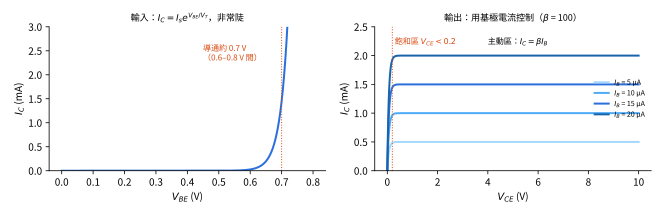
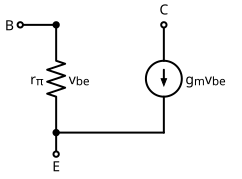

# 第 02 集 · Lec02：BJT 的電流與 $\beta$、特性曲線、直流偏壓、小信號模型 $g_m$、$r_\pi$ [▶ 影片](https://www.youtube.com/watch?v=-eyQjp8RHG0)

← 上一集：[01](01-pn-junction-review-bjt-intro.md) ｜ [總目錄](../README.md) ｜ 下一集：[03](03-bjt-saturation-bias-stability-emitter-resistor.md) →

> **課程**：電子學（三）前導課程，陽明交大 電子物理系，113 學年度 — 第 02 集
> **講者**：陳振芳 老師
> **來源**：YouTube 錄影逐字稿（1:56:02，whisper）＋ Sedra & Smith《Microelectronic Circuits》7th ed.
> **標記說明**：`【口頭】` 老師口頭補充；`【課本補充】` 課本有、課堂沒講；`[▶ mm:ss]` 影片時間點

---

## 目錄

- [0. 這堂課要做什麼](#0-這堂課要做什麼)
- [1. 主動模式：射極正向、集極反向](#1-主動模式射極正向集極反向)
- [2. 集極電流與基極電流](#2-集極電流與基極電流)
- [3. $\beta$ 為什麼很大](#3-beta-為什麼很大)
- [4. 符號：PNP 與 NPN](#4-符號pnp-與-npn)
- [5. 特性曲線](#5-特性曲線)
- [6. 直流偏壓：永遠用 0.7 V](#6-直流偏壓永遠用-07-v)
- [7. 小信號：$g_m = I_C/V_T$](#7-小信號g_m--i_cv_t)
- [8. $r_\pi$、$r_e$ 與 hybrid-π 模型](#8-r_pir_e-與-hybrid-π-模型)
- [9. 共射極放大器例題](#9-共射極放大器例題)
- [10. 一頁速查表](#10-一頁速查表)
- [11. 與後續集數的連結](#11-與後續集數的連結)

---

## 0. 這堂課要做什麼

從 PN 接面進到 BJT：算出三個電流、$\beta$，畫特性曲線，做直流偏壓，再推出小信號模型（$g_m$、$r_\pi$、$r_e$），最後做共射極放大器。

---

## 1. 主動模式：射極正向、集極反向

[▶ 00:33](https://youtu.be/-eyQjp8RHG0?t=33)

（複習）$P^+$ 射極濃度比 N 基極高兩個數量級 → 只看電洞從射極注入基極。BJT 第二個條件：**基極寬度 $W_B \ll L_p$**（例 $L_p \sim 1\ \mu$m、$W_B \sim 0.1\ \mu$m）。[▶ 11:25](https://youtu.be/-eyQjp8RHG0?t=685)

**主動模式**（active mode，放大要用的）[▶ 12:27](https://youtu.be/-eyQjp8RHG0?t=747)：

- 射極–基極接面（EBJ）**正向**：$V_{EB} > 0$，注入。
- 集極–基極接面（CBJ）**反向**：集極負責接收。數學上反向就是 $e^{-|V|/V_T} \approx 0$，邊界濃度掉到 0。

---

## 2. 集極電流與基極電流

[▶ 15:01](https://youtu.be/-eyQjp8RHG0?t=901)

基極很窄，指數函數在這麼短的距離幾乎是**直線**：從 $p_{n0}e^{V_{EB}/V_T}$ 直線降到 0。兩端斜率幾乎一樣 → 射極注入 100 個，99 個到集極。到集極後被反向偏壓的電場掃走（電場對正電荷就是往那邊推），進 99 個就要吐 99 個（穩態）。[▶ 17:07](https://youtu.be/-eyQjp8RHG0?t=1027)

$$
J_C \approx qD_p\frac{p_{n0}e^{V_{EB}/V_T}}{W_B}
$$

（嚴格是 $e^{V/V_T} - 1$，導通時 1 可以丟。）[▶ 20:45](https://youtu.be/-eyQjp8RHG0?t=1245)

**基極電流** [▶ 22:26](https://youtu.be/-eyQjp8RHG0?t=1346)：基極裡多出來的電洞 = 三角形面積 $\frac12p_{n0}e^{V_{EB}/V_T}W_B$，除以生命期就是每秒消失（復合）幾個；每消失一個電洞，基極就要補一個電子：

$$
J_B = \frac{q}{\tau_p}\cdot\frac12p_{n0}e^{V_{EB}/V_T}W_B
$$

---

## 3. $\beta$ 為什麼很大

[▶ 27:40](https://youtu.be/-eyQjp8RHG0?t=1660)

$$
\beta = \frac{I_C}{I_B} = \frac{2D_p\tau_p}{W_B^2} = 2\left(\frac{L_p}{W_B}\right)^2 \gg 1
$$

$W_B \ll L_p$，差一個數量級 $\beta$ 就上百。實際約 50～200，每顆都不一樣。【口頭】$W_B$ 做很大就變成兩顆背對背二極體，不是電晶體。[▶ 29:48](https://youtu.be/-eyQjp8RHG0?t=1788)

射極那邊每秒少 100 個電洞要補回來 → 

$$
I_E = I_C + I_B
$$

一定成立。[▶ 31:22](https://youtu.be/-eyQjp8RHG0?t=1882)

> 【課本補充】§6.1.2 (p. 307)：課本推導 NPN，$i_C = I_Se^{v_{BE}/V_T}$，$I_S = \dfrac{A_EqD_nn_i^2}{N_AW}$；$\beta$ 主要由基極寬度 $W$ 和摻雜比決定；$\alpha = \beta/(1+\beta)$。

---

## 4. 符號：PNP 與 NPN

[▶ 32:54](https://youtu.be/-eyQjp8RHG0?t=1974)

- **箭頭只畫在射極**（大家一致的規定），代表射極電流方向；箭頭也標出 PN 接面的方向。
- 箭頭進去 = PNP：$I_E$ 從射極流入，99% 從集極出來、1% 從基極出來。[▶ 34:27](https://youtu.be/-eyQjp8RHG0?t=2067)

$$
I_C = I_Se^{V_{EB}/V_T},
\qquad
I_B = \frac{I_C}{\beta},
\qquad
I_E = (1 + \beta)I_B
$$

**NPN**（更常用）[▶ 36:59](https://youtu.be/-eyQjp8RHG0?t=2219)：$N^+$ 射極、P 基極、N 集極；$V_{BE} > 0$ 正向、CBJ 反向（N 接正）。射極注入的是電子，電流方向和電子相反——箭頭往外。$I_C = I_Se^{V_{BE}/V_T}$，其餘完全對稱。

【口頭】PNP 通常畫在 NPN 頭上，所以習慣把 PNP 翻過來畫（射極在上）。箭頭方向就是電流方向。[▶ 41:36](https://youtu.be/-eyQjp8RHG0?t=2496)

---

## 5. 特性曲線

[▶ 46:18](https://youtu.be/-eyQjp8RHG0?t=2778)

**共射極**：射極接地，輸入 $V_{BE}$、輸出 $V_{CE}$、$I_C$。

**輸入特性** [▶ 47:48](https://youtu.be/-eyQjp8RHG0?t=2868)：$I_C = I_Se^{V_{BE}/V_T}$，指數，比 MOS 的二次方陡得多。0.5 V 幾乎沒電流，0.6 V 約 0.1 mA，0.8 V 已經幾百 mA。電路裡電流約 1 mA 上下 → **$V_{BE}$ 永遠差不多 0.7 V**。[▶ 49:20](https://youtu.be/-eyQjp8RHG0?t=2960)

**輸出特性** [▶ 52:55](https://youtu.be/-eyQjp8RHG0?t=3175)：

- 對 $V_{CB}$ 畫：$V_{CB} \ge 0$（反向或 0，內建電場照樣把電子掃過去）電流不變。$V_{CB}$ 變負到約 −0.5 V 以前還好；再負 CBJ 變正向、也開始注入 → 電流掉下來。[▶ 54:57](https://youtu.be/-eyQjp8RHG0?t=3297)
- 換成 $V_{CE} = V_{CB} + V_{BE}$：整張圖往右移 0.7 V → $V_{CE} \ge 0.2$ V 是平的。[▶ 58:30](https://youtu.be/-eyQjp8RHG0?t=3510)

**用基極電流來控制** [▶ 1:02:06](https://youtu.be/-eyQjp8RHG0?t=3726)：$V_{BE}$ 一點點變化電流就差好幾個數量級，每條線都是「0.7 V」，根本控制不了。改用 $I_B$：$I_C = \beta I_B$，例 $I_B = 10\ \mu$A → 1 mA。

**名稱和 MOS 相反** [▶ 1:05:09](https://youtu.be/-eyQjp8RHG0?t=3909)：BJT 平的地方叫**主動區**（active region），左邊陡的叫**飽和區**（saturation）。$V_{CE,\text{sat}}$ 用 0.2 V（有的書 0.3 V）。

$$
\text{主動區條件：}\ V_{CE} \ge 0.2\ \text{V}\quad(\text{即 } V_{CB} \ge -0.5\ \text{V})
$$

---

## 6. 直流偏壓：永遠用 0.7 V

[▶ 1:09:49](https://youtu.be/-eyQjp8RHG0?t=4189)

NPN，$V_{CC} = 10$ V、$R_C = 5$ kΩ，設計 $I_C = 1$ mA → $V_{CE} = 5$ V ≥ 0.2 ✓ 主動區。$\beta = 100$ → $I_B = 0.01$ mA。基極電阻接 10 V：[▶ 1:13:59](https://youtu.be/-eyQjp8RHG0?t=4439)

$$
R_B = \frac{10 - 0.7}{0.01} = 930\ \text{k}\Omega
$$

**誤差** [▶ 1:14:30](https://youtu.be/-eyQjp8RHG0?t=4470)：真的算出來可能 0.69 V，$I_B = 9.31/930$ vs. $9.3/930$，差千分之一，可以忽略。【口頭】以後 BJT 題目，只要導通、電流在 mA 附近，**一律用 0.7 V**。[▶ 1:17:06](https://youtu.be/-eyQjp8RHG0?t=4626)

交流信號要經**耦合電容**進來：沒有電容，信號源會把基極拉走，0.7 V 不見；有電容，它自己充電到 0.7 V 就停了。[▶ 1:18:38](https://youtu.be/-eyQjp8RHG0?t=4718)

---

## 7. 小信號：$g_m = I_C/V_T$

[▶ 1:21:55](https://youtu.be/-eyQjp8RHG0?t=4915)

$v_{BE} = V_{BE} + v$：

$$
i_C = I_Se^{(V_{BE} + v)/V_T} = I_C\,e^{v/V_T}
= I_C\left(1 + \frac{v}{V_T} + \frac12\left(\frac{v}{V_T}\right)^2 + \cdots\right)
$$

**小信號近似**：$\frac12(v/V_T)^2 \ll v/V_T$ ⇔ $|v| \ll 2V_T = 50$ mV。成立時 $i_C = I_C + \dfrac{I_C}{V_T}v$，直流 + 交流：[▶ 1:25:01](https://youtu.be/-eyQjp8RHG0?t=5101)

$$
g_m = \frac{I_C}{V_T}
$$

（也就是對指數曲線微分、在 Q 點的斜率。）1 mA → $g_m = 1/0.025 = 40$ mA/V。【口頭】MOS $k = 2$、1 mA 時 $g_m$ 只有 2 mA/V——指數比二次方陡得多。[▶ 1:29:42](https://youtu.be/-eyQjp8RHG0?t=5382)

> 【課本補充】§7.2.2 (p. 399)：小信號條件 $v_{be} \ll V_T$（課本用約 10 mV 以下）；$g_m = I_C/V_T$。

---

## 8. $r_\pi$、$r_e$ 與 hybrid-π 模型

[▶ 1:31:15](https://youtu.be/-eyQjp8RHG0?t=5475)

基極交流電流 = 集極交流電流 / $\beta$：

$$
i_b = \frac{g_mv}{\beta} = \frac{v}{r_\pi},
\qquad
r_\pi = \frac{\beta}{g_m} = \frac{V_T}{I_B}
$$

1 mA、$\beta = 100$：$r_\pi = 100/40 = 2.5$ kΩ（或 $0.025/0.01 = 2.5$ kΩ）。[▶ 1:33:22](https://youtu.be/-eyQjp8RHG0?t=5602)

**從基極看進去**（射極接地）[▶ 1:36:00](https://youtu.be/-eyQjp8RHG0?t=5760)：$R_{in} = r_\pi = 2.5$ kΩ——不大也不小。抓電壓要無窮大、抓電流要 0，它兩個都不是。

**從射極看進去**（基極接地）[▶ 1:37:36](https://youtu.be/-eyQjp8RHG0?t=5856)：射極電流是基極的 $(1 + \beta)$ 倍：

$$
r_e = \frac{r_\pi}{1 + \beta} = \frac{V_T}{I_E} \approx \frac{1}{g_m} = 25\ \Omega
$$

很小 → 共基極專門抓**電流**（例如光偵測器）；直流越大 $r_e$ 越小。[▶ 1:41:18](https://youtu.be/-eyQjp8RHG0?t=6078)

**射極串電阻 $R_E$ 時從基極看進去** [▶ 1:43:29](https://youtu.be/-eyQjp8RHG0?t=6209)：

$$
R_{in} = r_\pi + (1 + \beta)R_E
$$

射極的電阻放大 $(1 + \beta)$ 倍反映到基極。

---

## 9. 共射極放大器例題

[▶ 1:46:40](https://youtu.be/-eyQjp8RHG0?t=6400)

$V_{CC} = 10$ V、$R_C = 5$ kΩ、$R_B = 930$ kΩ、$\beta = 100$、1 mA（第 6 節）。信號源內阻 $R_s = 2.5$ kΩ，經耦合電容（夠大，短路）。

**交流** [▶ 1:48:47](https://youtu.be/-eyQjp8RHG0?t=6527)：拿掉 10 V（$R_B$、$R_C$ 上端接地）。

- 基極電壓：$v = v_s\dfrac{R_B\parallel r_\pi}{R_s + R_B\parallel r_\pi} \approx v_s\dfrac{2.5}{2.5 + 2.5} = \dfrac{v_s}{2}$（930 k 遠大於 2.5 k）。
- $v_o = -g_mvR_C$。

$$
\frac{v_o}{v_s} = -g_mR_C\frac{r_\pi}{R_s + r_\pi} = -40\times5\times\frac12 = -100
$$

[▶ 1:55:02](https://youtu.be/-eyQjp8RHG0?t=6902)

【口頭】BJT 稍微麻煩的地方：基極有電流，一定要算 $r_\pi$，它會和信號源內阻分壓。[▶ 1:55:32](https://youtu.be/-eyQjp8RHG0?t=6932)

---

## 10. 一頁速查表

| 項目 | 公式／重點 | 關鍵一步 |
|---|---|---|
| 主動模式 | EBJ 正向、CBJ 反向 | |
| 集極電流 | $I_C = I_Se^{V_{BE}/V_T}$ | 窄基極直線分布 |
| $\beta$ | $2(L_p/W_B)^2$，約 50–200 | 三角形面積 / $\tau_p$ |
| 電流關係 | $I_E = I_C + I_B$，$I_C = \beta I_B$ | |
| $V_{BE}$ | 一律 0.7 V | 誤差千分之一 |
| 主動區 | $V_{CE} \ge 0.2$ V | 和 MOS 名稱相反 |
| 偏壓例 | $R_B = 9.3\ \text{V}/0.01\ \text{mA} = 930$ k | |
| 小信號條件 | $\lvert v_{be}\rvert  \ll 2V_T$ | 指數展開 |
| $g_m$ | $I_C/V_T$（1 mA → 40 mA/V） | |
| $r_\pi$ | $\beta/g_m = V_T/I_B$（2.5 k） | |
| $r_e$ | $V_T/I_E \approx 1/g_m$（25 Ω） | |
| 基極看進去含 $R_E$ | $r_\pi + (1+\beta)R_E$ | |
| 共射極增益 | $-g_mR_C\frac{r_\pi}{R_s + r_\pi}$（例 −100） | |

---

## 11. 與後續集數的連結

| 本集觀念 | 後面在哪裡用到 |
|---|---|
| hybrid-π 模型 | 下一集起：共射、共基、共集放大器 |
| $r_\pi + (1+\beta)R_E$ | 射極退化、射極隨耦器 |
| 偏壓穩定（$\beta$ 不確定） | BJT 偏壓設計 |

---

## 附：本集一句話總結

> **主動模式下射極注入的載子在窄基極裡直線分布，$I_C = I_Se^{V_{BE}/V_T}$，只有少數在基極復合形成 $I_B$，$\beta = 2(L_p/W_B)^2$ 上百；$V_{BE}$ 永遠約 0.7 V，所以用 $I_B$ 控制 $I_C$，$V_{CE} \ge 0.2$ V 才在主動區；小信號下 $g_m = I_C/V_T$（1 mA 時 40 mA/V）、$r_\pi = \beta/g_m$、$r_e \approx 1/g_m$，共射極增益 $-g_mR_C$ 再乘上 $r_\pi$ 和信號源內阻的分壓。**

---

*筆記依據陳振芳老師「電子學（三）前導課程」113 學年度 Lec02 錄影逐字稿（whisper，1:56:02）與 Sedra & Smith《Microelectronic Circuits》7th ed. 整理。*
