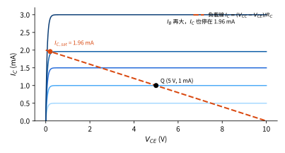

# 第 03 集 · Lec03：負載線與飽和、戴維寧偏壓、射極電阻穩定 $\beta$、部分旁路 [▶ 影片](https://www.youtube.com/watch?v=ai_xHfPYUlA)

← 上一集：[02](02-bjt-currents-characteristics-small-signal.md) ｜ [總目錄](../README.md) ｜ 下一集：[04](04-bjt-configurations-power-amplifier.md) →

> **課程**：電子學（三）前導課程，陽明交大 電子物理系，113 學年度 — 第 03 集
> **講者**：陳振芳 老師
> **來源**：YouTube 錄影逐字稿（1:51:12，whisper）＋ Sedra & Smith《Microelectronic Circuits》7th ed.
> **標記說明**：`【口頭】` 老師口頭補充；`【課本補充】` 課本有、課堂沒講；`[▶ mm:ss]` 影片時間點

---

## 目錄

- [0. 這堂課要做什麼](#0-這堂課要做什麼)
- [1. 複習：直流 + 交流](#1-複習直流--交流)
- [2. 負載線與飽和](#2-負載線與飽和)
- [3. 飽和條件：放大要避開、數位要故意](#3-飽和條件放大要避開數位要故意)
- [4. 戴維寧等效：一顆電源分壓](#4-戴維寧等效一顆電源分壓)
- [5. $\beta$ 不確定：加射極電阻](#5-beta-不確定加射極電阻)
- [6. 代價：增益只剩 $R_C/R_E$](#6-代價增益只剩-r_cr_e)
- [7. 旁路電容與溫度問題](#7-旁路電容與溫度問題)
- [8. 部分旁路：穩定又不受溫度影響](#8-部分旁路穩定又不受溫度影響)
- [9. 兩級串接](#9-兩級串接)
- [10. 一頁速查表](#10-一頁速查表)
- [11. 與後續集數的連結](#11-與後續集數的連結)

---

## 0. 這堂課要做什麼

BJT 的直流偏壓：飽和的條件、怎麼用一顆電源做偏壓、怎麼對付 $\beta$ 不確定；再看射極電阻對增益的影響，以及用部分旁路兼顧穩定和增益。

---

## 1. 複習：直流 + 交流

[▶ 00:00](https://youtu.be/ai_xHfPYUlA?t=0)

$V_{CC} = 10$ V、$R_C = 5$ kΩ、1 mA、$\beta = 100$ → $I_B = 0.01$ mA、$R_B = 9.3/0.01 = 930$ kΩ、$V_{CE} = 5$ V。往上擺 5 V、往下到 0.2 V。【口頭】$I_C$ 在 0.1～100 mA 時 $V_{BE}$ 都在 0.6～0.8 V，用 0.7 誤差很小；BJT 靠輸入**電流**控制。[▶ 03:07](https://youtu.be/ai_xHfPYUlA?t=187)

交流：$g_m = 40$ mA/V、$r_\pi = 2.5$ kΩ、$r_e = 1/g_m$；射極有 $R_E$ 時基極看進去 $r_\pi + (1+\beta)R_E$。增益 $-g_mR_C\dfrac{r_\pi}{R_s + r_\pi}$。[▶ 12:33](https://youtu.be/ai_xHfPYUlA?t=753)

---

## 2. 負載線與飽和

[▶ 22:56](https://youtu.be/ai_xHfPYUlA?t=1376)

$$
V_{CC} = I_CR_C + V_{CE}
$$

畫在 $I_C$-$V_{CE}$ 圖上是**負載線**：端點 $(10\ \text{V}, 0)$ 和 $(0, V_{CC}/R_C = 2\ \text{mA})$。Q 點 $(5\ \text{V}, 1\ \text{mA})$ 在中間。$I_B$ 越大，工作點沿負載線往左上走。[▶ 25:32](https://youtu.be/ai_xHfPYUlA?t=1532)

走到 $V_{CE} = 0.2$ V 就是**飽和**：[▶ 28:37](https://youtu.be/ai_xHfPYUlA?t=1717)

$$
I_{C,\text{sat}} = \frac{V_{CC} - V_{CE,\text{sat}}}{R_C} = \frac{10 - 0.2}{5} = 1.96\ \text{mA}
$$

之後 $I_B$ 再增加，$I_C$ 也不增加 → $I_C/I_B$ 不再是 $\beta$，比 $\beta$ 小。[▶ 31:48](https://youtu.be/ai_xHfPYUlA?t=1908)

---

## 3. 飽和條件：放大要避開、數位要故意

[▶ 33:21](https://youtu.be/ai_xHfPYUlA?t=2001)

$$
I_B \ge \frac{I_{C,\text{sat}}}{\beta}
\quad\Longleftrightarrow\quad
\beta\frac{V_{CC} - 0.7}{R_B} \ge \frac{V_{CC} - 0.2}{R_C}
$$

**例 1**（$R_B = 930$ kΩ、$R_C = 5$ kΩ）[▶ 36:29](https://youtu.be/ai_xHfPYUlA?t=2189)：

$$
\beta \ge \frac{9.8\times930}{9.3\times5} \approx 196
$$

買到 $\beta > 196$ 的那顆就飽和了，不能放大。【口頭】$\beta$ 範圍是 50～200 左右，很大，所以這樣設計危險。[▶ 40:10](https://youtu.be/ai_xHfPYUlA?t=2410)

**例 2：數位電路要它一定飽和**（只有飽和、不導通兩種）[▶ 40:41](https://youtu.be/ai_xHfPYUlA?t=2441)：讓 $\beta$ 低到 10 也飽和：

$$
R_B \le \frac{\beta R_C(V_{CC} - 0.7)}{V_{CC} - 0.2} = \frac{10\times5\times9.3}{9.8} \approx 47\ \text{k}\Omega
$$

$\beta$ 越大越會飽和，所以任何一顆放進去都飽和。[▶ 43:48](https://youtu.be/ai_xHfPYUlA?t=2628)

---

## 4. 戴維寧等效：一顆電源分壓

[▶ 46:21](https://youtu.be/ai_xHfPYUlA?t=2781)

自己選基極等效電阻 $R_{BB} = 100$ kΩ → $I_BR_{BB} = 1$ V → 需要 $V_{BB} = 1 + 0.7 = 1.7$ V。不要另買 1.7 V 電源（好電源很貴），從 10 V 用 $R_1$、$R_2$ 分壓，讓兩個電路**等效**：[▶ 48:01](https://youtu.be/ai_xHfPYUlA?t=2881)

- **開路電壓**（後面拿掉、不拉電流）：$V_{BB} = V_{CC}\dfrac{R_2}{R_1 + R_2}$。[▶ 50:13](https://youtu.be/ai_xHfPYUlA?t=3013)
- **看回去的電阻**（10 V 接地）：$R_{BB} = R_1 \parallel R_2$。[▶ 52:49](https://youtu.be/ai_xHfPYUlA?t=3169)

解出：

$$
R_1 = R_{BB}\frac{V_{CC}}{V_{BB}},
\qquad
R_2 = \frac{R_{BB}}{1 - V_{BB}/V_{CC}}
$$

1.7 V：$R_1 = 588$ kΩ、$R_2 \approx 120$ kΩ。[▶ 54:53](https://youtu.be/ai_xHfPYUlA?t=3293)

【口頭】解題時不要以為基極電壓是 $10\times\frac{R_2}{R_1+R_2}$ 就結束——基極有電流；基極永遠是 0.7 V，要用戴維寧等效算 $I_B = (V_{BB} - 0.7)/R_{BB}$。[▶ 56:28](https://youtu.be/ai_xHfPYUlA?t=3388)

交流上 588 k ∥ 120 k ≈ 100 k 仍遠大於 $r_\pi$，增益和上一集一樣。[▶ 59:06](https://youtu.be/ai_xHfPYUlA?t=3546)

---

## 5. $\beta$ 不確定：加射極電阻

[▶ 1:00:37](https://youtu.be/ai_xHfPYUlA?t=3637)

$$
I_C = \beta\frac{V_{BB} - 0.7}{R_{BB}}
$$

和 $\beta$ 成正比：$\beta = 200$ → 2 mA，超過 $I_{C,\text{sat}} = 1.96$ → 跳出去飽和。$\beta$ 變幾倍電流就變幾倍——**不穩定**。【口頭】你沒買來裝上去量，根本不知道 $\beta$ 多少。[▶ 1:01:42](https://youtu.be/ai_xHfPYUlA?t=3702)

**加射極電阻 $R_E$** [▶ 1:05:56](https://youtu.be/ai_xHfPYUlA?t=3956)：走一圈 $V_{BB} = I_BR_{BB} + 0.7 + I_ER_E$，$I_E = \frac{1+\beta}{\beta}I_C \approx I_C$：

$$
I_C = \frac{V_{BB} - 0.7}{R_E + R_{BB}/\beta}
\quad\left(\text{精確：}\frac{\beta(V_{BB} - 0.7)}{R_{BB} + (1+\beta)R_E}\right)
$$

$(1+\beta)R_E \gg R_{BB}$ 時 $I_C \approx (V_{BB} - 0.7)/R_E$，幾乎和 $\beta$ 無關。分母多了一項，穩定性好了一個數量級。[▶ 1:12:16](https://youtu.be/ai_xHfPYUlA?t=4336)

**負回授** [▶ 1:13:49](https://youtu.be/ai_xHfPYUlA?t=4429)：$\beta$ 變大 → 電流變大 → $R_E$ 壓降變大 → 基極電流被減下來。

**設計** [▶ 1:15:22](https://youtu.be/ai_xHfPYUlA?t=4522)：$R_E = 2$ kΩ（越大越穩）、1 mA → $V_E = 2$ V、$V_B = 2.7$ V；$R_{BB} = 100$ kΩ → $V_{BB} = 3.7$ V → $R_1 = 270$ kΩ、$R_2 = 158$ kΩ。$R_C = 4$ kΩ → $V_C = 6$ V：往上擺 4 V，往下到 $2 + 0.2 = 2.2$ V。[▶ 1:20:31](https://youtu.be/ai_xHfPYUlA?t=4831)

$\beta = 200$ 時電流比 1 mA 多一點，還在工作範圍。[▶ 1:19:29](https://youtu.be/ai_xHfPYUlA?t=4769)

> 【課本補充】§7.4.2 (p. 461)：BJT 分壓偏壓要讓 $V_{BB}$、$I_ER_E$、$V_{CB}$ 各約 $V_{CC}/3$，並讓 $R_{BB} \ll (\beta+1)R_E$。

---

## 6. 代價：增益只剩 $R_C/R_E$

[▶ 1:24:12](https://youtu.be/ai_xHfPYUlA?t=5052)

交流：從基極到地，信號跨在 $r_e = 1/g_m$ 和 $R_E$ 上，只有 $r_e$ 那一份產生 $g_m$ 的電流：

$$
\frac{v_o}{v_i} = -\frac{g_mR_C}{1 + g_mR_E} = -\frac{R_C}{r_e + R_E} \approx -\frac{R_C}{R_E}
$$

【口頭】就是「輸出電阻除以輸入電阻」：集極、射極電流幾乎一樣。原本 $-40\times4 = -160$，現在 $-4/2 = -2$。穩定性好了，增益只剩 2。[▶ 1:29:24](https://youtu.be/ai_xHfPYUlA?t=5364)

---

## 7. 旁路電容與溫度問題

[▶ 1:29:54](https://youtu.be/ai_xHfPYUlA?t=5394)

$R_E$ 並聯大電容 $C_E$：

- 直流：充飽後開路，$R_E$ 還在 → 穩定性還在。[▶ 1:30:58](https://youtu.be/ai_xHfPYUlA?t=5458)
- 交流：短路 → 增益回到 $-g_mR_C = -160$。

**新問題** [▶ 1:35:38](https://youtu.be/ai_xHfPYUlA?t=5738)：$g_m = I_C/V_T$，$V_T = kT/q$ 和**溫度**有關 → 增益隨溫度變，電路一發熱就變。

---

## 8. 部分旁路：穩定又不受溫度影響

[▶ 1:37:10](https://youtu.be/ai_xHfPYUlA?t=5830)

射極電阻拆兩段：上面 $R_E' = 0.2$ kΩ 不旁路，下面 1.8 kΩ 並大電容。

- 直流：總共 2 kΩ，穩定性不變；$R_1$、$R_2$ 幾乎不用改。[▶ 1:41:49](https://youtu.be/ai_xHfPYUlA?t=6109)
- 交流：只剩 0.2 kΩ：

$$
A_v = -\frac{R_C}{r_e + R_E'} = -\frac{4}{0.025 + 0.2} \approx -18
$$

$R_E' = 0.2$ k 比 $r_e = 25\ \Omega$ 大近一個數量級，$r_e$ 可忽略 → 增益 ≈ $-R_C/R_E' = -20$，**只看電阻，和溫度無關**（電阻最穩）。[▶ 1:39:43](https://youtu.be/ai_xHfPYUlA?t=5983)

【口頭】直流穩定、增益和溫度無關，做電子實驗非常好用。

---

## 9. 兩級串接

[▶ 1:43:21](https://youtu.be/ai_xHfPYUlA?t=6201)

兩級一樣的電路，中間電容耦合。第二級的輸入電阻（$C_E$ 交流短路，只剩 0.2 k）：[▶ 1:45:53](https://youtu.be/ai_xHfPYUlA?t=6353)

$$
R_{in2} = r_\pi + (1+\beta)R_E' \approx 2.5 + 100\times0.2 \approx 22\ \text{k}\Omega
$$

再並 $R_1 \parallel R_2$（約 100 k），老師取約 22 k。第一級的負載變成 $R_C \parallel R_{in2}$，增益比 20 稍微下降；總增益約 $20\times20$ 再乘信號源分壓。[▶ 1:48:29](https://youtu.be/ai_xHfPYUlA?t=6509)

以下**不是逐字稿內容**，是依上面的數字算的：$22 \parallel 100 \approx 18$ kΩ、$4 \parallel 18 \approx 3.3$ kΩ → 第一級約 $-3.3/0.225 \approx -15$，第二級約 $-18$，總共約 270 倍（不含信號源分壓）。

---

## 10. 一頁速查表

| 項目 | 公式／重點 | 關鍵 |
|---|---|---|
| 負載線 | $V_{CC} = I_CR_C + V_{CE}$ | |
| 飽和電流 | $I_{C,sat} = (V_{CC} - 0.2)/R_C$ | 例 1.96 mA |
| 飽和條件 | $I_B \ge I_{C,sat}/\beta$ | 放大避開、數位故意 |
| 戴維寧偏壓 | $V_{BB} = V_{CC}\frac{R_2}{R_1+R_2}$、$R_{BB} = R_1\parallel R_2$ | 開路電壓 + 看回去電阻 |
| 反推 | $R_1 = R_{BB}V_{CC}/V_{BB}$、$R_2 = R_{BB}/(1 - V_{BB}/V_{CC})$ | |
| 加 $R_E$ | $I_C = \frac{\beta(V_{BB}-0.7)}{R_{BB} + (1+\beta)R_E}$ | 負回授 |
| 增益（有 $R_E$） | $-R_C/(r_e + R_E)$ | 例 −2 |
| 全旁路 | $-g_mR_C$（例 −160） | 隨溫度變 |
| 部分旁路 | $-R_C/(r_e + R_E') \approx -R_C/R_E'$（例 ≈ −20） | 和溫度無關 |
| 輸入電阻 | $r_\pi + (1+\beta)R_E'$ | 例 ≈ 22 k |

---

## 11. 與後續集數的連結

| 本集觀念 | 後面在哪裡用到 |
|---|---|
| 射極退化 | 回授（電子學（四）） |
| BJT 開關（飽和） | 數位邏輯 |
| 多級輸入電阻 | 下一集起：共基、共集、多級 |

---

## 附：本集一句話總結

> **BJT 沿負載線工作，$I_B$ 太大就飽和在 $I_{C,sat} = (V_{CC}-0.2)/R_C$；放大要避開（$\beta$ 太大就危險）、數位反而要故意讓它飽和。偏壓用戴維寧等效從一顆電源分壓；$\beta$ 不確定時加射極電阻做負回授讓電流穩定，但增益只剩 $R_C/R_E$；旁路電容把增益救回 $g_mR_C$ 卻受溫度影響，所以只留一小段不旁路的 $R_E'$，增益約 $R_C/R_E'$，既穩定又和溫度無關。**

---

*筆記依據陳振芳老師「電子學（三）前導課程」113 學年度 Lec03 錄影逐字稿（whisper，1:51:12）與 Sedra & Smith《Microelectronic Circuits》7th ed. 整理。*
