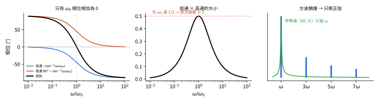

# 第 06 集 · Lec06：振盪的三個條件、RC 振盪器、並聯 RLC 選頻、變壓器與變壓器耦合振盪器 [▶ 影片](https://www.youtube.com/watch?v=jwWxmPhvg7k)

← 上一集：[05](05-differential-amp-active-load-bjt-cascode.md) ｜ [總目錄](../README.md) ｜ 下一集：[07](07-nonlinear-colpitts-hartley-mixer.md) →

> **課程**：電子學（三）前導課程，陽明交大 電子物理系，113 學年度 — 第 06 集
> **講者**：陳振芳 老師
> **來源**：YouTube 錄影逐字稿（2:03:18，whisper）＋ Sedra & Smith《Microelectronic Circuits》7th ed.
> **標記說明**：`【口頭】` 老師口頭補充；`【課本補充】` 課本有、課堂沒講；`[▶ mm:ss]` 影片時間點

---

## 目錄

- [0. 這堂課要做什麼](#0-這堂課要做什麼)
- [1. 振盪的條件與分析步驟](#1-振盪的條件與分析步驟)
- [2. 例 1：放大器 + RC 低通 + RC 高通](#2-例-1放大器--rc-低通--rc-高通)
- [3. 例 2：兩個反相放大器——頻率控制不了](#3-例-2兩個反相放大器頻率控制不了)
- [4. 並聯 RLC：只在 $\omega_0$ 相位為 0](#4-並聯-rlc只在-omega_0-相位為-0)
- [5. 應用：方波變正弦、收音機調諧](#5-應用方波變正弦收音機調諧)
- [6. 變壓器](#6-變壓器)
- [7. 變壓器耦合的 BJT 振盪器](#7-變壓器耦合的-bjt-振盪器)
- [8. 振幅怎麼停下來：非線性](#8-振幅怎麼停下來非線性)
- [9. 一頁速查表](#9-一頁速查表)
- [10. 與後續集數的連結](#10-與後續集數的連結)

---

## 0. 這堂課要做什麼

第 5 章把 BJT 講完，第 6 章拿來用：**信號產生與處理電路**（signal generation and processing circuits）。第一個是**振盪器**（oscillator）：沒有輸入，自己產生正弦波。[▶ 00:31](https://youtu.be/jwWxmPhvg7k?t=31)

---

## 1. 振盪的條件與分析步驟

[▶ 01:35](https://youtu.be/jwWxmPhvg7k?t=95)

三個條件：

1. 要有回授，而且是**正回授**（positive feedback）。
2. **同調**（coherence）：繞一圈回來的信號和原來的**同相**（相位差 0°）。[▶ 02:35](https://youtu.be/jwWxmPhvg7k?t=155)
3. **迴路增益 ≥ 1**：回來的 ÷ 出發的，大小要 ≥ 1。[▶ 03:08](https://youtu.be/jwWxmPhvg7k?t=188)

**步驟** [▶ 09:50](https://youtu.be/jwWxmPhvg7k?t=590)：

1. 在迴路任一處斷開，自己加一個測試信號 $v_t e^{j\omega t}$。
2. 繞一圈求回來的 $v_r$。
3. 求 $v_r/v_t$（$e^{j\omega t}$ 消掉）。
4. 相位 = 0 → 振盪頻率；在那個頻率 $|v_r/v_t| \ge 1$ → 會振。[▶ 12:27](https://youtu.be/jwWxmPhvg7k?t=747)

> 【課本補充】§18.1 (p. 1380)：這就是**巴克豪森準則**（Barkhausen criterion）：$L(j\omega_0) = A\beta = 1$（相位 0°、大小 1）。

---

## 2. 例 1：放大器 + RC 低通 + RC 高通

[▶ 03:40](https://youtu.be/jwWxmPhvg7k?t=220)

非反相放大器 $(1 + R_2/R_1)$（輸入電阻 ∞、輸出電阻 0，理想電壓放大器）→ RC 低通 → voltage follower（隔開，避免互相負載）→ RC 高通 → 接回放大器輸入。[▶ 07:45](https://youtu.be/jwWxmPhvg7k?t=465)

$$
\frac{v_r}{v_t} = \left(1 + \frac{R_2}{R_1}\right)\cdot\frac{1}{1 + j\omega/\omega_0}\cdot\frac{j\omega/\omega_0}{1 + j\omega/\omega_0},
\qquad
\omega_0 = \frac{1}{RC}
$$

[▶ 14:03](https://youtu.be/jwWxmPhvg7k?t=843)

- 低通相位 $-\tan^{-1}(\omega/\omega_0)$，高通 $90° - \tan^{-1}(\omega/\omega_0)$。相加 = 0 → $\tan^{-1} = 45°$ → **$\omega = \omega_0$**。[▶ 16:35](https://youtu.be/jwWxmPhvg7k?t=995)
- 在 $\omega_0$ 兩個濾波器各是 $1/\sqrt2$，乘起來 1/2 → 要 $1 + R_2/R_1 \ge 2$，即 $R_2 \ge R_1$。[▶ 18:09](https://youtu.be/jwWxmPhvg7k?t=1089)

**沒有輸入怎麼起振** [▶ 20:47](https://youtu.be/jwWxmPhvg7k?t=1247)：雜訊裡什麼頻率都有，$\omega_0$ 那個成分繞一圈被放大，越來越大。不會變無窮大——大到小信號近似不成立，非線性讓它平下來（steady state）。【口頭】振盪器最重要的是振盪**頻率**，振幅有時很難控制。[▶ 23:59](https://youtu.be/jwWxmPhvg7k?t=1439)

---

## 3. 例 2：兩個反相放大器——頻率控制不了

[▶ 24:29](https://youtu.be/jwWxmPhvg7k?t=1469)

兩級反相放大器 $-R_2/R_1$（輸入電阻是 $R_1$，不理想，中間加 voltage follower）串起來接回去：$180° + 180° = 360° = 0°$——**所有頻率**都同相，不知道會振在哪個頻率，完全無法控制。[▶ 28:09](https://youtu.be/jwWxmPhvg7k?t=1689)

→ 迴路裡加一個**並聯 RLC**：

$$
\frac{v_r}{v_t} = \left(\frac{R_2}{R_1}\right)^2\cdot\frac{Z_{RLC}}{R}
$$

只有 $\omega_0 = 1/\sqrt{LC}$ 時 RLC 的相位是 0（大小 1），所以振在 $\omega_0$，條件 $(R_2/R_1)^2 \ge 1$。[▶ 35:29](https://youtu.be/jwWxmPhvg7k?t=2129)

---

## 4. 並聯 RLC：只在 $\omega_0$ 相位為 0

[▶ 37:04](https://youtu.be/jwWxmPhvg7k?t=2224)

【口頭】這個電路以後會常常用到，詳細推一次。電感 $v = L\,di/dt$ → $Z_L = j\omega L$；$Z_C = 1/(j\omega C)$。[▶ 38:07](https://youtu.be/jwWxmPhvg7k?t=2287)

$$
Z_{L\parallel C} = \frac{j\omega L}{1 - \omega^2LC} = \frac{j\omega L}{1 - (\omega/\omega_0)^2}
$$

$\omega = \omega_0$ 時無窮大（像共振），三個並聯只剩 $R$。[▶ 40:10](https://youtu.be/jwWxmPhvg7k?t=2410)

**分三段看** [▶ 41:12](https://youtu.be/jwWxmPhvg7k?t=2472)：

- $\omega \ll \omega_0$：電容可忽略，電感接近短路 → $\approx j\omega L$（很小）。
- $\omega \gg \omega_0$：電感開路，電容接近短路 → $\approx 1/(j\omega C)$。
- $\omega \approx \omega_0$：$\omega_0^2 - \omega^2 \approx 2\omega_0(\omega_0 - \omega)$（相減那項不能直接代 $\omega_0$）：[▶ 48:02](https://youtu.be/jwWxmPhvg7k?t=2882)

$$
Z \approx \frac{R}{1 + j\,2RC(\omega - \omega_0)}
$$

$2RC|\omega - \omega_0| = 1$ 時大小 $R/\sqrt2$、相位 ∓45° → 頻寬 $B = 1/RC$。$RC$ 做大 → 很窄的**窄帶帶通**（narrowband band-pass filter）。[▶ 53:52](https://youtu.be/jwWxmPhvg7k?t=3232)

（大小和相位圖見電子學（二）第 7 集：[並聯 RLC 響應](../E2/07-am-transmitter-receiver-tuner.md)。）

---

## 5. 應用：方波變正弦、收音機調諧

**方波 → 正弦** [▶ 56:28](https://youtu.be/jwWxmPhvg7k?t=3388)：振幅 $V$ 的方波

$$
\frac{4V}{\pi}\left(\sin\omega t + \frac13\sin3\omega t + \frac15\sin5\omega t + \cdots\right)
$$

（老師提醒把方波的傅立葉級數記起來。）把 $\omega_0$ 調到 $\omega$、$RC$ 取大 → 只留第一根 → 輸出正弦波。很多地方需要方波轉正弦（或反過來）。[▶ 1:01:12](https://youtu.be/jwWxmPhvg7k?t=3672)

**AM 接收** [▶ 1:02:20](https://youtu.be/jwWxmPhvg7k?t=3740)：天線（線圈）接收所有電台。看回去：信號 = 電流源並 $R_s$，線圈本身是 $L$ → 並一顆 $C$ 就是並聯 RLC，$1/\sqrt{LC}$ 對準要的電台。接著用電晶體（$g_m$）轉成電流，集極再接一個調好的 RLC → **雙調諧**（double tuned）的 RF 放大器。[▶ 1:12:23](https://youtu.be/jwWxmPhvg7k?t=4343)

頻寬 $B$ 要蓋住載波兩邊的聲音邊帶（載波 ± 聲音最高頻率），又不能寬到抓進隔壁電台。[▶ 1:18:41](https://youtu.be/jwWxmPhvg7k?t=4721)

---

## 6. 變壓器

[▶ 1:20:46](https://youtu.be/jwWxmPhvg7k?t=4846)

兩個線圈繞在鐵心上（磁場關在裡面不漏）。安培定律：$B = \frac{\mu}{\ell}(N_1i_1 + N_2i_2)$；磁通量 × 圈數的時間變化是感應電動勢：[▶ 1:22:21](https://youtu.be/jwWxmPhvg7k?t=4941)

$$
v_1 = L_1\frac{di_1}{dt} + M\frac{di_2}{dt},
\qquad
v_2 = M\frac{di_1}{dt} + L_2\frac{di_2}{dt}
$$

$L_1 = \frac{\mu A}{\ell}N_1^2$、$L_2 = \frac{\mu A}{\ell}N_2^2$：**自感**（self-inductance）；$M = \frac{\mu A}{\ell}N_1N_2$：**互感**（mutual inductance）。【口頭】磁場不漏時 $M^2 = L_1L_2$；電壓比 = 圈數比 $v_2/v_1 = N_2/N_1$。[▶ 1:27:00](https://youtu.be/jwWxmPhvg7k?t=5220)

**次級接負載 $R$** [▶ 1:31:46](https://youtu.be/jwWxmPhvg7k?t=5506)：$i_2 = -v_2/R$，代入消去，從一次側看進去：

$$
Z_{in} = j\omega L_1 \parallel \left(\frac{N_1}{N_2}\right)^2R
$$

線圈不見了：一個 $L_1$ 並聯「圈數比平方 × $R$」。[▶ 1:40:11](https://youtu.be/jwWxmPhvg7k?t=6011)

> 【課本補充】理想變壓器的阻抗轉換 $R' = (N_1/N_2)^2R$。

---

## 7. 變壓器耦合的 BJT 振盪器

[▶ 1:42:48](https://youtu.be/jwWxmPhvg7k?t=6168)

BJT（射極接定電流源、旁路到地），集極接變壓器一次側 $L_1$（並聯 $C$ 和 $R$），二次側 $L_2$ 接回基極（基極看進去 $r_\pi$）。線圈上的點（dot）代表繞向，要選讓回授是正的那個方向。[▶ 1:44:27](https://youtu.be/jwWxmPhvg7k?t=6267)

把變壓器換成等效電路：集極看到 $L_1 \parallel C \parallel R \parallel (N_1/N_2)^2r_\pi$——又是並聯 RLC。[▶ 1:46:00](https://youtu.be/jwWxmPhvg7k?t=6360)

基極加測試信號 $v_t$：集極電流 $g_mv_t$ → 一次側電壓 $v_1 = g_mv_tZ$ → 二次側回到基極 $v_r = \frac{N_2}{N_1}v_1$：[▶ 1:49:12](https://youtu.be/jwWxmPhvg7k?t=6552)

$$
\frac{v_r}{v_t} = g_m\frac{N_2}{N_1}\,Z_{RLC}(\omega)
$$

- 相位 0 只在 $\omega_0 = 1/\sqrt{L_1C}$ → 振盪頻率。[▶ 1:54:34](https://youtu.be/jwWxmPhvg7k?t=6874)
- 條件：$g_m\dfrac{N_2}{N_1}R_{\text{eff}} \ge 1$（$R_{\text{eff}} = R\parallel(N_1/N_2)^2r_\pi$）。設計稍微大於 1，不要剛好 1。[▶ 1:56:05](https://youtu.be/jwWxmPhvg7k?t=6965)

> 【課本補充】這類電路叫**調諧集極振盪器**（tuned-collector oscillator），Sedra §18.3 (p. 1396) 的 LC 振盪器（Colpitts、Hartley）是同一個思路。

---

## 8. 振幅怎麼停下來：非線性

[▶ 1:56:35](https://youtu.be/jwWxmPhvg7k?t=6995)

起振後越來越大，大到小信號近似不成立 → **非線性效應**（nonlinear effect），增益下降到剛好 1，振幅平下來（steady state）。[▶ 1:57:07](https://youtu.be/jwWxmPhvg7k?t=7027)

直流：電感對直流短路 → 集極直流 $= V_{CC}$；交流正弦疊在 $V_{CC}$ 上。（非線性的值下禮拜簡單介紹。）[▶ 1:58:42](https://youtu.be/jwWxmPhvg7k?t=7122)

---

## 9. 一頁速查表

| 項目 | 公式／重點 | 關鍵 |
|---|---|---|
| 振盪條件 | 正回授、相位 0°、$\lvert v_r/v_t\rvert  \ge 1$ | 斷開迴路加 $v_t$ |
| RC 例 | 振在 $\omega_0 = 1/RC$；需 $1 + R_2/R_1 \ge 2$ | 各 45°、各 $1/\sqrt2$ |
| 兩級反相 | 360° 對所有頻率 → 要加 RLC 選頻 | |
| 並聯 LC | $j\omega L/(1 - \omega^2LC)$，$\omega_0$ 時 ∞ | |
| 近 $\omega_0$ | $R/[1 + j2RC(\omega - \omega_0)]$，$B = 1/RC$ | 相減那項要保留 |
| 方波 | $\frac{4V}{\pi}(\sin\omega t + \frac13\sin3\omega t + \cdots)$ | 帶通取基頻 |
| 變壓器 | $v_1 = L_1\dot i_1 + M\dot i_2$，$M^2 = L_1L_2$，$v_2/v_1 = N_2/N_1$ | |
| 阻抗轉換 | $Z_{in} = j\omega L_1 \parallel (N_1/N_2)^2R$ | |
| 變壓器振盪器 | $\omega_0 = 1/\sqrt{L_1C}$；$g_m\frac{N_2}{N_1}R_{\text{eff}} \ge 1$ | |
| 振幅 | 由非線性限制 | |

---

## 10. 與後續集數的連結

| 本集觀念 | 後面在哪裡用到 |
|---|---|
| 非線性限制振幅 | 下一集：非線性效應、其他振盪器 |
| 並聯 RLC | 調諧放大器、濾波器 |
| 變壓器 | 電源、阻抗匹配 |

---

## 附：本集一句話總結

> **振盪要正回授、繞一圈相位 0°、大小 ≥ 1：用放大器加 RC 低通和高通，只在 $\omega_0 = 1/RC$ 相位相消，需增益 ≥ 2；兩級反相對所有頻率都同相，要加並聯 RLC（$Z \approx R/[1+j2RC(\omega-\omega_0)]$，頻寬 $1/RC$）才振在 $1/\sqrt{LC}$；同樣的 RLC 可把方波濾成正弦、在收音機裡選台；變壓器從一次側看是 $L_1 \parallel (N_1/N_2)^2R$，接在 BJT 集極和基極之間就是振在 $1/\sqrt{L_1C}$ 的振盪器，振幅由非線性收住。**

---

*筆記依據陳振芳老師「電子學（三）前導課程」113 學年度 Lec06 錄影逐字稿（whisper，2:03:18）與 Sedra & Smith《Microelectronic Circuits》7th ed. 整理。*
